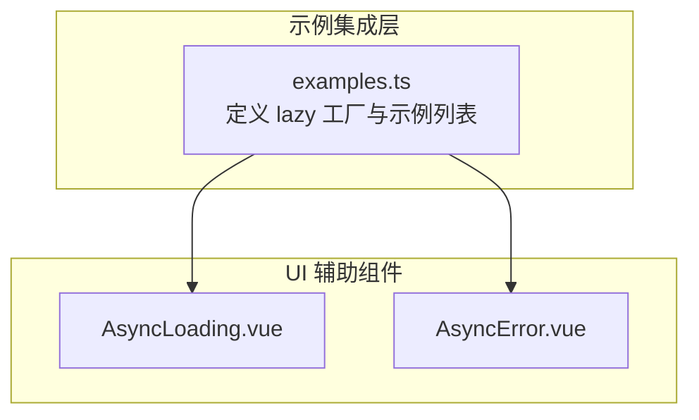
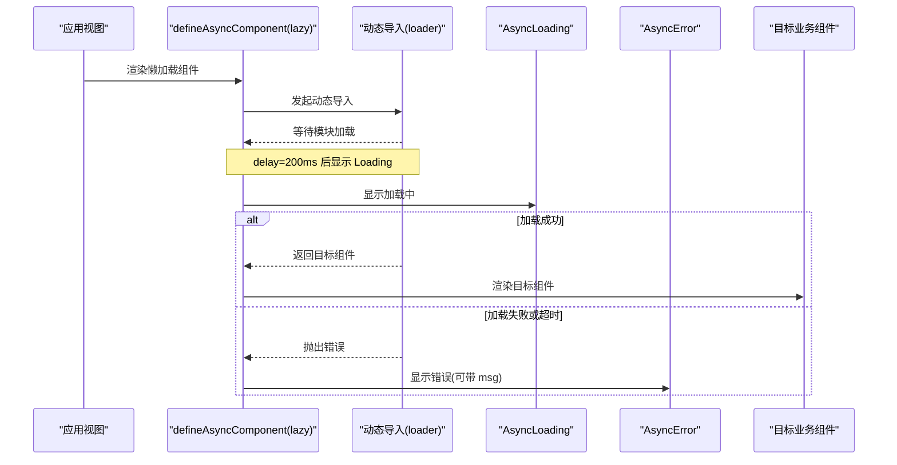
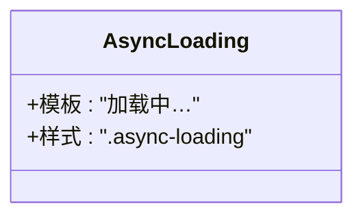
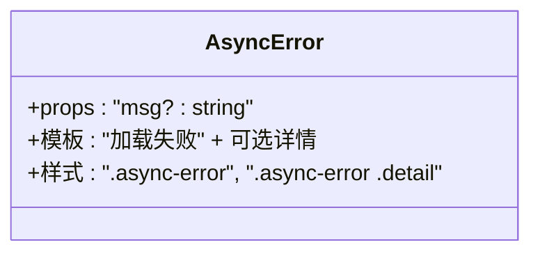
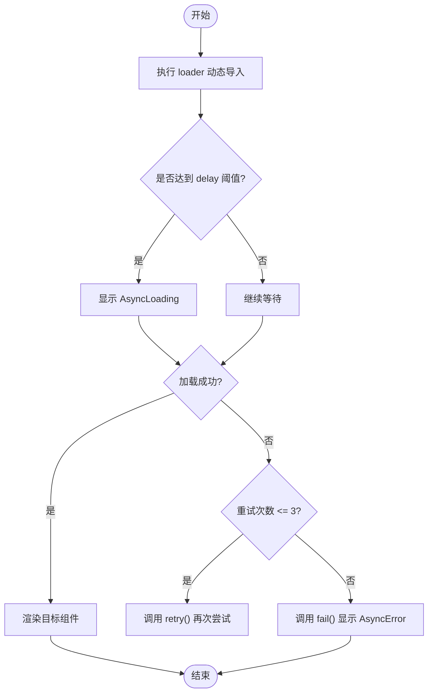
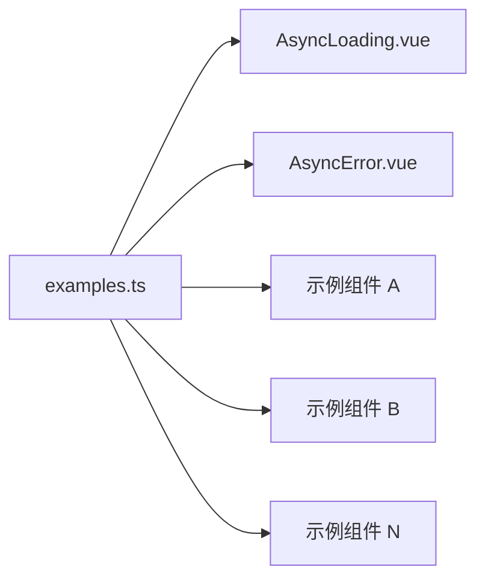

# UI 辅助组件

<cite>
**本文引用的文件**   
- [AsyncLoading.vue](file://src/components/Ui/AsyncLoading.vue)
- [AsyncError.vue](file://src/components/Ui/AsyncError.vue)
- [examples.ts](file://src/examples.ts)
</cite>

## 目录
1. [简介](#简介)
2. [项目结构](#项目结构)
3. [核心组件](#核心组件)
4. [架构总览](#架构总览)
5. [组件详细分析](#组件详细分析)
6. [依赖关系分析](#依赖关系分析)
7. [性能与体验优化](#性能与体验优化)
8. [主题定制与国际化](#主题定制与国际化)
9. [复用与扩展最佳实践](#复用与扩展最佳实践)
10. [故障排查指南](#故障排查指南)
11. [结论](#结论)

## 简介
本技术文档聚焦于 UI 辅助组件中的异步加载与错误处理能力，围绕以下目标展开：
- 说明 AsyncLoading（异步加载）与 AsyncError（异步错误）两个组件的设计理念、属性配置、事件处理与样式定制方式。
- 解释在异步数据加载过程中的用户体验优化策略与错误恢复机制。
- 提供组件复用与扩展的最佳实践，包括如何结合 Vue 的 defineAsyncComponent 进行懒加载与重试控制。
- 给出主题定制与国际化支持的实现方法，帮助在不同业务场景中快速适配。

## 项目结构
UI 辅助组件位于 src/components/Ui 目录下，包含两个基础展示型组件；示例工程通过 src/examples.ts 统一封装懒加载逻辑并挂载到各业务示例中。

**图表来源**
- [AsyncLoading.vue:1-15](file://src/components/Ui/AsyncLoading.vue#L1-L15)
- [AsyncError.vue:1-25](file://src/components/Ui/AsyncError.vue#L1-L25)
- [examples.ts:1-19](file://src/examples.ts#L1-L19)

**章节来源**
- [AsyncLoading.vue:1-15](file://src/components/Ui/AsyncLoading.vue#L1-L15)
- [AsyncError.vue:1-25](file://src/components/Ui/AsyncError.vue#L1-L25)
- [examples.ts:1-19](file://src/examples.ts#L1-L19)

## 核心组件
- AsyncLoading：用于在异步资源尚未就绪时展示“加载中”状态，默认文本为“加载中…”，具备最小化样式，便于嵌入任意容器。
- AsyncError：用于在异步资源加载失败时展示错误信息，支持可选的错误详情 msg 属性，具备基础错误提示样式。

这两个组件均为无状态展示型组件，职责单一、易于组合与替换。

**章节来源**
- [AsyncLoading.vue:1-15](file://src/components/Ui/AsyncLoading.vue#L1-L15)
- [AsyncError.vue:1-25](file://src/components/Ui/AsyncError.vue#L1-L25)

## 架构总览
在示例工程中，通过统一的 lazy 工厂函数将 AsyncLoading 与 AsyncError 作为 defineAsyncComponent 的 loadingComponent 与 errorComponent 注入，从而对所有业务示例组件提供一致的加载与错误体验。

**图表来源**
- [examples.ts:1-19](file://src/examples.ts#L1-L19)
- [AsyncLoading.vue:1-15](file://src/components/Ui/AsyncLoading.vue#L1-L15)
- [AsyncError.vue:1-25](file://src/components/Ui/AsyncError.vue#L1-L25)

## 组件详细分析

### AsyncLoading 组件
- 设计目标：以最小成本提供“加载中”占位，避免布局抖动与用户感知卡顿。
- 属性配置：当前未暴露 props，保持极简。
- 事件处理：无内部事件，仅作为展示节点。
- 样式定制：使用 scoped 样式，类名 async-loading，可通过覆盖 CSS 变量或外部样式类进行主题定制。
- 复杂度：O(1)，无计算逻辑。

**图表来源**
- [AsyncLoading.vue:1-15](file://src/components/Ui/AsyncLoading.vue#L1-L15)

**章节来源**
- [AsyncLoading.vue:1-15](file://src/components/Ui/AsyncLoading.vue#L1-L15)

### AsyncError 组件
- 设计目标：在异步加载失败时提供清晰的可读错误提示，并支持可选的详细错误信息。
- 属性配置：
  - msg?: string — 可选的错误详情文本，为空时不显示详情行。
- 事件处理：无内部事件。
- 样式定制：使用 scoped 样式，类名 async-error 与 .detail，可覆盖颜色、字号等。
- 复杂度：O(1)。

**图表来源**
- [AsyncError.vue:1-25](file://src/components/Ui/AsyncError.vue#L1-L25)

**章节来源**
- [AsyncError.vue:1-25](file://src/components/Ui/AsyncError.vue#L1-L25)

### 懒加载与错误恢复流程
示例工程通过 lazy 工厂统一封装 defineAsyncComponent 的行为，包括：
- loadingComponent: AsyncLoading
- errorComponent: AsyncError
- delay: 200ms（减少闪烁）
- timeout: 10000ms（防止长时间阻塞）
- onError: 最多重试 3 次，超过则 fail

**图表来源**
- [examples.ts:1-19](file://src/examples.ts#L1-L19)
- [AsyncLoading.vue:1-15](file://src/components/Ui/AsyncLoading.vue#L1-L15)
- [AsyncError.vue:1-25](file://src/components/Ui/AsyncError.vue#L1-L25)

**章节来源**
- [examples.ts:1-19](file://src/examples.ts#L1-L19)

## 依赖关系分析
- AsyncLoading 与 AsyncError 被 examples.ts 引入并作为 defineAsyncComponent 的默认加载与错误组件。
- 所有业务示例组件通过 lazy 工厂间接依赖这两个 UI 辅助组件，形成“集中式加载与错误展示”的统一入口。

**图表来源**
- [examples.ts:1-19](file://src/examples.ts#L1-L19)
- [AsyncLoading.vue:1-15](file://src/components/Ui/AsyncLoading.vue#L1-L15)
- [AsyncError.vue:1-25](file://src/components/Ui/AsyncError.vue#L1-L25)

**章节来源**
- [examples.ts:1-19](file://src/examples.ts#L1-L19)

## 性能与体验优化
- 延迟显示（delay=200ms）：避免网络极快时的闪烁，提升视觉稳定性。
- 超时保护（timeout=10000ms）：防止长时间阻塞导致页面假死。
- 自动重试（onError 最多 3 次）：在网络抖动或临时不可用时提高成功率。
- 最小化 DOM：两个组件结构简单，渲染开销极低。
- 建议：
  - 对超大组件或重型资源，继续使用懒加载拆分包体。
  - 根据业务场景调整 delay、timeout 与重试次数，平衡首屏速度与可靠性。

[本节为通用指导，无需代码引用]

## 主题定制与国际化

### 主题定制
- 通过覆盖 scoped 样式类名进行主题定制：
  - .async-loading：可修改 padding、color、背景等。
  - .async-error 与 .async-error .detail：可修改错误主色、详情文字大小与颜色。
- 若需要更灵活的主题系统，可在父组件传入主题 token（如颜色、字号），并在子组件中以 CSS 变量形式注入。

**章节来源**
- [AsyncLoading.vue:8-13](file://src/components/Ui/AsyncLoading.vue#L8-L13)
- [AsyncError.vue:13-23](file://src/components/Ui/AsyncError.vue#L13-L23)

### 国际化支持
- 当前组件文案为硬编码中文（例如“加载中…”、“加载失败”）。
- 推荐方案：
  - 在父组件或全局 i18n 配置中维护文案键值。
  - 将 AsyncLoading 与 AsyncError 的文案抽取为 props（如 loadingText、errorTitle、errorDetailPlaceholder），由上层注入本地化字符串。
  - 对于 AsyncError 的 msg，可由业务层格式化错误消息后再传入。

[本节为通用指导，无需代码引用]

## 复用与扩展最佳实践
- 统一懒加载入口：沿用 examples.ts 中的 lazy 工厂模式，集中管理 delay、timeout、重试策略与默认加载/错误组件。
- 组件替换：如需更换加载动画或错误页，只需替换 loadingComponent 与 errorComponent，无需改动业务组件。
- 扩展属性：
  - AsyncLoading：可增加 props 如 text、showSpinner、size 等，以满足不同场景的展示需求。
  - AsyncError：可增加 props 如 showRetry、retryLabel、onRetry 等，支持用户主动重试。
- 事件与回调：
  - 在 onError 中记录日志或上报监控指标。
  - 在 onResolve/onReject 钩子中埋点统计加载耗时与成功率。
- 组合使用：
  - 在页面级包裹一个“异步区块”，统一处理该区块内所有异步数据的加载与错误态。

**章节来源**
- [examples.ts:1-19](file://src/examples.ts#L1-L19)

## 故障排查指南
- 现象：一直显示“加载中…”
  - 检查 delay 是否过大。
  - 检查 loader 是否正确返回 Promise。
  - 检查网络请求或第三方库初始化是否卡住。
- 现象：频繁显示错误
  - 检查 onError 的重试次数与间隔策略。
  - 检查后端接口可用性、跨域与鉴权配置。
  - 查看浏览器控制台的网络与 JS 错误。
- 现象：样式异常
  - 确认组件样式未被全局样式覆盖。
  - 检查父容器尺寸与定位是否影响布局。

[本节为通用指导，无需代码引用]

## 结论
AsyncLoading 与 AsyncError 提供了轻量、可替换的异步加载与错误展示能力。配合 examples.ts 中的 lazy 工厂，可以在整个应用中实现一致的用户体验与可靠的错误恢复机制。通过合理的主题定制与国际化改造，以及进一步的属性与事件扩展，这些组件能够很好地服务于复杂业务场景下的异步数据加载与错误处理需求。