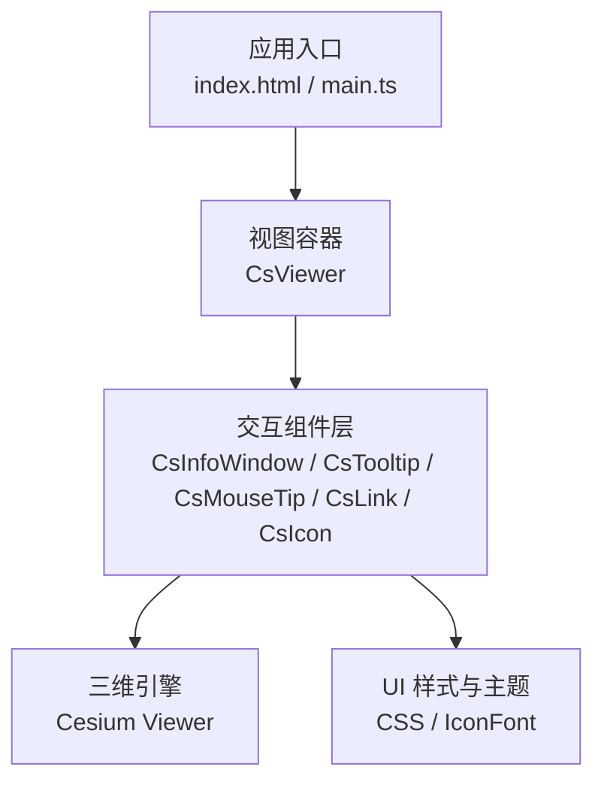
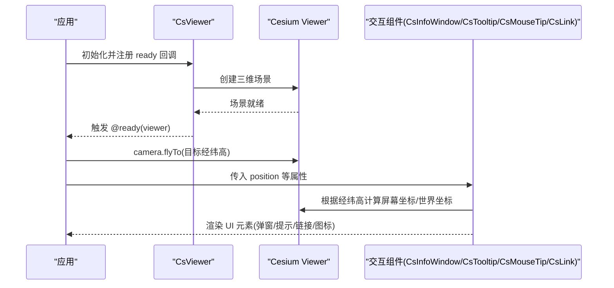
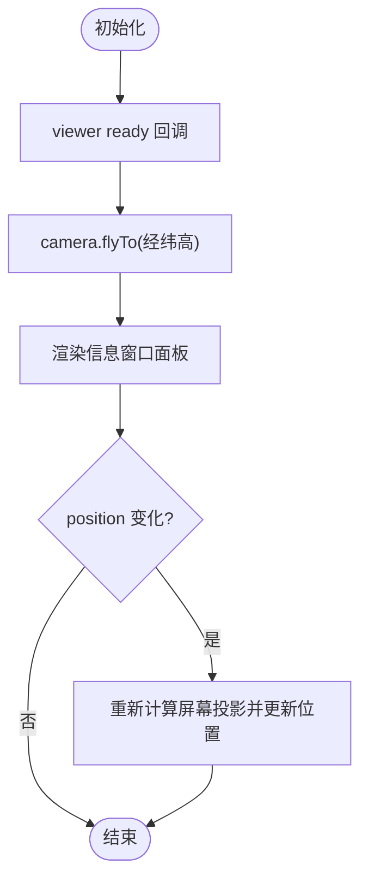
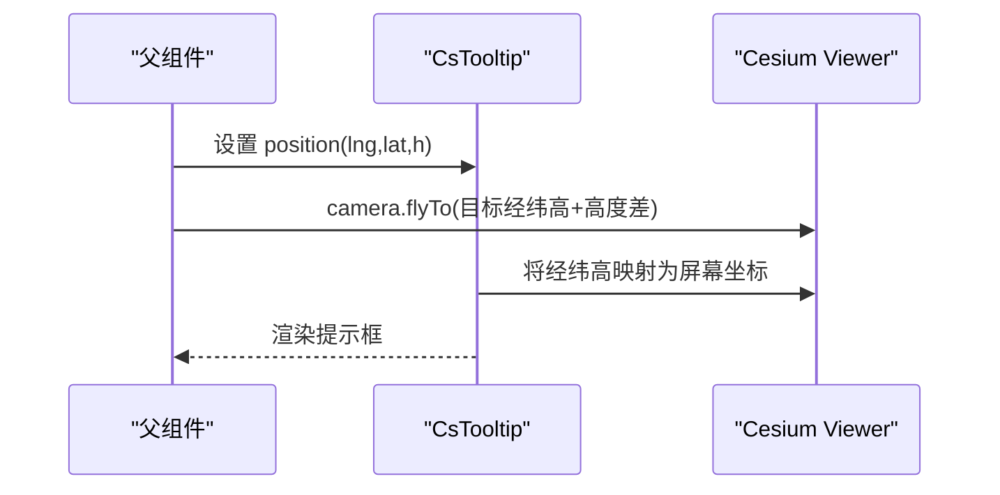
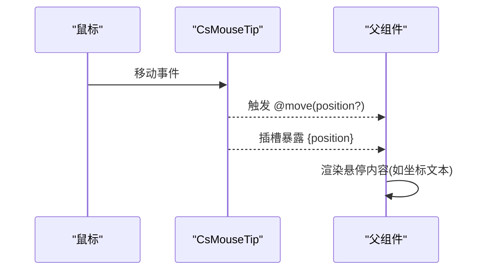
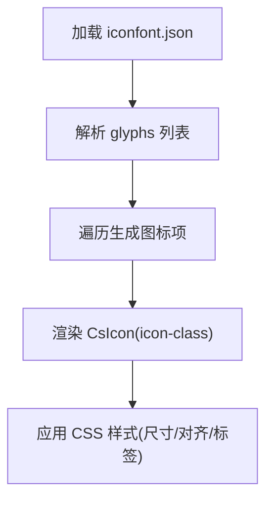
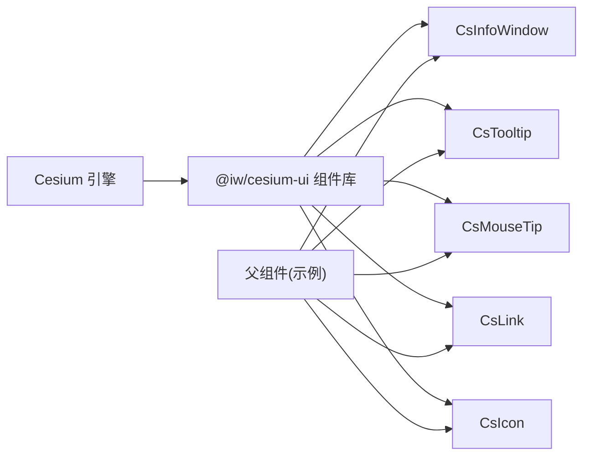

# 交互功能

<cite>
**本文引用的文件**   
- [README.md](file://README.md)
- [Demo-Others-InfoWindow.vue](file://src/components/Others/InfoWindow/Demo-Others-InfoWindow.vue)
- [Demo-Others-InfoWindowWithLine.vue](file://src/components/Others/InfoWindow/Demo-Others-InfoWindowWithLine.vue)
- [Demo-Others-MouseTip.vue](file://src/components/Others/Demo-Others-MouseTip.vue)
- [Demo-Others-ToolTip.vue](file://src/components/Others/Demo-Others-ToolTip.vue)
- [Demo-Others-Link.vue](file://src/components/Others/Demo-Others-Link.vue)
- [Demo-Others-Icon.vue](file://src/components/Others/Demo-Others-Icon.vue)
- [iconfont.json](file://src/assets/iconfont/iconfont.json)
</cite>

## 目录
1. [简介](#简介)
2. [项目结构](#项目结构)
3. [核心组件](#核心组件)
4. [架构总览](#架构总览)
5. [详细组件分析](#详细组件分析)
6. [依赖关系分析](#依赖关系分析)
7. [性能与体验优化](#性能与体验优化)
8. [可访问性与跨浏览器兼容](#可访问性与跨浏览器兼容)
9. [故障排查](#故障排查)
10. [结论](#结论)

## 简介
本技术文档聚焦于三维场景中的交互能力，包括信息窗口、工具提示、鼠标悬停效果、链接跳转与图标显示。文档基于示例工程中的演示组件，说明其实现方式、样式定制、事件绑定与状态管理；同时解释与三维场景的交互模式、坐标转换与定位算法，并提供用户体验优化与可访问性支持建议，以及响应式设计与跨浏览器兼容性考虑。

## 项目结构
该仓库是一个基于 Vue 3 + TypeScript + Vite 的前端示例工程，主要包含：
- 示例页面与组件：位于 src/components 下，按功能模块组织（如 Others 下的交互类示例）。
- 资源文件：如 iconfont 字体资源，用于图标展示。
- 配置与入口：Vite 配置、TypeScript 配置、应用入口等。



图表来源
- [Demo-Others-InfoWindow.vue:1-53](file://src/components/Others/InfoWindow/Demo-Others-InfoWindow.vue#L1-L53)
- [Demo-Others-MouseTip.vue:1-50](file://src/components/Others/Demo-Others-MouseTip.vue#L1-L50)
- [Demo-Others-ToolTip.vue:1-51](file://src/components/Others/Demo-Others-ToolTip.vue#L1-L51)
- [Demo-Others-Link.vue:1-51](file://src/components/Others/Demo-Others-Link.vue#L1-L51)
- [Demo-Others-Icon.vue:1-53](file://src/components/Others/Demo-Others-Icon.vue#L1-L53)

章节来源
- [README.md:1-6](file://README.md#L1-L6)

## 核心组件
本节概述各交互组件的职责与使用要点：
- 信息窗口（CsInfoWindow）：在指定经纬度位置渲染富内容弹窗，支持偏移、连线指示等。
- 工具提示（CsTooltip）：在三维空间坐标处显示轻量提示，常用于标注或辅助信息。
- 鼠标悬停（CsMouseTip）：监听鼠标移动，提供实时经纬高坐标数据，便于自定义悬停 UI。
- 链接（CsLink）：在三维空间中创建可点击的链接点，触发导航或业务动作。
- 图标（CsIcon）：基于 iconfont 的图标渲染，支持批量展示与样式控制。

章节来源
- [Demo-Others-InfoWindow.vue:1-53](file://src/components/Others/InfoWindow/Demo-Others-InfoWindow.vue#L1-L53)
- [Demo-Others-InfoWindowWithLine.vue:1-57](file://src/components/Others/InfoWindow/Demo-Others-InfoWindowWithLine.vue#L1-L57)
- [Demo-Others-MouseTip.vue:1-50](file://src/components/Others/Demo-Others-MouseTip.vue#L1-L50)
- [Demo-Others-ToolTip.vue:1-51](file://src/components/Others/Demo-Others-ToolTip.vue#L1-L51)
- [Demo-Others-Link.vue:1-51](file://src/components/Others/Demo-Others-Link.vue#L1-L51)
- [Demo-Others-Icon.vue:1-53](file://src/components/Others/Demo-Others-Icon.vue#L1-L53)

## 架构总览
交互组件统一挂载在三维视图容器内，通过 Cesium 提供的相机与坐标系统完成定位与动画。典型流程如下：



图表来源
- [Demo-Others-InfoWindow.vue:12-20](file://src/components/Others/InfoWindow/Demo-Others-InfoWindow.vue#L12-L20)
- [Demo-Others-InfoWindowWithLine.vue:12-20](file://src/components/Others/InfoWindow/Demo-Others-InfoWindowWithLine.vue#L12-L20)
- [Demo-Others-ToolTip.vue:15-23](file://src/components/Others/Demo-Others-ToolTip.vue#L15-L23)
- [Demo-Others-Link.vue:15-23](file://src/components/Others/Demo-Others-Link.vue#L15-L23)

## 详细组件分析

### 信息窗口（CsInfoWindow）
- 功能要点
  - 通过 position 属性接收经纬度数组，将内容面板定位到对应地理坐标上方。
  - 支持 show-link 与 offset 等属性，用于显示连接线与相对偏移。
  - 在 viewer ready 后调用相机飞行动画，使视角对准信息窗口位置。
- 样式定制
  - 通过插槽注入任意 HTML 内容，结合外层 CSS 控制尺寸、背景、边距等。
- 事件与状态
  - 父组件维护 position 响应式变量，必要时动态更新以驱动窗口重定位。
- 三维交互
  - 使用 Cartesian3.fromDegrees 将经纬度转换为三维坐标，配合 camera.flyTo 实现平滑过渡。



图表来源
- [Demo-Others-InfoWindow.vue:12-20](file://src/components/Others/InfoWindow/Demo-Others-InfoWindow.vue#L12-L20)
- [Demo-Others-InfoWindowWithLine.vue:31-37](file://src/components/Others/InfoWindow/Demo-Others-InfoWindowWithLine.vue#L31-L37)

章节来源
- [Demo-Others-InfoWindow.vue:1-53](file://src/components/Others/InfoWindow/Demo-Others-InfoWindow.vue#L1-L53)
- [Demo-Others-InfoWindowWithLine.vue:1-57](file://src/components/Others/InfoWindow/Demo-Others-InfoWindowWithLine.vue#L1-L57)

### 工具提示（CsTooltip）
- 功能要点
  - 在给定经纬高位置显示轻量提示框，适合标注或辅助信息。
  - 同样在 viewer ready 后执行相机飞行动画，确保覆盖物可见。
- 样式定制
  - 通过外部 CSS 控制提示框外观，内部仅承载文本或简单布局。
- 三维交互
  - 使用经纬高构建目标坐标，并通过相机飞行提升观察高度以获得良好视野。



图表来源
- [Demo-Others-ToolTip.vue:9-23](file://src/components/Others/Demo-Others-ToolTip.vue#L9-L23)

章节来源
- [Demo-Others-ToolTip.vue:1-51](file://src/components/Others/Demo-Others-ToolTip.vue#L1-L51)

### 鼠标悬停（CsMouseTip）
- 功能要点
  - 监听鼠标移动事件，暴露 position 插槽与 move 事件，返回可选的经纬高数组。
  - 可在插槽中渲染自定义悬停 UI，例如显示当前坐标。
- 事件与状态
  - 通过 v-slot="{position}" 获取实时坐标，并在 @move 回调中处理逻辑。
- 三维交互
  - 坐标来源于 Cesium 的拾取与射线检测，经转换得到经纬高供上层使用。



图表来源
- [Demo-Others-MouseTip.vue:17-30](file://src/components/Others/Demo-Others-MouseTip.vue#L17-L30)

章节来源
- [Demo-Others-MouseTip.vue:1-50](file://src/components/Others/Demo-Others-MouseTip.vue#L1-L50)

### 链接（CsLink）
- 功能要点
  - 在三维空间中放置可点击链接点，通常用于跳转到详情或触发业务操作。
  - 与 Tooltip 类似，通过 position 定位，并在 ready 后调整相机视角。
- 交互模式
  - 点击链接点时，由上层路由或业务逻辑处理跳转行为。
- 三维交互
  - 经纬高转三维坐标，相机飞行至目标点附近以便用户发现与点击。

```mermaid
sequenceDiagram
participant User as "用户"
participant Link as "CsLink"
participant Router as "路由/业务逻辑"
User->>Link : 点击链接点
Link->>Router : 触发跳转或回调
Router-->>User : 打开新页面/执行操作
```

图表来源
- [Demo-Others-Link.vue:9-23](file://src/components/Others/Demo-Others-Link.vue#L9-L23)

章节来源
- [Demo-Others-Link.vue:1-51](file://src/components/Others/Demo-Others-Link.vue#L1-L51)

### 图标（CsIcon）
- 功能要点
  - 基于 iconfont 资源，通过 icon-class 属性渲染图标。
  - 示例中遍历 iconfont.json 的 glyphs，批量生成图标列表。
- 样式定制
  - 通过外层 CSS 控制图标容器尺寸、对齐与文字标签样式。
- 资源集成
  - 引入 iconfont.json 获取图标清单，循环渲染 CsIcon 实例。



图表来源
- [Demo-Others-Icon.vue:4-15](file://src/components/Others/Demo-Others-Icon.vue#L4-L15)
- [iconfont.json](file://src/assets/iconfont/iconfont.json)

章节来源
- [Demo-Others-Icon.vue:1-53](file://src/components/Others/Demo-Others-Icon.vue#L1-L53)
- [iconfont.json](file://src/assets/iconfont/iconfont.json)

## 依赖关系分析
- 组件对外部库的依赖
  - Cesium：提供三维场景、相机与坐标转换能力（Cartesian3.fromDegrees、camera.flyTo）。
  - @iw/cesium-ui：封装 CsViewer、CsInfoWindow、CsTooltip、CsMouseTip、CsLink、CsIcon 等交互组件。
- 组件间耦合
  - 所有交互组件均依赖 CsViewer 提供的三维上下文；父组件负责状态管理与相机控制。
- 潜在循环依赖
  - 示例组件之间无直接相互引用，耦合度低，易于扩展与维护。



图表来源
- [Demo-Others-InfoWindow.vue:1-7](file://src/components/Others/InfoWindow/Demo-Others-InfoWindow.vue#L1-L7)
- [Demo-Others-MouseTip.vue:1-7](file://src/components/Others/Demo-Others-MouseTip.vue#L1-L7)
- [Demo-Others-ToolTip.vue:1-7](file://src/components/Others/Demo-Others-ToolTip.vue#L1-L7)
- [Demo-Others-Link.vue:1-7](file://src/components/Others/Demo-Others-Link.vue#L1-L7)
- [Demo-Others-Icon.vue:1-7](file://src/components/Others/Demo-Others-Icon.vue#L1-L7)

章节来源
- [Demo-Others-InfoWindow.vue:1-53](file://src/components/Others/InfoWindow/Demo-Others-InfoWindow.vue#L1-L53)
- [Demo-Others-MouseTip.vue:1-50](file://src/components/Others/Demo-Others-MouseTip.vue#L1-L50)
- [Demo-Others-ToolTip.vue:1-51](file://src/components/Others/Demo-Others-ToolTip.vue#L1-L51)
- [Demo-Others-Link.vue:1-51](file://src/components/Others/Demo-Others-Link.vue#L1-L51)
- [Demo-Others-Icon.vue:1-53](file://src/components/Others/Demo-Others-Icon.vue#L1-L53)

## 性能与体验优化
- 相机动画
  - 在 viewer ready 后使用 camera.flyTo 进行平滑过渡，避免突兀跳转影响体验。
- 坐标转换
  - 使用 Cartesian3.fromDegrees 将经纬高转为三维坐标，减少手动计算误差。
- 渲染优化
  - 对大量图标或提示项采用虚拟滚动或按需渲染，降低 DOM 压力。
- 事件节流
  - 对高频鼠标移动事件进行节流或防抖，避免频繁更新导致卡顿。
- 样式与主题
  - 通过 CSS 变量或主题文件统一管理颜色、阴影、圆角等视觉风格，保证一致性。

[本节为通用指导，不直接分析具体文件]

## 可访问性与跨浏览器兼容
- 键盘可达性
  - 为可点击链接与弹窗提供 tabindex 与焦点管理，确保键盘用户可操作。
- 语义化与 ARIA
  - 为信息窗口与工具提示添加 role="dialog"/role="tooltip" 及 aria-label，提高读屏器识别度。
- 对比度与可读性
  - 确保文本与背景对比度符合 WCAG 标准，提供深色模式适配。
- 跨浏览器兼容
  - 针对 Safari/Chrome/Firefox 的差异，测试相机动画与坐标投影表现，必要时降级处理。
- 移动端适配
  - 在小屏设备上优化弹窗尺寸与触控区域，避免遮挡关键信息。

[本节为通用指导，不直接分析具体文件]

## 故障排查
- 信息窗口不显示或位置异常
  - 检查 position 是否为有效的经纬度数组；确认 viewer ready 后再执行相机飞行。
  - 若启用 show-link 与 offset，确认偏移值合理，避免超出视口。
- 工具提示错位
  - 确认经纬高包含高度 h，且相机飞行高度足够，避免被地形遮挡。
- 鼠标悬停无响应
  - 检查 CsMouseTip 的事件名与参数类型；确保在正确的容器中监听移动事件。
- 链接点击无效
  - 确认上层已绑定点击回调或路由跳转逻辑；检查 z-index 是否被其他元素遮挡。
- 图标不显示
  - 确认 iconfont.json 已正确引入且 glyphs 存在；检查 icon-class 是否与资源一致。

章节来源
- [Demo-Others-InfoWindow.vue:12-20](file://src/components/Others/InfoWindow/Demo-Others-InfoWindow.vue#L12-L20)
- [Demo-Others-InfoWindowWithLine.vue:31-37](file://src/components/Others/InfoWindow/Demo-Others-InfoWindowWithLine.vue#L31-L37)
- [Demo-Others-MouseTip.vue:17-30](file://src/components/Others/Demo-Others-MouseTip.vue#L17-L30)
- [Demo-Others-ToolTip.vue:15-23](file://src/components/Others/Demo-Others-ToolTip.vue#L15-L23)
- [Demo-Others-Link.vue:15-23](file://src/components/Others/Demo-Others-Link.vue#L15-L23)
- [Demo-Others-Icon.vue:4-15](file://src/components/Others/Demo-Others-Icon.vue#L4-L15)

## 结论
本仓库通过 @iw/cesium-ui 提供的交互组件与 Cesium 三维引擎协作，实现了信息窗口、工具提示、鼠标悬停、链接与图标等常见交互能力。示例代码展示了如何在 viewer ready 后协调相机动画与坐标转换，从而获得流畅的用户体验。在实际项目中，建议结合性能优化、可访问性与跨浏览器兼容性策略，进一步提升交互质量与稳定性。