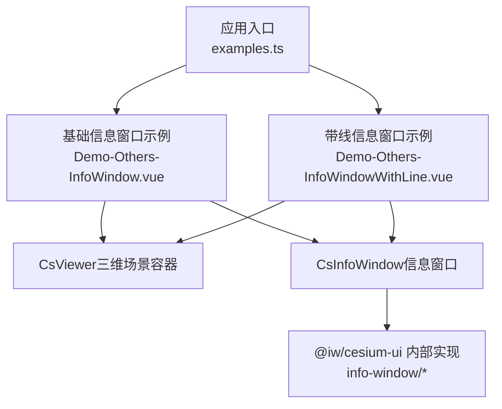
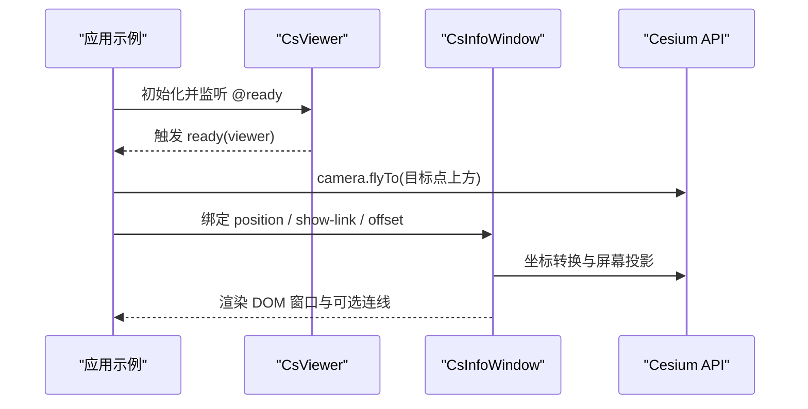
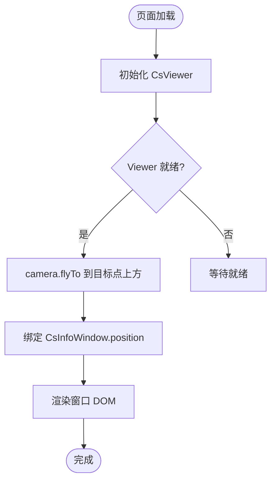
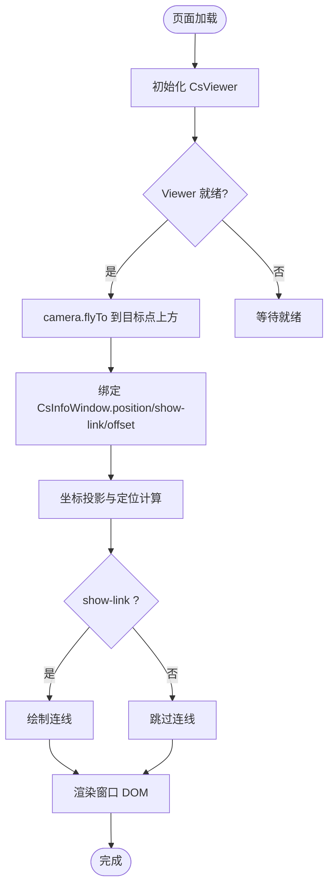
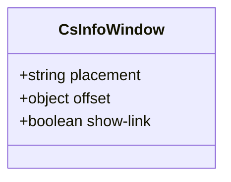
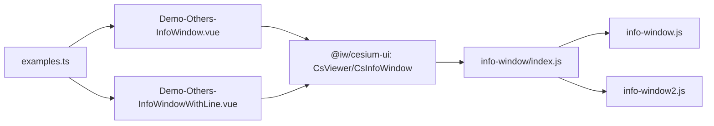

# 信息窗口

<cite>
**本文引用的文件**   
- [Demo-Others-InfoWindow.vue](file://src/components/Others/InfoWindow/Demo-Others-InfoWindow.vue)
- [Demo-Others-InfoWindowWithLine.vue](file://src/components/Others/InfoWindow/Demo-Others-InfoWindowWithLine.vue)
- [examples.ts](file://src/examples.ts)
- [index.js（info-window 组件入口）](file://node_modules/@iw/cesium-ui/es/components/info-window/index.js)
- [info-window.js（属性定义）](file://node_modules/@iw/cesium-ui/es/components/info-window/info-window.js)
- [info-window2.js（默认导出）](file://node_modules/@iw/cesium-ui/es/components/info-window/info-window2.js)
</cite>

## 目录
1. [简介](#简介)
2. [项目结构](#项目结构)
3. [核心组件](#核心组件)
4. [架构总览](#架构总览)
5. [详细组件分析](#详细组件分析)
6. [依赖关系分析](#依赖关系分析)
7. [性能与内存优化](#性能与内存优化)
8. [故障排查指南](#故障排查指南)
9. [结论](#结论)
10. [附录](#附录)

## 简介
本技术文档围绕“信息窗口”组件展开，涵盖基础信息窗口与带连接线信息窗口的实现原理、定位算法、坐标转换逻辑、DOM 操作、内容渲染、样式定制、事件处理机制，以及与三维场景的交互模式（点击拾取、位置绑定、动态更新）。同时提供生命周期管理、内存优化与性能调优的最佳实践，并给出响应式设计与多设备适配方案。

## 项目结构
本项目在示例层通过两个演示页面展示信息窗口的基础用法与带连接线的用法：
- 基础信息窗口示例：使用 CsInfoWindow 组件，传入经纬度位置，并在 Viewer 就绪后驱动相机飞至目标点上方。
- 带连接线信息窗口示例：在基础用法上开启 show-link，并通过 offset 调整偏移量以控制连线起点与窗口相对位置。

图表来源
- [examples.ts:42-58](file://src/examples.ts#L42-L58)
- [Demo-Others-InfoWindow.vue:1-53](file://src/components/Others/InfoWindow/Demo-Others-InfoWindow.vue#L1-L53)
- [Demo-Others-InfoWindowWithLine.vue:1-57](file://src/components/Others/InfoWindow/Demo-Others-InfoWindowWithLine.vue#L1-L57)
- [index.js（info-window 组件入口）:1-8](file://node_modules/@iw/cesium-ui/es/components/info-window/index.js#L1-L8)

章节来源
- [examples.ts:42-58](file://src/examples.ts#L42-L58)
- [Demo-Others-InfoWindow.vue:1-53](file://src/components/Others/InfoWindow/Demo-Others-InfoWindow.vue#L1-L53)
- [Demo-Others-InfoWindowWithLine.vue:1-57](file://src/components/Others/InfoWindow/Demo-Others-InfoWindowWithLine.vue#L1-L57)

## 核心组件
- CsInfoWindow：信息窗口组件，支持 placement、offset、show-link 等属性，用于控制窗口显示位置、偏移和是否显示连接线。
- CsViewer：三维场景容器，负责初始化 Cesium Viewer 并提供 ready 回调，便于在场景就绪后进行相机控制或数据加载。

关键要点
- 位置绑定：通过 position 属性将地理坐标（经度、纬度）与窗口位置绑定。
- 连接线：show-link 为 true 时显示从锚点到窗口的连线；offset 可微调窗口相对锚点的偏移。
- 内容渲染：插槽内容作为窗口主体，支持任意 DOM 结构与样式。

章节来源
- [info-window.js（属性定义）:1-25](file://node_modules/@iw/cesium-ui/es/components/info-window/info-window.js#L1-L25)
- [index.js（info-window 组件入口）:1-8](file://node_modules/@iw/cesium-ui/es/components/info-window/index.js#L1-L8)
- [info-window2.js（默认导出）:1-6](file://node_modules/@iw/cesium-ui/es/components/info-window/info-window2.js#L1-L6)

## 架构总览
信息窗口在三维场景中的整体交互流程如下：
- 用户侧：在 Vue 模板中声明 CsInfoWindow，绑定 position 与可选的 show-link、offset。
- 场景侧：CsViewer 初始化完成后触发 ready，示例中调用 camera.flyTo 将相机移动到目标点上方。
- 渲染侧：CsInfoWindow 根据 position 计算屏幕坐标，渲染 DOM 窗口，并在启用 show-link 时绘制连线。

图表来源
- [Demo-Others-InfoWindow.vue:12-20](file://src/components/Others/InfoWindow/Demo-Others-InfoWindow.vue#L12-L20)
- [Demo-Others-InfoWindowWithLine.vue:12-20](file://src/components/Others/InfoWindow/Demo-Others-InfoWindowWithLine.vue#L12-L20)
- [info-window.js（属性定义）:1-25](file://node_modules/@iw/cesium-ui/es/components/info-window/info-window.js#L1-L25)

## 详细组件分析

### 基础信息窗口（无连线）
- 功能要点
  - 通过 position 绑定经纬度坐标。
  - 在 Viewer ready 后驱动相机飞向目标点上方，提升可视性。
  - 插槽内容作为窗口主体，支持自定义样式与交互。
- 使用方式
  - 在模板中引入 CsInfoWindow，传入 position。
  - 在 ready 回调中使用 Cesium API 进行相机控制。

图表来源
- [Demo-Others-InfoWindow.vue:12-20](file://src/components/Others/InfoWindow/Demo-Others-InfoWindow.vue#L12-L20)
- [Demo-Others-InfoWindow.vue:27-37](file://src/components/Others/InfoWindow/Demo-Others-InfoWindow.vue#L27-L37)

章节来源
- [Demo-Others-InfoWindow.vue:1-53](file://src/components/Others/InfoWindow/Demo-Others-InfoWindow.vue#L1-L53)

### 带连接线信息窗口
- 功能要点
  - 启用 show-link 显示从锚点到窗口的连线。
  - 通过 offset 控制窗口相对锚点的偏移，避免遮挡或对齐需求。
  - 其余行为与基础信息窗口一致。
- 使用方式
  - 在 CsInfoWindow 上设置 :show-link="true" 与 :offset="{x, y}"。
  - 其他绑定与交互同基础用法。

图表来源
- [Demo-Others-InfoWindowWithLine.vue:12-20](file://src/components/Others/InfoWindow/Demo-Others-InfoWindowWithLine.vue#L12-L20)
- [Demo-Others-InfoWindowWithLine.vue:27-41](file://src/components/Others/InfoWindow/Demo-Others-InfoWindowWithLine.vue#L27-L41)
- [info-window.js（属性定义）:1-25](file://node_modules/@iw/cesium-ui/es/components/info-window/info-window.js#L1-L25)

章节来源
- [Demo-Others-InfoWindowWithLine.vue:1-57](file://src/components/Others/InfoWindow/Demo-Others-InfoWindowWithLine.vue#L1-L57)
- [info-window.js（属性定义）:1-25](file://node_modules/@iw/cesium-ui/es/components/info-window/info-window.js#L1-L25)

### 组件属性与类型
- placement：字符串类型，默认值 "bottom"，用于控制窗口相对锚点的放置方向。
- offset：对象类型，默认 {x: 0, y: 0}，用于像素级偏移调整。
- show-link：布尔类型，默认 false，控制是否显示连接线。

图表来源
- [info-window.js（属性定义）:1-25](file://node_modules/@iw/cesium-ui/es/components/info-window/info-window.js#L1-L25)

章节来源
- [info-window.js（属性定义）:1-25](file://node_modules/@iw/cesium-ui/es/components/info-window/info-window.js#L1-L25)

## 依赖关系分析
- 示例层依赖
  - examples.ts 注册并懒加载两个信息窗口示例。
  - Demo 页面依赖 @iw/cesium-ui 提供的 CsViewer 与 CsInfoWindow。
- 组件层依赖
  - info-window/index.js 暴露 CsInfoWindow 与 infoWindowProps。
  - info-window.js 定义属性集，包含 placement、offset、show-link。
  - info-window2.js 导出默认组件实例。

图表来源
- [examples.ts:42-58](file://src/examples.ts#L42-L58)
- [index.js（info-window 组件入口）:1-8](file://node_modules/@iw/cesium-ui/es/components/info-window/index.js#L1-L8)
- [info-window.js（属性定义）:1-25](file://node_modules/@iw/cesium-ui/es/components/info-window/info-window.js#L1-L25)
- [info-window2.js（默认导出）:1-6](file://node_modules/@iw/cesium-ui/es/components/info-window/info-window2.js#L1-L6)

章节来源
- [examples.ts:42-58](file://src/examples.ts#L42-L58)
- [index.js（info-window 组件入口）:1-8](file://node_modules/@iw/cesium-ui/es/components/info-window/index.js#L1-L8)
- [info-window.js（属性定义）:1-25](file://node_modules/@iw/cesium-ui/es/components/info-window/info-window.js#L1-L25)
- [info-window2.js（默认导出）:1-6](file://node_modules/@iw/cesium-ui/es/components/info-window/info-window2.js#L1-L6)

## 性能与内存优化
- 坐标投影与重绘
  - 频繁更新 position 会触发多次坐标投影与 DOM 重排。建议合并更新或使用防抖策略。
- 连线绘制
  - show-link 为 true 时会额外绘制连线元素。若大量窗口同时显示，应谨慎开启或按需显示。
- DOM 节点管理
  - 及时销毁不再使用的信息窗口，避免残留节点导致内存泄漏。
- 相机动画
  - 在 ready 回调中进行相机飞行动画时，注意避免重复触发造成卡顿。
- 样式与层级
  - 合理设置 z-index 与容器尺寸，减少重绘范围与布局抖动。

[本节为通用指导，不直接分析具体文件]

## 故障排查指南
- 窗口未显示
  - 检查 position 是否为有效的经纬度数组。
  - 确认 CsViewer 已就绪且 viewer.ready 回调已执行。
- 连线错位或不可见
  - 检查 show-link 是否正确开启。
  - 调整 offset 以修正窗口相对锚点的偏移。
- 相机未飞到目标点
  - 确认 handleReady 回调被触发，并在其中正确调用 camera.flyTo。
- 样式覆盖异常
  - 检查 CSS 选择器优先级与容器尺寸，确保窗口不被遮挡。

章节来源
- [Demo-Others-InfoWindow.vue:12-20](file://src/components/Others/InfoWindow/Demo-Others-InfoWindow.vue#L12-L20)
- [Demo-Others-InfoWindowWithLine.vue:12-20](file://src/components/Others/InfoWindow/Demo-Others-InfoWindowWithLine.vue#L12-L20)

## 结论
信息窗口组件通过简洁的属性配置实现了三维场景中常见的标注与说明能力。基础用法聚焦于位置绑定与内容渲染，带连线用法进一步增强了视觉引导。结合 CsViewer 的 ready 回调与 Cesium API，可实现流畅的场景交互体验。在生产环境中，建议关注坐标投影与 DOM 操作的频率，合理使用 show-link 与 offset，并进行必要的生命周期管理与性能优化。

[本节为总结性内容，不直接分析具体文件]

## 附录
- 相关示例路径
  - 基础信息窗口示例：[Demo-Others-InfoWindow.vue](file://src/components/Others/InfoWindow/Demo-Others-InfoWindow.vue)
  - 带线信息窗口示例：[Demo-Others-InfoWindowWithLine.vue](file://src/components/Others/InfoWindow/Demo-Others-InfoWindowWithLine.vue)
- 组件入口与属性定义
  - 组件入口：[index.js（info-window 组件入口）](file://node_modules/@iw/cesium-ui/es/components/info-window/index.js)
  - 属性定义：[info-window.js（属性定义）](file://node_modules/@iw/cesium-ui/es/components/info-window/info-window.js)
  - 默认导出：[info-window2.js（默认导出）](file://node_modules/@iw/cesium-ui/es/components/info-window/info-window2.js)