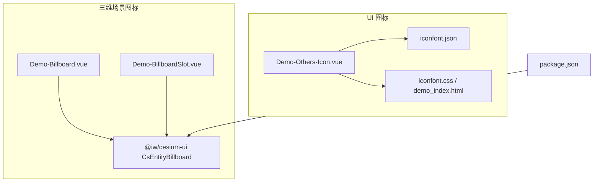
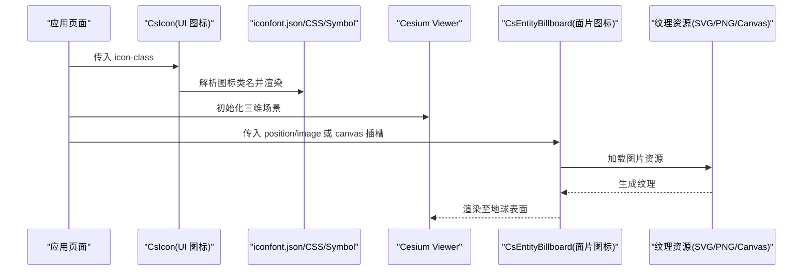
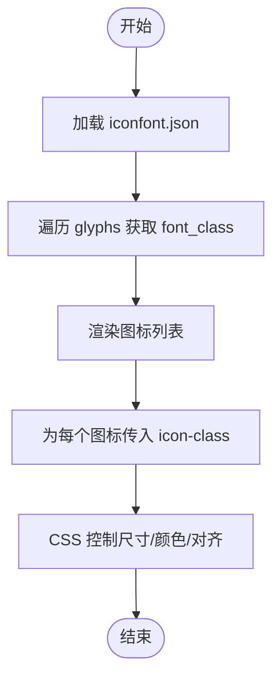
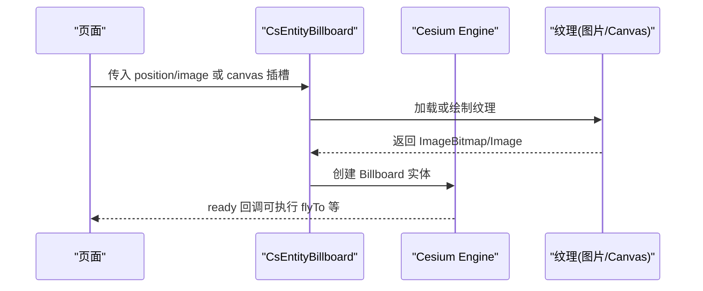
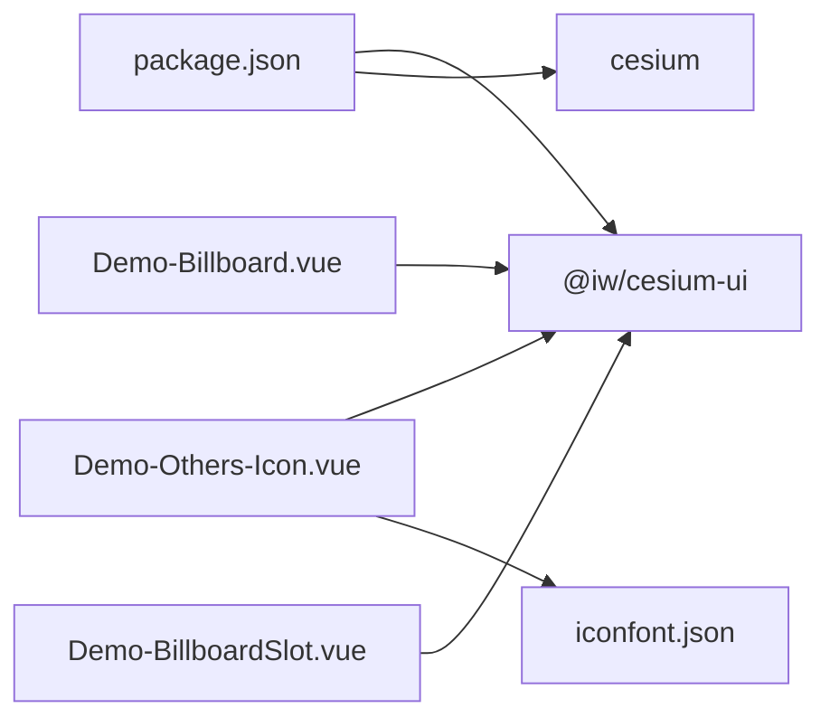

# 图标显示

<cite>
**本文引用的文件**   
- [Demo-Others-Icon.vue](file://src/components/Others/Demo-Others-Icon.vue)
- [iconfont.json](file://src/assets/iconfont/iconfont.json)
- [demo_index.html](file://src/assets/iconfont/demo_index.html)
- [Demo-Billboard.vue](file://src/components/Entity/billboard/Demo-Billboard.vue)
- [Demo-BillboardSlot.vue](file://src/components/Entity/billboard/Demo-BillboardSlot.vue)
- [package.json](file://package.json)
</cite>

## 目录
1. [简介](#简介)
2. [项目结构](#项目结构)
3. [核心组件](#核心组件)
4. [架构总览](#架构总览)
5. [详细组件分析](#详细组件分析)
6. [依赖关系分析](#依赖关系分析)
7. [性能与优化](#性能与优化)
8. [故障排查](#故障排查)
9. [结论](#结论)
10. [附录：最佳实践清单](#附录最佳实践清单)

## 简介
本技术文档围绕“图标显示”能力，系统梳理本项目中两类图标使用方式：
- UI 层图标（基于 iconfont）：通过 CSS/SVG symbol 实现多色图标、样式控制与批量展示。
- 三维场景中的面片图标（Billboard）：在 Cesium 地球表面以点实体形式渲染图片资源，支持 SVG/PNG 等格式，并可通过 Canvas 动态绘制纹理。

文档重点覆盖：
- 图标资源的加载、缓存与管理机制（SVG、PNG 等）
- 图标的定位算法、缩放适配与层级管理
- 与三维场景的集成方式（地球表面投影、视距自适应、性能优化）
- 主题定制、动态切换与批量管理
- 可访问性与国际化考虑

## 项目结构
本项目为 Vue 3 + TypeScript + Vite 工程，图标相关代码主要分布在以下位置：
- UI 图标示例与数据源：src/components/Others/Demo-Others-Icon.vue、src/assets/iconfont/iconfont.json、src/assets/iconfont/demo_index.html
- 三维场景面片图标示例：src/components/Entity/billboard/Demo-Billboard.vue、src/components/Entity/billboard/Demo-BillboardSlot.vue
- 依赖声明：package.json

图表来源
- [Demo-Others-Icon.vue:1-52](file://src/components/Others/Demo-Others-Icon.vue#L1-L52)
- [iconfont.json](file://src/assets/iconfont/iconfont.json)
- [demo_index.html:297-331](file://src/assets/iconfont/demo_index.html#L297-L331)
- [Demo-Billboard.vue:1-56](file://src/components/Entity/billboard/Demo-Billboard.vue#L1-L56)
- [Demo-BillboardSlot.vue:1-67](file://src/components/Entity/billboard/Demo-BillboardSlot.vue#L1-L67)
- [package.json:12-17](file://package.json#L12-L17)

章节来源
- [Demo-Others-Icon.vue:1-52](file://src/components/Others/Demo-Others-Icon.vue#L1-L52)
- [Demo-Billboard.vue:1-56](file://src/components/Entity/billboard/Demo-Billboard.vue#L1-L56)
- [Demo-BillboardSlot.vue:1-67](file://src/components/Entity/billboard/Demo-BillboardSlot.vue#L1-L67)
- [package.json:12-17](file://package.json#L12-L17)

## 核心组件
- CsIcon（UI 图标）
  - 作用：根据 iconfont 数据源渲染图标，支持按类名批量展示与样式控制。
  - 关键用法：通过传入 icon-class 属性渲染对应图标；图标列表由 iconfont.json 提供。
  - 参考路径：[Demo-Others-Icon.vue:6-27](file://src/components/Others/Demo-Others-Icon.vue#L6-L27)

- CsEntityBillboard（三维场景面片图标）
  - 作用：在 Cesium 场景中创建 Billboard 实体，将图片资源（如 SVG/PNG）贴到地球表面指定坐标处。
  - 关键用法：通过 position 设置经纬度，image 传入图片资源；或通过 slot:canvas 动态绘制纹理。
  - 参考路径：
    - [Demo-Billboard.vue:33-37](file://src/components/Entity/billboard/Demo-Billboard.vue#L33-L37)
    - [Demo-BillboardSlot.vue:42-47](file://src/components/Entity/billboard/Demo-BillboardSlot.vue#L42-L47)

章节来源
- [Demo-Others-Icon.vue:1-52](file://src/components/Others/Demo-Others-Icon.vue#L1-L52)
- [Demo-Billboard.vue:1-56](file://src/components/Entity/billboard/Demo-Billboard.vue#L1-L56)
- [Demo-BillboardSlot.vue:1-67](file://src/components/Entity/billboard/Demo-BillboardSlot.vue#L1-L67)

## 架构总览
下图展示了 UI 图标与三维场景图标的整体流程与依赖关系。

图表来源
- [Demo-Others-Icon.vue:6-27](file://src/components/Others/Demo-Others-Icon.vue#L6-L27)
- [iconfont.json](file://src/assets/iconfont/iconfont.json)
- [demo_index.html:297-331](file://src/assets/iconfont/demo_index.html#L297-L331)
- [Demo-Billboard.vue:33-37](file://src/components/Entity/billboard/Demo-Billboard.vue#L33-L37)
- [Demo-BillboardSlot.vue:42-47](file://src/components/Entity/billboard/Demo-BillboardSlot.vue#L42-L47)

## 详细组件分析

### UI 图标（CsIcon + iconfont）
- 资源组织
  - iconfont.json 提供图标元数据（glyphs），包含 font_class 等字段，用于驱动图标列表渲染。
  - demo_index.html 说明了 symbol 模式的使用步骤与注意事项（包括兼容性、性能对比）。
- 渲染流程
  - 组件读取 iconfont.glyphs，提取 font_class 列表。
  - 对每个图标实例传入 cs-icon 的 icon-class 属性进行渲染。
- 样式与主题
  - 通过 CSS 控制尺寸、颜色等；symbol 模式下可使用 fill: currentColor 继承文本颜色。
- 可访问性
  - 建议在 SVG use 元素上添加 aria-hidden="true"，避免被读屏器重复朗读。

图表来源
- [Demo-Others-Icon.vue:8-15](file://src/components/Others/Demo-Others-Icon.vue#L8-L15)
- [Demo-Others-Icon.vue:25-27](file://src/components/Others/Demo-Others-Icon.vue#L25-L27)
- [demo_index.html:297-331](file://src/assets/iconfont/demo_index.html#L297-L331)

章节来源
- [Demo-Others-Icon.vue:1-52](file://src/components/Others/Demo-Others-Icon.vue#L1-L52)
- [iconfont.json](file://src/assets/iconfont/iconfont.json)
- [demo_index.html:297-331](file://src/assets/iconfont/demo_index.html#L297-L331)

### 三维场景图标（CsEntityBillboard）
- 基本用法
  - 通过 position 传入经纬度数组，image 传入本地静态资源（如 vue.svg）。
  - 组件内部将 image 转换为 Cesium 纹理并渲染为 Billboard。
- 动态纹理
  - 通过 slot:canvas 注入一个隐藏的 <canvas>，并在 onMounted 中用 2D 上下文绘制图形，作为动态纹理。
- 定位与投影
  - 使用 WGS84 经纬度坐标，Cesium 自动将其投影到地球表面。
- 缩放与视距自适应
  - 通常通过 billboard.scale、billboard.heightReference 等属性控制大小与相对高度；视距变化时，结合 scale 或 heightReference 保持视觉一致性。
- 层级管理
  - 多个 Billboard 默认按绘制顺序叠加；如需自定义层级，可在父级集合或实体配置中调整 zIndex 或 drawOrder（取决于底层封装）。

图表来源
- [Demo-Billboard.vue:33-37](file://src/components/Entity/billboard/Demo-Billboard.vue#L33-L37)
- [Demo-BillboardSlot.vue:42-47](file://src/components/Entity/billboard/Demo-BillboardSlot.vue#L42-L47)

章节来源
- [Demo-Billboard.vue:1-56](file://src/components/Entity/billboard/Demo-Billboard.vue#L1-L56)
- [Demo-BillboardSlot.vue:1-67](file://src/components/Entity/billboard/Demo-BillboardSlot.vue#L1-L67)

## 依赖关系分析
- 第三方库
  - @iw/cesium-ui：提供 CsViewer、CsEntityBillboard、CsIcon 等组件封装。
  - cesium：三维引擎，负责地球渲染与 WebGL 管线。
- 构建工具
  - vite：模块打包与资源处理（SVG 等静态资源会被内联或输出为 URL）。
- 图标资源
  - iconfont.json：图标元数据，驱动 UI 图标列表。
  - demo_index.html：说明 symbol 模式的引入与使用方式。

图表来源
- [package.json:12-17](file://package.json#L12-L17)
- [Demo-Others-Icon.vue:6-27](file://src/components/Others/Demo-Others-Icon.vue#L6-L27)
- [Demo-Billboard.vue:6-37](file://src/components/Entity/billboard/Demo-Billboard.vue#L6-L37)
- [Demo-BillboardSlot.vue:6-47](file://src/components/Entity/billboard/Demo-BillboardSlot.vue#L6-L47)

章节来源
- [package.json:12-17](file://package.json#L12-L17)
- [Demo-Others-Icon.vue:1-52](file://src/components/Others/Demo-Others-Icon.vue#L1-L52)
- [Demo-Billboard.vue:1-56](file://src/components/Entity/billboard/Demo-Billboard.vue#L1-L56)
- [Demo-BillboardSlot.vue:1-67](file://src/components/Entity/billboard/Demo-BillboardSlot.vue#L1-L67)

## 性能与优化
- 资源格式选择
  - PNG：位图，适合复杂色彩与阴影，GPU 采样效率高。
  - SVG：矢量，适合单色/少色图标，便于缩放；但在浏览器中渲染 SVG 的性能一般不如 PNG（参见 iconfont 文档说明）。
- 缓存策略
  - 静态图片：利用浏览器 HTTP 缓存与 CDN 缓存；Vite 构建产物自带哈希文件名，利于长期缓存。
  - 动态 Canvas 纹理：避免频繁重绘，仅在必要时更新；复用同一 Canvas 对象，减少分配开销。
- 批量渲染
  - 大量 Billboard：优先使用 SpriteCollection 或合并图集（Sprite Sheet）以减少 Draw Call；若使用封装组件，尽量集中创建与销毁。
- 视距自适应
  - 根据相机距离动态调整 billboard.scale，保证在不同缩放级别下图标清晰且不过大。
- 层级与遮挡
  - 合理设置 heightReference（如地面贴合、相对地形高度），避免不必要的深度冲突。
- 可访问性与国际化
  - 为图标提供语义化标题与描述（title/desc），配合 aria-label 提升可访问性。
  - 面向多语言时，建议将文案外置为 i18n 键值，图标本身保持中性语义。

[本节为通用指导，不直接分析具体文件]

## 故障排查
- 图标不显示
  - 检查 image 路径是否正确，确保 Vite 能正确解析静态资源。
  - 确认 CsEntityBillboard 的 position 是否为有效的经纬度数组。
- 图标模糊或失真
  - 检查图片分辨率是否足够；对于放大场景，建议使用更高分辨率 PNG 或矢量转位图后缓存。
- 动态 Canvas 未生效
  - 确认 slot:canvas 已正确绑定 ref，并在 onMounted 中完成绘制。
- 性能卡顿
  - 减少每帧重绘次数；合并图标为图集；限制同时可见的 Billboard 数量。

章节来源
- [Demo-Billboard.vue:33-37](file://src/components/Entity/billboard/Demo-Billboard.vue#L33-L37)
- [Demo-BillboardSlot.vue:24-47](file://src/components/Entity/billboard/Demo-BillboardSlot.vue#L24-L47)

## 结论
本项目通过 CsIcon 与 CsEntityBillboard 分别覆盖了 UI 层与三维场景的图标需求。UI 图标借助 iconfont 的数据驱动与 symbol 模式，实现了批量管理与主题控制；三维场景图标则依托 Cesium 的 Billboard 机制，将图片资源高效地投影到地球表面，并支持动态纹理绘制。在实际工程中，应结合资源格式、缓存策略、批量渲染与视距自适应等手段，平衡清晰度与性能，并通过可访问性与国际化配置提升用户体验。

[本节为总结性内容，不直接分析具体文件]

## 附录：最佳实践清单
- 资源管理
  - 统一图标资源目录，区分 UI 图标与三维场景图标。
  - 对常用图标生成 Sprite Sheet，降低 Draw Call。
- 主题与动态切换
  - UI 图标：通过 CSS 变量或主题类切换 color/fill。
  - 三维图标：维护多套图片资源，运行时根据主题切换 image 路径。
- 批量管理
  - 使用列表渲染与懒加载，避免一次性创建过多 Billboard。
  - 对不可见区域的图标进行隐藏或降级渲染。
- 可访问性与国际化
  - 为图标提供 aria-label/title；文案走 i18n 键值。
  - 对重要操作图标增加键盘可达性与焦点样式。

[本节为通用指导，不直接分析具体文件]