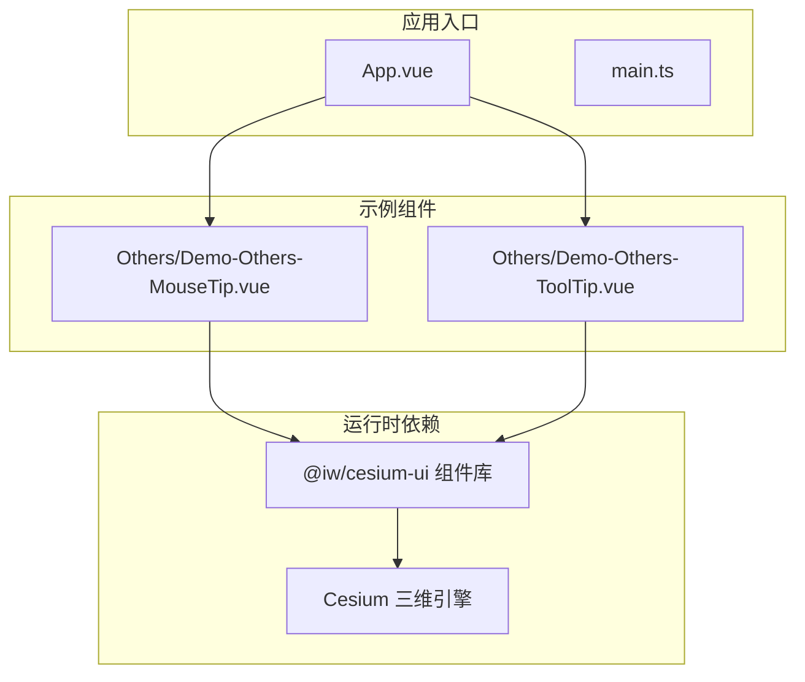
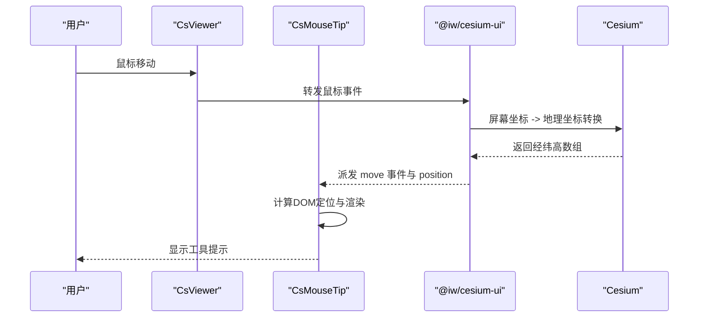
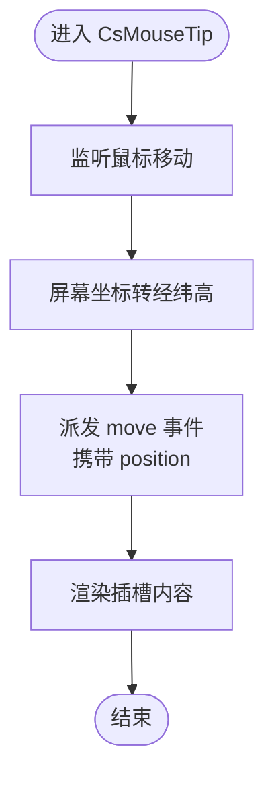
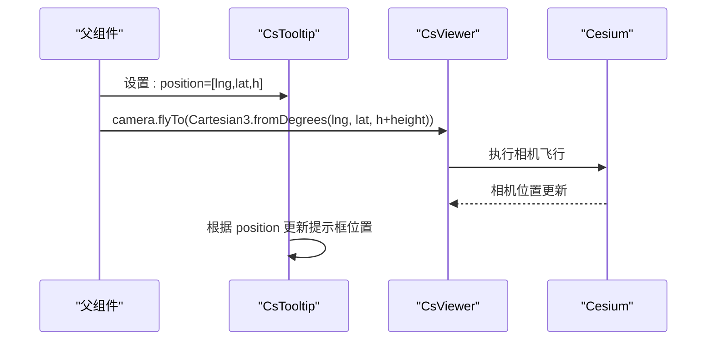
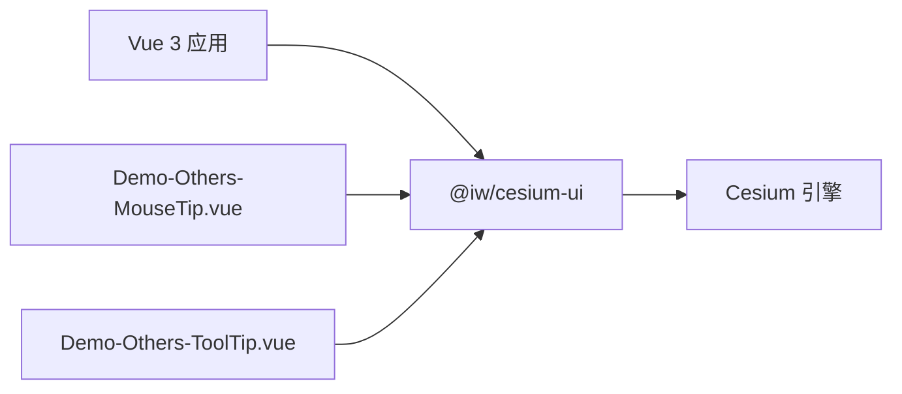

# 工具提示系统

<cite>
**本文引用的文件**   
- [Demo-Others-MouseTip.vue](file://src/components/Others/Demo-Others-MouseTip.vue)
- [Demo-Others-ToolTip.vue](file://src/components/Others/Demo-Others-ToolTip.vue)
- [package.json](file://package.json)
</cite>

## 目录
1. [简介](#简介)
2. [项目结构](#项目结构)
3. [核心组件](#核心组件)
4. [架构总览](#架构总览)
5. [详细组件分析](#详细组件分析)
6. [依赖关系分析](#依赖关系分析)
7. [性能与内存优化](#性能与内存优化)
8. [用户体验最佳实践](#用户体验最佳实践)
9. [故障排查指南](#故障排查指南)
10. [结论](#结论)

## 简介
本技术文档围绕“工具提示系统”展开，聚焦基础工具提示与鼠标悬停效果的实现机制，包括：
- 鼠标事件监听、坐标计算与 DOM 定位算法
- 提示内容的动态生成、样式定制与动画效果
- 与三维场景的交互集成（实体悬停检测、距离计算、视觉反馈）
- 用户体验优化（延迟显示、智能定位、可访问性支持）
- 性能优化策略与内存管理方案

本项目通过 Vue 3 + Cesium 构建三维可视化应用，并使用第三方 UI 库 @iw/cesium-ui 提供的 CsMouseTip 与 CsTooltip 组件完成工具提示能力。示例代码展示了如何接入这些组件并与 Viewer 进行交互。

## 项目结构
仓库采用按功能域组织的组件结构，工具提示相关示例位于 Others 目录下：
- src/components/Others/Demo-Others-MouseTip.vue：演示基于鼠标移动的工具提示
- src/components/Others/Demo-Others-ToolTip.vue：演示绑定三维位置的工具提示

图表来源
- [Demo-Others-MouseTip.vue:1-31](file://src/components/Others/Demo-Others-MouseTip.vue#L1-L31)
- [Demo-Others-ToolTip.vue:1-33](file://src/components/Others/Demo-Others-ToolTip.vue#L1-L33)
- [package.json:12-17](file://package.json#L12-L17)

章节来源
- [Demo-Others-MouseTip.vue:1-31](file://src/components/Others/Demo-Others-MouseTip.vue#L1-L31)
- [Demo-Others-ToolTip.vue:1-33](file://src/components/Others/Demo-Others-ToolTip.vue#L1-L33)
- [package.json:12-17](file://package.json#L12-L17)

## 核心组件
- CsMouseTip：提供鼠标移动时的实时坐标提示，支持插槽渲染自定义内容，并对外暴露 move 事件以获取经纬高数组。
- CsTooltip：将提示框绑定到三维空间中的指定位置（经度、纬度、高度），随相机或实体位置变化而更新。

关键用法要点
- 在 CsViewer 内部使用 CsMouseTip，并通过 v-slot 获取 position 数据，结合 @move 事件处理逻辑。
- 在 CsViewer 内部使用 CsTooltip，通过 :position 传入经纬高数组，配合 viewer.camera.flyTo 等 API 调整视角。

章节来源
- [Demo-Others-MouseTip.vue:1-31](file://src/components/Others/Demo-Others-MouseTip.vue#L1-L31)
- [Demo-Others-ToolTip.vue:1-33](file://src/components/Others/Demo-Others-ToolTip.vue#L1-L33)

## 架构总览
工具提示系统在应用层由 Vue 组件驱动，底层依赖 @iw/cesium-ui 封装的 Cesium 交互能力。整体流程如下：
- 用户鼠标移动触发屏幕坐标事件
- 组件内部将屏幕坐标转换为地理坐标（经纬高）
- 根据定位算法计算提示框的 DOM 位置
- 渲染自定义提示内容，并可联动三维场景（如相机飞行、实体高亮）

图表来源
- [Demo-Others-MouseTip.vue:27-31](file://src/components/Others/Demo-Others-MouseTip.vue#L27-L31)
- [package.json:12-17](file://package.json#L12-L17)

## 详细组件分析

### CsMouseTip 组件分析
职责与行为
- 监听鼠标移动事件，输出可选的经纬高数组
- 通过插槽接收父组件自定义内容，展示坐标信息
- 向外抛出 move 事件，供父组件扩展业务逻辑

数据流与事件
- 插槽参数：position（经纬高数组）
- 事件：@move(position?)

图表来源
- [Demo-Others-MouseTip.vue:27-31](file://src/components/Others/Demo-Others-MouseTip.vue#L27-L31)

章节来源
- [Demo-Others-MouseTip.vue:1-31](file://src/components/Others/Demo-Others-MouseTip.vue#L1-L31)

### CsTooltip 组件分析
职责与行为
- 将提示框固定在三维空间中的指定位置（经度、纬度、高度）
- 支持随相机或实体位置变化自动更新
- 可与 viewer.camera.flyTo 等 API 联动，提升展示体验

输入与联动
- 属性：position（经纬高数组）
- 联动：viewer.camera.flyTo(destination)

图表来源
- [Demo-Others-ToolTip.vue:15-23](file://src/components/Others/Demo-Others-ToolTip.vue#L15-L23)
- [Demo-Others-ToolTip.vue:31-33](file://src/components/Others/Demo-Others-ToolTip.vue#L31-L33)

章节来源
- [Demo-Others-ToolTip.vue:1-33](file://src/components/Others/Demo-Others-ToolTip.vue#L1-L33)

### 与三维场景的交互集成
- 实体悬停检测：可通过 Cesium 的拾取机制（如 Scene.pick）对实体进行悬停检测，并在检测到悬停时触发工具提示显示。
- 距离计算：利用 Cesium 的几何计算 API（如 Cartesian3.distance）计算鼠标位置或实体之间的距离，用于提示内容展示或阈值判断。
- 视觉反馈：结合 CsEntity* 系列组件（点、线、面等）的高亮或颜色变化，增强用户感知。

说明
- 上述交互模式为通用实践建议，具体实现需结合 Cesium API 与业务需求进行扩展。

## 依赖关系分析
- 应用依赖 @iw/cesium-ui 提供的 CsMouseTip 与 CsTooltip 组件
- 组件内部依赖 Cesium 进行三维坐标转换、相机控制与场景交互
- 示例组件通过 Vue 3 的组合式 API 组织逻辑，保持低耦合与高内聚

图表来源
- [package.json:12-17](file://package.json#L12-L17)
- [Demo-Others-MouseTip.vue:1-7](file://src/components/Others/Demo-Others-MouseTip.vue#L1-L7)
- [Demo-Others-ToolTip.vue:1-7](file://src/components/Others/Demo-Others-ToolTip.vue#L1-L7)

章节来源
- [package.json:12-17](file://package.json#L12-L17)
- [Demo-Others-MouseTip.vue:1-7](file://src/components/Others/Demo-Others-MouseTip.vue#L1-L7)
- [Demo-Others-ToolTip.vue:1-7](file://src/components/Others/Demo-Others-ToolTip.vue#L1-L7)

## 性能与内存优化
- 事件节流与防抖：对鼠标移动事件进行节流/防抖处理，降低频繁坐标转换与 DOM 更新的开销。
- 批量更新：合并多次状态变更，减少重绘与回流次数。
- 按需渲染：仅在需要时创建和销毁提示框实例，避免常驻节点导致的内存占用。
- 资源复用：复用样式与模板片段，减少重复计算与渲染成本。
- 合理层级：将工具提示置于合适的 DOM/CSS 层级，避免不必要的合成层切换。

[本节为通用指导，不直接分析具体文件]

## 用户体验最佳实践
- 延迟显示：在鼠标悬停超过一定阈值后再显示提示，避免频繁闪烁。
- 智能定位：根据视口边界与提示框尺寸计算最优位置，防止溢出屏幕。
- 可访问性支持：为提示框添加 aria-label、role 等语义化属性，确保键盘导航与读屏器可用。
- 动画过渡：使用轻量级 CSS 过渡或动画，提升显示/隐藏的平滑感。
- 多语言与格式化：对坐标、距离等数值进行本地化与单位格式化，提升可读性。

[本节为通用指导，不直接分析具体文件]

## 故障排查指南
- 坐标为空或未更新：检查 CsMouseTip 的 move 事件是否被正确触发，确认 position 数据是否存在。
- 提示框位置异常：验证 position 的经纬高格式是否正确，注意高度单位与坐标系一致性。
- 相机飞行无响应：确认 viewer.camera.flyTo 的 destination 是否为有效的 Cartesian3 对象。
- 样式覆盖问题：检查 CSS 选择器优先级与 z-index，确保提示框不被遮挡。

章节来源
- [Demo-Others-MouseTip.vue:17-20](file://src/components/Others/Demo-Others-MouseTip.vue#L17-L20)
- [Demo-Others-ToolTip.vue:15-23](file://src/components/Others/Demo-Others-ToolTip.vue#L15-L23)

## 结论
本工具提示系统通过 CsMouseTip 与 CsTooltip 两个核心组件，结合 Cesium 的三维能力，实现了从鼠标移动到三维位置绑定的完整提示链路。示例代码展示了如何在 Vue 应用中快速接入并扩展该能力。在实际项目中，建议结合事件节流、智能定位与可访问性优化，以获得更稳定、流畅且友好的用户体验。