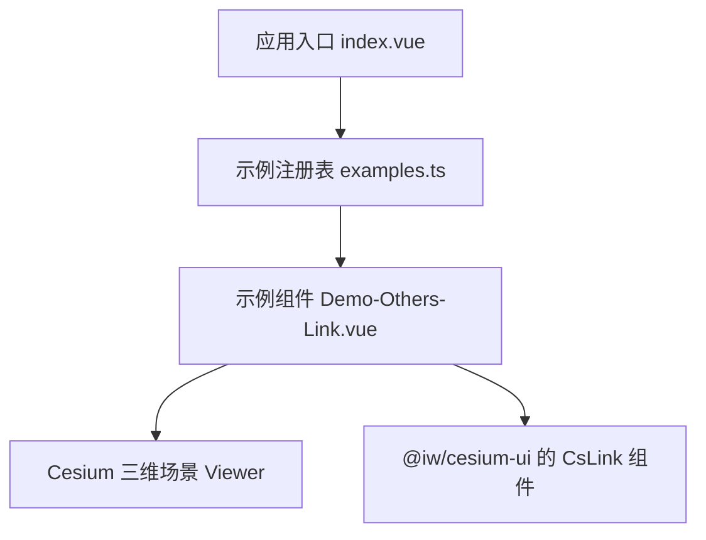
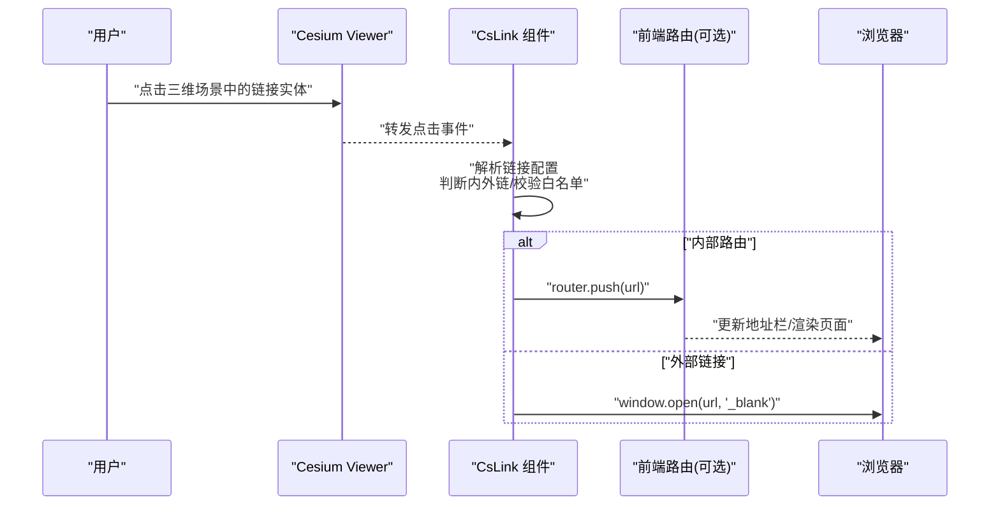
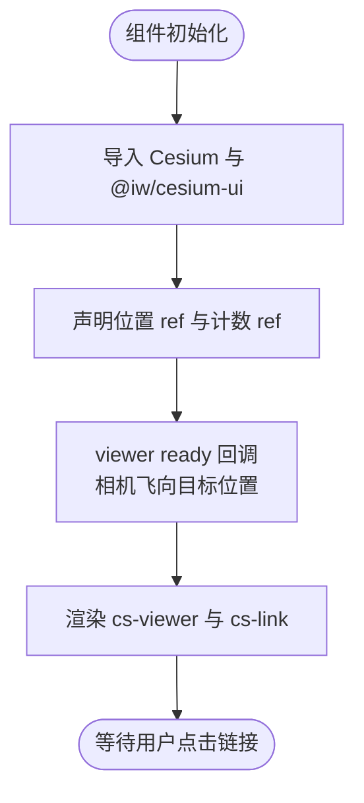
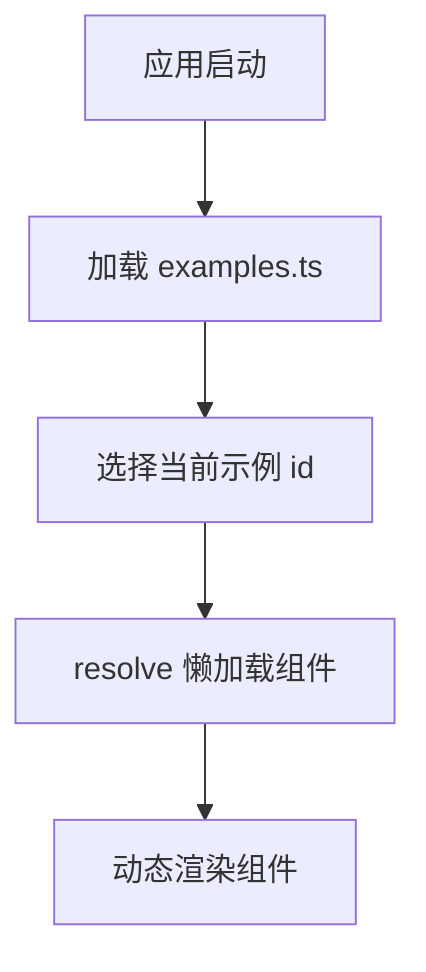
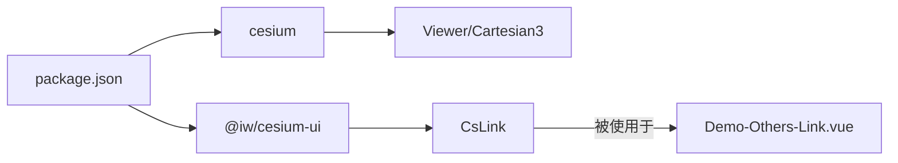

# 链接跳转

<cite>
**本文引用的文件**   
- [Demo-Others-Link.vue](file://src/components/Others/Demo-Others-Link.vue)
- [examples.ts](file://src/examples.ts)
- [index.vue](file://src/index.vue)
- [package.json](file://package.json)
</cite>

## 目录
1. [简介](#简介)
2. [项目结构](#项目结构)
3. [核心组件与入口](#核心组件与入口)
4. [架构总览](#架构总览)
5. [详细组件分析](#详细组件分析)
6. [依赖关系分析](#依赖关系分析)
7. [性能与兼容性](#性能与兼容性)
8. [安全考虑](#安全考虑)
9. [故障排查](#故障排查)
10. [结论](#结论)

## 简介
本技术文档围绕“链接跳转”能力展开，聚焦以下目标：
- 外部链接打开、内部路由跳转的实现方式
- 链接配置管理、目标地址处理与浏览器兼容性
- 与三维场景的集成方式（点击实体触发链接、URL 参数传递、数据同步）
- 安全策略（URL 白名单、XSS 防护、跨域处理）
- 用户体验优化（新窗口打开、加载状态、错误处理）

本项目通过第三方 UI 库 @iw/cesium-ui 提供的 CsLink 组件在 Cesium 三维场景中展示可点击链接；示例页面通过 Vue 动态渲染该组件。由于 CsLink 的具体实现位于第三方包内，本文基于仓库中的使用方式进行说明，并给出通用实现建议与安全最佳实践。

## 项目结构
与“链接跳转”直接相关的代码集中在 Others 示例组件中，并通过示例注册表进行懒加载与动态渲染。

**图表来源**
- [index.vue:14-32](file://src/index.vue#L14-L32)
- [examples.ts:23-54](file://src/examples.ts#L23-L54)
- [Demo-Others-Link.vue:28-36](file://src/components/Others/Demo-Others-Link.vue#L28-L36)

**章节来源**
- [index.vue:14-32](file://src/index.vue#L14-L32)
- [examples.ts:23-54](file://src/examples.ts#L23-L54)
- [Demo-Others-Link.vue:28-36](file://src/components/Others/Demo-Others-Link.vue#L28-L36)

## 核心组件与入口
- 示例入口：index.vue 根据当前示例 id 动态渲染对应组件。
- 示例注册：examples.ts 将各示例组件以懒加载形式注册，其中包含 Link 示例。
- 链接示例：Demo-Others-Link.vue 引入 CsViewer 与 CsLink，并在三维场景中放置一个链接点。

关键路径与职责：
- index.vue：负责切换和渲染当前示例组件。
- examples.ts：集中管理示例元数据与懒加载逻辑。
- Demo-Others-Link.vue：演示如何在 Cesium 场景中挂载 CsLink 并设置位置。

**章节来源**
- [index.vue:14-32](file://src/index.vue#L14-L32)
- [examples.ts:23-54](file://src/examples.ts#L23-L54)
- [Demo-Others-Link.vue:1-36](file://src/components/Others/Demo-Others-Link.vue#L1-L36)

## 架构总览
下图展示了从用户交互到链接跳转的整体流程：用户在三维场景中点击 CsLink，CsLink 根据配置的 URL 执行跳转；若为外部链接则可能在新窗口打开，若为内部路由则由前端路由接管。

**图表来源**
- [Demo-Others-Link.vue:28-36](file://src/components/Others/Demo-Others-Link.vue#L28-L36)
- [examples.ts:23-54](file://src/examples.ts#L23-L54)

## 详细组件分析

### 链接示例组件 Demo-Others-Link.vue
该组件用于演示在 Cesium 三维场景中放置一个可点击的链接点。它引入了 CsViewer 与 CsLink，并将位置信息作为属性传入 CsLink。

要点：
- 引入 Cesium 的 Viewer 与 Cartesian3，用于相机飞行动画。
- 引入 @iw/cesium-ui 的 CsViewer、CsLink 与 DegreeAry 类型。
- 在模板中使用 cs-viewer 与 cs-link，绑定 position 属性。
- 监听 viewer ready 事件，将相机飞行至覆盖物上空，便于观察链接点。

**图表来源**
- [Demo-Others-Link.vue:1-36](file://src/components/Others/Demo-Others-Link.vue#L1-L36)

**章节来源**
- [Demo-Others-Link.vue:1-36](file://src/components/Others/Demo-Others-Link.vue#L1-L36)

### 示例注册与动态渲染
examples.ts 定义了示例数组，每个示例包含 id、label 与懒加载的组件引用。Link 示例即其中之一。index.vue 根据当前 exampleId 计算 currentComponent 并渲染。

要点：
- 使用 defineAsyncComponent 包裹示例组件，提供 loading 与 error 组件。
- 对异步加载失败进行重试与超时控制。
- 通过 v-if="currentComponent" 动态渲染当前示例。

**图表来源**
- [examples.ts:1-19](file://src/examples.ts#L1-L19)
- [examples.ts:23-54](file://src/examples.ts#L23-L54)
- [index.vue:14-32](file://src/index.vue#L14-L32)

**章节来源**
- [examples.ts:1-19](file://src/examples.ts#L1-L19)
- [examples.ts:23-54](file://src/examples.ts#L23-L54)
- [index.vue:14-32](file://src/index.vue#L14-L32)

### 与三维场景的集成方式
- 点击实体触发链接：在三维场景中，CsLink 通常表现为一个可点击的实体（如图标或标记）。点击后由 CsLink 内部逻辑决定跳转行为。
- URL 参数传递：可在链接配置中拼接查询参数，例如 ?id=xxx&scene=yyy，以便目标页面接收并进行数据同步。
- 数据同步：对于内部路由，可通过前端路由的状态管理（如 query/state）与业务 store 同步；对于外部链接，建议在目标页面对 URL 参数进行解析与本地存储。

注意：具体 CsLink 的内部实现与 API 细节位于第三方包 @iw/cesium-ui 中，本仓库仅展示其使用方式。

**章节来源**
- [Demo-Others-Link.vue:1-36](file://src/components/Others/Demo-Others-Link.vue#L1-L36)

## 依赖关系分析
项目依赖 @iw/cesium-ui 提供 CsLink 等三维 UI 组件，同时依赖 Cesium 进行三维场景渲染。

**图表来源**
- [package.json:12-17](file://package.json#L12-L17)
- [Demo-Others-Link.vue:1-6](file://src/components/Others/Demo-Others-Link.vue#L1-L6)

**章节来源**
- [package.json:12-17](file://package.json#L12-L17)
- [Demo-Others-Link.vue:1-6](file://src/components/Others/Demo-Others-Link.vue#L1-L6)

## 性能与兼容性
- 新窗口打开：外部链接建议使用 window.open(url, '_blank') 并配合 rel="noopener noreferrer" 避免反向标签页劫持与提升性能。
- 浏览器兼容：不同浏览器对新窗口弹窗的限制存在差异，建议在移动端或受限环境中降级为在当前窗口跳转或提示用户允许弹窗。
- 加载状态：示例注册已提供 AsyncLoading 与 AsyncError 组件，可用于异步资源加载时的反馈。
- 错误处理：示例注册中对异步加载失败进行了重试与超时控制，避免阻塞主流程。

**章节来源**
- [examples.ts:1-19](file://src/examples.ts#L1-L19)

## 安全考虑
- URL 白名单：在跳转前对目标地址进行白名单校验，仅允许受信任域名与协议（如 https://）。
- XSS 防护：避免直接使用用户输入拼接 URL；如需显示用户内容，应进行 HTML 转义或使用安全的渲染方式。
- 跨域处理：外部链接跳转本身不触发跨域限制；但若在页面内嵌入 iframe 或发起网络请求，需遵循 CORS 策略与后端配置。
- 防劫持：对外部链接添加 rel="noopener noreferrer"，防止目标页通过 window.opener 访问原页面。

建议实现步骤：
1. 定义白名单规则（域名、协议、路径前缀）。
2. 在 CsLink 点击事件中统一拦截，先校验 URL。
3. 根据校验结果决定跳转方式（内部路由或外部链接）。
4. 记录审计日志，便于追踪异常跳转。

[本节为通用安全建议，不直接分析具体文件]

## 故障排查
常见问题与定位思路：
- 链接无响应：检查 CsLink 是否正确挂载到 Viewer，以及 position 是否有效。
- 外部链接被拦截：确认浏览器是否阻止了新窗口弹窗，必要时引导用户授权。
- 内部路由未生效：确认前端路由配置与 router.push 调用是否正确。
- 加载失败：查看 AsyncError 组件输出，检查网络与依赖加载情况。

参考路径：
- 示例注册与错误组件：examples.ts、AsyncError.vue
- 链接示例：Demo-Others-Link.vue

**章节来源**
- [examples.ts:1-19](file://src/examples.ts#L1-L19)
- [Demo-Others-Link.vue:1-36](file://src/components/Others/Demo-Others-Link.vue#L1-L36)

## 结论
本项目通过 @iw/cesium-ui 的 CsLink 组件在 Cesium 三维场景中实现了链接跳转的基础能力。结合示例注册与动态渲染机制，开发者可以快速扩展更多链接场景。为确保安全性与用户体验，建议在生产环境中补充 URL 白名单校验、XSS 防护、跨域策略与加载/错误反馈。对于复杂业务，可将链接配置集中管理，并在 CsLink 的事件钩子中统一处理跳转逻辑。

[本节为总结性内容，不直接分析具体文件]