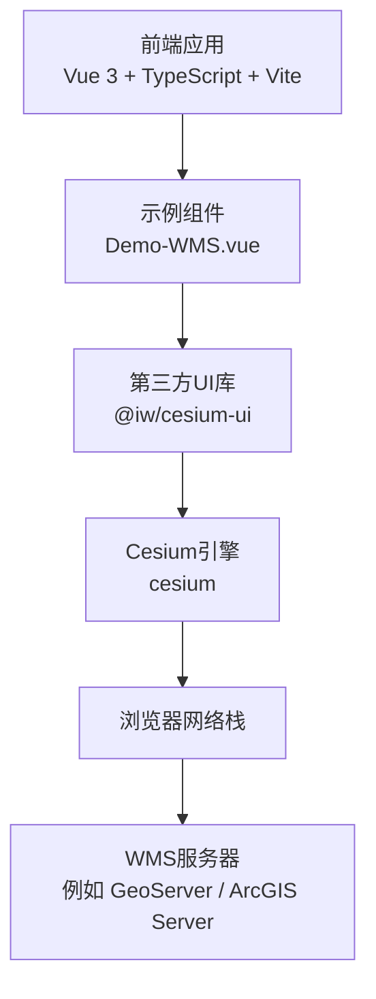
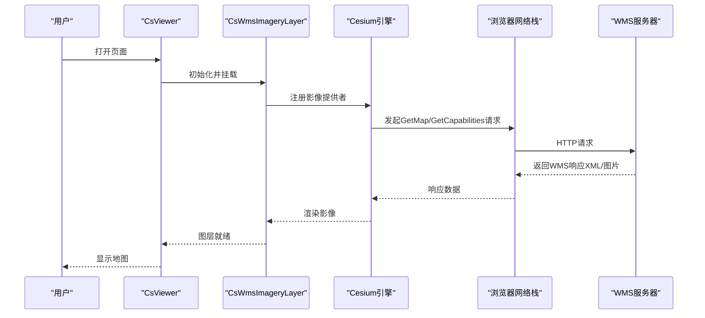
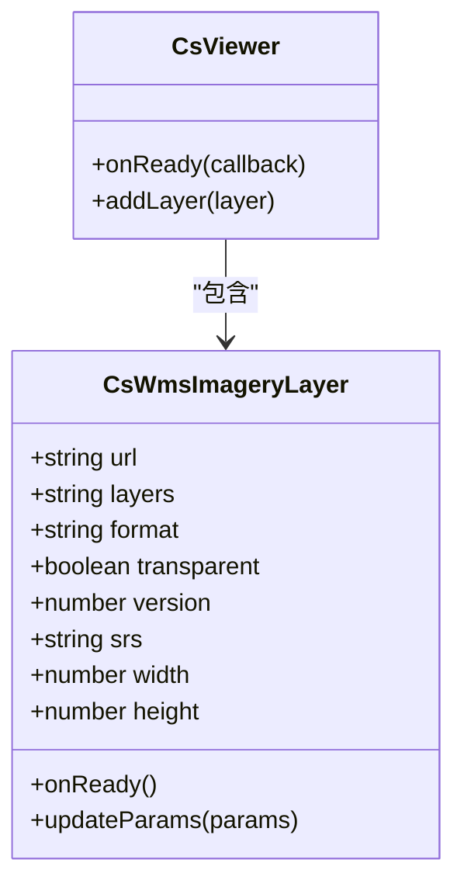
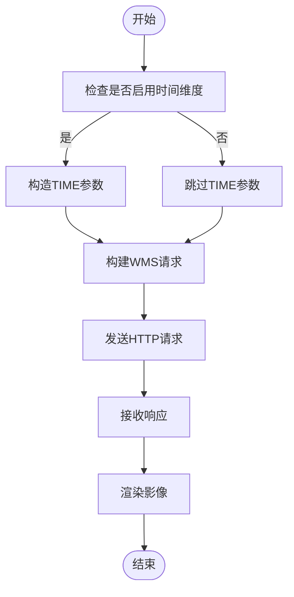
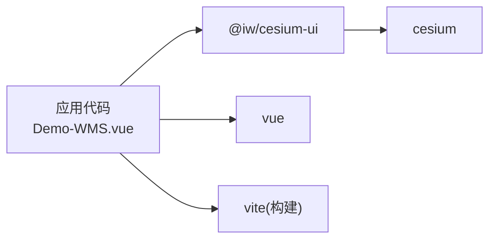

# WMS标准服务

<cite>
**本文引用的文件**   
- [README.md](file://README.md)
- [package.json](file://package.json)
- [Demo-WMS.vue](file://src/components/Provider/Layers/Demo-WMS.vue)
</cite>

## 目录
1. [引言](#引言)
2. [项目结构](#项目结构)
3. [核心组件](#核心组件)
4. [架构总览](#架构总览)
5. [详细组件分析](#详细组件分析)
6. [依赖关系分析](#依赖关系分析)
7. [性能考虑](#性能考虑)
8. [故障排查指南](#故障排查指南)
9. [结论](#结论)
10. [附录](#附录)

## 引言
本技术文档围绕OGC WMS（Web Map Service）标准在工程中的实现与使用展开，重点说明：
- OGC WMS协议在本工程中的集成方式与服务发现机制
- WMS服务的URL参数配置要点（LAYERS、SRS、BBOX、WIDTH、HEIGHT等）
- 主流WMS服务器（如GeoServer、ArcGIS Server）的对接方法
- WMS图层的时间维度支持与动态更新机制
- WMS服务的调试方法与常见问题排查
- WMS与其他地图服务（WMTS、Tiled XYZ、ArcGIS REST）的对比分析与适用场景

本仓库是一个基于Vue 3 + TypeScript + Vite的前端示例工程，通过第三方UI库封装的CsWmsImageryLayer组件接入WMS服务。

**章节来源**
- [README.md:1-6](file://README.md#L1-L6)

## 项目结构
本项目采用典型的前端工程结构，WMS相关能力集中在Provider/Layers目录下，示例组件为Demo-WMS.vue，用于演示如何以声明式方式加载WMS影像层。

**图表来源**
- [Demo-WMS.vue:1-55](file://src/components/Provider/Layers/Demo-WMS.vue#L1-L55)
- [package.json:12-17](file://package.json#L12-L17)

**章节来源**
- [Demo-WMS.vue:1-55](file://src/components/Provider/Layers/Demo-WMS.vue#L1-L55)
- [package.json:1-31](file://package.json#L1-L31)

## 核心组件
- CsWmsImageryLayer：第三方UI库提供的WMS影像层组件，负责将WMS请求转换为Cesium可渲染的影像瓦片或图像流。
- CsViewer：Cesium Viewer的封装组件，提供地图容器与生命周期钩子。
- Demo-WMS.vue：示例页面，演示如何向CsWmsImageryLayer传入url与layers等属性，完成WMS图层的加载。

关键用法要点（来自示例）：
- 通过属性url指定WMS服务地址
- 通过属性layers指定要加载的图层名称（如topp:states）

**章节来源**
- [Demo-WMS.vue:1-55](file://src/components/Provider/Layers/Demo-WMS.vue#L1-L55)

## 架构总览
下图展示了从前端到WMS服务器的完整调用链：

**图表来源**
- [Demo-WMS.vue:1-55](file://src/components/Provider/Layers/Demo-WMS.vue#L1-L55)

## 详细组件分析

### CsWmsImageryLayer组件分析
该组件封装了WMS协议的请求构建与渲染逻辑，通常内部会：
- 根据当前视口计算BBOX、WIDTH、HEIGHT
- 根据配置选择SRS/CRS（如EPSG:4326或EPSG:3857）
- 构造LAYERS、FORMAT、TRANSPARENT等参数
- 调用底层Cesium ImageryProvider进行渲染

由于具体实现位于第三方库中，本节从使用侧给出最佳实践与注意事项。

**图表来源**
- [Demo-WMS.vue:1-55](file://src/components/Provider/Layers/Demo-WMS.vue#L1-L55)

**章节来源**
- [Demo-WMS.vue:1-55](file://src/components/Provider/Layers/Demo-WMS.vue#L1-L55)

### WMS URL参数配置说明
以下为WMS常用参数的含义与配置建议（通用规范，适用于GeoServer、ArcGIS Server等）：
- LAYERS：必填，逗号分隔的图层名列表，如topp:states
- SRS/CRS：坐标参考系，常见值EPSG:4326（地理坐标）、EPSG:3857（Web墨卡托）
- BBOX：边界框，格式minX,minY,maxX,maxY，需与SRS一致
- WIDTH/HEIGHT：输出图像宽高，影响清晰度与带宽
- FORMAT：MIME类型，如image/png、image/jpeg；PNG支持透明
- TRANSPARENT：是否透明背景，true/false
- VERSION：WMS版本，通常为1.1.1或1.3.0
- STYLES：样式名，取决于服务端配置
- TIME：时间维度（若服务端启用），如2023-01-01T00:00:00Z
- EXCEPTIONS：错误返回格式，如application/json

提示：
- 当SRS为EPSG:3857时，BBOX单位为米；当为EPSG:4326时，单位为经纬度
- WIDTH/HEIGHT越大，图像越清晰但带宽越高；建议结合缩放级别动态调整

**章节来源**
- [Demo-WMS.vue:1-55](file://src/components/Provider/Layers/Demo-WMS.vue#L1-L55)

### 不同WMS服务器的对接方法

#### GeoServer
- 服务地址：通常为http(s)://host/geoserver/wms
- 图层命名：workspace:layer，如topp:states
- 推荐SRS：EPSG:3857（Web墨卡托）以获得更好性能
- 可选TIME：需在GeoServer中开启TimeDimension插件并在图层中启用时间

#### ArcGIS Server
- 服务地址：通常为http(s)://host/arcgis/services/.../MapServer/WMSServer
- 图层ID：数字形式，如0,1,2；可通过GetCapabilities获取
- 推荐SRS：EPSG:3857
- 动态更新：可使用ArcGIS Server的缓存策略与时间范围过滤

#### 其他平台
- QGIS Server：类似GeoServer，遵循OGC WMS规范
- SuperMap iServer：支持WMS，注意SRS与切片策略

**章节来源**
- [Demo-WMS.vue:1-55](file://src/components/Provider/Layers/Demo-WMS.vue#L1-L55)

### WMS图层的时间维度支持与动态更新机制
- 时间维度：若WMS服务器启用了时间维度（如GeoServer TimeDimension），可在请求中附加TIME参数，按时间点或时间段拉取对应影像
- 动态更新：客户端可通过监听地图状态变化（如缩放、平移、时间切换）重新构建WMS请求，实现动态刷新
- 缓存策略：合理设置浏览器缓存与服务器缓存，避免频繁重复请求

**图表来源**
- [Demo-WMS.vue:1-55](file://src/components/Provider/Layers/Demo-WMS.vue#L1-L55)

**章节来源**
- [Demo-WMS.vue:1-55](file://src/components/Provider/Layers/Demo-WMS.vue#L1-L55)

## 依赖关系分析
项目依赖的关键包如下：
- @iw/cesium-ui：提供CsViewer、CsWmsImageryLayer等组件
- cesium：Cesium三维地球引擎
- vue：前端框架
- vite：构建工具

**图表来源**
- [package.json:12-17](file://package.json#L12-L17)

**章节来源**
- [package.json:1-31](file://package.json#L1-L31)

## 性能考虑
- 选择合适的SRS：优先使用EPSG:3857以减少投影转换开销
- 控制WIDTH/HEIGHT：根据设备分辨率与缩放级别动态调整
- 合理使用FORMAT：PNG透明度高但体积大，JPEG体积小但不支持透明
- 启用缓存：利用浏览器与服务端缓存减少重复请求
- 分层管理：将高频更新的图层与静态底图分离，按需加载

[本节为通用指导，不直接分析具体文件]

## 故障排查指南
常见问题与排查步骤：
- 跨域问题（CORS）
  - 现象：控制台报跨域错误，无法加载WMS
  - 处理：在服务端配置允许前端的Origin，或使用代理转发
- 图层名称错误
  - 现象：GetCapabilities返回正常但图层不显示
  - 处理：核对LAYERS参数，确保workspace:layer格式正确
- 坐标系统不一致
  - 现象：地图偏移或错位
  - 处理：统一SRS，确保BBOX单位与SRS匹配
- 尺寸过大导致卡顿
  - 现象：拖动地图卡顿、内存占用高
  - 处理：降低WIDTH/HEIGHT，或改用WMTS/Tiled服务
- 时间维度无效
  - 现象：TIME参数被忽略
  - 处理：确认服务端已启用时间维度，且图层支持时间

**章节来源**
- [Demo-WMS.vue:1-55](file://src/components/Provider/Layers/Demo-WMS.vue#L1-L55)

## 结论
本工程通过第三方UI库封装的CsWmsImageryLayer组件，快速集成了OGC WMS服务。在实际项目中，应重点关注：
- 正确的URL与LAYERS配置
- 统一的SRS与BBOX单位
- 合理的WIDTH/HEIGHT与FORMAT选择
- 时间维度的启用与动态更新策略
- 跨域与缓存等运维层面的优化

[本节为总结性内容，不直接分析具体文件]

## 附录
- WMS GetCapabilities：用于服务发现，获取可用图层、SRS、版本等信息
- WMS GetMap：用于获取指定区域与尺寸的地图图像
- 与WMTS对比：WMTS基于预切片瓦片，性能更优；WMS按需生成，灵活性更高
- 与ArcGIS REST对比：ArcGIS REST功能丰富，但WMS具有更强的互操作性

[本节为概念性内容，不直接分析具体文件]