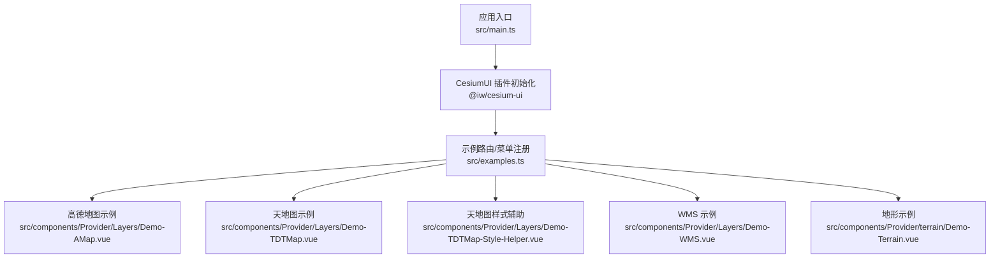
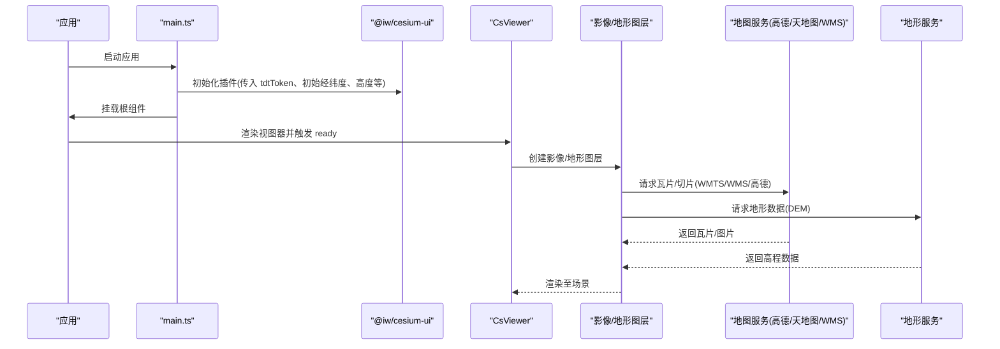
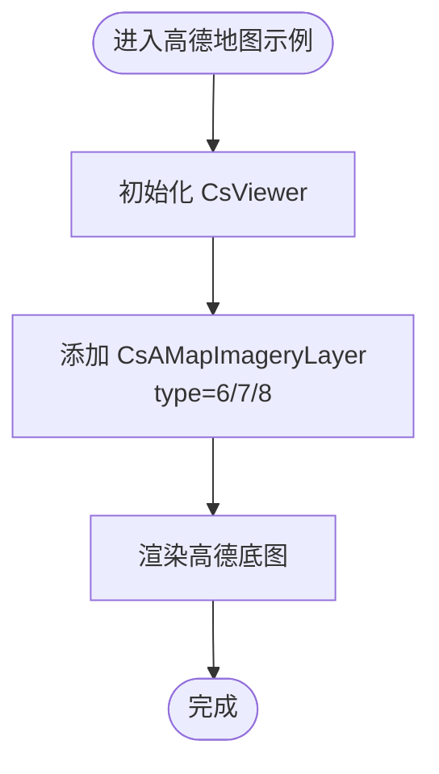
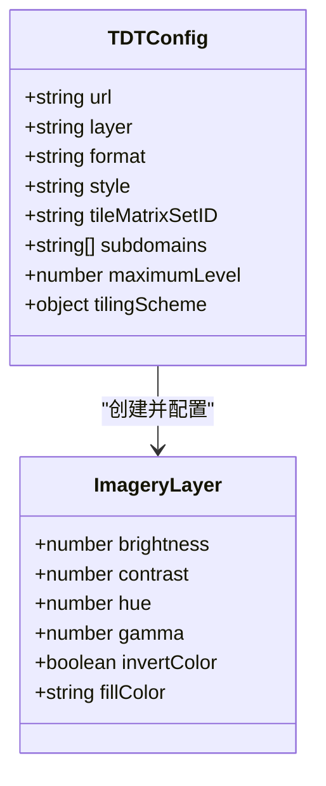
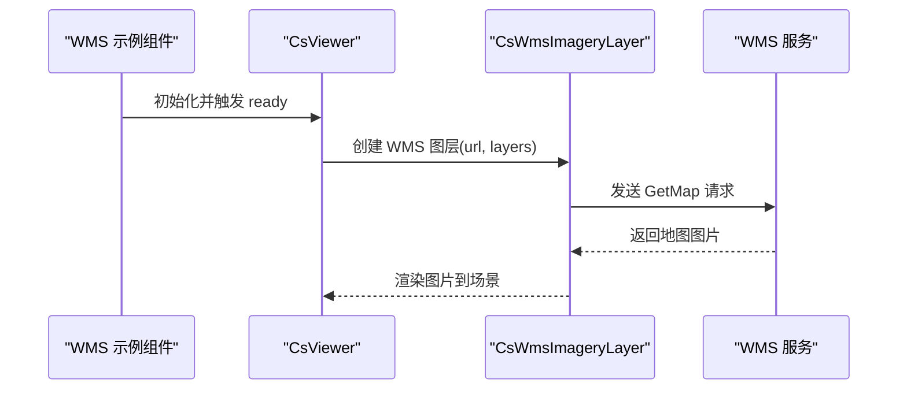
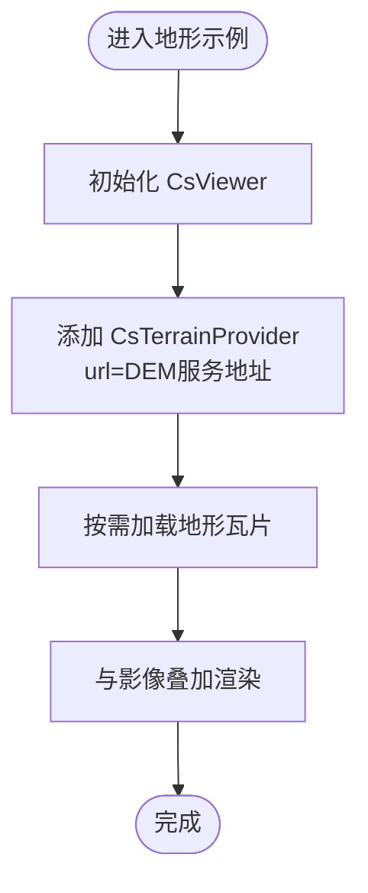
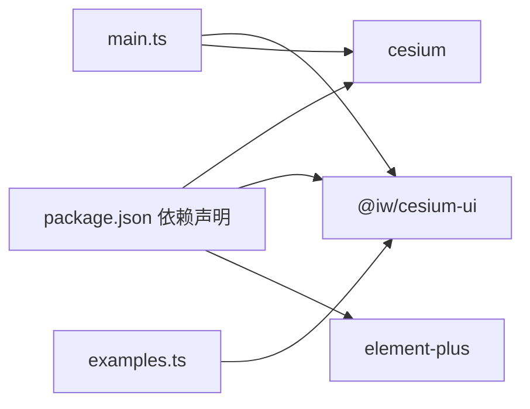

# 地图服务集成

<cite>
**本文引用的文件**   
- [main.ts](file://src/main.ts)
- [package.json](file://package.json)
- [examples.ts](file://src/examples.ts)
- [Demo-AMap.vue](file://src/components/Provider/Layers/Demo-AMap.vue)
- [Demo-TDTMap.vue](file://src/components/Provider/Layers/Demo-TDTMap.vue)
- [Demo-TDTMap-Style-Helper.vue](file://src/components/Provider/Layers/Demo-TDTMap-Style-Helper.vue)
- [Demo-WMS.vue](file://src/components/Provider/Layers/Demo-WMS.vue)
- [Demo-Terrain.vue](file://src/components/Provider/terrain/Demo-Terrain.vue)
</cite>

## 目录
1. [简介](#简介)
2. [项目结构](#项目结构)
3. [核心组件与能力](#核心组件与能力)
4. [架构总览](#架构总览)
5. [详细组件分析](#详细组件分析)
6. [依赖关系分析](#依赖关系分析)
7. [性能与可用性建议](#性能与可用性建议)
8. [故障排查指南](#故障排查指南)
9. [结论](#结论)
10. [附录：配置与示例清单](#附录配置与示例清单)

## 简介
本技术文档围绕“地图服务集成功能”展开，聚焦以下目标：
- 高德地图、天地图、WMS 标准服务的接入方法与配置选项
- 地形数据的加载与显示机制
- 服务密钥配置、图层样式定制、错误处理与重试机制
- 不同地图服务的对比分析与选择建议
- 实际集成示例与常见问题解决方案

本项目基于 Vue 3 + TypeScript + Vite，使用 CesiumJS 作为三维地球引擎，并通过 @iw/cesium-ui 提供的封装组件（如 CsViewer、CsAMapImageryLayer、CsTdtImageryLayer、CsWmsImageryLayer、CsTerrainProvider）简化地图服务集成。

## 项目结构
仓库采用按功能域组织的目录结构，地图相关代码集中在 src/components/Provider 下：
- Provider/Layers：影像图层示例（高德、天地图、WMS）
- Provider/terrain：地形数据示例
- Viewer：视图器相关示例
- 其他：实体绘制、测量、工具等

图表来源
- [main.ts:11-24](file://src/main.ts#L11-L24)
- [examples.ts:35-39](file://src/examples.ts#L35-L39)

章节来源
- [main.ts:1-26](file://src/main.ts#L1-L26)
- [examples.ts:35-39](file://src/examples.ts#L35-L39)

## 核心组件与能力
- CsViewer：Cesium 视图器的封装，提供 ready 事件、相机控制等基础能力
- CsAMapImageryLayer：高德地图影像图层封装，通过 type 切换底图类型
- CsTdtImageryLayer：天地图影像图层封装，通过 type 切换矢量/影像/标注等
- CsWmsImageryLayer：WMS 标准服务图层封装，支持 url/layers 等参数
- CsTerrainProvider：地形数据提供者封装，支持全局或局部配置

上述组件均来源于 @iw/cesium-ui，配合 CesiumJS 的 ImageryLayer、WebMapTileServiceImageryProvider 等底层能力实现。

章节来源
- [Demo-AMap.vue:9-11](file://src/components/Provider/Layers/Demo-AMap.vue#L9-L11)
- [Demo-TDTMap.vue:9-11](file://src/components/Provider/Layers/Demo-TDTMap.vue#L9-L11)
- [Demo-WMS.vue:4-7](file://src/components/Provider/Layers/Demo-WMS.vue#L4-L7)
- [Demo-Terrain.vue:13-17](file://src/components/Provider/terrain/Demo-Terrain.vue#L13-L17)

## 架构总览
下图展示从应用启动到地图服务渲染的整体流程，包括密钥注入、图层创建与渲染。

图表来源
- [main.ts:11-24](file://src/main.ts#L11-L24)
- [Demo-AMap.vue:34-49](file://src/components/Provider/Layers/Demo-AMap.vue#L34-L49)
- [Demo-TDTMap.vue:30-42](file://src/components/Provider/Layers/Demo-TDTMap.vue#L30-L42)
- [Demo-WMS.vue:29-37](file://src/components/Provider/Layers/Demo-WMS.vue#L29-L37)
- [Demo-Terrain.vue:27-34](file://src/components/Provider/terrain/Demo-Terrain.vue#L27-L34)

## 详细组件分析

### 高德地图(Cesium + CsAMapImageryLayer)
- 接入方式
  - 在 CsViewer 内使用 CsAMapImageryLayer，通过 type 属性切换不同底图类型
  - 示例中展示了三种 type 值，分别对应不同的高德底图风格
- 关键配置项
  - type：高德底图类型标识（示例中使用字符串数字）
- 注意事项
  - 若需自定义密钥或域名，请查阅 @iw/cesium-ui 文档；当前示例未显式设置密钥
  - 多个 CsViewer 可独立加载不同高德底图

图表来源
- [Demo-AMap.vue:34-49](file://src/components/Provider/Layers/Demo-AMap.vue#L34-L49)

章节来源
- [Demo-AMap.vue:1-67](file://src/components/Provider/Layers/Demo-AMap.vue#L1-L67)

### 天地图(Cesium + CsTdtImageryLayer / WMTS)
- 接入方式
  - 通过 CsTdtImageryLayer 快速接入天地图矢量/影像/标注等图层
  - 也可通过 WMTS 直接构建 ImageryProvider（见样式辅助示例）
- 关键配置项
  - type：天地图图层标识（如 img_w、vec_w）
  - subdomains：二级域名数组
  - maximumLevel：最大缩放级别（示例为 18）
  - tilingScheme：投影方案（WebMercator/Geographic）
- 样式定制
  - 可通过 ImageryLayer 的属性调整亮度、对比度、色调、伽马等
  - 支持颜色反转与填充色覆盖（用于特殊可视化）
- 密钥
  - 天地图 tk 参数在 URL 中配置，示例中已包含测试用 tk

图表来源
- [Demo-TDTMap-Style-Helper.vue:75-107](file://src/components/Provider/Layers/Demo-TDTMap-Style-Helper.vue#L75-L107)

章节来源
- [Demo-TDTMap.vue:30-42](file://src/components/Provider/Layers/Demo-TDTMap.vue#L30-L42)
- [Demo-TDTMap-Style-Helper.vue:53-107](file://src/components/Provider/Layers/Demo-TDTMap-Style-Helper.vue#L53-L107)

### WMS 标准服务(CsWmsImageryLayer)
- 接入方式
  - 在 CsViewer 内使用 CsWmsImageryLayer，指定 url 与 layers
- 关键配置项
  - url：WMS 服务地址
  - layers：图层名称（逗号分隔）
- 行为说明
  - 示例中演示了将相机飞行到特定坐标，便于查看 WMS 图层效果

图表来源
- [Demo-WMS.vue:29-37](file://src/components/Provider/Layers/Demo-WMS.vue#L29-L37)

章节来源
- [Demo-WMS.vue:1-55](file://src/components/Provider/Layers/Demo-WMS.vue#L1-L55)

### 地形数据(CsTerrainProvider)
- 接入方式
  - 在 CsViewer 内使用 CsTerrainProvider，传入 terrain 服务地址
  - 也支持在 main.ts 中通过 CesiumUI 插件进行全局地形配置（注释示例）
- 关键配置项
  - url：DEM 服务地址
- 显示机制
  - 地形数据以瓦片形式按需加载，结合影像图层形成三维起伏效果

图表来源
- [Demo-Terrain.vue:27-34](file://src/components/Provider/terrain/Demo-Terrain.vue#L27-L34)

章节来源
- [Demo-Terrain.vue:1-52](file://src/components/Provider/terrain/Demo-Terrain.vue#L1-L52)

## 依赖关系分析
- 运行时依赖
  - cesium：三维地球引擎
  - @iw/cesium-ui：Cesium 组件封装（CsViewer、各类 ImageryLayer、TerrainProvider）
  - element-plus、color 等：UI 与工具库
- 开发依赖
  - vite、vue-tsc、unplugin-*：构建与自动导入
- 关键初始化
  - main.ts 中设置 Cesium Ion 访问令牌与 CesiumUI 插件参数（含 tdtToken、初始经纬度、高度）

图表来源
- [package.json:12-28](file://package.json#L12-L28)
- [main.ts:11-24](file://src/main.ts#L11-L24)
- [examples.ts:35-39](file://src/examples.ts#L35-L39)

章节来源
- [package.json:1-31](file://package.json#L1-L31)
- [main.ts:11-24](file://src/main.ts#L11-L24)
- [examples.ts:35-39](file://src/examples.ts#L35-L39)

## 性能与可用性建议
- 图层层级与可见性
  - 合理管理 ImageryLayer 的层级顺序，避免不必要的重绘
  - 对非可视区域关闭或降级图层（例如降低最大缩放级别）
- 瓦片与缓存
  - 利用浏览器与服务端缓存策略，减少重复请求
  - 对高频访问的底图（如高德/天地图）启用合适的缓存头
- 地形数据
  - 根据业务范围选择合适的 DEM 分辨率与分块大小
  - 地形与影像分层加载，优先影像后地形，提升首帧速度
- 网络与容错
  - 对第三方服务增加超时与重试逻辑（建议在封装层统一处理）
  - 对跨域问题提前配置代理或后端转发
- 样式优化
  - 谨慎使用高开销的滤镜（如大幅反转、复杂填充），仅在必要时开启

[本节为通用指导，不直接分析具体文件]

## 故障排查指南
- 天地图 tk 无效或受限
  - 现象：天地图瓦片无法加载或报错
  - 排查：检查 URL 中的 tk 参数是否有效、配额是否耗尽
  - 解决：更换有效的 tk 或在服务端代理时携带正确凭证
  - 参考路径：[Demo-TDTMap-Style-Helper.vue:86-97](file://src/components/Provider/Layers/Demo-TDTMap-Style-Helper.vue#L86-L97)
- 高德地图无内容或白屏
  - 现象：高德底图不显示
  - 排查：确认 type 值是否合法；检查网络请求是否被拦截
  - 解决：核对高德开放平台密钥与域名白名单
  - 参考路径：[Demo-AMap.vue:34-49](file://src/components/Provider/Layers/Demo-AMap.vue#L34-L49)
- WMS 图层不可见
  - 现象：WMS 请求成功但画面空白
  - 排查：layers 名称是否正确；坐标系与投影是否与 Cesium 一致
  - 解决：校验 WMS GetCapabilities，确保 EPSG 与 Cesium 默认球体匹配
  - 参考路径：[Demo-WMS.vue:29-37](file://src/components/Provider/Layers/Demo-WMS.vue#L29-L37)
- 地形不生效
  - 现象：地形未显示或起伏异常
  - 排查：地形服务地址是否可达；URL 末尾斜杠是否正确
  - 解决：修正地形服务地址，或在全局配置中统一设置
  - 参考路径：[Demo-Terrain.vue:27-34](file://src/components/Provider/terrain/Demo-Terrain.vue#L27-L34)
- Cesium Ion 令牌问题
  - 现象：部分 Cesium 资源无法加载
  - 排查：Ion.defaultAccessToken 是否设置且有效
  - 解决：更新为有效的访问令牌
  - 参考路径：[main.ts:11-13](file://src/main.ts#L11-L13)

章节来源
- [Demo-TDTMap-Style-Helper.vue:86-97](file://src/components/Provider/Layers/Demo-TDTMap-Style-Helper.vue#L86-L97)
- [Demo-AMap.vue:34-49](file://src/components/Provider/Layers/Demo-AMap.vue#L34-L49)
- [Demo-WMS.vue:29-37](file://src/components/Provider/Layers/Demo-WMS.vue#L29-L37)
- [Demo-Terrain.vue:27-34](file://src/components/Provider/terrain/Demo-Terrain.vue#L27-L34)
- [main.ts:11-13](file://src/main.ts#L11-L13)

## 结论
本项目通过 @iw/cesium-ui 提供了简洁一致的地图服务接入方式：
- 高德地图：通过 CsAMapImageryLayer 快速切换多种底图
- 天地图：通过 CsTdtImageryLayer 或 WMTS 直接接入，支持丰富的样式定制
- WMS：通过 CsWmsImageryLayer 接入任意符合 OGC WMS 标准的地图服务
- 地形：通过 CsTerrainProvider 或全局配置加载 DEM 数据，形成三维起伏

在实际项目中，建议：
- 将密钥与基础配置集中管理（如 main.ts）
- 对第三方服务增加统一的错误处理与重试策略
- 根据业务需求选择合适的地图服务与样式，平衡性能与视觉效果

[本节为总结性内容，不直接分析具体文件]

## 附录：配置与示例清单
- 服务密钥与基础配置
  - Cesium Ion 访问令牌：[main.ts:11-13](file://src/main.ts#L11-L13)
  - CesiumUI 插件参数（tdtToken、初始经纬度、高度）：[main.ts:18-24](file://src/main.ts#L18-L24)
- 高德地图示例
  - 组件与用法：[Demo-AMap.vue:34-49](file://src/components/Provider/Layers/Demo-AMap.vue#L34-L49)
- 天地图示例与样式
  - 基础用法：[Demo-TDTMap.vue:30-42](file://src/components/Provider/Layers/Demo-TDTMap.vue#L30-L42)
  - WMTS 与样式定制：[Demo-TDTMap-Style-Helper.vue:75-107](file://src/components/Provider/Layers/Demo-TDTMap-Style-Helper.vue#L75-L107)
- WMS 示例
  - 组件与用法：[Demo-WMS.vue:29-37](file://src/components/Provider/Layers/Demo-WMS.vue#L29-L37)
- 地形示例
  - 组件与用法：[Demo-Terrain.vue:27-34](file://src/components/Provider/terrain/Demo-Terrain.vue#L27-L34)
- 示例菜单注册
  - 示例入口注册：[examples.ts:35-39](file://src/examples.ts#L35-L39)

章节来源
- [main.ts:11-24](file://src/main.ts#L11-L24)
- [Demo-AMap.vue:34-49](file://src/components/Provider/Layers/Demo-AMap.vue#L34-L49)
- [Demo-TDTMap.vue:30-42](file://src/components/Provider/Layers/Demo-TDTMap.vue#L30-L42)
- [Demo-TDTMap-Style-Helper.vue:75-107](file://src/components/Provider/Layers/Demo-TDTMap-Style-Helper.vue#L75-L107)
- [Demo-WMS.vue:29-37](file://src/components/Provider/Layers/Demo-WMS.vue#L29-L37)
- [Demo-Terrain.vue:27-34](file://src/components/Provider/terrain/Demo-Terrain.vue#L27-L34)
- [examples.ts:35-39](file://src/examples.ts#L35-L39)