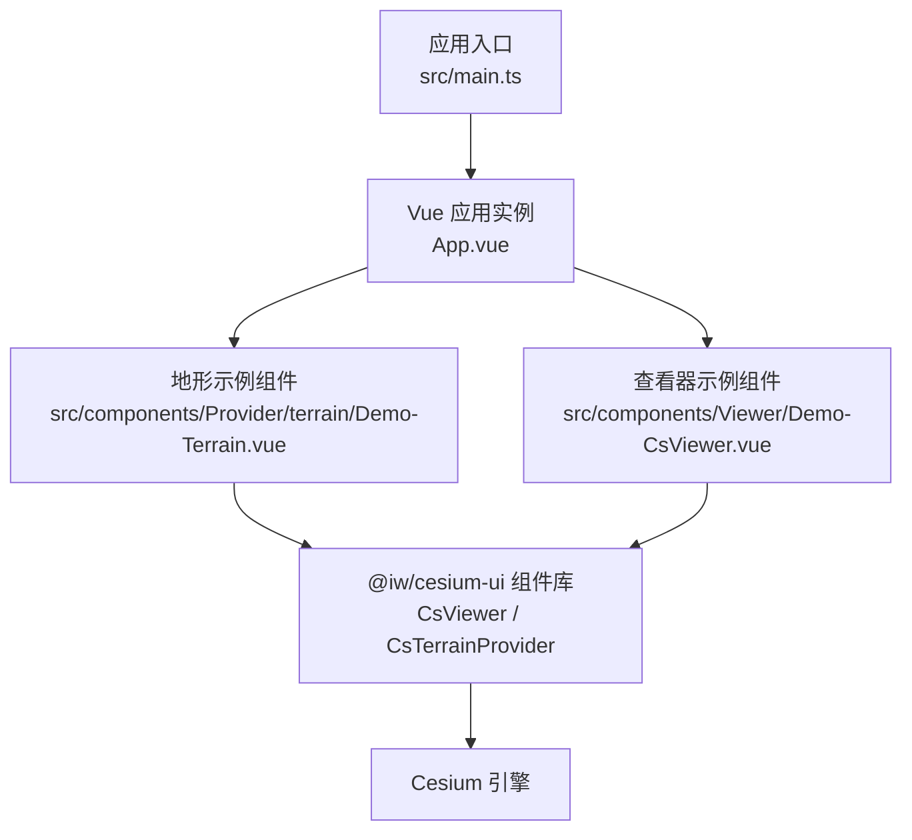
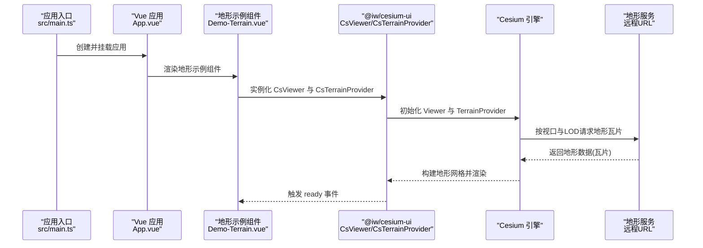
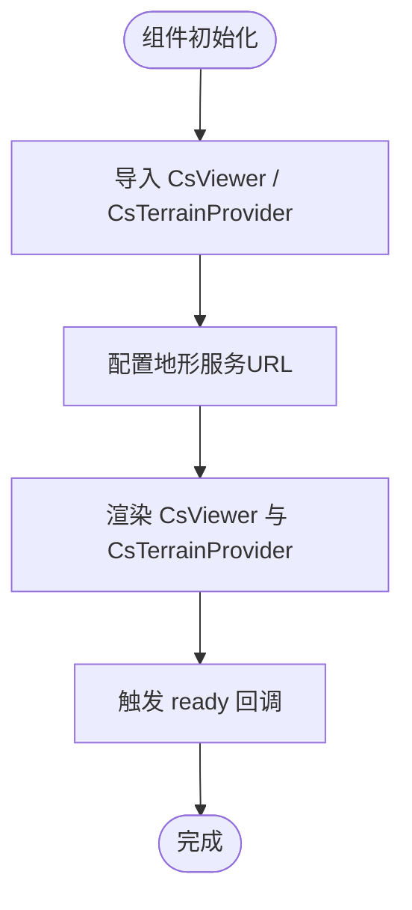
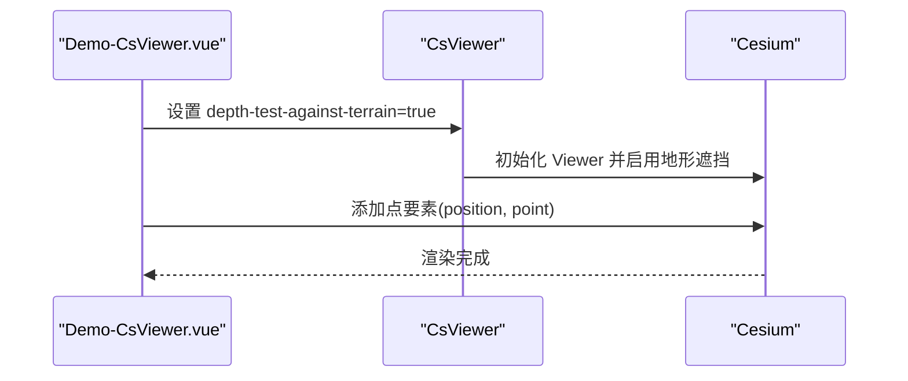
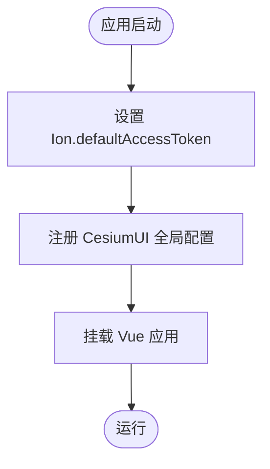
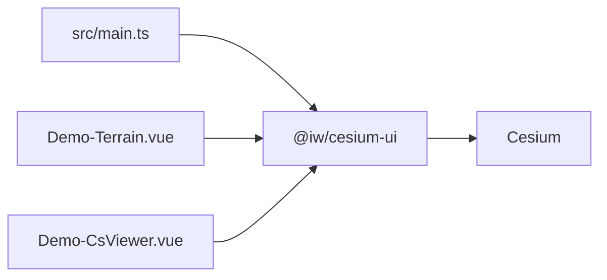

# 地形数据加载

<cite>
**本文引用的文件**   
- [README.md](file://README.md)
- [main.ts](file://src/main.ts)
- [Demo-Terrain.vue](file://src/components/Provider/terrain/Demo-Terrain.vue)
- [Demo-CsViewer.vue](file://src/components/Viewer/Demo-CsViewer.vue)
</cite>

## 目录
1. [简介](#简介)
2. [项目结构](#项目结构)
3. [核心组件](#核心组件)
4. [架构总览](#架构总览)
5. [详细组件分析](#详细组件分析)
6. [依赖关系分析](#依赖关系分析)
7. [性能与优化](#性能与优化)
8. [故障排查指南](#故障排查指南)
9. [结论](#结论)
10. [附录](#附录)

## 简介
本技术文档围绕“地形数据加载”能力，结合仓库中的示例代码，系统说明如何在 Vue + TypeScript + Vite 项目中集成 Cesium 地形服务，并通过 @iw/cesium-ui 提供的 CsTerrainProvider 组件接入远程地形数据源。文档覆盖：
- 三维地形数据的格式支持与处理思路（DEM、GeoTIFF 等）
- 地形数据的加载机制与缓存策略（含 LOD 渐进式加载）
- 坐标系统与投影处理要点
- 不同地形数据源的集成方式（Cesium Ion Terrain、本地或自建地形服务）
- 性能优化技巧（压缩、分块、内存管理）
- 质量评估与可视化调优方法

## 项目结构
本项目为基于 Vue 3 + TypeScript + Vite 的前端工程，包含若干演示组件。与地形相关的关键文件如下：
- src/main.ts：应用初始化，注册 CesiumUI 全局配置（如初始经纬度、高度、天地图 token 等），并设置 Cesium Ion Token
- src/components/Provider/terrain/Demo-Terrain.vue：通过 CsTerrainProvider 组件接入远程地形服务
- src/components/Viewer/Demo-CsViewer.vue：展示 CsViewer 的 depth-test-against-terrain 属性用法

图表来源
- [main.ts:1-26](file://src/main.ts#L1-L26)
- [Demo-Terrain.vue:1-52](file://src/components/Provider/terrain/Demo-Terrain.vue#L1-L52)
- [Demo-CsViewer.vue:1-67](file://src/components/Viewer/Demo-CsViewer.vue#L1-L67)

章节来源
- [README.md:1-6](file://README.md#L1-L6)
- [main.ts:1-26](file://src/main.ts#L1-L26)
- [Demo-Terrain.vue:1-52](file://src/components/Provider/terrain/Demo-Terrain.vue#L1-L52)
- [Demo-CsViewer.vue:1-67](file://src/components/Viewer/Demo-CsViewer.vue#L1-L67)

## 核心组件
- CsViewer：封装 Cesium Viewer 的 Vue 组件，提供 ready 事件、depth-test-against-terrain 等属性，用于控制地形遮挡测试
- CsTerrainProvider：封装 Cesium 地形 Provider 的 Vue 组件，通过 url 属性指向地形服务根地址，自动完成地形瓦片请求与渲染

在 Demo-Terrain.vue 中，使用 CsTerrainProvider 指定地形服务 URL；在 Demo-CsViewer.vue 中，通过 depth-test-against-terrain 启用地形深度测试，使实体在地形上方正确显示。

章节来源
- [Demo-Terrain.vue:17-32](file://src/components/Provider/terrain/Demo-Terrain.vue#L17-L32)
- [Demo-CsViewer.vue:48-48](file://src/components/Viewer/Demo-CsViewer.vue#L48-L48)

## 架构总览
下图展示了从应用初始化到地形渲染的整体流程：

图表来源
- [main.ts:11-24](file://src/main.ts#L11-L24)
- [Demo-Terrain.vue:17-32](file://src/components/Provider/terrain/Demo-Terrain.vue#L17-L32)

## 详细组件分析

### 地形示例组件（Demo-Terrain.vue）
- 功能要点
  - 引入 CsViewer 与 CsTerrainProvider
  - 通过 <cs-terrain-provider url="..."> 指定地形服务地址
  - 支持在 main.ts 中以全局配置的方式注入 terrainUrl（注释示例）
- 关键实现位置
  - 组件导入与调用：[Demo-Terrain.vue:17-32](file://src/components/Provider/terrain/Demo-Terrain.vue#L17-L32)
  - 全局配置注释示例（terrainUrl）：[Demo-Terrain.vue:3-11](file://src/components/Provider/terrain/Demo-Terrain.vue#L3-L11)

图表来源
- [Demo-Terrain.vue:17-32](file://src/components/Provider/terrain/Demo-Terrain.vue#L17-L32)

章节来源
- [Demo-Terrain.vue:1-52](file://src/components/Provider/terrain/Demo-Terrain.vue#L1-L52)

### 查看器示例组件（Demo-CsViewer.vue）
- 功能要点
  - 使用 CsViewer 的 depth-test-against-terrain 属性开启地形遮挡测试
  - 在 ready 事件中向场景添加点要素
- 关键实现位置
  - 启用地形深度测试：[Demo-CsViewer.vue:48-48](file://src/components/Viewer/Demo-CsViewer.vue#L48-L48)
  - 添加点要素示例：[Demo-CsViewer.vue:23-35](file://src/components/Viewer/Demo-CsViewer.vue#L23-L35)

图表来源
- [Demo-CsViewer.vue:23-35](file://src/components/Viewer/Demo-CsViewer.vue#L23-L35)
- [Demo-CsViewer.vue:48-48](file://src/components/Viewer/Demo-CsViewer.vue#L48-L48)

章节来源
- [Demo-CsViewer.vue:1-67](file://src/components/Viewer/Demo-CsViewer.vue#L1-L67)

### 应用初始化（main.ts）
- 功能要点
  - 设置 Cesium Ion Token
  - 通过 app.use(CesiumUI, {...}) 注入全局配置（lng、lat、height、tdtToken 等）
- 关键实现位置
  - Ion Token 设置：[main.ts:11-13](file://src/main.ts#L11-L13)
  - CesiumUI 全局配置：[main.ts:18-24](file://src/main.ts#L18-L24)

图表来源
- [main.ts:11-24](file://src/main.ts#L11-L24)

章节来源
- [main.ts:1-26](file://src/main.ts#L1-L26)

## 依赖关系分析
- 外部依赖
  - Cesium：三维地球引擎
  - @iw/cesium-ui：封装了 CsViewer、CsTerrainProvider 等常用组件
- 内部依赖
  - 示例组件依赖 @iw/cesium-ui 提供的组件
  - 应用入口负责全局配置与资源初始化

图表来源
- [main.ts:1-26](file://src/main.ts#L1-L26)
- [Demo-Terrain.vue:17-32](file://src/components/Provider/terrain/Demo-Terrain.vue#L17-L32)
- [Demo-CsViewer.vue:10-10](file://src/components/Viewer/Demo-CsViewer.vue#L10-L10)

章节来源
- [main.ts:1-26](file://src/main.ts#L1-L26)
- [Demo-Terrain.vue:1-52](file://src/components/Provider/terrain/Demo-Terrain.vue#L1-L52)
- [Demo-CsViewer.vue:1-67](file://src/components/Viewer/Demo-CsViewer.vue#L1-L67)

## 性能与优化
以下建议适用于当前基于 Cesium 的地形加载方案，并结合示例组件的使用方式：

- 数据格式与预处理
  - DEM/GeoTIFF：建议在服务端转换为 Cesium 兼容的地形瓦片格式（如 Quantized Mesh），以提升解码与传输效率
  - 压缩：优先使用带压缩的瓦片格式（如 .kmz/.cmf 等，具体取决于服务端实现），减少带宽占用
- 分块与 LOD
  - 利用 Cesium 内置的 LOD 机制，按需加载不同分辨率的地形瓦片
  - 合理设置地形服务的层级范围，避免过细层级导致请求过多
- 缓存策略
  - 浏览器 HTTP 缓存：确保服务端对地形瓦片响应头设置合适的 Cache-Control/ETag
  - 客户端缓存：可结合 Service Worker 对高频地形瓦片进行缓存
- 内存管理
  - 及时销毁不再使用的 Viewer 或 DataSource
  - 控制场景中同时存在的实体数量，避免内存峰值过高
- 网络与并发
  - 合理限制并发请求数，避免拥塞
  - 使用 CDN 就近分发地形瓦片，降低延迟
- 可视性与交互
  - 根据缩放级别动态调整地形精度
  - 关闭不必要的阴影、光照计算以换取更高帧率

[本节为通用指导，不直接分析具体文件]

## 故障排查指南
- 无法加载地形
  - 检查地形服务 URL 是否可达，跨域是否正确
  - 确认 Cesium Ion Token 已正确设置（若使用 Ion 地形）
  - 参考：Ion Token 设置位置 [main.ts:11-13](file://src/main.ts#L11-L13)
- 地形遮挡异常
  - 确认已启用 depth-test-against-terrain
  - 参考：属性设置位置 [Demo-CsViewer.vue:48-48](file://src/components/Viewer/Demo-CsViewer.vue#L48-L48)
- 全局配置未生效
  - 检查 CesiumUI 的全局配置是否正确传入
  - 参考：全局配置位置 [main.ts:18-24](file://src/main.ts#L18-L24)
- 组件未渲染
  - 检查 CsViewer 与 CsTerrainProvider 的引入与使用是否正确
  - 参考：组件引入与使用 [Demo-Terrain.vue:17-32](file://src/components/Provider/terrain/Demo-Terrain.vue#L17-L32)

章节来源
- [main.ts:11-24](file://src/main.ts#L11-L24)
- [Demo-CsViewer.vue:48-48](file://src/components/Viewer/Demo-CsViewer.vue#L48-L48)
- [Demo-Terrain.vue:17-32](file://src/components/Provider/terrain/Demo-Terrain.vue#L17-L32)

## 结论
本项目通过 @iw/cesium-ui 提供的 CsViewer 与 CsTerrainProvider 组件，快速集成了 Cesium 地形能力。示例代码展示了如何：
- 在应用中初始化 Cesium 与全局配置
- 通过 CsTerrainProvider 接入远程地形服务
- 使用 depth-test-against-terrain 启用地形遮挡测试

在此基础上，结合服务端将 DEM/GeoTIFF 转换为 Cesium 兼容的地形瓦片，可实现高效、稳定的三维地形加载与渲染。

[本节为总结性内容，不直接分析具体文件]

## 附录

### 地形数据格式支持与处理方法
- 支持的输入格式（服务端侧）
  - DEM（数字高程模型）
  - GeoTIFF（地理栅格）
- 推荐的处理流程
  - 读取原始 DEM/GeoTIFF
  - 重采样与裁剪至目标区域
  - 转换为 Cesium 地形瓦片（Quantized Mesh）
  - 部署为 RESTful 地形服务（提供层级、经度、纬度索引）
- 前端对接
  - 通过 CsTerrainProvider.url 指向地形服务根地址
  - 由 Cesium 自动发起瓦片请求与渲染

[本节为概念性说明，不直接分析具体文件]

### 坐标系统与投影处理
- 坐标系
  - Cesium 默认使用 WGS84 地理坐标（经纬度）
- 投影
  - 地形瓦片通常以 Web Mercator 投影组织
- 注意事项
  - 确保输入 DEM/GeoTIFF 的坐标参考系与目标一致
  - 必要时在服务端进行投影转换与重采样

[本节为概念性说明，不直接分析具体文件]

### 不同地形数据源的集成方式
- Cesium World Terrain
  - 通过 Cesium Ion 访问，需在应用中设置 Ion Token
  - 参考：Ion Token 设置 [main.ts:11-13](file://src/main.ts#L11-L13)
- 本地或自建地形服务
  - 将生成的地形瓦片部署为静态服务或后端接口
  - 在 CsTerrainProvider.url 中指向该服务根地址
  - 参考：地形服务 URL 配置 [Demo-Terrain.vue:32-32](file://src/components/Provider/terrain/Demo-Terrain.vue#L32-L32)

章节来源
- [main.ts:11-13](file://src/main.ts#L11-L13)
- [Demo-Terrain.vue:32-32](file://src/components/Provider/terrain/Demo-Terrain.vue#L32-L32)

### 质量评估与可视化调优
- 质量评估
  - 观察不同缩放级别下的地形细节与接缝
  - 对比原始 DEM/GeoTIFF 与服务端输出的一致性
- 可视化调优
  - 调整地形精度层级范围
  - 结合影像图层增强视觉效果
  - 控制阴影、光照与雾效参数以获得更佳观感

[本节为概念性说明，不直接分析具体文件]