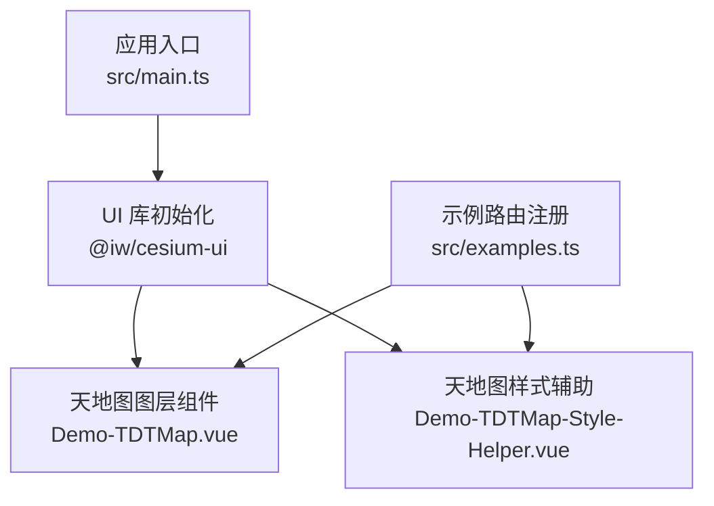
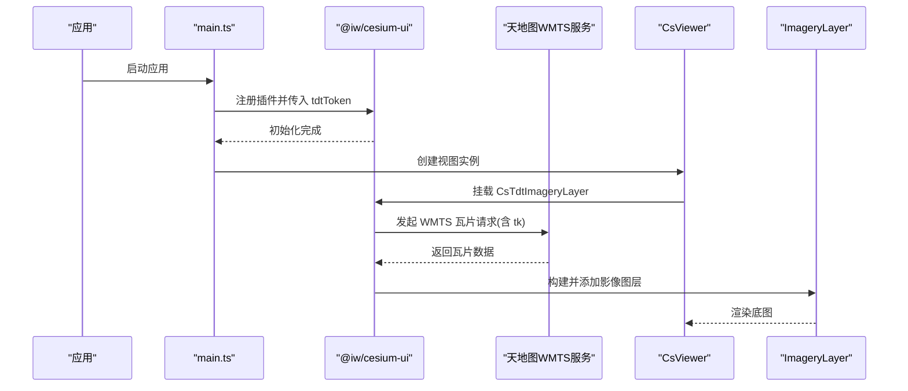
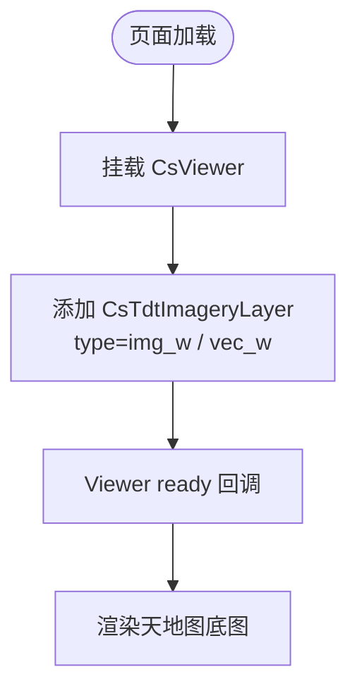
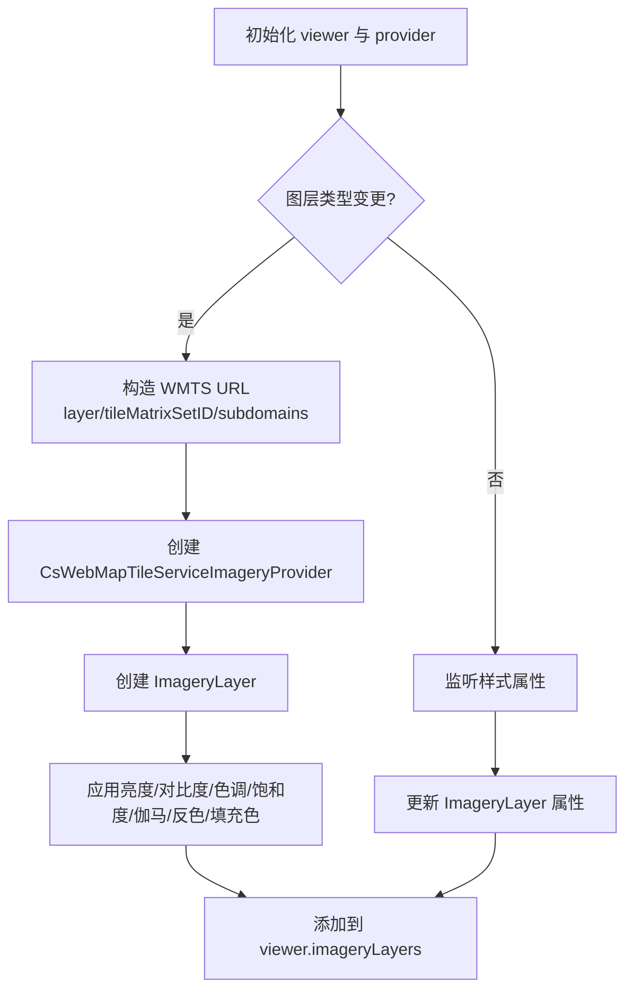
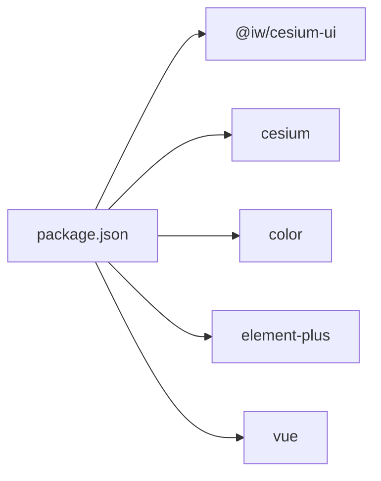

# 天地图集成

<cite>
**本文引用的文件**   
- [README.md](file://README.md)
- [package.json](file://package.json)
- [src/main.ts](file://src/main.ts)
- [src/examples.ts](file://src/examples.ts)
- [src/components/Provider/Layers/Demo-TDTMap.vue](file://src/components/Provider/Layers/Demo-TDTMap.vue)
- [src/components/Provider/Layers/Demo-TDTMap-Style-Helper.vue](file://src/components/Provider/Layers/Demo-TDTMap-Style-Helper.vue)
</cite>

## 目录
1. [简介](#简介)
2. [项目结构](#项目结构)
3. [核心组件](#核心组件)
4. [架构总览](#架构总览)
5. [详细组件分析](#详细组件分析)
6. [依赖分析](#依赖分析)
7. [性能考虑](#性能考虑)
8. [故障排查指南](#故障排查指南)
9. [结论](#结论)
10. [附录](#附录)

## 简介
本技术文档围绕“天地图”在基于 Cesium 的 Vue 3 + TypeScript 项目中的集成方式展开，重点说明：
- 天地图服务接入与 Token 配置
- 图层类型与使用场景（矢量图、影像图、地形图等）
- 样式辅助工具（颜色、透明度、叠加效果）
- 服务端与客户端调用示例
- 与高德地图的差异与选型建议
- 常见问题与性能优化技巧

本项目通过第三方 UI 库 @iw/cesium-ui 提供 CsTdtImageryLayer 等封装组件，简化了天地图瓦片服务的接入与样式控制。

## 项目结构
与天地图相关的代码主要位于 Provider/Layers 目录下，包含基础用法与样式辅助两个示例组件；全局初始化在 src/main.ts 中完成；示例路由注册在 src/examples.ts 中。

图表来源
- [src/main.ts:18-24](file://src/main.ts#L18-L24)
- [src/components/Provider/Layers/Demo-TDTMap.vue:1-59](file://src/components/Provider/Layers/Demo-TDTMap.vue#L1-L59)
- [src/components/Provider/Layers/Demo-TDTMap-Style-Helper.vue:1-187](file://src/components/Provider/Layers/Demo-TDTMap-Style-Helper.vue#L1-L187)
- [src/examples.ts:30-42](file://src/examples.ts#L30-L42)

章节来源
- [src/main.ts:18-24](file://src/main.ts#L18-L24)
- [src/examples.ts:30-42](file://src/examples.ts#L30-L42)

## 核心组件
- CsTdtImageryLayer：用于快速加载天地图底图，支持 type 属性切换不同图层（如 img_w、vec_w）。
- CsWebMapTileServiceImageryProvider：底层 WMTS 提供者，用于自定义天地图 URL、切片方案、子域名等。
- ImageryLayer：Cesium 影像图层对象，用于设置亮度、对比度、色调、饱和度、伽马值等视觉参数。

章节来源
- [src/components/Provider/Layers/Demo-TDTMap.vue:9-12](file://src/components/Provider/Layers/Demo-TDTMap.vue#L9-L12)
- [src/components/Provider/Layers/Demo-TDTMap-Style-Helper.vue:6-8](file://src/components/Provider/Layers/Demo-TDTMap-Style-Helper.vue#L6-L8)

## 架构总览
下图展示了从应用启动到渲染天地图图层的整体流程，包括全局配置、组件挂载与服务端请求。

图表来源
- [src/main.ts:18-24](file://src/main.ts#L18-L24)
- [src/components/Provider/Layers/Demo-TDTMap.vue:33-41](file://src/components/Provider/Layers/Demo-TDTMap.vue#L33-L41)
- [src/components/Provider/Layers/Demo-TDTMap-Style-Helper.vue:86-113](file://src/components/Provider/Layers/Demo-TDTMap-Style-Helper.vue#L86-L113)

## 详细组件分析

### 天地图基础用法（Demo-TDTMap.vue）
该组件演示了两种常用天地图图层：
- 影像底图：type="img_w"
- 矢量底图：type="vec_w"

要点：
- 使用 CsTdtImageryLayer 组件，通过 type 属性选择图层。
- 结合 CsMeasureDistance 测量组件进行交互。
- 适用于快速集成，无需手动构造 WMTS URL。

图表来源
- [src/components/Provider/Layers/Demo-TDTMap.vue:33-41](file://src/components/Provider/Layers/Demo-TDTMap.vue#L33-L41)

章节来源
- [src/components/Provider/Layers/Demo-TDTMap.vue:1-59](file://src/components/Provider/Layers/Demo-TDTMap.vue#L1-L59)

### 天地图样式辅助（Demo-TDTMap-Style-Helper.vue）
该组件提供了对天地图图层的精细化样式控制，包括：
- 图层类型切换：vec_w、cva_w、img_w、cia_w、ter_w
- 瓦片样式：反色、填充色
- 图层样式：亮度、对比度、色调、饱和度、伽马值
- 切片方案：根据 tileMatrixSetID 自动选择 WebMercatorTilingScheme 或 GeographicTilingScheme
- 最大层级：maximumLevel=18（天地图当前支持级别）

关键实现点：
- 使用 CsWebMapTileServiceImageryProvider 构造 WMTS 请求，拼接 tk 参数。
- 通过 subdomains 数组启用多子域并行加载。
- 监听样式变化，动态更新 ImageryLayer 和 Provider 的属性。

图表来源
- [src/components/Provider/Layers/Demo-TDTMap-Style-Helper.vue:75-115](file://src/components/Provider/Layers/Demo-TDTMap-Style-Helper.vue#L75-L115)

章节来源
- [src/components/Provider/Layers/Demo-TDTMap-Style-Helper.vue:1-187](file://src/components/Provider/Layers/Demo-TDTMap-Style-Helper.vue#L1-L187)

### 图层类型与使用场景
- 矢量底图（vec_w）：适合业务标注、路径规划、POI 展示等需要清晰道路与行政区划的场景。
- 影像底图（img_w）：适合实景观察、遥感分析、环境评估等强调真实地表纹理的场景。
- 地形晕渲（ter_w）：适合三维可视化、高程分析、地形地貌展示。
- 注记图层（cva_w、cia_w）：可与矢量/影像叠加，显示地名与注记信息。

章节来源
- [src/components/Provider/Layers/Demo-TDTMap-Style-Helper.vue:123-130](file://src/components/Provider/Layers/Demo-TDTMap-Style-Helper.vue#L123-L130)

### 样式辅助工具使用方法
- 颜色配置：通过颜色选择器设置 fillColor，内部转换为 RGBA 数组供 Provider 使用。
- 透明度：可通过 ImageryLayer 的 alpha 属性或 Provider 的 invertColor 配合色彩调整实现视觉效果。
- 图层叠加：可同时添加多个 ImageryLayer（如影像+注记），通过层级顺序控制叠加效果。
- 切片方案：根据 tileMatrixSetID 自动选择投影坐标系，确保瓦片正确对齐。

章节来源
- [src/components/Provider/Layers/Demo-TDTMap-Style-Helper.vue:101-110](file://src/components/Provider/Layers/Demo-TDTMap-Style-Helper.vue#L101-L110)
- [src/components/Provider/Layers/Demo-TDTMap-Style-Helper.vue:86-97](file://src/components/Provider/Layers/Demo-TDTMap-Style-Helper.vue#L86-L97)

### 服务端配置与客户端调用示例
- 服务端：天地图 WMTS 服务地址为 https://t{s}.tianditu.gov.cn/{layer}/{tileMatrixSetID}/wmts?tk={token}。
- 客户端：
  - 全局配置：在 main.ts 中通过 @iw/cesium-ui 的初始化参数传入 tdtToken。
  - 组件调用：在 Demo-TDTMap.vue 中使用 CsTdtImageryLayer 指定 type。
  - 高级定制：在 Demo-TDTMap-Style-Helper.vue 中直接构造 CsWebMapTileServiceImageryProvider，灵活控制 URL、subdomains、tilingScheme、maximumLevel 等。

章节来源
- [src/main.ts:18-24](file://src/main.ts#L18-L24)
- [src/components/Provider/Layers/Demo-TDTMap.vue:33-41](file://src/components/Provider/Layers/Demo-TDTMap.vue#L33-L41)
- [src/components/Provider/Layers/Demo-TDTMap-Style-Helper.vue:86-97](file://src/components/Provider/Layers/Demo-TDTMap-Style-Helper.vue#L86-L97)

### 与高德地图的区别与选择建议
- 数据来源与覆盖范围：天地图为国家地理信息公共服务平台，权威性强；高德地图商业属性更强，POI 与导航能力丰富。
- 授权与合规：天地图需申请 tk 并在请求中携带；高德地图需申请 Key 并遵循其使用协议。
- 样式与扩展：天地图侧重底图与地形；高德地图在 POI、路线规划、交通等方面生态完善。
- 选择建议：
  - 若强调权威性与合规性，优先选择天地图。
  - 若需要丰富的商业 POI、导航与交通数据，可考虑高德地图。
  - 也可组合使用：天地图作为权威底图，叠加高德 POI 或业务数据。

[本节为概念性内容，不直接分析具体文件]

## 依赖分析
项目依赖关系如下：
- 运行时依赖：@iw/cesium-ui、cesium、color、element-plus、vue
- 开发依赖：vite、typescript、unplugin-* 系列、vite-plugin-cesium-next

图表来源
- [package.json:12-17](file://package.json#L12-L17)

章节来源
- [package.json:1-31](file://package.json#L1-L31)

## 性能考虑
- 子域并行：通过 subdomains 数组提升瓦片并发下载效率。
- 层级限制：将 maximumLevel 设置为 18，避免无效的高层级请求。
- 投影匹配：根据 tileMatrixSetID 选择合适的 tilingScheme，减少瓦片错位导致的重绘。
- 样式开销：频繁调整亮度、对比度等属性会触发重绘，建议在用户交互结束后批量更新。
- 图层叠加：合理控制叠加层数量与层级顺序，避免过多 ImageryLayer 导致渲染压力。

章节来源
- [src/components/Provider/Layers/Demo-TDTMap-Style-Helper.vue:80-97](file://src/components/Provider/Layers/Demo-TDTMap-Style-Helper.vue#L80-L97)

## 故障排查指南
- 无法加载天地图：
  - 检查 tdtToken 是否正确配置于 main.ts。
  - 确认网络可达且 tk 参数已附加至 WMTS URL。
- 瓦片错位或模糊：
  - 核对 tileMatrixSetID 与 tilingScheme 是否匹配。
  - 检查 subdomains 是否与天地图服务一致。
- 样式不生效：
  - 确认 ImageryLayer 属性（brightness、contrast、hue、saturation、gamma）赋值时机。
  - 检查 fillColor 是否有效并转换为 RGBA 数组。
- 性能问题：
  - 减少不必要的样式更新频率。
  - 控制叠加图层数量与层级。

章节来源
- [src/main.ts:18-24](file://src/main.ts#L18-L24)
- [src/components/Provider/Layers/Demo-TDTMap-Style-Helper.vue:101-110](file://src/components/Provider/Layers/Demo-TDTMap-Style-Helper.vue#L101-L110)

## 结论
本项目通过 @iw/cesium-ui 提供的封装组件与底层 Provider，实现了天地图的快速接入与精细样式控制。开发者可根据业务需求选择合适的图层类型与样式策略，并结合性能优化手段获得更流畅的地图体验。对于权威地理信息与合规性要求较高的场景，天地图是可靠的选择；对于商业生态与导航能力更强的需求，可考虑高德地图或两者组合使用。

## 附录
- 示例路由注册位置：src/examples.ts
- 相关组件路径：
  - 天地图基础用法：src/components/Provider/Layers/Demo-TDTMap.vue
  - 天地图样式辅助：src/components/Provider/Layers/Demo-TDTMap-Style-Helper.vue

章节来源
- [src/examples.ts:30-42](file://src/examples.ts#L30-L42)