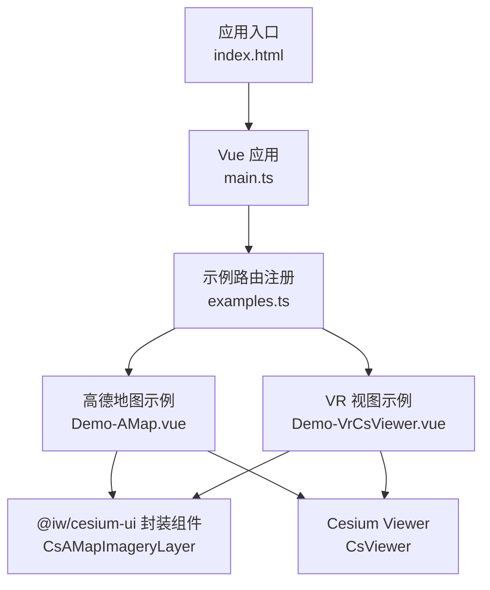
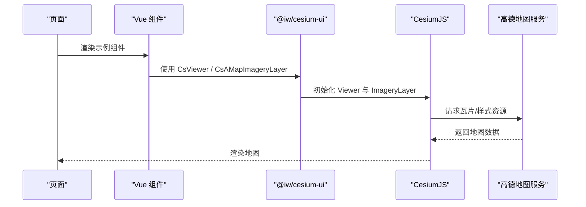
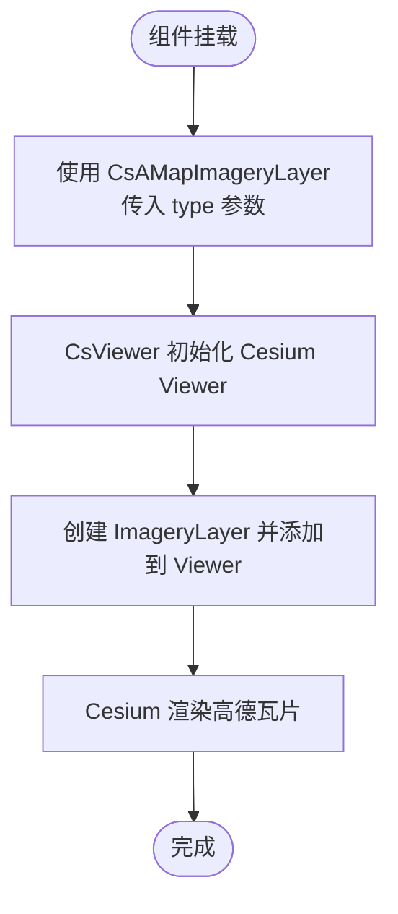
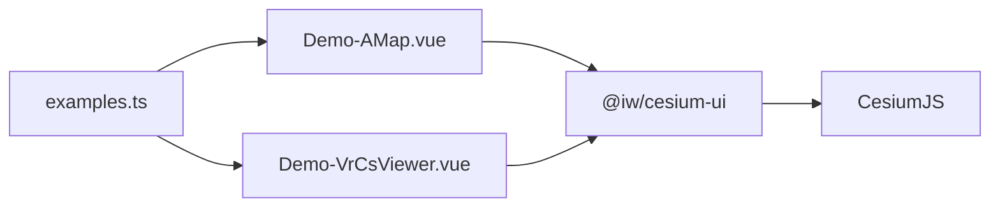

# 高德地图集成

<cite>
**本文引用的文件**   
- [Demo-AMap.vue](file://src/components/Provider/Layers/Demo-AMap.vue)
- [Demo-VrCsViewer.vue](file://src/components/Viewer/Demo-VrCsViewer.vue)
- [examples.ts](file://src/examples.ts)
- [package.json](file://package.json)
- [Demo-TDTMap-Style-Helper.vue](file://src/components/Provider/Layers/Demo-TDTMap-Style-Helper.vue)
- [Demo-WMS.vue](file://src/components/Provider/Layers/Demo-WMS.vue)
- [Demo-Terrain.vue](file://src/components/Provider/terrain/Demo-Terrain.vue)
</cite>

## 目录
1. [简介](#简介)
2. [项目结构](#项目结构)
3. [核心组件与依赖](#核心组件与依赖)
4. [架构总览](#架构总览)
5. [详细组件分析](#详细组件分析)
6. [依赖关系分析](#依赖关系分析)
7. [性能与最佳实践](#性能与最佳实践)
8. [故障排查指南](#故障排查指南)
9. [结论](#结论)
10. [附录：配置清单与示例路径](#附录配置清单与示例路径)

## 简介
本技术文档围绕在 CesiumJS 中集成高德地图服务展开，结合仓库中的示例代码，说明如何在 Vue 3 + TypeScript + Vite 环境下，通过第三方 UI 封装组件快速接入高德地图图层、地形服务，并给出样式定制、缩放级别控制、视角设置、错误处理与网络异常重试策略的实践建议。

## 项目结构
本项目采用按功能域组织的目录结构，与高德地图相关的实现集中在 Provider/Layers 与 Viewer 目录下，并通过 examples.ts 进行示例路由注册。

图表来源
- [examples.ts:35-39](file://src/examples.ts#L35-L39)
- [Demo-AMap.vue:1-67](file://src/components/Provider/Layers/Demo-AMap.vue#L1-L67)
- [Demo-VrCsViewer.vue:1-45](file://src/components/Viewer/Demo-VrCsViewer.vue#L1-L45)

章节来源
- [examples.ts:35-39](file://src/examples.ts#L35-L39)
- [Demo-AMap.vue:1-67](file://src/components/Provider/Layers/Demo-AMap.vue#L1-L67)
- [Demo-VrCsViewer.vue:1-45](file://src/components/Viewer/Demo-VrCsViewer.vue#L1-L45)

## 核心组件与依赖
- @iw/cesium-ui 提供 CsViewer、CsAMapImageryLayer、CsTerrainProvider 等封装组件，简化 CesiumJS 的初始化与图层配置。
- CesiumJS 作为底层三维地球引擎，负责渲染、相机控制、影像层与地形加载。
- Vue 3 + TypeScript + Vite 作为前端工程化基础。

章节来源
- [package.json:12-28](file://package.json#L12-L28)
- [Demo-AMap.vue:9-11](file://src/components/Provider/Layers/Demo-AMap.vue#L9-L11)
- [Demo-VrCsViewer.vue:3-5](file://src/components/Viewer/Demo-VrCsViewer.vue#L3-L5)

## 架构总览
下图展示从页面到 Cesium 渲染的高德地图集成链路，以及示例组件如何组织。

图表来源
- [Demo-AMap.vue:34-50](file://src/components/Provider/Layers/Demo-AMap.vue#L34-L50)
- [Demo-VrCsViewer.vue:19-26](file://src/components/Viewer/Demo-VrCsViewer.vue#L19-L26)

## 详细组件分析

### 高德地图图层（CsAMapImageryLayer）
- 作用：在 CsViewer 下挂载高德地图影像图层，支持通过 type 属性切换不同样式（如矢量、影像、卫星、地形等）。
- 关键用法：
  - 在模板中使用 <cs-a-map-imagery-layer type="..."></cs-a-map-imagery-layer> 指定图层类型。
  - 多个 viewer 可同时挂载不同类型的高德图层，便于对比展示。

图表来源
- [Demo-AMap.vue:34-50](file://src/components/Provider/Layers/Demo-AMap.vue#L34-L50)

章节来源
- [Demo-AMap.vue:1-67](file://src/components/Provider/Layers/Demo-AMap.vue#L1-L67)

### VR 视图下的图层挂载（CsVirtualViewer）
- 作用：在虚拟视口容器中挂载高德图层，适用于多窗口或分屏场景。
- 关键用法：
  - 使用 <cs-virtual-viewer to="cesium-viewer"> 将虚拟容器绑定到真实 viewer 节点。
  - 在虚拟容器中放置 <cs-a-map-imagery-layer type="..."> 以复用同一 viewer 实例。

章节来源
- [Demo-VrCsViewer.vue:1-45](file://src/components/Viewer/Demo-VrCsViewer.vue#L1-L45)

### 样式定制与视觉调整（参考天地图样式示例）
虽然该示例针对天地图，但其对 ImageryLayer 的亮度、对比度、色调、饱和度、伽马值以及反色、填充色的处理方式可迁移至高德图层，用于统一视觉风格。

- 常用属性：
  - brightness、contrast、hue、saturation、gamma
  - invertColor、fillColor（需配合颜色库解析）

章节来源
- [Demo-TDTMap-Style-Helper.vue:1-142](file://src/components/Provider/Layers/Demo-TDTMap-Style-Helper.vue#L1-L142)

### 视角与飞行控制（Camera.flyTo）
- 作用：在 viewer ready 后执行相机飞行，定位到目标坐标与高度。
- 适用场景：进入页面即聚焦到特定区域，提升用户体验。

章节来源
- [Demo-WMS.vue:15-22](file://src/components/Provider/Layers/Demo-WMS.vue#L15-L22)

### 地形服务（CsTerrainProvider）
- 作用：为 Cesium 提供数字高程模型（DEM），增强地表起伏表现。
- 关键用法：
  - 在 CsViewer 内添加 <cs-terrain-provider url="..."> 指定地形服务地址。
  - 也可在全局配置 terrainUrl 以统一注入。

章节来源
- [Demo-Terrain.vue:1-51](file://src/components/Provider/terrain/Demo-Terrain.vue#L1-L51)

## 依赖关系分析
- 示例组件通过 @iw/cesium-ui 暴露的封装组件与 CesiumJS 交互，降低直接操作 Cesium API 的复杂度。
- examples.ts 将高德地图示例纳入导航，便于演示与调试。

图表来源
- [examples.ts:35-39](file://src/examples.ts#L35-L39)
- [Demo-AMap.vue:9-11](file://src/components/Provider/Layers/Demo-AMap.vue#L9-L11)
- [Demo-VrCsViewer.vue:3-5](file://src/components/Viewer/Demo-VrCsViewer.vue#L3-L5)

章节来源
- [examples.ts:35-39](file://src/examples.ts#L35-L39)
- [package.json:12-28](file://package.json#L12-L28)

## 性能与最佳实践
- 按需加载与懒加载
  - 示例通过 lazy(() => import(...)) 延迟加载示例组件，减少首屏体积。
- 合理设置最大缩放级别
  - 根据底图服务限制设置 maximumLevel，避免无效请求。
- 控制图层数量与层级
  - 避免同时叠加过多 ImageryLayer；必要时使用 ImageryLayerCollection 管理显隐与透明度。
- 相机动画优化
  - 使用 flyTo 时合理设置 duration 与 easingFunction，避免频繁重绘。
- 地形与影像分离
  - 地形服务与影像服务分别配置，按需启用，减少带宽压力。
- 缓存与预取
  - 利用浏览器缓存与 CDN 加速瓦片加载；对热点区域做预取策略。

[本节为通用指导，不直接分析具体文件]

## 故障排查指南
- 图层无法加载
  - 检查 type 参数是否与服务端支持的图层类型匹配。
  - 确认网络可达性与跨域策略。
- 样式异常或偏色
  - 调整 brightness、contrast、hue、saturation、gamma 等属性。
  - 若使用反色或填充色，确保颜色格式正确。
- 视角未生效
  - 确保在 viewer ready 回调中执行 camera.flyTo。
- 地形无显示
  - 校验 terrainUrl 是否有效，服务是否支持当前坐标系与切片方案。
- 性能卡顿
  - 减少同时显示的图层与实体数量；关闭不必要的标注与效果。

章节来源
- [Demo-TDTMap-Style-Helper.vue:75-115](file://src/components/Provider/Layers/Demo-TDTMap-Style-Helper.vue#L75-L115)
- [Demo-WMS.vue:15-22](file://src/components/Provider/Layers/Demo-WMS.vue#L15-L22)
- [Demo-Terrain.vue:27-34](file://src/components/Provider/terrain/Demo-Terrain.vue#L27-L34)

## 结论
通过 @iw/cesium-ui 提供的封装组件，可在 Vue 工程中快速集成高德地图图层与地形服务，并以较低成本实现样式定制、视角控制与性能优化。示例代码展示了多种常见用法，可作为生产集成的参考基线。

[本节为总结性内容，不直接分析具体文件]

## 附录：配置清单与示例路径
- 高德地图图层
  - 示例组件：Demo-AMap.vue
  - 关键标签：<cs-a-map-imagery-layer type="...">
- VR 视图挂载
  - 示例组件：Demo-VrCsViewer.vue
  - 关键标签：<cs-virtual-viewer to="cesium-viewer">
- 样式定制（参考）
  - 示例组件：Demo-TDTMap-Style-Helper.vue
  - 关键属性：brightness、contrast、hue、saturation、gamma、invertColor、fillColor
- 视角控制
  - 示例组件：Demo-WMS.vue
  - 关键方法：viewer.camera.flyTo(...)
- 地形服务
  - 示例组件：Demo-Terrain.vue
  - 关键标签：<cs-terrain-provider url="...">
- 示例路由注册
  - 文件：examples.ts
  - 条目：高德地图、天地图、WMS、地形等

章节来源
- [Demo-AMap.vue:34-50](file://src/components/Provider/Layers/Demo-AMap.vue#L34-L50)
- [Demo-VrCsViewer.vue:19-26](file://src/components/Viewer/Demo-VrCsViewer.vue#L19-L26)
- [Demo-TDTMap-Style-Helper.vue:75-115](file://src/components/Provider/Layers/Demo-TDTMap-Style-Helper.vue#L75-L115)
- [Demo-WMS.vue:15-22](file://src/components/Provider/Layers/Demo-WMS.vue#L15-L22)
- [Demo-Terrain.vue:27-34](file://src/components/Provider/terrain/Demo-Terrain.vue#L27-L34)
- [examples.ts:35-39](file://src/examples.ts#L35-L39)