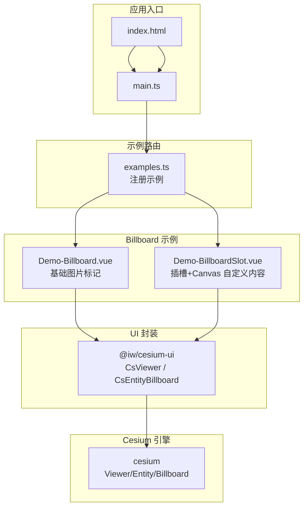
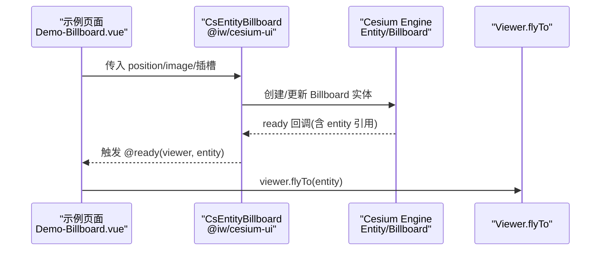
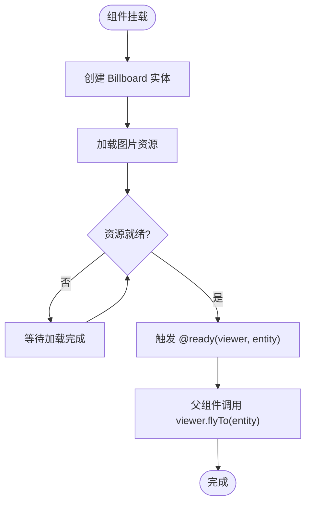
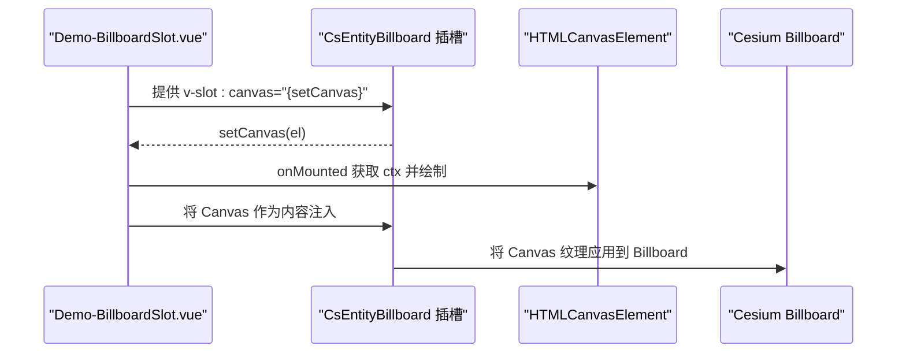
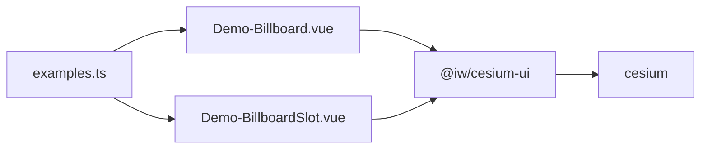

# Billboard 标记

<cite>
**本文引用的文件**   
- [Demo-Billboard.vue](file://src/components/Entity/billboard/Demo-Billboard.vue)
- [Demo-BillboardSlot.vue](file://src/components/Entity/billboard/Demo-BillboardSlot.vue)
- [package.json](file://package.json)
- [examples.ts](file://src/examples.ts)
- [components.d.ts](file://components.d.ts)
</cite>

## 目录
1. [简介](#简介)
2. [项目结构](#项目结构)
3. [核心组件与概念](#核心组件与概念)
4. [架构总览](#架构总览)
5. [详细组件分析](#详细组件分析)
6. [依赖关系分析](#依赖关系分析)
7. [性能与优化建议](#性能与优化建议)
8. [故障排查指南](#故障排查指南)
9. [结论](#结论)
10. [附录：使用模式与最佳实践](#附录使用模式与最佳实践)

## 简介
本技术文档围绕 CesiumJS 的 Billboard（贴花/面片）标记体系，结合仓库中的示例代码，系统讲解以下主题：
- Billboard 的概念、用途与优势
- 基础用法：图片资源加载、位置定位、尺寸设置、旋转角度等关键属性
- 插槽机制：如何在标记中嵌入自定义内容（如 Canvas 绘制）
- 交互事件处理、层级管理与性能优化策略
- 实际项目中的使用模式与最佳实践

Billboard 是面向屏幕的二维图形元素，始终朝向相机，适合用于地图上的图标、信息面板、动态指示器等场景。相比三维模型，Billboard 渲染开销更低、实现更简单，且易于与 DOM/Canvas 内容组合。

## 项目结构
本项目基于 Vue 3 + Vite + TypeScript，通过第三方库 @iw/cesium-ui 封装了 Cesium 的实体能力，提供 CsViewer 与 CsEntityBillboard 等组件。Billboard 相关示例位于 Entity/billboard 目录下，并通过 examples.ts 注册为可懒加载的示例页面。

图表来源
- [examples.ts:23-27](file://src/examples.ts#L23-L27)
- [Demo-Billboard.vue:1-56](file://src/components/Entity/billboard/Demo-Billboard.vue#L1-L56)
- [Demo-BillboardSlot.vue:1-67](file://src/components/Entity/billboard/Demo-BillboardSlot.vue#L1-L67)
- [package.json:12-17](file://package.json#L12-L17)

章节来源
- [examples.ts:23-27](file://src/examples.ts#L23-L27)
- [package.json:12-17](file://package.json#L12-L17)

## 核心组件与概念
- CsViewer：Cesium Viewer 的 Vue 封装，负责初始化地图、生命周期管理、事件桥接等。
- CsEntityBillboard：Cesium Entity Billboard 的 Vue 封装，暴露 position、image、size、rotation 等常用属性，并支持插槽注入自定义内容（如 canvas）。
- 插槽机制：通过具名插槽（例如 canvas）将外部 DOM/Canvas 元素注入到 Billboard 内部，由底层在合适的时机渲染为纹理或贴图。

章节来源
- [Demo-Billboard.vue:1-56](file://src/components/Entity/billboard/Demo-Billboard.vue#L1-L56)
- [Demo-BillboardSlot.vue:1-67](file://src/components/Entity/billboard/Demo-BillboardSlot.vue#L1-L67)

## 架构总览
下图展示了从示例组件到 Cesium 引擎的数据流与调用链：

图表来源
- [Demo-Billboard.vue:15-24](file://src/components/Entity/billboard/Demo-Billboard.vue#L15-L24)
- [Demo-BillboardSlot.vue:16-21](file://src/components/Entity/billboard/Demo-BillboardSlot.vue#L16-L21)

## 详细组件分析

### 基础 Billboard 标记（图片资源）
- 功能要点
  - 通过 position 指定经纬度坐标
  - 通过 image 绑定图片资源（支持 SVG/PNG 等）
  - 监听 @ready 获取 entity 后执行 flyTo 自动定位
- 关键流程
  - 组件挂载时向 Cesium 创建 Billboard
  - 资源加载完成后触发 ready 回调
  - 父组件根据 entity 进行视角跳转

图表来源
- [Demo-Billboard.vue:15-24](file://src/components/Entity/billboard/Demo-Billboard.vue#L15-L24)
- [Demo-Billboard.vue:32-37](file://src/components/Entity/billboard/Demo-Billboard.vue#L32-L37)

章节来源
- [Demo-Billboard.vue:1-56](file://src/components/Entity/billboard/Demo-Billboard.vue#L1-L56)

### 插槽机制与自定义内容（Canvas）
- 功能要点
  - 通过具名插槽（canvas）将外部 <canvas> 注入到 Billboard
  - 在 onMounted 中获取 Canvas 上下文并进行绘制
  - 插槽函数 setCanvas 用于将 DOM 元素回传给子组件以完成绑定
- 关键流程
  - 模板中声明插槽并提供 setCanvas
  - 父组件在 mounted 阶段绘制 Canvas
  - 子组件将 Canvas 作为纹理应用到 Billboard

图表来源
- [Demo-BillboardSlot.vue:24-33](file://src/components/Entity/billboard/Demo-BillboardSlot.vue#L24-L33)
- [Demo-BillboardSlot.vue:42-47](file://src/components/Entity/billboard/Demo-BillboardSlot.vue#L42-L47)

章节来源
- [Demo-BillboardSlot.vue:1-67](file://src/components/Entity/billboard/Demo-BillboardSlot.vue#L1-L67)

### 属性与配置说明（基于示例用法归纳）
- position：经纬度数组，用于定位 Billboard 在地球表面的位置
- image：图片路径或对象，用于显示图标
- size：控制 Billboard 在屏幕上的像素尺寸（示例未直接展示，但属于常见属性）
- rotation：旋转角度（示例未直接展示，但属于常见属性）
- 插槽 canvas：用于注入自定义 Canvas 内容

注意：上述属性定义来自对示例用法的归纳与通用 API 理解；具体类型与默认值以 @iw/cesium-ui 的实际实现为准。

章节来源
- [Demo-Billboard.vue:32-37](file://src/components/Entity/billboard/Demo-Billboard.vue#L32-L37)
- [Demo-BillboardSlot.vue:42-47](file://src/components/Entity/billboard/Demo-BillboardSlot.vue#L42-L47)

## 依赖关系分析
- 示例组件依赖 @iw/cesium-ui 提供的 CsViewer 与 CsEntityBillboard
- @iw/cesium-ui 依赖 cesium 引擎
- 示例通过 examples.ts 注册为懒加载页面，提升首屏性能

图表来源
- [examples.ts:23-27](file://src/examples.ts#L23-L27)
- [package.json:12-17](file://package.json#L12-L17)

章节来源
- [examples.ts:23-27](file://src/examples.ts#L23-L27)
- [package.json:12-17](file://package.json#L12-L17)

## 性能与优化建议
- 资源复用与缓存
  - 复用相同的图片资源，避免重复加载
  - 对频繁更新的 Canvas 内容采用离屏 Canvas 缓存，减少重绘
- 批量操作
  - 大量 Billboard 建议使用集合或批量更新接口，避免频繁创建销毁
- 视锥裁剪与可见性
  - 根据缩放级别控制 Billboard 的显示/隐藏，减少不可见元素的渲染
- 纹理尺寸
  - 合理设置图片尺寸，避免过大纹理导致内存压力
- 插槽内容更新频率
  - 对高频更新的 Canvas 内容，降低刷新频率或使用增量绘制

[本节为通用指导，不直接分析具体文件]

## 故障排查指南
- 图片资源未显示
  - 检查 image 路径是否正确、是否被打包工具正确处理（SVG/PNG）
  - 确认浏览器控制台是否存在跨域或加载失败错误
- Canvas 插槽未生效
  - 确保在 onMounted 之后才访问 Canvas DOM
  - 检查 setCanvas 是否正确拿到元素引用
- 视角跳转无效
  - 确认 @ready 回调已触发，并在回调内调用 viewer.flyTo(entity)
- 性能问题
  - 检查是否一次性创建过多 Billboard
  - 评估 Canvas 绘制复杂度与刷新频率

章节来源
- [Demo-Billboard.vue:15-24](file://src/components/Entity/billboard/Demo-Billboard.vue#L15-L24)
- [Demo-BillboardSlot.vue:24-33](file://src/components/Entity/billboard/Demo-BillboardSlot.vue#L24-L33)

## 结论
本项目通过 @iw/cesium-ui 提供了简洁易用的 CsEntityBillboard 组件，配合 Vue 插槽机制，能够灵活地在地图上放置图标、信息面板与动态内容。示例展示了基础的图片标记与 Canvas 插槽用法，并结合 Cesium 的 flyTo 实现了自动定位。在实际项目中，应关注资源复用、批量更新、可视范围控制与 Canvas 绘制优化，以获得更好的性能与用户体验。

[本节为总结性内容，不直接分析具体文件]

## 附录：使用模式与最佳实践
- 基础图标标记
  - 使用 position 定位，image 指定图标，监听 @ready 后执行 flyTo
- 信息面板
  - 使用插槽 canvas 绘制复杂信息面板，按需更新内容
- 动态内容
  - 对需要动画或实时数据的场景，使用离屏 Canvas 缓存与节流更新
- 层级管理
  - 通过 Cesium 的 zIndex 或图层顺序控制 Billboard 的叠加关系
- 交互事件
  - 在 @ready 回调中为 entity 绑定点击、悬停等事件，结合 UI 层展示详情

章节来源
- [Demo-Billboard.vue:32-37](file://src/components/Entity/billboard/Demo-Billboard.vue#L32-L37)
- [Demo-BillboardSlot.vue:42-47](file://src/components/Entity/billboard/Demo-BillboardSlot.vue#L42-L47)