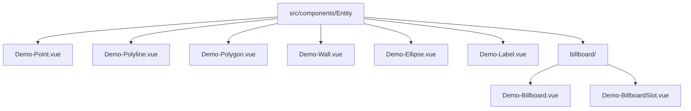
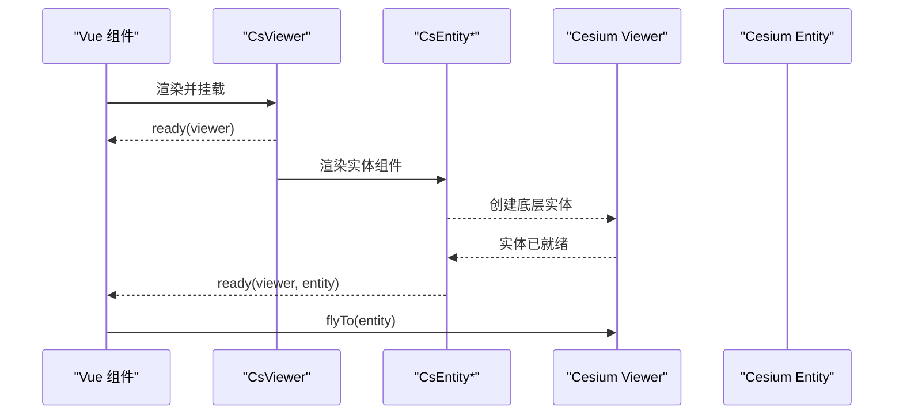
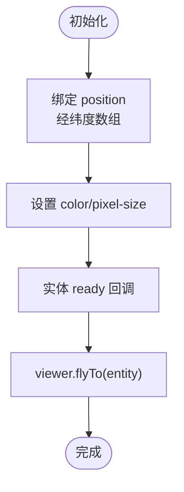
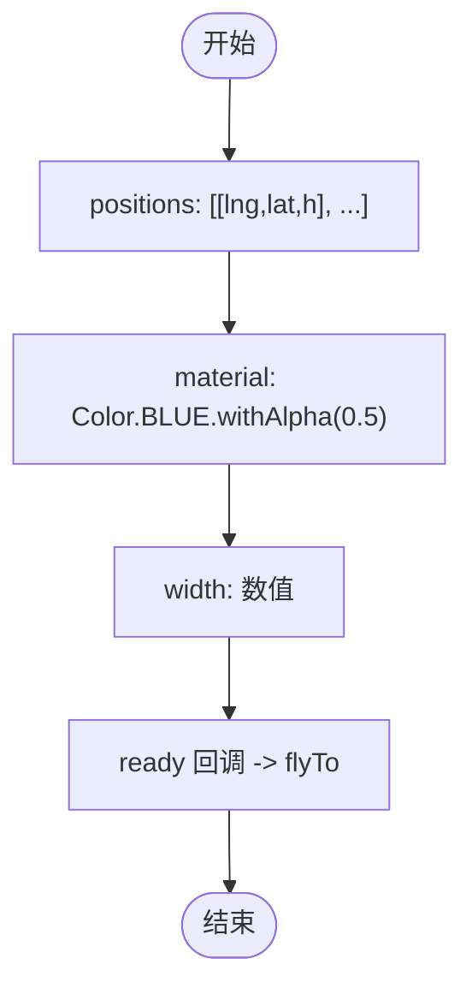
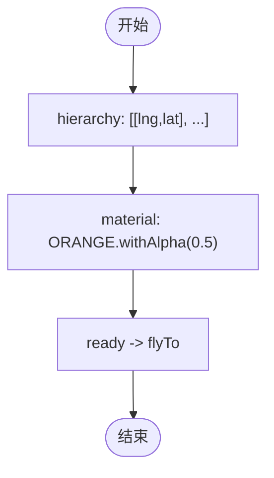
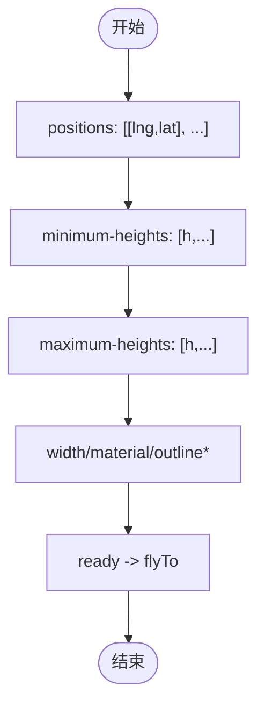
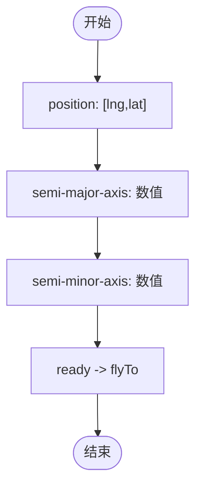
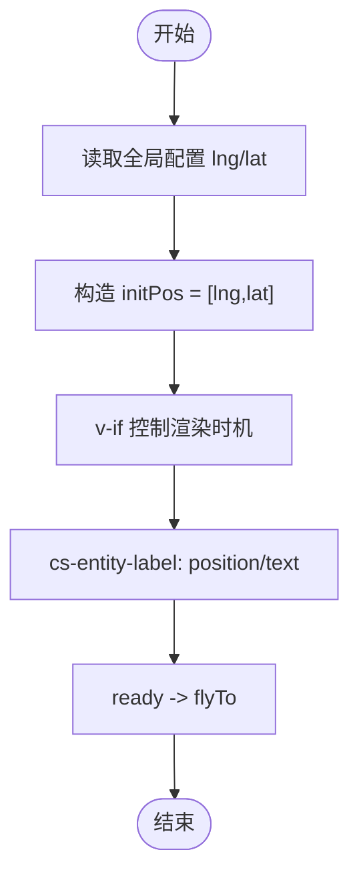
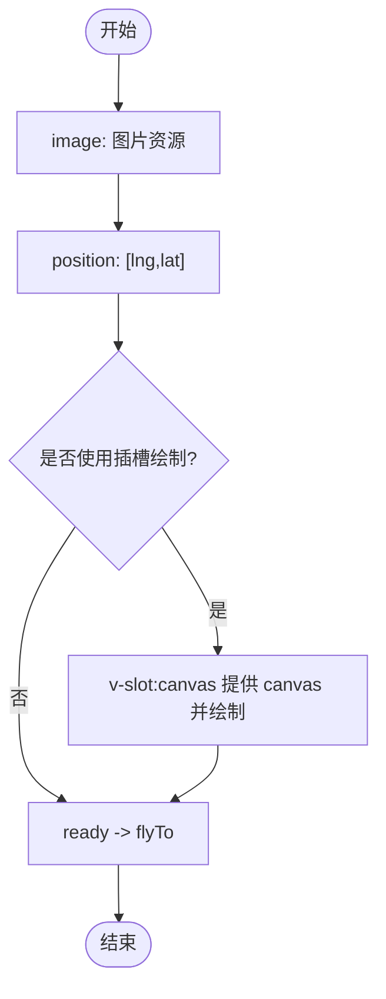
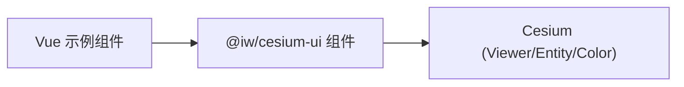

# 基础实体

<cite>
**本文引用的文件**   
- [Demo-Point.vue](file://src/components/Entity/Demo-Point.vue)
- [Demo-Polyline.vue](file://src/components/Entity/Demo-Polyline.vue)
- [Demo-Polygon.vue](file://src/components/Entity/Demo-Polygon.vue)
- [Demo-Wall.vue](file://src/components/Entity/Demo-Wall.vue)
- [Demo-Ellipse.vue](file://src/components/Entity/Demo-Ellipse.vue)
- [Demo-Label.vue](file://src/components/Entity/Demo-Label.vue)
- [Demo-Billboard.vue](file://src/components/Entity/billboard/Demo-Billboard.vue)
- [Demo-BillboardSlot.vue](file://src/components/Entity/billboard/Demo-BillboardSlot.vue)
</cite>

## 目录
1. [简介](#简介)
2. [项目结构](#项目结构)
3. [核心组件总览](#核心组件总览)
4. [架构概览](#架构概览)
5. [详细组件分析](#详细组件分析)
6. [依赖关系分析](#依赖关系分析)
7. [性能与优化](#性能与优化)
8. [常见问题与排错](#常见问题与排错)
9. [结论](#结论)
10. [附录：属性速查](#附录属性速查)

## 简介
本技术文档围绕 CesiumJS 基础实体组件，系统讲解点（Point）、折线（Polyline）、多边形（Polygon）、墙体（Wall）、椭圆（Ellipse）和标签（Label）等核心实体的创建方法、关键属性配置与样式定制。文档结合仓库中的示例组件，说明位置定义、几何参数、颜色设置、透明度控制、动态更新与事件处理，并给出生命周期管理、性能优化技巧以及与三维场景交互的最佳实践。

## 项目结构
本项目采用按功能域组织的前端工程结构，实体相关示例集中在 src/components/Entity 目录下，每个基础实体对应一个演示组件；图标（Billboard）示例位于子目录 billboard 下。

图表来源
- [Demo-Point.vue:1-63](file://src/components/Entity/Demo-Point.vue#L1-L63)
- [Demo-Polyline.vue:1-68](file://src/components/Entity/Demo-Polyline.vue#L1-L68)
- [Demo-Polygon.vue:1-65](file://src/components/Entity/Demo-Polygon.vue#L1-L65)
- [Demo-Wall.vue:1-73](file://src/components/Entity/Demo-Wall.vue#L1-L73)
- [Demo-Ellipse.vue:1-63](file://src/components/Entity/Demo-Ellipse.vue#L1-L63)
- [Demo-Label.vue:1-79](file://src/components/Entity/Demo-Label.vue#L1-L79)
- [Demo-Billboard.vue:1-56](file://src/components/Entity/billboard/Demo-Billboard.vue#L1-L56)
- [Demo-BillboardSlot.vue:1-67](file://src/components/Entity/billboard/Demo-BillboardSlot.vue#L1-L67)

章节来源
- [Demo-Point.vue:1-63](file://src/components/Entity/Demo-Point.vue#L1-L63)
- [Demo-Polyline.vue:1-68](file://src/components/Entity/Demo-Polyline.vue#L1-L68)
- [Demo-Polygon.vue:1-65](file://src/components/Entity/Demo-Polygon.vue#L1-L65)
- [Demo-Wall.vue:1-73](file://src/components/Entity/Demo-Wall.vue#L1-L73)
- [Demo-Ellipse.vue:1-63](file://src/components/Entity/Demo-Ellipse.vue#L1-L63)
- [Demo-Label.vue:1-79](file://src/components/Entity/Demo-Label.vue#L1-L79)
- [Demo-Billboard.vue:1-56](file://src/components/Entity/billboard/Demo-Billboard.vue#L1-L56)
- [Demo-BillboardSlot.vue:1-67](file://src/components/Entity/billboard/Demo-BillboardSlot.vue#L1-L67)

## 核心组件总览
- CsEntityPoint：点实体，支持像素尺寸、颜色等样式。
- CsEntityPolyline：折线实体，支持点位序列、宽度、材质（含透明度）。
- CsEntityPolygon：多边形实体，支持顶点序列、填充材质。
- CsEntityWall：墙体实体，支持轮廓线、最小/最大高度数组、材质与描边。
- CsEntityEllipse：椭圆实体，支持中心位置、半长轴/半短轴。
- CsEntityLabel：标签实体，支持文本内容与位置。
- CsEntityBillboard：面片（图标）实体，支持图片资源或自定义 Canvas。

章节来源
- [Demo-Point.vue:1-63](file://src/components/Entity/Demo-Point.vue#L1-L63)
- [Demo-Polyline.vue:1-68](file://src/components/Entity/Demo-Polyline.vue#L1-L68)
- [Demo-Polygon.vue:1-65](file://src/components/Entity/Demo-Polygon.vue#L1-L65)
- [Demo-Wall.vue:1-73](file://src/components/Entity/Demo-Wall.vue#L1-L73)
- [Demo-Ellipse.vue:1-63](file://src/components/Entity/Demo-Ellipse.vue#L1-L63)
- [Demo-Label.vue:1-79](file://src/components/Entity/Demo-Label.vue#L1-L79)
- [Demo-Billboard.vue:1-56](file://src/components/Entity/billboard/Demo-Billboard.vue#L1-L56)
- [Demo-BillboardSlot.vue:1-67](file://src/components/Entity/billboard/Demo-BillboardSlot.vue#L1-L67)

## 架构概览
以下时序图展示从 Vue 组件到 Cesium 实体的典型加载流程，包括 Viewer 就绪回调、实体就绪回调以及自动飞行定位。

图表来源
- [Demo-Point.vue:14-30](file://src/components/Entity/Demo-Point.vue#L14-L30)
- [Demo-Polyline.vue:14-30](file://src/components/Entity/Demo-Polyline.vue#L14-L30)
- [Demo-Polygon.vue:12-28](file://src/components/Entity/Demo-Polygon.vue#L12-L28)
- [Demo-Wall.vue:14-30](file://src/components/Entity/Demo-Wall.vue#L14-L30)
- [Demo-Ellipse.vue:14-30](file://src/components/Entity/Demo-Ellipse.vue#L14-L30)
- [Demo-Label.vue:14-30](file://src/components/Entity/Demo-Label.vue#L14-L30)
- [Demo-Billboard.vue:15-24](file://src/components/Entity/billboard/Demo-Billboard.vue#L15-L24)

## 详细组件分析

### 点（Point）
- 位置定义：通过 position 传入经纬度坐标数组。
- 样式定制：pixel-size 控制像素尺寸；color 使用 Cesium Color 常量或实例。
- 生命周期：在 handleEntityReady 中可获取实体对象并进行 flyTo 等操作。
- 动态更新：可通过响应式变量绑定 pixel-size/color 实现运行时更新。

图表来源
- [Demo-Point.vue:38-44](file://src/components/Entity/Demo-Point.vue#L38-L44)
- [Demo-Point.vue:23-30](file://src/components/Entity/Demo-Point.vue#L23-L30)

章节来源
- [Demo-Point.vue:1-63](file://src/components/Entity/Demo-Point.vue#L1-L63)

### 折线（Polyline）
- 位置定义：positions 为二维数组，每项为 [经度, 纬度, 高度]。
- 样式定制：width 设置线宽；material 使用 Color.withAlpha 控制透明度。
- 生命周期：ready 回调中可执行 flyTo 定位。
- 动态更新：修改 positions 或 material 可驱动折线重绘。

图表来源
- [Demo-Polyline.vue:39-49](file://src/components/Entity/Demo-Polyline.vue#L39-L49)
- [Demo-Polyline.vue:23-30](file://src/components/Entity/Demo-Polyline.vue#L23-L30)

章节来源
- [Demo-Polyline.vue:1-68](file://src/components/Entity/Demo-Polyline.vue#L1-L68)

### 多边形（Polygon）
- 位置定义：hierarchy 为二维数组，表示多边形顶点环。
- 样式定制：material 使用带透明度的颜色进行填充。
- 生命周期：ready 回调中可进行相机定位。
- 动态更新：变更 hierarchy 或 material 触发重绘。

图表来源
- [Demo-Polygon.vue:37-46](file://src/components/Entity/Demo-Polygon.vue#L37-L46)
- [Demo-Polygon.vue:21-28](file://src/components/Entity/Demo-Polygon.vue#L21-L28)

章节来源
- [Demo-Polygon.vue:1-65](file://src/components/Entity/Demo-Polygon.vue#L1-L65)

### 墙体（Wall）
- 位置定义：positions 为二维数组，表示墙底边路径。
- 高度控制：minimum-heights 与 maximum-heights 为等长数组，定义每段墙高范围。
- 样式定制：width 设置线宽；material 设置填充材质；outline/outline-color/outline-width 控制轮廓。
- 生命周期：ready 回调中进行 flyTo。
- 动态更新：修改 heights 数组或 outline 相关属性可实时更新墙体外观。

图表来源
- [Demo-Wall.vue:39-54](file://src/components/Entity/Demo-Wall.vue#L39-L54)
- [Demo-Wall.vue:23-30](file://src/components/Entity/Demo-Wall.vue#L23-L30)

章节来源
- [Demo-Wall.vue:1-73](file://src/components/Entity/Demo-Wall.vue#L1-L73)

### 椭圆（Ellipse）
- 位置定义：position 为中心点经纬度。
- 几何参数：semi-major-axis 与 semi-minor-axis 分别设置半长轴与半短轴（单位通常为米）。
- 样式定制：可进一步设置 material（示例未显式设置）。
- 生命周期：ready 回调中进行 flyTo。
- 动态更新：修改半径参数可实时调整椭圆大小。

图表来源
- [Demo-Ellipse.vue:39-44](file://src/components/Entity/Demo-Ellipse.vue#L39-L44)
- [Demo-Ellipse.vue:23-30](file://src/components/Entity/Demo-Ellipse.vue#L23-L30)

章节来源
- [Demo-Ellipse.vue:1-63](file://src/components/Entity/Demo-Ellipse.vue#L1-L63)

### 标签（Label）
- 位置定义：position 为经纬度数组。
- 文本内容：text 属性设置显示文字。
- 生命周期：ready 回调中进行 flyTo。
- 动态更新：可结合全局配置与 v-if 控制显示时机，避免初始数据缺失导致的渲染问题。

图表来源
- [Demo-Label.vue:37-48](file://src/components/Entity/Demo-Label.vue#L37-L48)
- [Demo-Label.vue:55-60](file://src/components/Entity/Demo-Label.vue#L55-L60)
- [Demo-Label.vue:23-30](file://src/components/Entity/Demo-Label.vue#L23-L30)

章节来源
- [Demo-Label.vue:1-79](file://src/components/Entity/Demo-Label.vue#L1-L79)

### 面片（Billboard）
- 图片模式：image 属性直接绑定图片资源。
- Canvas 模式：通过插槽提供 canvas 元素，并在 mounted 后绘制图形。
- 位置定义：position 为经纬度数组。
- 生命周期：ready 回调中进行 flyTo。

图表来源
- [Demo-Billboard.vue:33-37](file://src/components/Entity/billboard/Demo-Billboard.vue#L33-L37)
- [Demo-BillboardSlot.vue:42-47](file://src/components/Entity/billboard/Demo-BillboardSlot.vue#L42-L47)
- [Demo-Billboard.vue:19-24](file://src/components/Entity/billboard/Demo-Billboard.vue#L19-L24)

章节来源
- [Demo-Billboard.vue:1-56](file://src/components/Entity/billboard/Demo-Billboard.vue#L1-L56)
- [Demo-BillboardSlot.vue:1-67](file://src/components/Entity/billboard/Demo-BillboardSlot.vue#L1-L67)

## 依赖关系分析
- 外部库依赖：所有示例均引入 Cesium 的 Viewer、Entity、Color 等类型与常量，并通过 @iw/cesium-ui 提供的 CsViewer 与各 CsEntity* 组件封装底层 Cesium 实体。
- 组件耦合：示例组件仅负责数据绑定与事件处理，具体渲染逻辑由封装组件完成，降低业务代码复杂度。
- 生命周期钩子：统一通过 @ready 暴露 viewer 与 entity，便于统一处理相机定位与后续操作。

图表来源
- [Demo-Point.vue:4-6](file://src/components/Entity/Demo-Point.vue#L4-L6)
- [Demo-Polyline.vue:4-6](file://src/components/Entity/Demo-Polyline.vue#L4-L6)
- [Demo-Polygon.vue:4-6](file://src/components/Entity/Demo-Polygon.vue#L4-L6)
- [Demo-Wall.vue:4-6](file://src/components/Entity/Demo-Wall.vue#L4-L6)
- [Demo-Ellipse.vue:4-6](file://src/components/Entity/Demo-Ellipse.vue#L4-L6)
- [Demo-Label.vue:4-6](file://src/components/Entity/Demo-Label.vue#L4-L6)
- [Demo-Billboard.vue:4-6](file://src/components/Entity/billboard/Demo-Billboard.vue#L4-L6)
- [Demo-BillboardSlot.vue:4-6](file://src/components/Entity/billboard/Demo-BillboardSlot.vue#L4-L6)

章节来源
- [Demo-Point.vue:1-63](file://src/components/Entity/Demo-Point.vue#L1-L63)
- [Demo-Polyline.vue:1-68](file://src/components/Entity/Demo-Polyline.vue#L1-L68)
- [Demo-Polygon.vue:1-65](file://src/components/Entity/Demo-Polygon.vue#L1-L65)
- [Demo-Wall.vue:1-73](file://src/components/Entity/Demo-Wall.vue#L1-L73)
- [Demo-Ellipse.vue:1-63](file://src/components/Entity/Demo-Ellipse.vue#L1-L63)
- [Demo-Label.vue:1-79](file://src/components/Entity/Demo-Label.vue#L1-L79)
- [Demo-Billboard.vue:1-56](file://src/components/Entity/billboard/Demo-Billboard.vue#L1-L56)
- [Demo-BillboardSlot.vue:1-67](file://src/components/Entity/billboard/Demo-BillboardSlot.vue#L1-L67)

## 性能与优化
- 批量渲染：将多个同类型实体合并为集合或使用图层管理，减少重复创建开销。
- 材质复用：对相同颜色的材质进行缓存复用，避免频繁创建 Color 实例。
- 延迟渲染：对于标签等重型元素，结合 v-if 与 nextTick 确保数据就绪后再渲染，避免无效计算。
- 合理层级：墙体等高差较大的实体应谨慎使用过多分段，避免过度细分导致三角面增多。
- 视锥剔除：利用可见性控制与距离阈值隐藏远端实体，降低绘制压力。
- 事件节流：对频繁更新的属性（如 positions）进行节流或增量更新，避免每帧全量替换。

[本节为通用指导，不直接分析具体文件]

## 常见问题与排错
- 实体 ready 回调未触发
  - 检查 CsViewer 是否正确挂载且 ready 事件已监听。
  - 确认实体所需必填属性（如 position、positions/hierarchy）已正确传入。
- 位置不生效或偏移异常
  - 确认经纬度顺序为 [经度, 纬度]，必要时添加高度值。
- 透明度不生效
  - 折线/多边形需使用 Color.withAlpha 生成带透明度的材质。
- 墙体轮廓不显示
  - 确保 outline 为 true，并设置 outline-color 与 outline-width。
- 标签未显示
  - 检查 v-if 条件与全局配置是否已赋值，必要时使用 nextTick 确保 DOM 就绪。
- Billboard 图片不显示
  - 确认 image 路径有效；若使用 Canvas 插槽，确保在 mounted 后绘制并正确传递 canvas 引用。

章节来源
- [Demo-Label.vue:37-48](file://src/components/Entity/Demo-Label.vue#L37-L48)
- [Demo-BillboardSlot.vue:24-33](file://src/components/Entity/billboard/Demo-BillboardSlot.vue#L24-L33)
- [Demo-Wall.vue:46-53](file://src/components/Entity/Demo-Wall.vue#L46-L53)
- [Demo-Polyline.vue:46-48](file://src/components/Entity/Demo-Polyline.vue#L46-L48)

## 结论
通过 @iw/cesium-ui 提供的实体组件，开发者可以以声明式方式快速构建 Cesium 基础实体，并通过统一的 ready 回调进行相机定位与后续交互。结合响应式数据绑定，可实现实体的动态更新与样式定制。遵循本文的性能优化建议与常见问题排查步骤，可在复杂三维场景中稳定高效地呈现各类基础实体。

[本节为总结性内容，不直接分析具体文件]

## 附录：属性速查
- Point
  - position: 经纬度数组
  - pixel-size: 像素尺寸
  - color: 颜色（Cesium Color）
- Polyline
  - positions: 二维数组 [lng,lat,h]
  - width: 线宽
  - material: 材质（支持 withAlpha）
- Polygon
  - hierarchy: 二维数组 [lng,lat]
  - material: 材质（支持 withAlpha）
- Wall
  - positions: 二维数组 [lng,lat]
  - minimum-heights: 高度数组
  - maximum-heights: 高度数组
  - width: 线宽
  - material: 材质
  - outline / outline-color / outline-width: 轮廓控制
- Ellipse
  - position: 中心经纬度
  - semi-major-axis: 半长轴
  - semi-minor-axis: 半短轴
- Label
  - position: 经纬度数组
  - text: 文本内容
- Billboard
  - position: 经纬度数组
  - image: 图片资源
  - 插槽 canvas: 自定义绘制

章节来源
- [Demo-Point.vue:38-44](file://src/components/Entity/Demo-Point.vue#L38-L44)
- [Demo-Polyline.vue:39-49](file://src/components/Entity/Demo-Polyline.vue#L39-L49)
- [Demo-Polygon.vue:37-46](file://src/components/Entity/Demo-Polygon.vue#L37-L46)
- [Demo-Wall.vue:39-54](file://src/components/Entity/Demo-Wall.vue#L39-L54)
- [Demo-Ellipse.vue:39-44](file://src/components/Entity/Demo-Ellipse.vue#L39-L44)
- [Demo-Label.vue:55-60](file://src/components/Entity/Demo-Label.vue#L55-L60)
- [Demo-Billboard.vue:33-37](file://src/components/Entity/billboard/Demo-Billboard.vue#L33-L37)
- [Demo-BillboardSlot.vue:42-47](file://src/components/Entity/billboard/Demo-BillboardSlot.vue#L42-L47)