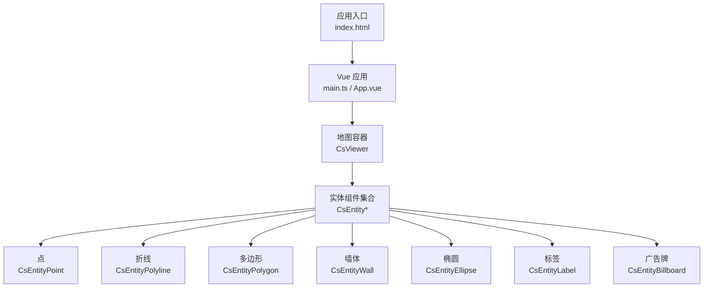
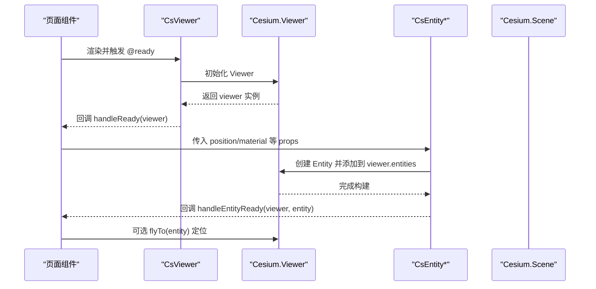
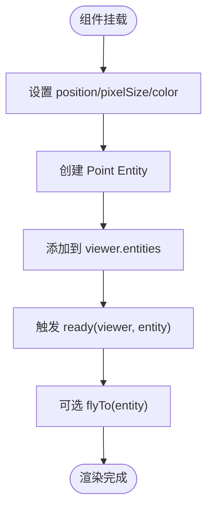
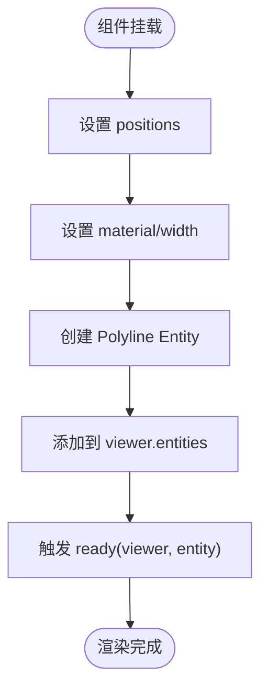
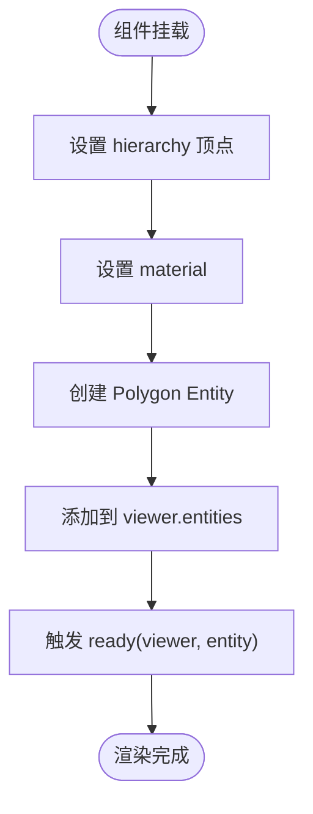
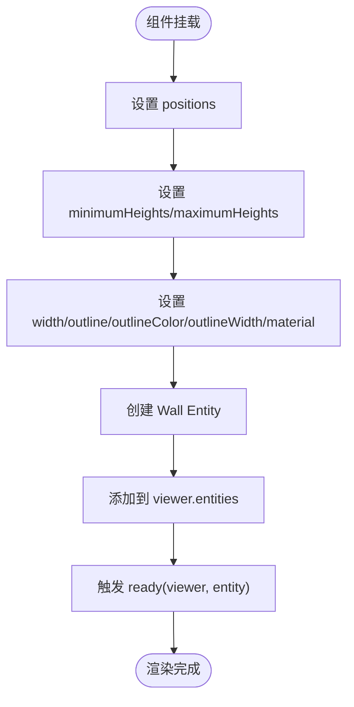
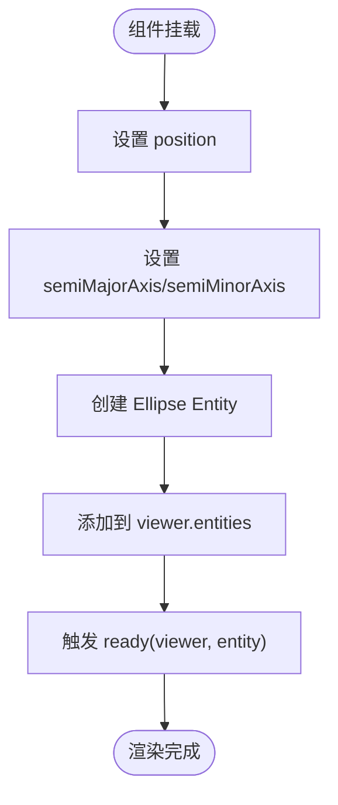
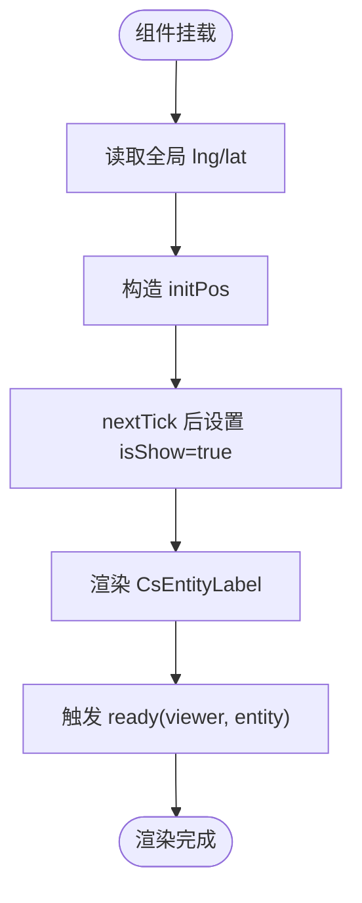
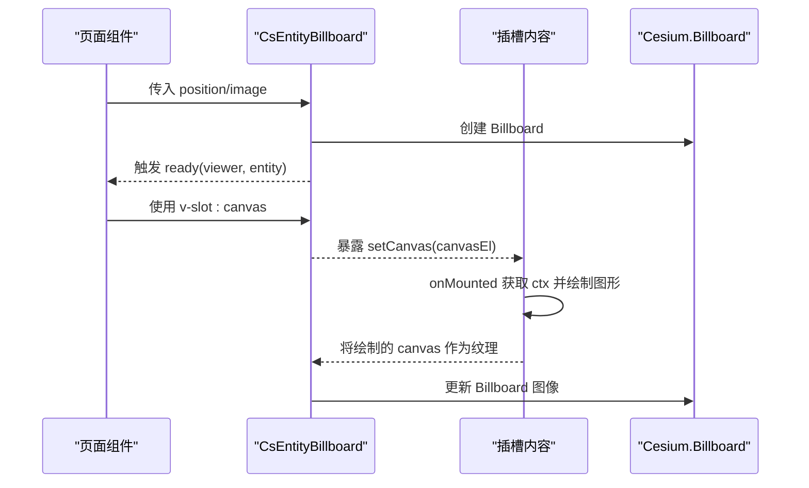
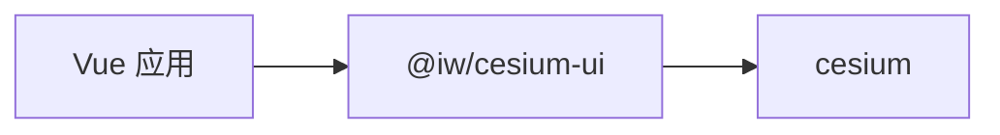

# 实体系统

<cite>
**本文引用的文件**   
- [README.md](file://README.md)
- [package.json](file://package.json)
- [Demo-Billboard.vue](file://src/components/Entity/billboard/Demo-Billboard.vue)
- [Demo-BillboardSlot.vue](file://src/components/Entity/billboard/Demo-BillboardSlot.vue)
- [Demo-Point.vue](file://src/components\Entity\Demo-Point.vue)
- [Demo-Polyline.vue](file://src/components\Entity\Demo-Polyline.vue)
- [Demo-Polygon.vue](file://src/components\Entity\Demo-Polygon.vue)
- [Demo-Wall.vue](file://src/components\Entity\Demo-Wall.vue)
- [Demo-Ellipse.vue](file://src/components\Entity\Demo-Ellipse.vue)
- [Demo-Label.vue](file://src/components\Entity\Demo-Label.vue)
</cite>

## 目录
1. [简介](#简介)
2. [项目结构](#项目结构)
3. [核心组件与实体类型](#核心组件与实体类型)
4. [架构总览](#架构总览)
5. [详细组件分析](#详细组件分析)
6. [依赖关系分析](#依赖关系分析)
7. [性能与优化](#性能与优化)
8. [故障排查](#故障排查)
9. [结论](#结论)

## 简介
本技术文档围绕 CesiumJS 的实体系统，结合仓库中的示例组件，系统性说明点、线、面、墙体、椭圆、标签等实体的创建方式、属性配置与样式定制；重点解析 Billboard 标记系统的基础用法与插槽机制；并给出生命周期管理、事件处理、三维场景交互模式与性能优化实践。所有示例均基于 Vue 3 + TypeScript + Vite 工程，使用第三方库 @iw/cesium-ui 提供的 CsViewer 与各类 CsEntity* 组件封装。

## 项目结构
本项目采用按功能域组织的目录结构，实体相关示例集中在 src/components/Entity 下，Billboard 示例位于子目录 billboard。根级 README 为模板说明，package.json 声明了 cesium 与 @iw/cesium-ui 等依赖。

图表来源
- [package.json:12-17](file://package.json#L12-L17)

章节来源
- [README.md:1-6](file://README.md#L1-L6)
- [package.json:1-31](file://package.json#L1-L31)

## 核心组件与实体类型
- CsViewer：Cesium Viewer 的 Vue 封装，负责初始化地图并提供 ready 事件回调。
- CsEntityPoint：点实体，支持位置、像素大小、颜色等基础样式。
- CsEntityPolyline：折线实体，支持点位序列、宽度、材质（颜色/透明度）。
- CsEntityPolygon：多边形实体，支持层级（hierarchy）顶点数组、填充材质。
- CsEntityWall：墙体实体，支持轮廓边、最小/最大高度、材质与描边。
- CsEntityEllipse：椭圆实体，支持中心位置、半长轴/半短轴。
- CsEntityLabel：标签实体，支持文本、位置、可见性控制。
- CsEntityBillboard：广告牌实体，支持图片、位置、插槽 canvas 自定义绘制。

章节来源
- [Demo-Point.vue:1-63](file://src/components\Entity\Demo-Point.vue#L1-L63)
- [Demo-Polyline.vue:1-68](file://src/components\Entity\Demo-Polyline.vue#L1-L68)
- [Demo-Polygon.vue:1-65](file://src/components\Entity\Demo-Polygon.vue#L1-L65)
- [Demo-Wall.vue:1-73](file://src/components\Entity\Demo-Wall.vue#L1-L73)
- [Demo-Ellipse.vue:1-63](file://src/components\Entity\Demo-Ellipse.vue#L1-L63)
- [Demo-Label.vue:1-79](file://src/components\Entity\Demo-Label.vue#L1-L79)
- [Demo-Billboard.vue:1-56](file://src/components/Entity/billboard/Demo-Billboard.vue#L1-L56)
- [Demo-BillboardSlot.vue:1-67](file://src/components/Entity/billboard/Demo-BillboardSlot.vue#L1-L67)

## 架构总览
下图展示从页面到 Cesium 渲染的关键调用链：Vue 组件通过 CsViewer 暴露 ready 事件，内部实例化 Cesium Viewer；实体组件在挂载后向 Viewer 添加对应 Entity，并在 ready 回调中返回底层 entity 对象供上层业务使用。

图表来源
- [Demo-Point.vue:14-30](file://src/components\Entity\Demo-Point.vue#L14-L30)
- [Demo-Polyline.vue:14-30](file://src/components\Entity\Demo-Polyline.vue#L14-L30)
- [Demo-Polygon.vue:12-28](file://src/components\Entity\Demo-Polygon.vue#L12-L28)
- [Demo-Wall.vue:14-30](file://src/components\Entity\Demo-Wall.vue#L14-L30)
- [Demo-Ellipse.vue:14-30](file://src/components\Entity\Demo-Ellipse.vue#L14-L30)
- [Demo-Label.vue:14-30](file://src/components\Entity\Demo-Label.vue#L14-L30)
- [Demo-Billboard.vue:15-24](file://src/components/Entity/billboard/Demo-Billboard.vue#L15-L24)
- [Demo-BillboardSlot.vue:12-21](file://src/components/Entity/billboard/Demo-BillboardSlot.vue#L12-L21)

## 详细组件分析

### 点实体（CsEntityPoint）
- 关键属性
  - position：经纬度坐标数组
  - pixelSize：像素尺寸
  - color：颜色（来自 Cesium.Color）
- 常用模式
  - 在 handleEntityReady 中调用 viewer.flyTo(entity) 自动定位
  - 动态修改 pixelSize/color 实现高亮或缩放效果

图表来源
- [Demo-Point.vue:38-44](file://src/components\Entity\Demo-Point.vue#L38-L44)
- [Demo-Point.vue:23-30](file://src/components\Entity\Demo-Point.vue#L23-L30)

章节来源
- [Demo-Point.vue:1-63](file://src/components\Entity\Demo-Point.vue#L1-L63)

### 折线实体（CsEntityPolyline）
- 关键属性
  - positions：二维/三维坐标数组
  - width：线宽
  - material：材质（如 Color.BLUE.withAlpha(0.5)）
- 常用模式
  - 通过 positions 定义路径，material 控制视觉风格
  - 在 ready 回调中获取 entity 进行后续操作（如动画、选中态）

图表来源
- [Demo-Polyline.vue:39-49](file://src/components\Entity\Demo-Polyline.vue#L39-L49)
- [Demo-Polyline.vue:23-30](file://src/components\Entity\Demo-Polyline.vue#L23-L30)

章节来源
- [Demo-Polyline.vue:1-68](file://src/components\Entity\Demo-Polyline.vue#L1-L68)

### 多边形实体（CsEntityPolygon）
- 关键属性
  - hierarchy：顶点数组（可包含孔洞）
  - material：填充材质（如 ORANGE.withAlpha(0.5)）
- 常用模式
  - 使用 hierarchy 定义闭合区域
  - 在 ready 回调中执行 flyTo 或拾取检测

图表来源
- [Demo-Polygon.vue:37-46](file://src/components\Entity\Demo-Polygon.vue#L37-L46)
- [Demo-Polygon.vue:21-28](file://src/components\Entity\Demo-Polygon.vue#L21-L28)

章节来源
- [Demo-Polygon.vue:1-65](file://src/components\Entity\Demo-Polygon.vue#L1-L65)

### 墙体实体（CsEntityWall）
- 关键属性
  - positions：底部轮廓顶点
  - minimumHeights / maximumHeights：墙底/墙顶高度数组
  - width / outline / outlineColor / outlineWidth：线宽与轮廓样式
  - material：材质
- 常用模式
  - 通过 minimum/maximum heights 控制墙体高度变化
  - 开启 outline 增强边界识别

图表来源
- [Demo-Wall.vue:39-54](file://src/components\Entity\Demo-Wall.vue#L39-L54)
- [Demo-Wall.vue:23-30](file://src/components\Entity\Demo-Wall.vue#L23-L30)

章节来源
- [Demo-Wall.vue:1-73](file://src/components\Entity\Demo-Wall.vue#L1-L73)

### 椭圆实体（CsEntityEllipse）
- 关键属性
  - position：中心点
  - semiMajorAxis / semiMinorAxis：半长轴/半短轴
- 常用模式
  - 用于绘制圆形/椭圆形区域，常用于范围标注

图表来源
- [Demo-Ellipse.vue:39-44](file://src/components\Entity\Demo-Ellipse.vue#L39-L44)
- [Demo-Ellipse.vue:23-30](file://src/components\Entity\Demo-Ellipse.vue#L23-L30)

章节来源
- [Demo-Ellipse.vue:1-63](file://src/components\Entity\Demo-Ellipse.vue#L1-L63)

### 标签实体（CsEntityLabel）
- 关键属性
  - position：标签位置
  - text：显示文本
  - v-if 控制可见性
- 常用模式
  - 结合 useCsGlobalConfig 读取全局配置，延迟渲染避免闪烁
  - 在 ready 回调中执行 flyTo 定位

图表来源
- [Demo-Label.vue:37-48](file://src/components\Entity\Demo-Label.vue#L37-L48)
- [Demo-Label.vue:55-60](file://src/components\Entity\Demo-Label.vue#L55-L60)
- [Demo-Label.vue:23-30](file://src/components\Entity\Demo-Label.vue#L23-L30)

章节来源
- [Demo-Label.vue:1-79](file://src/components\Entity\Demo-Label.vue#L1-L79)

### 广告牌实体（CsEntityBillboard）
- 基础用法
  - position：经纬度坐标
  - image：图片资源（支持 SVG/PNG 等）
  - ready 回调：获取 entity 并执行 flyTo
- 插槽机制（canvas 插槽）
  - 提供 v-slot:canvas="{setCanvas}" 插槽
  - 在插槽内放置 <canvas> 并通过 setCanvas(el) 将画布交给组件
  - 可在 onMounted 中获取 CanvasRenderingContext2D 进行自定义绘制

图表来源
- [Demo-Billboard.vue:33-37](file://src/components/Entity/billboard/Demo-Billboard.vue#L33-L37)
- [Demo-Billboard.vue:19-24](file://src/components/Entity/billboard/Demo-Billboard.vue#L19-L24)
- [Demo-BillboardSlot.vue:42-47](file://src/components/Entity/billboard/Demo-BillboardSlot.vue#L42-L47)
- [Demo-BillboardSlot.vue:24-33](file://src/components/Entity/billboard/Demo-BillboardSlot.vue#L24-L33)
- [Demo-BillboardSlot.vue:16-21](file://src/components/Entity/billboard/Demo-BillboardSlot.vue#L16-L21)

章节来源
- [Demo-Billboard.vue:1-56](file://src/components/Entity/billboard/Demo-Billboard.vue#L1-L56)
- [Demo-BillboardSlot.vue:1-67](file://src/components/Entity/billboard/Demo-BillboardSlot.vue#L1-L67)

## 依赖关系分析
- 运行时依赖
  - cesium：三维地球引擎
  - @iw/cesium-ui：提供 CsViewer 与 CsEntity* 组件封装
- 开发依赖
  - vite、vue-tsc、unplugin-* 等工具链

图表来源
- [package.json:12-17](file://package.json#L12-L17)

章节来源
- [package.json:1-31](file://package.json#L1-L31)

## 性能与优化
- 批量创建与复用
  - 尽量合并多个小实体的创建，减少频繁 re-render
  - 对大量点/线/面使用共享材质与样式，降低 GPU 状态切换
- 可见性与懒加载
  - 使用 v-if 控制标签等轻量实体的显隐，避免不必要的绘制
  - 根据视口范围按需加载实体（例如仅在缩放到一定级别时显示）
- 材质与纹理
  - 优先使用简单纯色材质；复杂纹理建议预合成到离屏 Canvas 再作为 billboard 图像
  - 控制透明度 withAlpha 的使用频率，避免过度混合开销
- 事件与回调
  - 在 ready 回调中只做必要操作（如 flyTo），避免阻塞主线程
  - 对高频交互（鼠标移动、拖拽）做节流/防抖处理
- 几何复杂度
  - 多边形/墙体顶点过多时，考虑简化几何或分块渲染
  - 合理设置 outline 与 width，避免过粗描边造成渲染压力

[本节为通用指导，不直接分析具体文件]

## 故障排查
- 实体未显示
  - 检查 position 是否为有效经纬度
  - 确认 CsViewer 已 ready 且 viewer 实例可用
  - 对于 billboard，确认 image 资源路径正确并可加载
- 标签不显示
  - 检查 v-if 条件是否满足
  - 确认 useCsGlobalConfig 返回的 lng/lat 存在
- 插槽 canvas 无效
  - 确保在 onMounted 中获取 canvas 元素
  - 使用 setCanvas(el) 将元素交给组件，避免重复赋值
- 定位异常
  - 在 handleEntityReady 中调用 flyTo(entity) 前确保 entity 已就绪
  - 若多次 flyTo，注意去重与节流

章节来源
- [Demo-Label.vue:37-48](file://src/components\Entity\Demo-Label.vue#L37-L48)
- [Demo-BillboardSlot.vue:24-33](file://src/components/Entity/billboard/Demo-BillboardSlot.vue#L24-L33)
- [Demo-Billboard.vue:19-24](file://src/components/Entity/billboard/Demo-Billboard.vue#L19-L24)

## 结论
本仓库通过 @iw/cesium-ui 提供了对 CesiumJS 实体系统的 Vue 封装，覆盖点、线、面、墙体、椭圆、标签与广告牌等常见类型。示例展示了标准的创建流程、属性配置与样式定制方法，并演示了 billboard 的插槽机制以支持自定义绘制。借助 ready 回调与 viewer.flyTo，可实现自然的三维场景交互。在实际项目中，应关注批量创建、材质复用、可见性控制与几何简化等性能优化策略，以获得更流畅的用户体验。