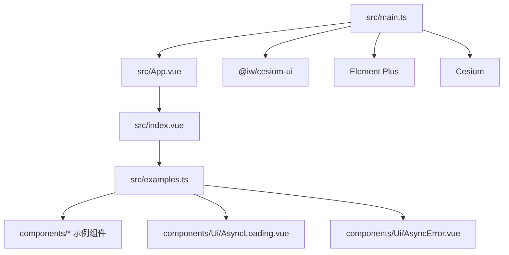
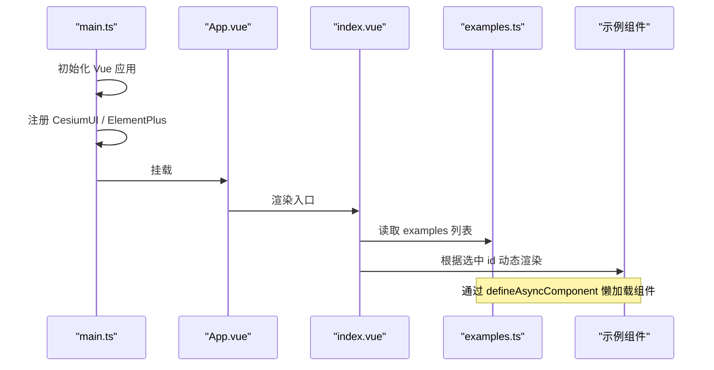
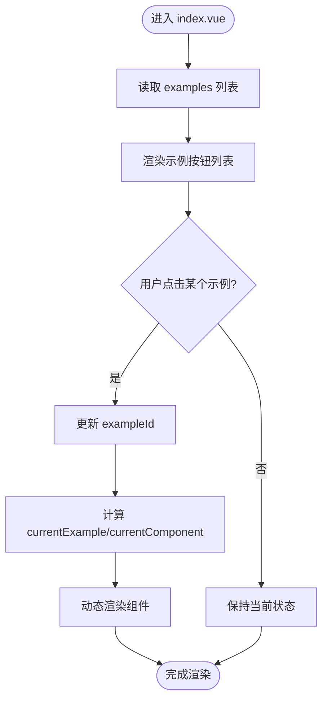
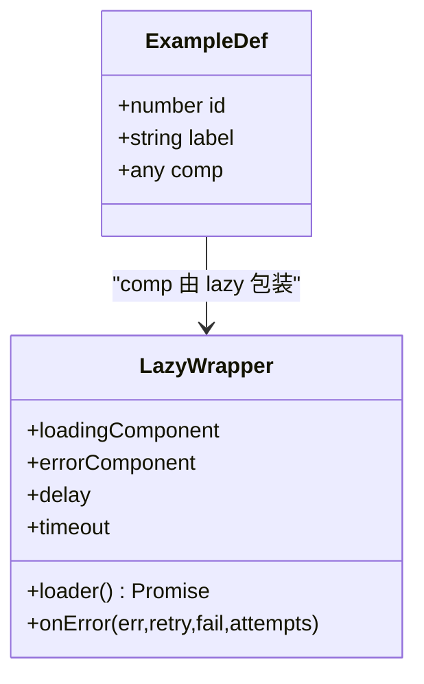
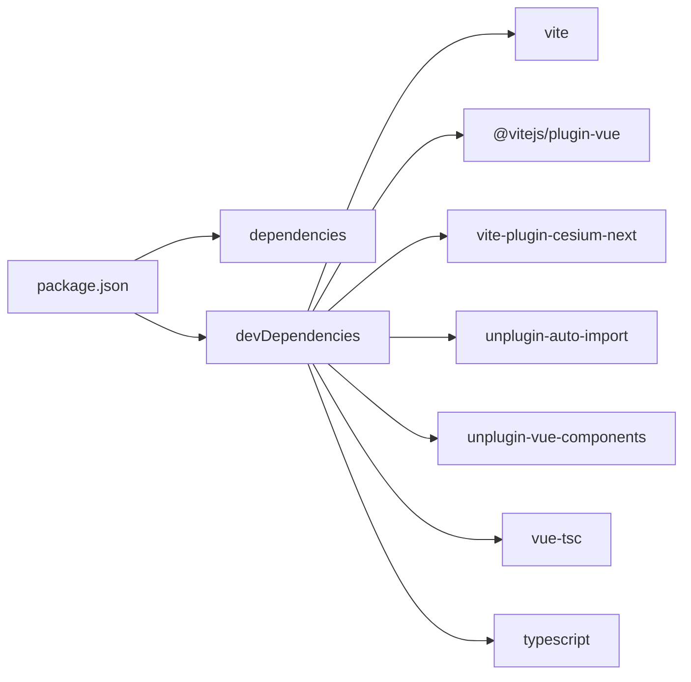

# 开发指南

<cite>
**本文引用的文件**   
- [README.md](file://README.md)
- [package.json](file://package.json)
- [vite.config.ts](file://vite.config.ts)
- [tsconfig.json](file://tsconfig.json)
- [tsconfig.app.json](file://tsconfig.app.json)
- [tsconfig.node.json](file://tsconfig.node.json)
- [src/main.ts](file://src/main.ts)
- [src/App.vue](file://src/App.vue)
- [src/index.vue](file://src/index.vue)
- [src/examples.ts](file://src/examples.ts)
- [src/components/Ui/AsyncLoading.vue](file://src/components/Ui/AsyncLoading.vue)
- [src/components/Ui/AsyncError.vue](file://src/components/Ui/AsyncError.vue)
- [src/style.css](file://src/style.css)
</cite>

## 目录
1. [简介](#简介)
2. [项目结构](#项目结构)
3. [核心组件](#核心组件)
4. [架构总览](#架构总览)
5. [详细组件分析](#详细组件分析)
6. [依赖关系分析](#依赖关系分析)
7. [性能与构建优化](#性能与构建优化)
8. [调试与测试](#调试与测试)
9. [代码规范与最佳实践](#代码规范与最佳实践)
10. [贡献流程与代码审查](#贡献流程与代码审查)
11. [常见问题排查](#常见问题排查)
12. [结论](#结论)

## 简介
本项目基于 Vue 3 + TypeScript + Vite，结合 Cesium 与 Element Plus，提供一组可交互的示例组件，用于演示地图可视化、测量、绘制、图层与地形等能力。仓库采用模块化组织，示例组件通过动态加载机制在统一入口中切换展示。

本指南面向新增示例组件与二次开发者，涵盖：
- 如何添加新的示例组件
- 命名约定与文件组织结构
- 构建配置、TypeScript 配置与开发环境设置
- 调试技巧、测试方法与性能分析工具
- 代码审查标准与贡献流程

## 项目结构
- 根目录包含包管理、Vite 与 TypeScript 配置，以及示例资源（public）。
- src 为应用源码：
  - main.ts 负责应用初始化、插件注册与全局样式引入。
  - App.vue 作为顶层容器，渲染 index.vue。
  - index.vue 提供示例导航与动态渲染。
  - examples.ts 集中声明所有示例元数据与懒加载映射。
  - components 下按功能域划分示例组件；Ui 提供通用 UI 组件。
  - style.css 提供全局样式变量与基础样式。

图表来源
- [src/main.ts:1-26](file://src/main.ts#L1-L26)
- [src/App.vue:1-9](file://src/App.vue#L1-L9)
- [src/index.vue:1-55](file://src/index.vue#L1-L55)
- [src/examples.ts:1-59](file://src/examples.ts#L1-L59)

章节来源
- [README.md:1-6](file://README.md#L1-L6)
- [package.json:1-31](file://package.json#L1-L31)
- [vite.config.ts:1-25](file://vite.config.ts#L1-L25)
- [tsconfig.json:1-8](file://tsconfig.json#L1-L8)
- [tsconfig.app.json:1-17](file://tsconfig.app.json#L1-L17)
- [tsconfig.node.json:1-27](file://tsconfig.node.json#L1-L27)
- [src/main.ts:1-26](file://src/main.ts#L1-L26)
- [src/App.vue:1-9](file://src/App.vue#L1-L9)
- [src/index.vue:1-55](file://src/index.vue#L1-L55)
- [src/examples.ts:1-59](file://src/examples.ts#L1-L59)

## 核心组件
- 应用入口
  - main.ts：创建 Vue 应用实例，注入 CesiumUI 与 Element Plus，设置 Cesium Ion Token 与初始视角参数，挂载到 DOM。
- 顶层容器
  - App.vue：仅作为占位容器，渲染 index.vue。
- 示例导航与渲染
  - index.vue：维护当前示例 id，计算当前示例与组件，使用 Element Plus 按钮列表驱动切换，并通过 <component :is> 动态渲染目标组件。
- 示例清单与懒加载
  - examples.ts：定义 ExampleDef 类型，导出 examples 数组；使用 defineAsyncComponent 包装每个示例组件，并统一配置 AsyncLoading 与 AsyncError 作为加载与失败态。
- 通用 UI
  - AsyncLoading.vue：异步加载占位提示。
  - AsyncError.vue：异步加载失败提示，支持可选错误消息。

章节来源
- [src/main.ts:1-26](file://src/main.ts#L1-L26)
- [src/App.vue:1-9](file://src/App.vue#L1-L9)
- [src/index.vue:1-55](file://src/index.vue#L1-L55)
- [src/examples.ts:1-59](file://src/examples.ts#L1-L59)
- [src/components/Ui/AsyncLoading.vue:1-15](file://src/components/Ui/AsyncLoading.vue#L1-L15)
- [src/components/Ui/AsyncError.vue:1-25](file://src/components/Ui/AsyncError.vue#L1-L25)

## 架构总览
下图展示了从应用启动到示例组件渲染的关键调用链与依赖关系。

图表来源
- [src/main.ts:1-26](file://src/main.ts#L1-L26)
- [src/App.vue:1-9](file://src/App.vue#L1-L9)
- [src/index.vue:1-55](file://src/index.vue#L1-L55)
- [src/examples.ts:1-59](file://src/examples.ts#L1-L59)

## 详细组件分析

### 示例导航与动态渲染（index.vue）
- 职责
  - 维护当前示例 id，计算当前示例对象与对应组件。
  - 使用 Element Plus 按钮组渲染示例列表，点击切换。
  - 通过 <component :is="currentComponent"> 动态渲染目标组件。
- 关键点
  - 使用 computed 派生 currentExample 与 currentComponent，保证响应式更新。
  - 样式使用 scoped，避免污染全局样式。

图表来源
- [src/index.vue:1-55](file://src/index.vue#L1-L55)

章节来源
- [src/index.vue:1-55](file://src/index.vue#L1-L55)

### 示例清单与懒加载（examples.ts）
- 职责
  - 定义示例元数据结构 ExampleDef（id、label、comp）。
  - 导出 examples 数组，将每个示例与懒加载组件绑定。
  - 统一封装 lazy 函数，配置加载与失败组件、重试策略与超时。
- 关键点
  - 使用 defineAsyncComponent 实现按需加载，提升首屏性能。
  - 通过 AsyncLoading 与 AsyncError 提供一致的加载与错误体验。
  - 新增示例仅需在 examples 数组追加一条记录。

图表来源
- [src/examples.ts:1-59](file://src/examples.ts#L1-L59)
- [src/components/Ui/AsyncLoading.vue:1-15](file://src/components/Ui/AsyncLoading.vue#L1-L15)
- [src/components/Ui/AsyncError.vue:1-25](file://src/components/Ui/AsyncError.vue#L1-L25)

章节来源
- [src/examples.ts:1-59](file://src/examples.ts#L1-L59)
- [src/components/Ui/AsyncLoading.vue:1-15](file://src/components/Ui/AsyncLoading.vue#L1-L15)
- [src/components/Ui/AsyncError.vue:1-25](file://src/components/Ui/AsyncError.vue#L1-L25)

### 应用初始化（main.ts）
- 职责
  - 引入 Vue、Cesium、Element Plus 与 CesiumUI。
  - 设置 Cesium Ion 默认访问令牌。
  - 注册 Element Plus 与 CesiumUI（含初始经纬度、高度、天地图 token 等）。
  - 挂载应用到 #app。
- 关键点
  - 全局样式与主题样式在入口处统一引入。
  - 通过 app.use 注入插件，确保后续组件可用。

章节来源
- [src/main.ts:1-26](file://src/main.ts#L1-L26)

## 依赖关系分析
- 运行时依赖
  - vue：前端框架。
  - cesium：三维地球引擎。
  - @iw/cesium-ui：Cesium 相关 UI 组件库。
  - element-plus：UI 组件库。
  - color：颜色处理库。
- 开发依赖
  - vite：构建工具。
  - @vitejs/plugin-vue：Vue 支持。
  - vite-plugin-cesium-next：Cesium 集成插件。
  - unplugin-auto-import：自动导入 API。
  - unplugin-vue-components：自动按需引入组件。
  - vue-tsc：类型检查。
  - typescript：语言支持。

图表来源
- [package.json:1-31](file://package.json#L1-L31)

章节来源
- [package.json:1-31](file://package.json#L1-L31)

## 性能与构建优化
- 懒加载示例组件
  - 通过 defineAsyncComponent 与统一的 lazy 包装，减少首屏体积，提升加载速度。
- 自动导入与按需引入
  - 使用 unplugin-auto-import 与 unplugin-vue-components 自动解析 Element Plus API 与组件，减少手动 import 开销。
- 构建与类型检查
  - build 脚本先执行 vue-tsc 进行类型检查，再执行 vite build，确保类型安全后再打包。
- 开发服务器
  - 固定 host 与 port，便于本地联调与自动化测试。

建议
- 对大型示例组件继续采用懒加载。
- 谨慎引入全局样式，优先使用 scoped 或 CSS Modules。
- 合理使用 Cesium 资源缓存与层级管理，避免频繁重建实体。

章节来源
- [src/examples.ts:1-59](file://src/examples.ts#L1-L59)
- [vite.config.ts:1-25](file://vite.config.ts#L1-L25)
- [package.json:7-11](file://package.json#L7-L11)

## 调试与测试
- 调试技巧
  - 浏览器开发者工具：查看网络面板确认静态资源与接口请求；查看控制台日志定位异常；使用 Vue Devtools 检查组件树与状态。
  - 断点调试：在关键逻辑处（如示例切换、Cesium 初始化、事件回调）打断点，逐步验证数据流。
  - 环境变量与配置：通过 vite.config.ts 调整 server.host/port，便于多端口并行调试。
- 测试方法
  - 单元测试：建议使用 Vitest（可与 Vite 无缝集成），针对纯函数与工具方法进行覆盖。
  - 组件测试：可使用 @vue/test-utils 模拟 DOM 与事件，验证组件行为。
  - 端到端测试：可使用 Playwright/Cypress 对示例页面进行冒烟测试。
- 性能分析
  - 浏览器 Performance 面板录制关键操作，分析主线程耗时与重绘重排。
  - Network 面板分析资源大小与加载顺序，识别大体积依赖。
  - Lighthouse 评估页面性能、可访问性与 SEO。

[本节为通用指导，不直接分析具体文件]

## 代码规范与最佳实践
- 组件命名
  - 示例组件以 Demo- 前缀开头，后接功能名，例如 Demo-Billboard.vue、Demo-Measure-Distance.vue。
  - 目录按功能域划分：Entity、Measure、Drawing、Provider、GeoSot、Others、Viewer、Ui。
- 文件组织
  - 示例组件放在对应功能目录下，保持高内聚、低耦合。
  - 通用 UI 组件放入 components/Ui，供多个示例复用。
- 类型与语法
  - 使用 Vue 3 script setup 与 TypeScript，开启严格模式。
  - 遵循 tsconfig.app.json 中的严格规则（noUnusedLocals、noUnusedParameters 等）。
- 样式
  - 优先使用 scoped 样式，必要时在 style.css 中定义全局变量与基础样式。
- 插件与第三方库
  - 在 vite.config.ts 中集中配置插件与解析器，避免分散配置。
  - 在 main.ts 中统一注册全局插件与样式。

章节来源
- [src/examples.ts:1-59](file://src/examples.ts#L1-L59)
- [tsconfig.app.json:1-17](file://tsconfig.app.json#L1-L17)
- [vite.config.ts:1-25](file://vite.config.ts#L1-L25)
- [src/style.css:1-297](file://src/style.css#L1-L297)

## 贡献流程与代码审查
- 分支策略
  - 主分支保护，新功能与修复在独立分支开发，完成后提交合并请求。
- 提交信息
  - 使用语义化提交信息（feat/fix/docs/style/refactor/test/chore），便于生成变更日志。
- 代码审查标准
  - 类型安全：无未使用变量/参数，类型明确。
  - 可读性：命名清晰，逻辑分层合理，注释必要且准确。
  - 性能：避免不必要的重复计算与大对象创建，合理使用懒加载。
  - 可维护性：组件职责单一，依赖最小化，避免循环依赖。
- 自动化
  - 建议在 CI 中运行类型检查与构建脚本，确保质量基线。

[本节为通用流程说明，不直接分析具体文件]

## 常见问题排查
- 无法加载示例组件
  - 检查 examples.ts 中对应路径是否正确，确保组件存在且可被动态导入。
  - 查看 AsyncError 是否显示错误信息，定位导入失败原因。
- Cesium 相关报错
  - 确认 main.ts 中已正确设置 Cesium Ion Token。
  - 检查网络是否能访问 Cesium 资源服务。
- Element Plus 样式或组件异常
  - 确认已在 main.ts 中引入 Element Plus 样式与插件。
  - 检查是否在 vite.config.ts 中启用自动导入与组件解析。
- 构建失败
  - 先运行类型检查（vue-tsc），根据错误信息修复类型问题。
  - 检查 tsconfig.app.json 与 tsconfig.node.json 的配置是否一致。

章节来源
- [src/examples.ts:1-59](file://src/examples.ts#L1-L59)
- [src/components/Ui/AsyncError.vue:1-25](file://src/components/Ui/AsyncError.vue#L1-L25)
- [src/main.ts:1-26](file://src/main.ts#L1-L26)
- [vite.config.ts:1-25](file://vite.config.ts#L1-L25)
- [tsconfig.app.json:1-17](file://tsconfig.app.json#L1-L17)
- [tsconfig.node.json:1-27](file://tsconfig.node.json#L1-L27)

## 结论
本项目提供了清晰的示例组件组织方式与完善的开发基础设施。通过遵循本文的命名约定、文件结构与最佳实践，开发者可以快速扩展新的示例，同时保证代码质量与构建稳定性。建议在持续迭代中完善自动化测试与性能监控，进一步提升用户体验与开发效率。

[本节为总结性内容，不直接分析具体文件]