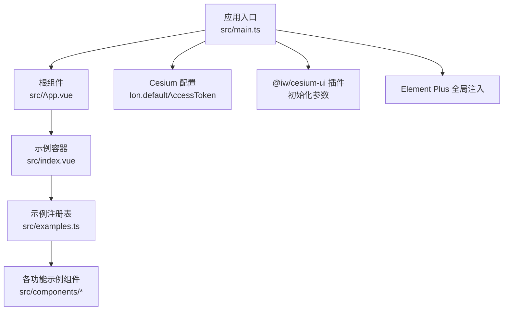
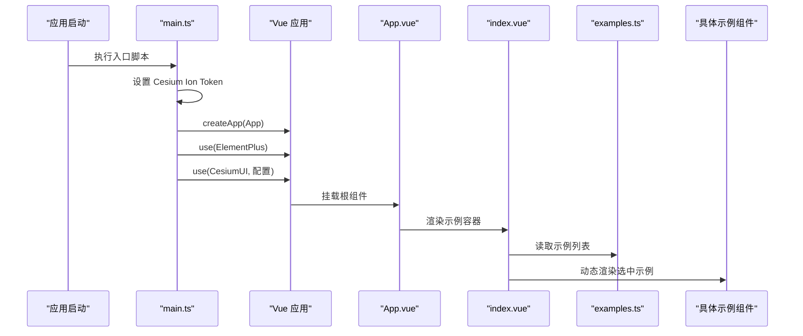
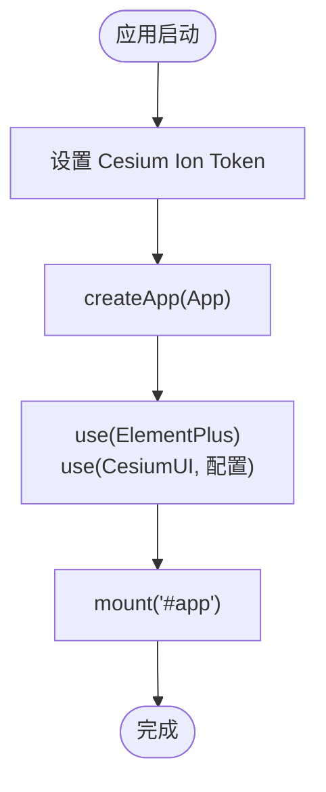
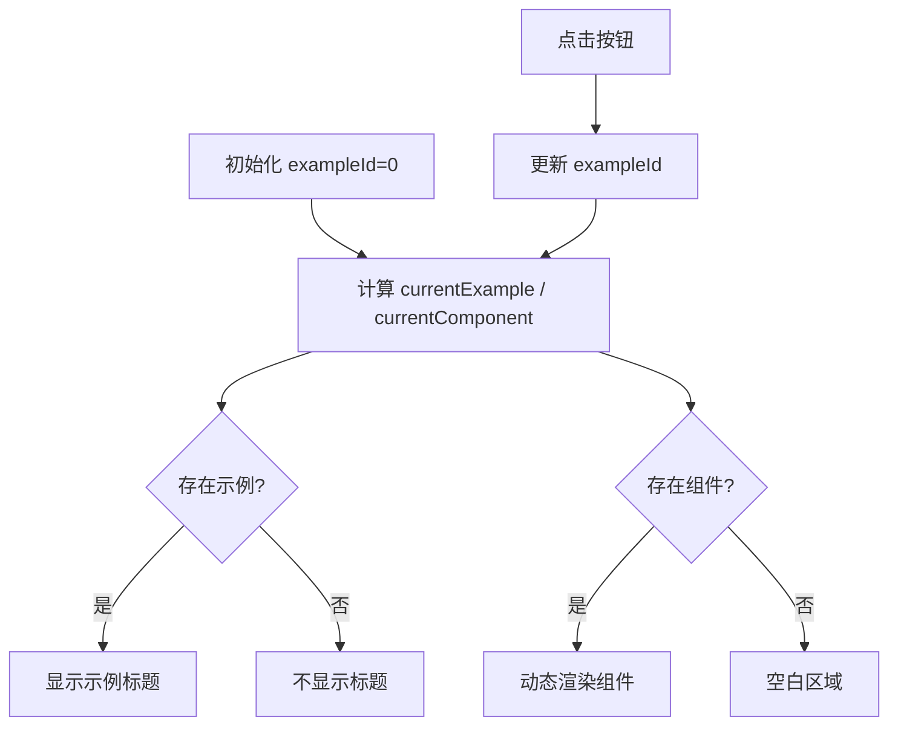
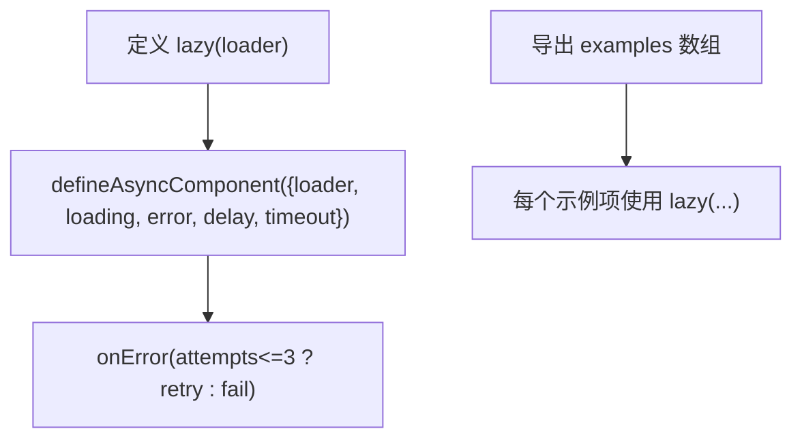
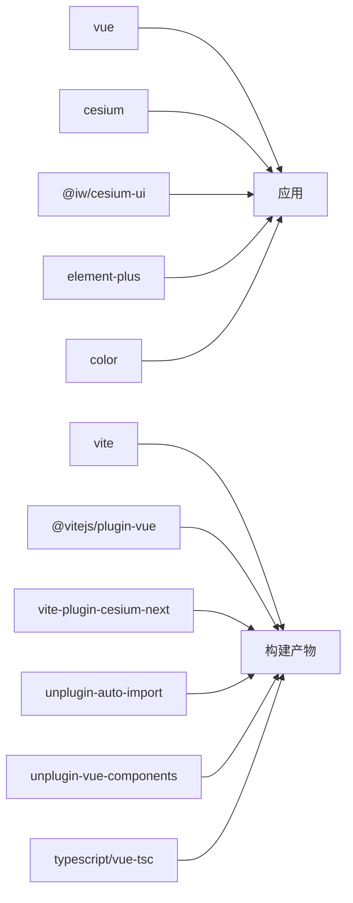

# AI 助手开发指南

<cite>
**本文引用的文件**   
- [README.md](file://README.md)
- [package.json](file://package.json)
- [vite.config.ts](file://vite.config.ts)
- [src/main.ts](file://src/main.ts)
- [src/App.vue](file://src/App.vue)
- [src/index.vue](file://src/index.vue)
- [src/examples.ts](file://src/examples.ts)
</cite>

## 目录
1. [简介](#简介)
2. [项目结构](#项目结构)
3. [核心组件](#核心组件)
4. [架构总览](#架构总览)
5. [详细组件分析](#详细组件分析)
6. [依赖关系分析](#依赖关系分析)
7. [性能与构建优化](#性能与构建优化)
8. [故障排查指南](#故障排查指南)
9. [结论](#结论)
10. [附录：示例清单与扩展建议](#附录示例清单与扩展建议)

## 简介
本项目是一个基于 Vue 3 + TypeScript + Vite 的三维可视化示例集合，使用 Cesium 作为三维引擎，并通过 @iw/cesium-ui 提供 UI 能力，Element Plus 提供通用 UI 组件。仓库以“示例驱动”的方式组织代码，通过动态加载机制按需渲染不同功能演示（如地图、实体、测量、绘制、信息窗等）。

本指南面向希望在此工程基础上开发“AI 助手”功能的开发者，给出从环境搭建、入口初始化、示例路由到可扩展架构的建议方案，帮助你在现有三维场景之上集成智能交互能力。

## 项目结构
项目采用按功能域划分的组件目录结构，便于扩展与维护：
- src/components/Viewer：三维 Viewer 相关示例
- src/components/Entity：三维实体（点、线、面、墙体、标签等）
- src/components/Provider/Layers：地图图层（高德、天地图、WMS 等）
- src/components/Provider/terrain：地形服务
- src/components/Measure：测量工具（距离、面积、坐标拾取）
- src/components/Drawing：绘制工具（折线、墙）
- src/components/GeoSot/primitive：网格化展示
- src/components/Others：辅助 UI（提示、链接、图标、信息窗）
- src/components/Ui：异步加载与错误占位组件

图表来源
- [src/main.ts:1-26](file://src/main.ts#L1-L26)
- [src/App.vue:1-9](file://src/App.vue#L1-L9)
- [src/index.vue:1-54](file://src/index.vue#L1-L54)
- [src/examples.ts:1-59](file://src/examples.ts#L1-L59)

章节来源
- [src/main.ts:1-26](file://src/main.ts#L1-L26)
- [src/App.vue:1-9](file://src/App.vue#L1-L9)
- [src/index.vue:1-54](file://src/index.vue#L1-L54)
- [src/examples.ts:1-59](file://src/examples.ts#L1-L59)

## 核心组件
- 应用入口 main.ts
  - 初始化 Cesium Ion Token
  - 挂载 Element Plus 与 @iw/cesium-ui 插件
  - 启动 Vue 应用并挂载至 #app
- 根组件 App.vue
  - 仅承载示例容器 index.vue
- 示例容器 index.vue
  - 维护当前示例 id
  - 根据 examples 数组动态渲染对应组件
  - 使用 Element Plus 按钮切换示例
- 示例注册表 examples.ts
  - 定义示例元数据（id、label、comp）
  - 使用 defineAsyncComponent 实现懒加载
  - 统一处理加载与错误状态

章节来源
- [src/main.ts:1-26](file://src/main.ts#L1-L26)
- [src/App.vue:1-9](file://src/App.vue#L1-L9)
- [src/index.vue:1-54](file://src/index.vue#L1-L54)
- [src/examples.ts:1-59](file://src/examples.ts#L1-L59)

## 架构总览
下图展示了从应用启动到示例渲染的关键流程，以及外部依赖的接入点。

图表来源
- [src/main.ts:1-26](file://src/main.ts#L1-L26)
- [src/App.vue:1-9](file://src/App.vue#L1-L9)
- [src/index.vue:1-54](file://src/index.vue#L1-L54)
- [src/examples.ts:1-59](file://src/examples.ts#L1-L59)

## 详细组件分析

### 应用入口与插件初始化（main.ts）
- 职责
  - 引入 Vue、Cesium、样式与主题
  - 设置 Cesium Ion 默认访问令牌
  - 全局注册 Element Plus 与 @iw/cesium-ui
  - 挂载应用
- 关键点
  - Cesium Ion Token 用于访问在线资源（如影像、地形）
  - @iw/cesium-ui 初始化参数包含经纬度、初始高度、天地图 Token 等
  - Element Plus 提供全局 UI 能力

图表来源
- [src/main.ts:1-26](file://src/main.ts#L1-L26)

章节来源
- [src/main.ts:1-26](file://src/main.ts#L1-L26)

### 示例容器与动态渲染（index.vue）
- 职责
  - 维护当前示例 id
  - 计算当前示例对象与组件引用
  - 渲染标题与按钮组
  - 动态渲染选中的示例组件
- 关键点
  - 使用 computed 派生 currentExample 与 currentComponent
  - 使用 <component :is="..."> 进行动态组件渲染
  - 使用 Element Plus 按钮切换示例

图表来源
- [src/index.vue:1-54](file://src/index.vue#L1-L54)

章节来源
- [src/index.vue:1-54](file://src/index.vue#L1-L54)

### 示例注册表与懒加载（examples.ts）
- 职责
  - 定义示例类型 ExampleDef
  - 导出示例数组 examples
  - 封装 lazy 函数，统一处理异步组件加载、超时与重试
- 关键点
  - 使用 defineAsyncComponent 实现按需加载
  - 统一 loading/error 组件
  - onError 中最多重试 3 次

图表来源
- [src/examples.ts:1-59](file://src/examples.ts#L1-L59)

章节来源
- [src/examples.ts:1-59](file://src/examples.ts#L1-L59)

### 根组件（App.vue）
- 职责
  - 仅承载示例容器
- 关键点
  - 保持极简，避免业务耦合

章节来源
- [src/App.vue:1-9](file://src/App.vue#L1-L9)

## 依赖关系分析
- 运行时依赖
  - vue：前端框架
  - cesium：三维引擎
  - @iw/cesium-ui：Cesium UI 增强
  - element-plus：通用 UI 组件库
  - color：颜色处理
- 开发依赖
  - vite：构建工具
  - @vitejs/plugin-vue：Vue 支持
  - vite-plugin-cesium-next：Cesium 在 Vite 中的支持
  - unplugin-auto-import / unplugin-vue-components：自动导入与组件注册
  - typescript / vue-tsc：类型检查与编译

图表来源
- [package.json:1-31](file://package.json#L1-L31)
- [vite.config.ts:1-25](file://vite.config.ts#L1-L25)

章节来源
- [package.json:1-31](file://package.json#L1-L31)
- [vite.config.ts:1-25](file://vite.config.ts#L1-L25)

## 性能与构建优化
- 懒加载示例组件
  - 通过 defineAsyncComponent 与 examples.ts 集中管理，减少首屏体积
- 自动导入与组件注册
  - 借助 unplugin-auto-import 与 unplugin-vue-components 减少样板代码
- Cesium 构建支持
  - 使用 vite-plugin-cesium-next 确保 Cesium 资源正确打包
- 开发服务器
  - 固定 host 与 port，便于本地调试与联调

[本节为通用指导，无需特定文件引用]

## 故障排查指南
- Cesium Ion Token 无效或过期
  - 现象：无法加载在线影像/地形资源
  - 排查：确认 main.ts 中设置的 Ion.defaultAccessToken 是否有效
- 天地图 Token 问题
  - 现象：天地图图层加载失败
  - 排查：确认 @iw/cesium-ui 初始化参数中的 tdtToken 是否正确
- 示例组件加载失败
  - 现象：示例按钮点击后无内容或报错
  - 排查：检查 examples.ts 中对应路径是否正确；查看异步组件的 onError 逻辑与网络请求
- Element Plus 样式异常
  - 现象：按钮样式错乱
  - 排查：确认 main.ts 中已引入 element-plus 样式

章节来源
- [src/main.ts:1-26](file://src/main.ts#L1-L26)
- [src/examples.ts:1-59](file://src/examples.ts#L1-L59)

## 结论
本项目提供了完善的三维可视化示例骨架，具备清晰的组件分层与懒加载机制。在此基础上，你可以快速集成“AI 助手”功能，例如：
- 在示例容器中新增“AI 助手”示例项
- 将对话面板、意图识别、指令解析等模块封装为独立组件
- 结合 Cesium 事件系统实现自然语言驱动的三维操作（定位、标注、测量、绘制等）

[本节为总结性内容，无需特定文件引用]

## 附录：示例清单与扩展建议
- 示例清单（部分）
  - viewer 初始化、virtual viewer
  - Billboard、Ellipse、Label、Point、Polygon、Polyline、Wall
  - PrimitiveCollection
  - 高德地图、天地图、WMS 地图、地形
  - 坐标拾取、测距、圆形/多边形面积测量
  - 绘制折线、圆形墙、多边形墙
  - GeoSot 二维/三维网格
  - ToolTip、MouseTip、InfoWindow、Link、Icon

- 扩展建议
  - 新增示例：在 examples.ts 中添加新条目，并在 components 下创建对应组件
  - 统一交互协议：定义“指令-动作”映射，便于 AI 助手调用
  - 状态管理：可引入轻量状态管理（如 provide/inject 或 Pinia）统一管理视图与数据
  - 国际化与可访问性：结合 Element Plus 的 i18n 与无障碍特性提升体验

章节来源
- [src/examples.ts:1-59](file://src/examples.ts#L1-L59)