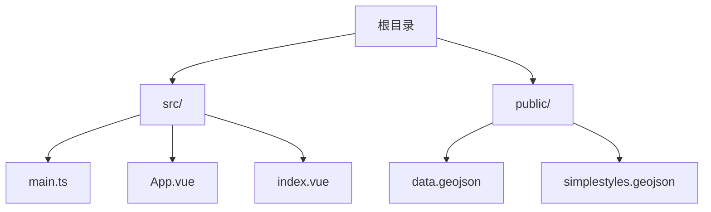
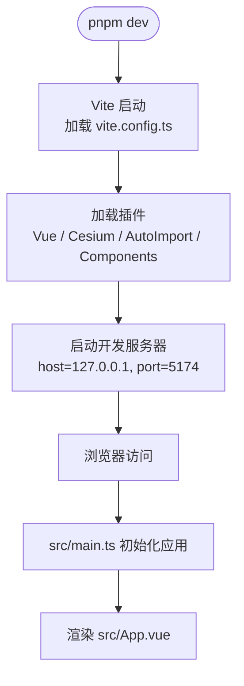
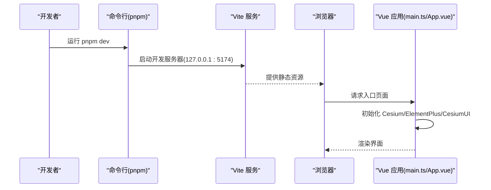

# 快速开始

<cite>
**本文引用的文件**   
- [README.md](file://README.md)
- [package.json](file://package.json)
- [vite.config.ts](file://vite.config.ts)
- [.npmrc](file://.npmrc)
- [src/main.ts](file://src/main.ts)
- [src/App.vue](file://src/App.vue)
- [tsconfig.json](file://tsconfig.json)
</cite>

## 目录
1. [简介](#简介)
2. [项目结构](#项目结构)
3. [环境要求与准备](#环境要求与准备)
4. [克隆与安装依赖](#克隆与安装依赖)
5. [启动开发服务器](#启动开发服务器)
6. [构建与预览](#构建与预览)
7. [项目配置说明](#项目配置说明)
8. [运行流程概览](#运行流程概览)
9. [常见问题与故障排除](#常见问题与故障排除)
10. [结论](#结论)

## 简介
本项目基于 Vue 3 + TypeScript + Vite 模板，集成了 Cesium、Element Plus 等常用库，用于快速搭建三维可视化应用。通过本指南，你可以在最短时间内完成环境准备、依赖安装、本地开发与构建部署的基本流程。

**章节来源**
- [README.md:1-6](file://README.md#L1-L6)

## 项目结构
- src：源代码目录，包含入口文件、主组件与示例页面
- public：静态资源目录，存放 GeoJSON 等数据文件
- 根目录配置文件：package.json（脚本与依赖）、vite.config.ts（Vite 插件与服务配置）、.npmrc（包源镜像）

[无需图表来源，因为该图为概念性结构示意]

## 环境要求与准备
- Node.js：建议使用较新的长期支持版本（如 18.x 或更高），以确保与 Vite 8 和 TypeScript 5 的兼容性
- pnpm：推荐使用与项目一致的版本（packageManager 指定为 pnpm@10.18.2）
- 网络与镜像：项目使用私有 npm 源（见 .npmrc），请确保网络可达；如需切换回官方源，可临时修改 .npmrc

**章节来源**
- [package.json:6](file://package.json#L6)
- [.npmrc:1-1](file://.npmrc#L1-L1)

## 克隆与安装依赖
1. 克隆仓库到本地
2. 进入项目目录
3. 安装依赖（pnpm 会自动根据 packageManager 字段选择对应版本）

提示：若首次安装较慢，请检查 .npmrc 配置的镜像地址是否可达。

**章节来源**
- [package.json:1-11](file://package.json#L1-L11)
- [.npmrc:1-1](file://.npmrc#L1-L1)

## 启动开发服务器
- 命令：pnpm dev
- 默认监听地址与端口：127.0.0.1:5174（可在 vite.config.ts 中调整）
- 启动后浏览器访问 http://127.0.0.1:5174 即可看到应用

注意：如果端口被占用，请在 vite.config.ts 中修改 server.port。

**章节来源**
- [package.json:7-10](file://package.json#L7-L10)
- [vite.config.ts:20-23](file://vite.config.ts#L20-L23)

## 构建与预览
- 构建生产包：pnpm build
  - 会先执行类型检查（vue-tsc），再打包（vite build）
- 预览构建产物：pnpm preview
  - 在本地启动一个静态服务器预览构建结果

建议：在 CI 或发布前务必执行 pnpm build，以尽早发现类型错误与潜在问题。

**章节来源**
- [package.json:7-10](file://package.json#L7-L10)

## 项目配置说明
- Vite 插件
  - @vitejs/plugin-vue：启用 Vue SFC 支持
  - vite-plugin-cesium-next：集成 Cesium
  - unplugin-auto-import：自动导入 Element Plus API
  - unplugin-vue-components：自动注册 Element Plus 组件
- 开发服务器
  - host: '127.0.0.1'
  - port: 5174
- 应用初始化
  - main.ts 中初始化 Vue 应用、Cesium Ion Token、Element Plus 与 CesiumUI，并挂载到 #app
- TypeScript
  - tsconfig.json 引用了 tsconfig.app.json 与 tsconfig.node.json，分别用于应用与 Node 侧的类型检查

**图表来源**
- [vite.config.ts:1-24](file://vite.config.ts#L1-L24)
- [src/main.ts:1-26](file://src/main.ts#L1-L26)
- [src/App.vue:1-9](file://src/App.vue#L1-L9)

**章节来源**
- [vite.config.ts:1-24](file://vite.config.ts#L1-L24)
- [src/main.ts:1-26](file://src/main.ts#L1-L26)
- [src/App.vue:1-9](file://src/App.vue#L1-L9)
- [tsconfig.json:1-8](file://tsconfig.json#L1-L8)

## 运行流程概览
- 开发模式
  - 执行 pnpm dev
  - Vite 加载插件并启动本地服务
  - 浏览器打开 http://127.0.0.1:5174
  - main.ts 初始化 Cesium、Element Plus 与 CesiumUI，并挂载应用
- 构建模式
  - 执行 pnpm build
  - 先进行类型检查，再进行打包
  - 输出产物可用于部署

**图表来源**
- [package.json:7-10](file://package.json#L7-L10)
- [vite.config.ts:20-23](file://vite.config.ts#L20-L23)
- [src/main.ts:1-26](file://src/main.ts#L1-L26)
- [src/App.vue:1-9](file://src/App.vue#L1-L9)

## 常见问题与故障排除
- 无法连接私有 npm 源
  - 现象：安装依赖失败或超时
  - 排查：检查 .npmrc 中的 registry 地址是否可达；必要时临时切换到官方源
  - 参考：[.npmrc:1-1](file://.npmrc#L1-L1)
- 端口被占用
  - 现象：启动时报端口冲突
  - 处理：修改 vite.config.ts 中的 server.port 为其他可用端口
  - 参考：[vite.config.ts:20-23](file://vite.config.ts#L20-L23)
- 类型检查报错
  - 现象：pnpm build 报类型错误
  - 处理：根据错误信息修复代码；确保 TypeScript 配置正确
  - 参考：[package.json:9](file://package.json#L9)、[tsconfig.json:1-8](file://tsconfig.json#L1-L8)
- Cesium 相关资源加载异常
  - 现象：地图或地形资源加载失败
  - 处理：检查 main.ts 中的 Cesium Ion Token 与 CesiumUI 初始化参数是否正确
  - 参考：[src/main.ts:11-24](file://src/main.ts#L11-L24)
- 组件未自动注册或样式缺失
  - 现象：Element Plus 组件不可用或样式不生效
  - 处理：确认 vite.config.ts 中已启用 AutoImport 与 Components 插件，并在 main.ts 引入 Element Plus 样式
  - 参考：[vite.config.ts:10-18](file://vite.config.ts#L10-L18)、[src/main.ts:8-9](file://src/main.ts#L8-L9)

**章节来源**
- [.npmrc:1-1](file://.npmrc#L1-L1)
- [vite.config.ts:10-23](file://vite.config.ts#L10-L23)
- [src/main.ts:8-24](file://src/main.ts#L8-L24)
- [package.json:9](file://package.json#L9)
- [tsconfig.json:1-8](file://tsconfig.json#L1-L8)

## 结论
按照本指南的步骤，你可以快速完成环境准备、依赖安装、本地开发与构建预览。若遇到网络、端口或类型检查等问题，请参考“常见问题与故障排除”部分定位并解决。建议在正式发布前始终执行构建命令，以确保代码质量与稳定性。