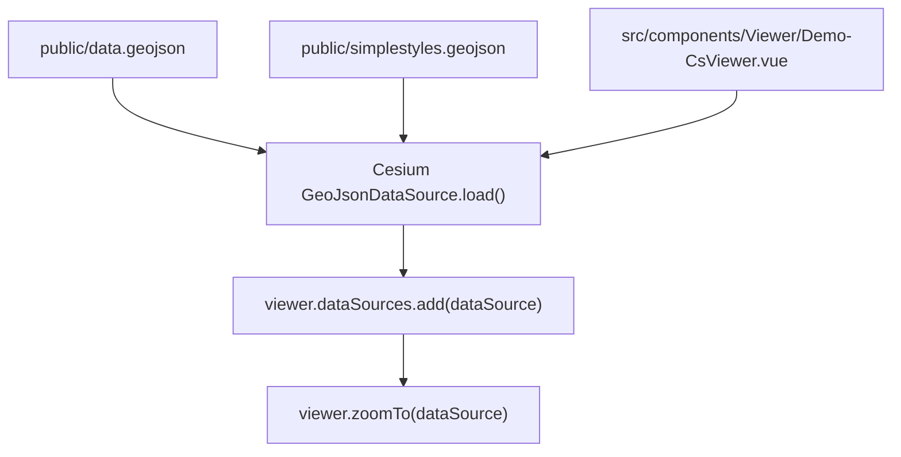
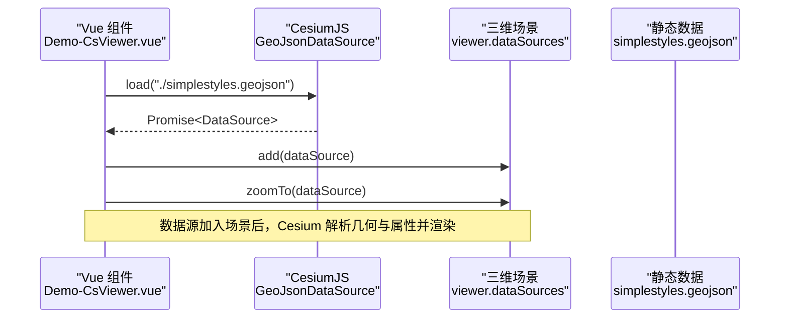
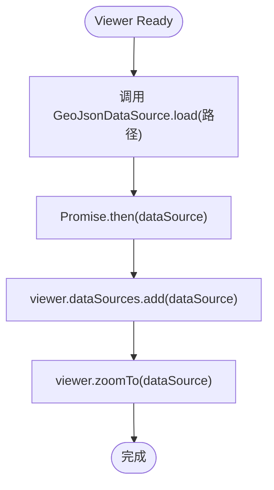
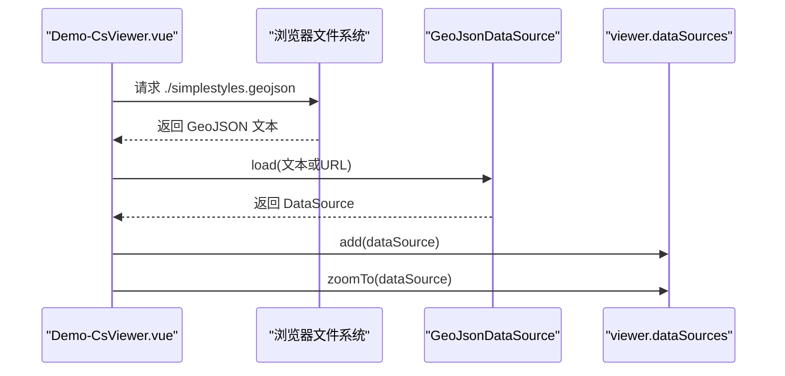
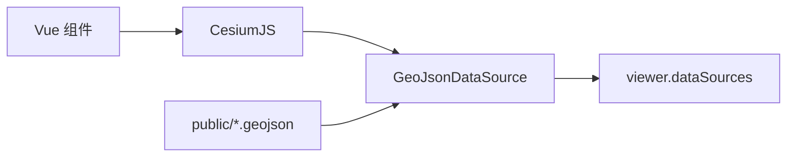

# GeoJSON 数据可视化

<cite>
**本文引用的文件**   
- [README.md](file://README.md)
- [data.geojson](file://public/data.geojson)
- [simplestyles.geojson](file://public/simplestyles.geojson)
- [Demo-CsViewer.vue](file://src/components/Viewer/Demo-CsViewer.vue)
- [Demo-Point.vue](file://src/components/Entity/Demo-Point.vue)
- [Demo-Polygon.vue](file://src/components/Entity/Demo-Polygon.vue)
- [Demo-Polyline.vue](file://src/components/Entity/Demo-Polyline.vue)
- [Demo-Billboard.vue](file://src/components/Entity/billboard/Demo-Billboard.vue)
</cite>

## 目录
1. [引言](#引言)
2. [项目结构](#项目结构)
3. [核心组件](#核心组件)
4. [架构总览](#架构总览)
5. [详细组件分析](#详细组件分析)
6. [依赖关系分析](#依赖关系分析)
7. [性能与优化](#性能与优化)
8. [故障排查指南](#故障排查指南)
9. [结论](#结论)
10. [附录：GeoJSON 规范与示例](#附录geojson-规范与示例)

## 引言
本技术文档围绕仓库中的 GeoJSON 数据可视化能力展开，重点说明：
- GeoJSON 数据格式规范与 FeatureCollection 结构定义
- 坐标系统与坐标系配置（CRS）
- 几何类型支持（点、线、面等）
- 数据加载流程、样式映射机制与属性绑定方法
- 从外部文件加载 GeoJSON 并在三维场景中渲染的完整流程
- 数据验证、错误处理与性能优化的最佳实践

本项目基于 Vue 3 + TypeScript + Vite，使用 CesiumJS 进行三维地理可视化，并通过 @iw/cesium-ui 提供的封装组件简化开发。

**章节来源**
- [README.md:1-6](file://README.md#L1-L6)

## 项目结构
与 GeoJSON 可视化直接相关的资源与代码分布如下：
- public 目录存放静态 GeoJSON 数据文件
- src/components/Viewer 下包含通过 Cesium 的 GeoJsonDataSource 加载 GeoJSON 的演示组件
- src/components/Entity 提供点、线、面等基础实体展示示例，便于理解坐标与样式映射

**图表来源**
- [Demo-CsViewer.vue:31-35](file://src/components/Viewer/Demo-CsViewer.vue#L31-L35)
- [data.geojson:1-9](file://public/data.geojson#L1-L9)
- [simplestyles.geojson:1-20](file://public/simplestyles.geojson#L1-L20)

**章节来源**
- [Demo-CsViewer.vue:1-67](file://src/components/Viewer/Demo-CsViewer.vue#L1-L67)
- [data.geojson:1-9](file://public/data.geojson#L1-L9)
- [simplestyles.geojson:1-20](file://public/simplestyles.geojson#L1-L20)

## 核心组件
- Demo-CsViewer.vue：在 Viewer ready 后，调用 Cesium 的 GeoJsonDataSource.load 加载 simplestyles.geojson，并将数据源添加到 viewer.dataSources，随后执行 zoomTo 以适配视图范围。
- Entity 系列组件（点、线、面、广告牌）：用于展示基础几何实体的创建与样式设置，帮助理解坐标与样式映射方式。

关键职责：
- 数据加载：通过 GeoJsonDataSource 将 GeoJSON 转换为 Cesium 可识别的数据源对象
- 场景集成：将数据源加入 viewer.dataSources，并自动计算合适的相机视角
- 样式与属性：Cesium 会根据 GeoJSON 的 properties 字段生成默认样式；可通过自定义样式函数进一步控制

**章节来源**
- [Demo-CsViewer.vue:20-36](file://src/components/Viewer/Demo-CsViewer.vue#L20-L36)
- [Demo-Point.vue:1-63](file://src/components/Entity/Demo-Point.vue#L1-L63)
- [Demo-Polygon.vue:1-65](file://src/components/Entity/Demo-Polygon.vue#L1-L65)
- [Demo-Polyline.vue:1-68](file://src/components/Entity/Demo-Polyline.vue#L1-L68)
- [Demo-Billboard.vue:1-56](file://src/components/Entity/billboard/Demo-Billboard.vue#L1-L56)

## 架构总览
下图展示了从静态 GeoJSON 到三维场景渲染的整体流程，以及各参与模块的职责边界。

**图表来源**
- [Demo-CsViewer.vue:31-35](file://src/components/Viewer/Demo-CsViewer.vue#L31-L35)
- [simplestyles.geojson:1-20](file://public/simplestyles.geojson#L1-L20)

## 详细组件分析

### 数据加载流程（GeoJSON → Cesium 数据源）
- 入口：在 Viewer ready 回调中触发
- 步骤：
  1) 调用 GeoJsonDataSource.load 指定 GeoJSON 路径
  2) 获取 Promise 返回的 DataSource 对象
  3) 将 DataSource 添加到 viewer.dataSources
  4) 调用 viewer.zoomTo 使相机适配数据范围

**图表来源**
- [Demo-CsViewer.vue:31-35](file://src/components/Viewer/Demo-CsViewer.vue#L31-L35)

**章节来源**
- [Demo-CsViewer.vue:20-36](file://src/components/Viewer/Demo-CsViewer.vue#L20-L36)

### 坐标系统与 CRS 配置
- data.geojson 中包含 crs 字段，声明了坐标参考系统为 OGC:1.3:CRS84（即 WGS84，经纬度顺序为经度、纬度）。
- Cesium 默认期望 GeoJSON 使用 WGS84 经纬度坐标，因此无需额外转换即可正确显示。
- 若数据包含高程（z），Cesium 会将其作为高度值处理；否则高度默认为 0。

注意：
- coordinates 数组的顺序需符合 GeoJSON 规范（二维为 [经度, 纬度]，三维为 [经度, 纬度, 高度]）
- 若数据非 WGS84，需在加载前进行投影转换或使用 Cesium 的坐标转换工具

**章节来源**
- [data.geojson:1-9](file://public/data.geojson#L1-L9)

### 几何类型支持与样式映射
- simplestyles.geojson 包含大量 Point 类型的 Feature，每个 Feature 的 properties 中包含 marker-color、marker-symbol、title 等字段。
- Cesium 的 GeoJsonDataSource 会将这些 properties 映射为点的颜色、符号和标签等样式属性。
- 对于 LineString/Polygon 等几何类型，Cesium 同样会依据 properties 生成对应的线宽、材质、填充色等样式。

建议：
- 在 properties 中统一命名样式键（如 marker-color、marker-symbol），以便稳定映射
- 如需更复杂的样式逻辑，可在数据源加载完成后遍历 entities，按业务规则覆盖默认样式

**章节来源**
- [simplestyles.geojson:1-20](file://public/simplestyles.geojson#L1-L20)

### 属性绑定方法与扩展
- 默认行为：Cesium 根据 GeoJSON 的 properties 自动生成标签、颜色等样式
- 扩展方式：
  - 在 dataSource 加载完成后，访问其 entities 集合，对每个 entity 的 properties 进行读取与二次处理
  - 结合业务字段（如名称、分类）动态设置颜色、图标、弹出信息等
- 与 Entity 组件的关系：Entity 组件展示了如何在 Cesium 中手动创建点、线、面实体，有助于理解底层数据结构与样式参数

**章节来源**
- [Demo-Point.vue:1-63](file://src/components/Entity/Demo-Point.vue#L1-L63)
- [Demo-Polygon.vue:1-65](file://src/components/Entity/Demo-Polygon.vue#L1-L65)
- [Demo-Polyline.vue:1-68](file://src/components/Entity/Demo-Polyline.vue#L1-L68)
- [Demo-Billboard.vue:1-56](file://src/components/Entity/billboard/Demo-Billboard.vue#L1-L56)

### 实际数据处理示例（从外部文件加载并在三维场景中渲染）
- 数据来源：public/simplestyles.geojson
- 加载位置：Demo-CsViewer.vue 的 handleReady 回调
- 渲染结果：Cesium 自动解析几何与属性，并在三维场景中渲染点要素；随后相机自动缩放至数据范围

**图表来源**
- [Demo-CsViewer.vue:31-35](file://src/components/Viewer/Demo-CsViewer.vue#L31-L35)
- [simplestyles.geojson:1-20](file://public/simplestyles.geojson#L1-L20)

**章节来源**
- [Demo-CsViewer.vue:20-36](file://src/components/Viewer/Demo-CsViewer.vue#L20-L36)

## 依赖关系分析
- 前端框架：Vue 3 + TypeScript + Vite
- 三维引擎：CesiumJS（通过 @iw/cesium-ui 封装）
- 数据源：静态 GeoJSON 文件（位于 public 目录）
- 组件耦合：
  - Demo-CsViewer.vue 依赖 Cesium 的 GeoJsonDataSource 与 viewer.dataSources
  - Entity 组件依赖 Cesium 的 Cartesian3、Color、Entity 等基础 API

**图表来源**
- [Demo-CsViewer.vue:8-35](file://src/components/Viewer/Demo-CsViewer.vue#L8-L35)
- [simplestyles.geojson:1-20](file://public/simplestyles.geojson#L1-L20)

**章节来源**
- [Demo-CsViewer.vue:1-67](file://src/components/Viewer/Demo-CsViewer.vue#L1-L67)

## 性能与优化
- 批量加载：尽量使用单个 GeoJSON 文件承载大量要素，减少网络请求次数
- 样式缓存：对重复使用的样式（颜色、图标）进行缓存，避免重复计算
- 按需渲染：仅加载当前视口范围内的数据，或使用分层/分块策略
- 数据预处理：在服务端对 GeoJSON 进行简化（如 Douglas-Peucker 算法）以减少顶点数量
- 事件与交互：对大量实体启用合理的 picking 策略，避免不必要的点击检测开销
- 内存管理：及时移除不再使用的数据源与实体，防止内存泄漏

[本节为通用指导，不直接分析具体文件]

## 故障排查指南
常见问题与定位思路：
- GeoJSON 路径错误：确认 public 目录下的文件路径是否正确，且构建产物可被浏览器访问
- 坐标系不一致：检查 GeoJSON 的 crs 字段与 coordinates 顺序是否符合 WGS84（经度在前，纬度在后）
- 样式未生效：确认 properties 字段名是否与 Cesium 默认映射一致，或是否需要在加载后自定义样式
- 数据未显示：检查 viewer.dataSources.add 是否成功执行，以及 viewer.zoomTo 是否触发
- 网络请求失败：查看浏览器开发者工具的 Network 面板，确认 GeoJSON 文件是否成功返回

建议的调试步骤：
- 在 handleReady 中添加日志，确认 GeoJsonDataSource.load 的 Promise 状态
- 在 then 回调中打印 dataSource.entities 的数量与属性，验证数据解析结果
- 临时添加一个已知坐标的点实体，验证 Viewer 与 Cesium 初始化是否正常

**章节来源**
- [Demo-CsViewer.vue:20-36](file://src/components/Viewer/Demo-CsViewer.vue#L20-L36)

## 结论
本项目通过 Cesium 的 GeoJsonDataSource 实现了从静态 GeoJSON 到三维场景的端到端可视化。数据加载流程清晰，样式映射与属性绑定遵循 GeoJSON 规范与 Cesium 默认约定。通过合理的数据组织、样式设计与性能优化策略，可以在大规模数据场景下保持流畅的交互体验。

[本节为总结性内容，不直接分析具体文件]

## 附录：GeoJSON 规范与示例

### GeoJSON 数据格式规范要点
- 顶层对象必须包含 type 字段，值为 "FeatureCollection"
- features 数组包含多个 Feature 对象
- 每个 Feature 包含 geometry 与 properties
- geometry.type 支持 Point、LineString、Polygon 等
- coordinates 数组顺序：二维为 [经度, 纬度]，三维为 [经度, 纬度, 高度]
- crs 字段可选，用于声明坐标参考系统（如 OGC:1.3:CRS84）

### FeatureCollection 结构定义
- type: "FeatureCollection"
- name: 可选，数据集名称
- crs: 可选，坐标参考系统定义
- features: Feature 数组

### 坐标系统配置
- 推荐使用 WGS84（EPSG:4326 / OGC:1.3:CRS84）
- 确保 coordinates 顺序为 [经度, 纬度]
- 若包含高程，第三维为高度（单位通常为米）

### 几何类型支持
- Point：单点位置
- LineString：折线
- Polygon：多边形
- MultiPoint/MultiLineString/MultiPolygon：几何集合
- GeometryCollection：几何对象集合

### 示例数据说明
- data.geojson：包含一个 Point 要素，带有名称与坐标信息，并声明了 CRS
- simplestyles.geojson：包含大量 Point 要素，properties 中包含 marker-color、marker-symbol、title 等样式字段

**章节来源**
- [data.geojson:1-9](file://public/data.geojson#L1-L9)
- [simplestyles.geojson:1-20](file://public/simplestyles.geojson#L1-L20)