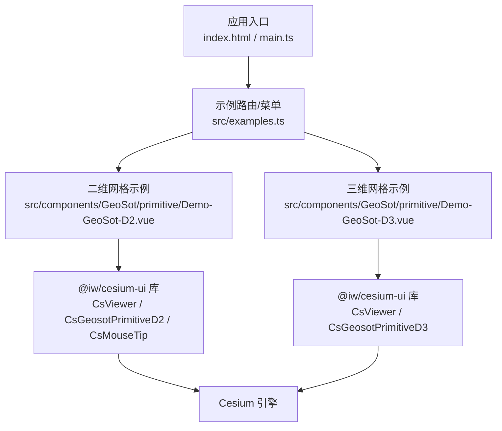
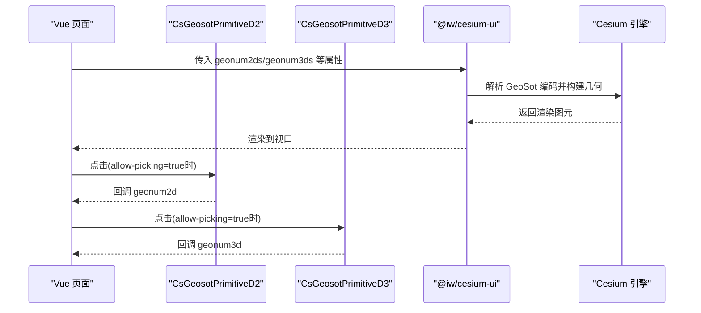
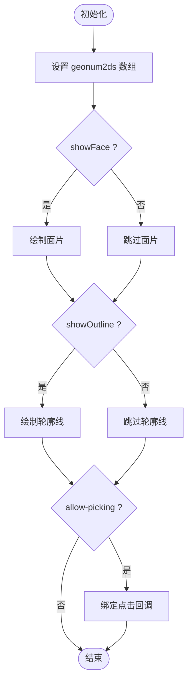
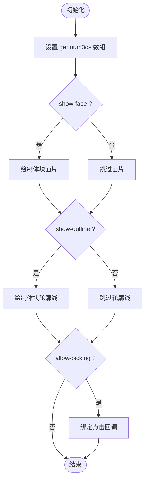
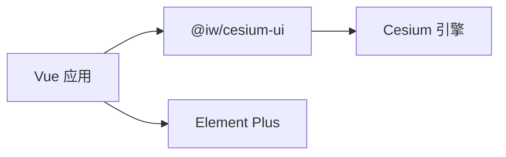

# GeoSot 网格系统

<cite>
**本文引用的文件**   
- [Demo-GeoSot-D2.vue](file://src/components/GeoSot/primitive/Demo-GeoSot-D2.vue)
- [Demo-GeoSot-D3.vue](file://src/components/GeoSot/primitive/Demo-GeoSot-D3.vue)
- [package.json](file://package.json)
- [examples.ts](file://src/examples.ts)
</cite>

## 目录
1. [简介](#简介)
2. [项目结构](#项目结构)
3. [核心组件与能力](#核心组件与能力)
4. [架构总览](#架构总览)
5. [详细组件分析](#详细组件分析)
6. [依赖关系分析](#依赖关系分析)
7. [性能与渲染特性](#性能与渲染特性)
8. [常见问题与排错](#常见问题与排错)
9. [结论](#结论)
10. [附录：API 与配置参考](#附录api-与配置参考)

## 简介
本仓库为基于 Vue 3 + TypeScript + Vite 的前端示例工程，重点展示了如何使用 @iw/cesium-ui 提供的 GeoSot 二维与三维网格组件进行空间可视化。文档聚焦以下目标：
- 说明 GeoSot 二维网格编码原理、空间索引机制与层次化组织结构（概念性说明）
- 解释二维平面展示与三维立体渲染的实现方式
- 梳理网格生成、样式配置与交互功能的使用流程
- 提供不同分辨率级别切换、网格查询与空间分析的应用示例思路
- 解释网格系统与地理坐标系统的转换关系（概念性说明）

注意：本仓库未包含 GeoSot 算法的底层实现代码，相关原理与坐标转换以概念性说明为主；实际渲染由 @iw/cesium-ui 中的 CsGeosotPrimitiveD2/CsGeosotPrimitiveD3 组件完成。

## 项目结构
本项目采用按功能域组织的组件目录结构，GeoSot 网格相关示例位于 src/components/GeoSot/primitive 下，分别对应二维与三维网格演示。

图表来源
- [examples.ts:47-48](file://src/examples.ts#L47-L48)
- [Demo-GeoSot-D2.vue:1-175](file://src/components/GeoSot/primitive/Demo-GeoSot-D2.vue#L1-L175)
- [Demo-GeoSot-D3.vue:1-169](file://src/components/GeoSot/primitive/Demo-GeoSot-D3.vue#L1-L169)
- [package.json:12-17](file://package.json#L12-L17)

章节来源
- [examples.ts:47-48](file://src/examples.ts#L47-L48)
- [Demo-GeoSot-D2.vue:1-175](file://src/components/GeoSot/primitive/Demo-GeoSot-D2.vue#L1-L175)
- [Demo-GeoSot-D3.vue:1-169](file://src/components/GeoSot/primitive/Demo-GeoSot-D3.vue#L1-L169)
- [package.json:12-17](file://package.json#L12-L17)

## 核心组件与能力
- CsGeosotPrimitiveD2：二维 GeoSot 网格面片与轮廓线渲染，支持面片显示开关、面片颜色、轮廓线显示开关、轮廓线颜色、拾取控制与点击事件回调。
- CsGeosotPrimitiveD3：三维 GeoSot 网格体块渲染，支持面片显示开关、面片颜色、轮廓线显示开关、轮廓线颜色、拾取控制与点击事件回调。
- CsViewer：Cesium Viewer 封装，提供 ready 事件与视口管理。
- CsMouseTip：鼠标位置提示工具（二维示例中使用）。

章节来源
- [Demo-GeoSot-D2.vue:6-6](file://src/components/GeoSot/primitive/Demo-GeoSot-D2.vue#L6-L6)
- [Demo-GeoSot-D3.vue:6-6](file://src/components/GeoSot/primitive/Demo-GeoSot-D3.vue#L6-L6)

## 架构总览
GeoSot 网格在应用中通过 Vue 组件组合 @iw/cesium-ui 暴露的 Primitive 组件，将 GeoSot 编码字符串数组作为输入，由底层 Cesium 完成几何构建与渲染。

图表来源
- [Demo-GeoSot-D2.vue:129-138](file://src/components/GeoSot/primitive/Demo-GeoSot-D2.vue#L129-L138)
- [Demo-GeoSot-D3.vue:125-134](file://src/components/GeoSot/primitive/Demo-GeoSot-D3.vue#L125-L134)

## 详细组件分析

### 二维网格组件（CsGeosotPrimitiveD2）
- 输入属性
  - geonum2ds：GeoSot 二维编码字符串数组
  - showFace：是否显示面片
  - faceColor：面片颜色
  - showOutline：是否显示轮廓线
  - outlineColor：轮廓线颜色
  - allow-picking：是否允许拾取
- 事件
  - click：返回被点击的 geonum2d 字符串

使用要点
- 通过 v-if 控制组件挂载与销毁，配合 nextTick 刷新视图
- 使用 watch 监听颜色变化，触发重新渲染
- 结合 CsMouseTip 可获取鼠标经纬度用于辅助定位或查询

图表来源
- [Demo-GeoSot-D2.vue:129-138](file://src/components/GeoSot/primitive/Demo-GeoSot-D2.vue#L129-L138)
- [Demo-GeoSot-D2.vue:40-57](file://src/components/GeoSot/primitive/Demo-GeoSot-D2.vue#L40-L57)
- [Demo-GeoSot-D2.vue:63-70](file://src/components/GeoSot/primitive/Demo-GeoSot-D2.vue#L63-L70)
- [Demo-GeoSot-D2.vue:90-97](file://src/components/GeoSot/primitive/Demo-GeoSot-D2.vue#L90-L97)
- [Demo-GeoSot-D2.vue:100-119](file://src/components/GeoSot/primitive/Demo-GeoSot-D2.vue#L100-L119)

章节来源
- [Demo-GeoSot-D2.vue:1-175](file://src/components/GeoSot/primitive/Demo-GeoSot-D2.vue#L1-L175)

### 三维网格组件（CsGeosotPrimitiveD3）
- 输入属性
  - geonum3ds：GeoSot 三维编码字符串数组
  - show-face：是否显示面片
  - faceColor：面片颜色
  - show-outline：是否显示轮廓线
  - outline-color：轮廓线颜色
  - allow-picking：是否允许拾取
- 事件
  - click：返回被点击的 geonum3d 字符串

使用要点
- 与二维类似，通过 v-if 与 nextTick 控制渲染时机
- 通过 watch 监听颜色变化，触发更新
- 适合用于地形起伏、体素化展示、分层切片等场景

图表来源
- [Demo-GeoSot-D3.vue:125-134](file://src/components/GeoSot/primitive/Demo-GeoSot-D3.vue#L125-L134)
- [Demo-GeoSot-D3.vue:48-67](file://src/components/GeoSot/primitive/Demo-GeoSot-D3.vue#L48-L67)
- [Demo-GeoSot-D3.vue:87-94](file://src/components/GeoSot/primitive/Demo-GeoSot-D3.vue#L87-L94)
- [Demo-GeoSot-D3.vue:97-116](file://src/components/GeoSot/primitive/Demo-GeoSot-D3.vue#L97-L116)

章节来源
- [Demo-GeoSot-D3.vue:1-169](file://src/components/GeoSot/primitive/Demo-GeoSot-D3.vue#L1-L169)

### GeoSot 编码与层次化组织（概念性说明）
- 编码原理（概念）
  - GeoSot 是一种基于球面四叉树（Quadtree）的空间划分与编码方法，通过对地球表面进行递归细分，形成具有唯一编码的网格单元。
  - 编码通常包含层级信息与子区域选择路径，便于快速判断父子关系与邻接关系。
- 空间索引机制（概念）
  - 利用编码前缀匹配实现范围查询与祖先/后代检索，支持高效的“包含”“相交”“邻接”等空间谓词。
  - 可通过编码长度控制分辨率，短编码表示大范围低分辨率，长编码表示小范围高分辨率。
- 层次化组织结构（概念）
  - 根节点为最大范围，逐级细分为四个子节点，形成树状结构。
  - 同一父节点下的子节点共享边界，便于跨层级聚合与统计。

[本节为概念性说明，不直接分析具体源码文件]

### 网格生成与分辨率切换（应用示例思路）
- 生成策略（概念）
  - 根据业务需求确定初始分辨率（编码长度），对感兴趣区域进行递归细分，得到一组 GeoSot 编码集合。
  - 可将编码集合缓存并按层级分组，便于动态加载与卸载。
- 分辨率切换（应用）
  - 用户缩放地图时，根据当前视口范围与缩放级别，动态替换 geonum2ds/geonum3ds 为更粗或更细的编码集合。
  - 结合 v-if 与 nextTick 控制组件重建，避免频繁重绘导致的卡顿。

[本节为概念性说明与应用建议，不直接分析具体源码文件]

### 网格查询与空间分析（应用示例思路）
- 点查网格（概念）
  - 将经纬度坐标转换为 GeoSot 编码，再与现有编码集合做匹配，快速定位所在网格。
- 范围查询（概念）
  - 将矩形或多边形范围分解为若干 GeoSot 编码集合，利用前缀匹配筛选候选网格。
- 统计分析（概念）
  - 对选定网格集合进行聚合计算（如面积、体积、均值等），结合三维体块渲染直观呈现结果。

[本节为概念性说明与应用建议，不直接分析具体源码文件]

### 网格系统与地理坐标系统的转换关系（概念性说明）
- 投影与坐标系（概念）
  - Cesium 默认使用 WGS84 经纬度与椭球体模型，GeoSot 编码与经纬度的转换需考虑投影与分块规则。
- 转换流程（概念）
  - 经纬度 → 球面坐标 → 四叉树路径 → GeoSot 编码
  - GeoSot 编码 → 四叉树路径 → 球面坐标 → 经纬度
- 精度与误差（概念）
  - 编码长度决定空间精度；不同分辨率下边界误差不同，需注意在可视化与分析中保持一致的精度假设。

[本节为概念性说明，不直接分析具体源码文件]

## 依赖关系分析
- 运行时依赖
  - cesium：三维地球引擎，负责几何与渲染
  - @iw/cesium-ui：封装了 CsViewer、CsGeosotPrimitiveD2、CsGeosotPrimitiveD3 等组件
  - element-plus：示例界面控件（按钮、复选框、颜色选择器等）
  - vue：前端框架

图表来源
- [package.json:12-17](file://package.json#L12-L17)

章节来源
- [package.json:12-17](file://package.json#L12-L17)

## 性能与渲染特性
- 按需渲染
  - 使用 v-if 控制组件挂载，减少不必要的几何创建与渲染开销。
  - 通过 nextTick 确保状态变更后视图正确更新。
- 颜色与透明度
  - 面片与轮廓线颜色支持透明通道，合理设置 alpha 值可提升多层叠加的可读性。
- 拾取与交互
  - 仅在需要交互时开启 allow-picking，避免不必要的拾取计算。
- 大数据量优化（建议）
  - 对大量网格进行分块加载与可视范围裁剪
  - 合并相邻网格以减少图元数量
  - 使用 LOD（多分辨率编码）随缩放级别动态切换

[本节为通用性能建议，不直接分析具体源码文件]

## 常见问题与排错
- 网格不显示
  - 检查 geonum2ds/geonum3ds 是否为空数组
  - 确认 showFace/showOutline 是否正确启用
  - 检查组件是否通过 v-if 控制挂载
- 颜色不更新
  - 确保在修改颜色后触发 re-render（v-if 切换或 nextTick）
  - 使用 watch 监听颜色变量变化
- 点击无回调
  - 确认 allow-picking 已启用
  - 检查 click 事件绑定是否正确

章节来源
- [Demo-GeoSot-D2.vue:40-57](file://src/components/GeoSot/primitive/Demo-GeoSot-D2.vue#L40-L57)
- [Demo-GeoSot-D2.vue:63-70](file://src/components/GeoSot/primitive/Demo-GeoSot-D2.vue#L63-L70)
- [Demo-GeoSot-D2.vue:90-97](file://src/components/GeoSot/primitive/Demo-GeoSot-D2.vue#L90-L97)
- [Demo-GeoSot-D3.vue:48-67](file://src/components/GeoSot/primitive/Demo-GeoSot-D3.vue#L48-L67)
- [Demo-GeoSot-D3.vue:87-94](file://src/components/GeoSot/primitive/Demo-GeoSot-D3.vue#L87-L94)

## 结论
本仓库通过两个示例组件展示了如何在 Vue 应用中集成并使用 GeoSot 二维与三维网格。尽管未包含 GeoSot 算法的底层实现，但借助 @iw/cesium-ui 提供的组件，开发者可以快速实现网格的可视化、样式配置与交互。对于 GeoSot 的编码原理、空间索引与坐标转换，本文提供了概念性说明与最佳实践建议，帮助读者在实际项目中扩展与优化网格系统。

## 附录：API 与配置参考

### CsGeosotPrimitiveD2 属性与事件
- 属性
  - geonum2ds：string[]，GeoSot 二维编码数组
  - showFace：boolean，是否显示面片
  - faceColor：string，面片颜色
  - showOutline：boolean，是否显示轮廓线
  - outlineColor：string，轮廓线颜色
  - allow-picking：boolean，是否允许拾取
- 事件
  - click：回调参数为 geonum2d（string）

章节来源
- [Demo-GeoSot-D2.vue:129-138](file://src/components/GeoSot/primitive/Demo-GeoSot-D2.vue#L129-L138)

### CsGeosotPrimitiveD3 属性与事件
- 属性
  - geonum3ds：string[]，GeoSot 三维编码数组
  - show-face：boolean，是否显示面片
  - faceColor：string，面片颜色
  - show-outline：boolean，是否显示轮廓线
  - outline-color：string，轮廓线颜色
  - allow-picking：boolean，是否允许拾取
- 事件
  - click：回调参数为 geonum3d（string）

章节来源
- [Demo-GeoSot-D3.vue:125-134](file://src/components/GeoSot/primitive/Demo-GeoSot-D3.vue#L125-L134)

### 示例入口与路由
- examples.ts 中注册了两个 GeoSot 示例，分别对应二维与三维网格页面。

章节来源
- [examples.ts:47-48](file://src/examples.ts#L47-L48)