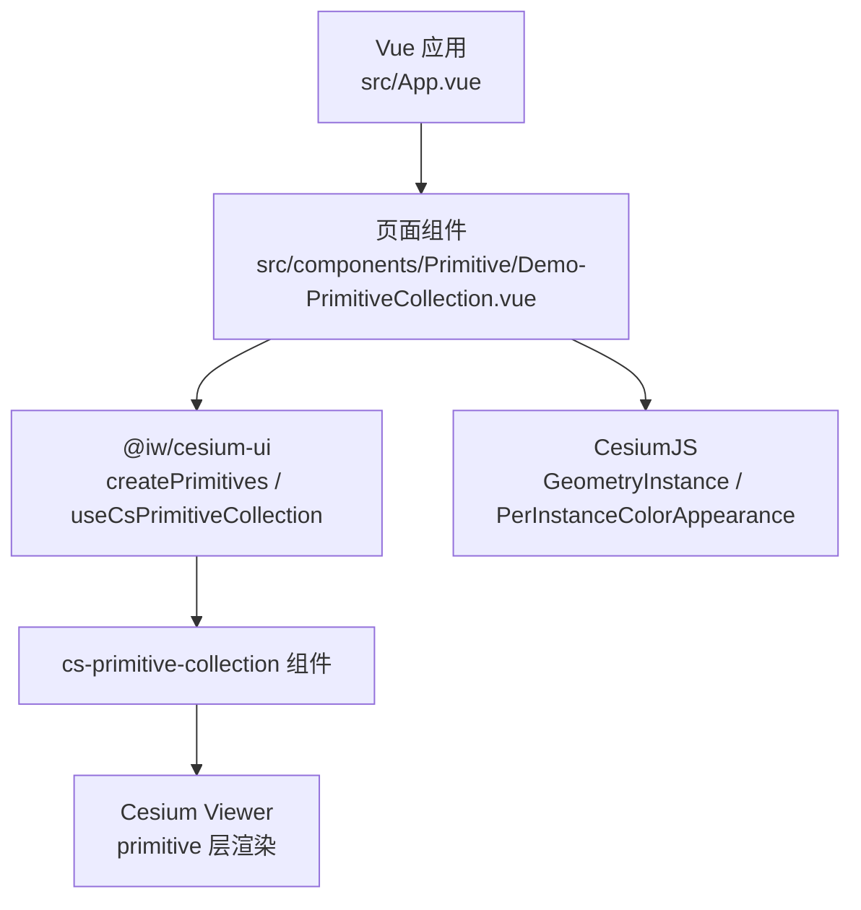
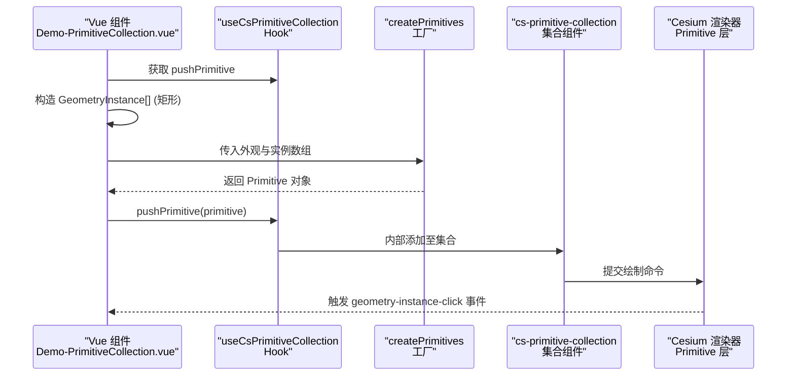
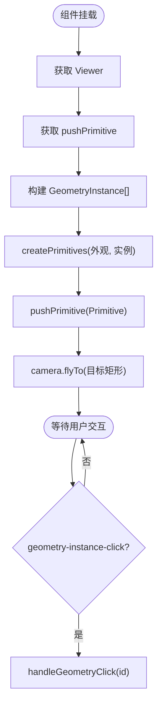
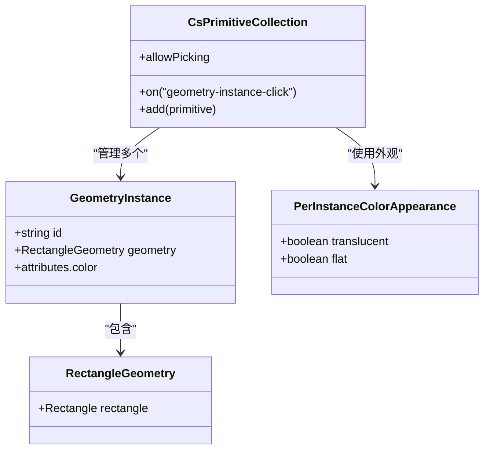
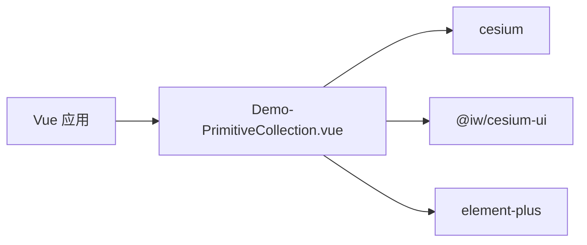

# Primitive 集合管理

<cite>
**本文引用的文件**   
- [Demo-PrimitiveCollection.vue](file://src/components/Primitive/Demo-PrimitiveCollection.vue)
- [package.json](file://package.json)
</cite>

## 目录
1. [简介](#简介)
2. [项目结构](#项目结构)
3. [核心组件](#核心组件)
4. [架构总览](#架构总览)
5. [详细组件分析](#详细组件分析)
6. [依赖关系分析](#依赖关系分析)
7. [性能与内存优化](#性能与内存优化)
8. [故障排查指南](#故障排查指南)
9. [结论](#结论)
10. [附录：示例与最佳实践](#附录示例与最佳实践)

## 简介
本技术文档围绕 CesiumJS 的 Primitive 集合管理能力展开，结合仓库中的示例代码，系统说明 Primitive 对象的概念、优势与使用方式。重点包括：
- Primitive 与 Entity 的差异及适用场景
- 高性能图形对象的创建、管理与销毁机制
- 批量操作、状态更新与内存优化策略
- 点、线、面等基础图形的 Primitive 构建方法
- 动态更新与交互处理（拾取、点击）
- 性能监控与调试技巧

## 项目结构
本项目为基于 Vue 3 + Vite 的前端工程，集成 CesiumJS 与 @iw/cesium-ui 组件库。与 Primitive 集合管理直接相关的示例位于 src/components/Primitive 目录下，通过 cs-primitive-collection 组件与 createPrimitives/useCsPrimitiveCollection API 完成 Primitive 的创建与挂载。

图表来源
- [Demo-PrimitiveCollection.vue:1-99](file://src/components/Primitive/Demo-PrimitiveCollection.vue#L1-L99)

章节来源
- [Demo-PrimitiveCollection.vue:1-99](file://src/components/Primitive/Demo-PrimitiveCollection.vue#L1-L99)
- [package.json:12-17](file://package.json#L12-L17)

## 核心组件
- cs-primitive-collection：封装 Cesium 的 Primitive 集合能力，提供 allowPicking、事件回调等属性，便于在 Vue 中声明式地管理 Primitive。
- createPrimitives：工厂函数，将 GeometryInstance[] 与外观配置组合为一个可添加到集合的 Primitive 对象。
- useCsPrimitiveCollection：组合式 Hook，暴露 pushPrimitive 等方法，用于向集合中添加 Primitive。
- Cesium 类型与几何：GeometryInstance、RectangleGeometry、PerInstanceColorAppearance、Color 等，用于定义几何体、外观与颜色属性。

章节来源
- [Demo-PrimitiveCollection.vue:9-17](file://src/components/Primitive/Demo-PrimitiveCollection.vue#L9-L17)
- [Demo-PrimitiveCollection.vue:21-56](file://src/components/Primitive/Demo-PrimitiveCollection.vue#L21-L56)

## 架构总览
下图展示了从 Vue 组件到 Cesium 渲染管线的关键调用链，以及 Primitive 集合在其中的作用。

图表来源
- [Demo-PrimitiveCollection.vue:23-56](file://src/components/Primitive/Demo-PrimitiveCollection.vue#L23-L56)
- [Demo-PrimitiveCollection.vue:75-80](file://src/components/Primitive/Demo-PrimitiveCollection.vue#L75-L80)

## 详细组件分析

### Demo-PrimitiveCollection.vue 组件
该组件演示了如何在 Vue 中使用 cs-primitive-collection 与 createPrimitives 创建并显示一个矩形 Primitive，并启用拾取以响应点击事件。

关键流程要点：
- 初始化阶段：通过 useCsViewer 获取 Viewer，再通过 useCsPrimitiveCollection 获取 pushPrimitive。
- 几何构建：使用 RectangleGeometry 与 Rectangle.fromDegrees 定义地理范围，并通过 GeometryInstance 包装几何与颜色属性。
- 外观配置：使用 PerInstanceColorAppearance 设置半透明与平面着色。
- 添加 Primitive：通过 pushPrimitive 将创建的 Primitive 加入集合。
- 相机定位：使用 camera.flyTo 自动定位到目标矩形区域。
- 交互处理：监听 geometry-instance-click 事件，根据 GeometryInstance.id 进行业务逻辑。

图表来源
- [Demo-PrimitiveCollection.vue:23-56](file://src/components/Primitive/Demo-PrimitiveCollection.vue#L23-L56)
- [Demo-PrimitiveCollection.vue:59-61](file://src/components/Primitive/Demo-PrimitiveCollection.vue#L59-L61)

章节来源
- [Demo-PrimitiveCollection.vue:1-99](file://src/components/Primitive/Demo-PrimitiveCollection.vue#L1-L99)

### Primitive 集合与外观
- 集合能力：cs-primitive-collection 提供 allowPicking 开关与 geometry-instance-click 事件，简化拾取与交互逻辑。
- 外观控制：PerInstanceColorAppearance 支持 translucent 与 flat 等选项，影响渲染路径与性能。
- 实例化：GeometryInstance 支持 id、geometry、attributes 等字段，id 可用于拾取识别。

章节来源
- [Demo-PrimitiveCollection.vue:30-51](file://src/components/Primitive/Demo-PrimitiveCollection.vue#L30-L51)
- [Demo-PrimitiveCollection.vue:75-80](file://src/components/Primitive/Demo-PrimitiveCollection.vue#L75-L80)

### 数据模型与关系

图表来源
- [Demo-PrimitiveCollection.vue:30-51](file://src/components/Primitive/Demo-PrimitiveCollection.vue#L30-L51)
- [Demo-PrimitiveCollection.vue:75-80](file://src/components/Primitive/Demo-PrimitiveCollection.vue#L75-L80)

## 依赖关系分析
- 运行时依赖：cesium 提供底层图形能力；@iw/cesium-ui 提供 Vue 组件与工具函数。
- 组件依赖：Demo-PrimitiveCollection.vue 依赖 @iw/cesium-ui 的 createPrimitives、useCsPrimitiveCollection、useCsViewer 与 cs-primitive-collection 组件。
- 外部样式与 UI：使用 element-plus 的消息提示组件展示点击反馈。

图表来源
- [package.json:12-17](file://package.json#L12-L17)
- [Demo-PrimitiveCollection.vue:1-19](file://src/components/Primitive/Demo-PrimitiveCollection.vue#L1-L19)

章节来源
- [package.json:12-17](file://package.json#L12-L17)
- [Demo-PrimitiveCollection.vue:1-19](file://src/components/Primitive/Demo-PrimitiveCollection.vue#L1-L19)

## 性能与内存优化
- 批量几何合并：将多个 GeometryInstance 放入同一个 Primitive，减少 draw call 次数，提升渲染吞吐。
- 外观复用：尽量复用 PerInstanceColorAppearance 实例，避免频繁创建新外观对象。
- 按需开启拾取：仅在需要交互时启用 allowPicking，降低拾取计算开销。
- 合理设置外观参数：translucent 与 flat 会影响渲染路径，应根据场景权衡精度与性能。
- 动态更新策略：优先更新 attributes 或 geometry 的属性而非重建整个 Primitive；必要时替换整个 Primitive 并清理旧引用，避免内存泄漏。
- 相机与视锥裁剪：利用 camera.flyTo 与视锥裁剪减少离屏绘制。

[本节为通用性能建议，不直接分析具体文件]

## 故障排查指南
- 点击无响应：
  - 检查 cs-primitive-collection 是否设置 allow-picking="true"。
  - 确认 GeometryInstance 设置了唯一 id，并在 handleGeometryClick 中正确消费。
- 图形不显示：
  - 确认 RectangleGeometry 的坐标范围有效且可见。
  - 检查 PerInstanceColorAppearance 的 translucent 与 flat 配置是否符合预期。
- 性能抖动：
  - 评估是否频繁创建新的 GeometryInstance 或外观对象。
  - 考虑合并几何、减少外观切换与关闭不必要的拾取。

章节来源
- [Demo-PrimitiveCollection.vue:75-80](file://src/components/Primitive/Demo-PrimitiveCollection.vue#L75-L80)
- [Demo-PrimitiveCollection.vue:59-61](file://src/components/Primitive/Demo-PrimitiveCollection.vue#L59-L61)

## 结论
通过 cs-primitive-collection 与 createPrimitives/useCsPrimitiveCollection，可以在 Vue 应用中高效地管理 Cesium Primitive 集合。结合 GeometryInstance 与 PerInstanceColorAppearance，能够灵活构建点、线、面等基础图形，并以较低开销实现动态更新与交互。遵循批量合并、外观复用与按需拾取的策略，可在大规模场景中保持良好性能。

[本节为总结性内容，不直接分析具体文件]

## 附录：示例与最佳实践

### 创建基础图形 Primitive 的方法
- 点：使用 PointGraphics 对应的几何（如 CircleGeometry），配合 GeometryInstance 与外观。
- 线：使用 PolylineGeometry 或 PathGeometry，按顶点序列构建 GeometryInstance。
- 面：使用 PolygonGeometry 或 RectangleGeometry，按边界坐标构建 GeometryInstance。

注意：以上为概念性说明，实际实现请参考仓库中的几何与外观用法模式。

章节来源
- [Demo-PrimitiveCollection.vue:30-51](file://src/components/Primitive/Demo-PrimitiveCollection.vue#L30-L51)

### 动态更新与交互处理
- 动态更新：优先修改 GeometryInstance.attributes 或 geometry 的可变属性，避免重建 Primitive。
- 交互处理：监听 geometry-instance-click，依据 GeometryInstance.id 执行业务逻辑。

章节来源
- [Demo-PrimitiveCollection.vue:59-61](file://src/components/Primitive/Demo-PrimitiveCollection.vue#L59-L61)

### 性能监控与调试技巧
- 使用浏览器开发者工具的 Performance 面板记录帧率与 GPU 时间，观察 draw call 数量变化。
- 在 Chrome DevTools 的 Memory 面板进行堆快照对比，检查是否存在未释放的 GeometryInstance 或外观对象。
- 逐步关闭 allow-picking 与 translucent，评估对性能的影响。

[本节为通用调试建议，不直接分析具体文件]