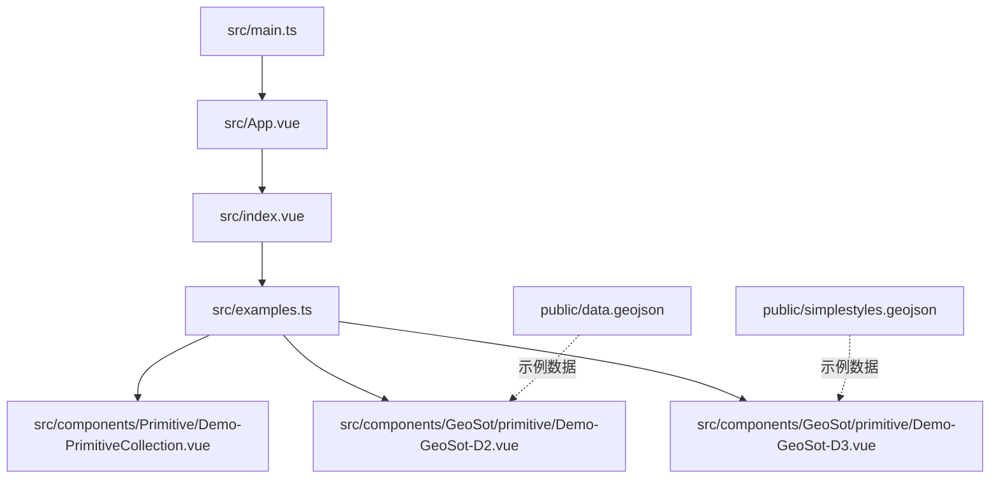
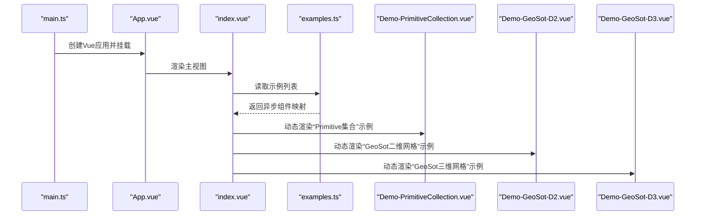
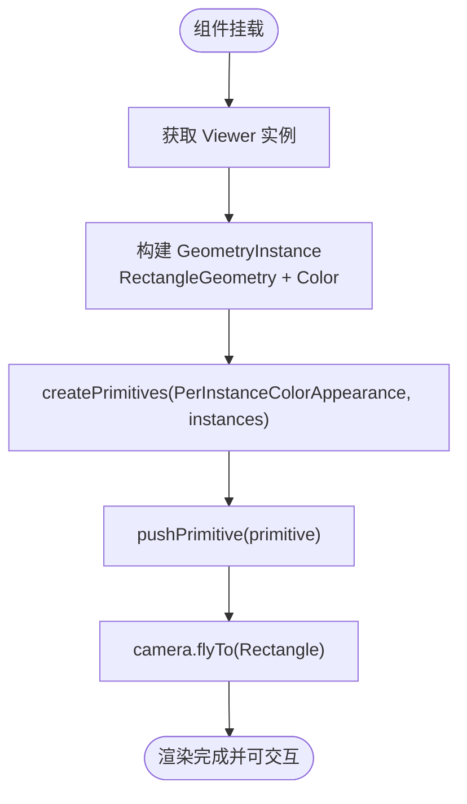
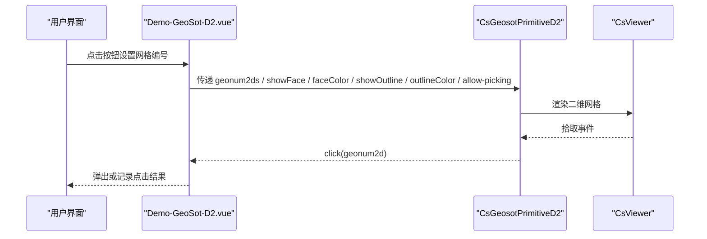
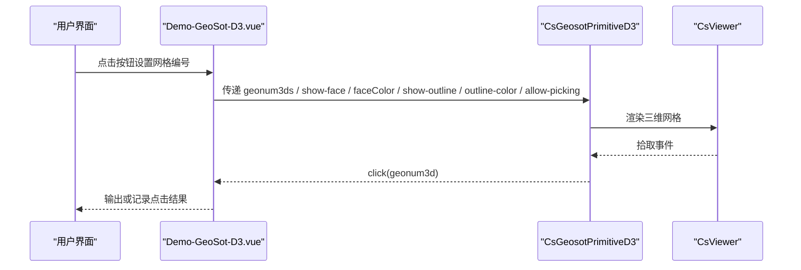
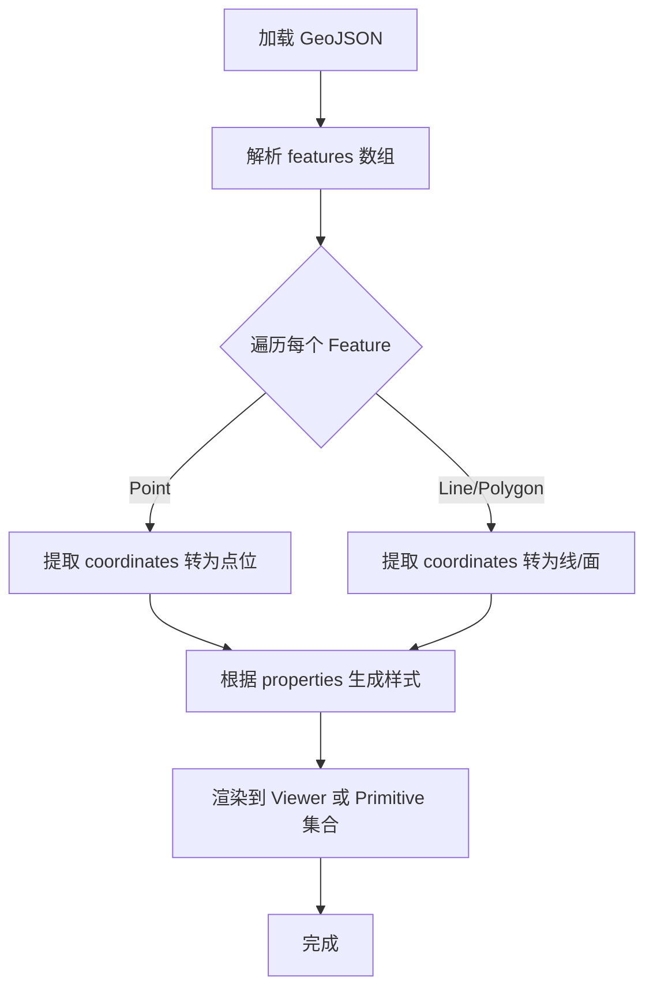
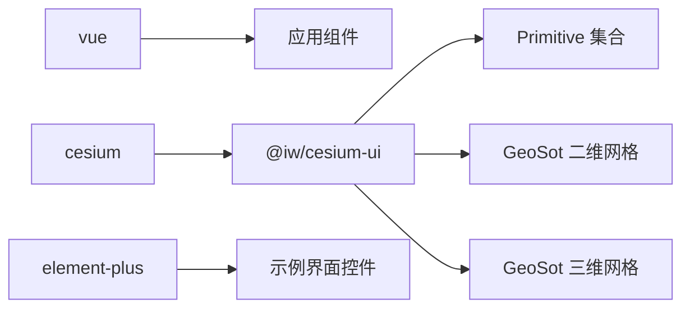

# 数据可视化

<cite>
**本文引用的文件**   
- [main.ts](file://src/main.ts)
- [index.vue](file://src/index.vue)
- [examples.ts](file://src/examples.ts)
- [Demo-PrimitiveCollection.vue](file://src/components/Primitive/Demo-PrimitiveCollection.vue)
- [Demo-GeoSot-D2.vue](file://src/components/GeoSot/primitive/Demo-GeoSot-D2.vue)
- [Demo-GeoSot-D3.vue](file://src/components/GeoSot/primitive/Demo-GeoSot-D3.vue)
- [data.geojson](file://public/data.geojson)
- [simplestyles.geojson](file://public/simplestyles.geojson)
</cite>

## 目录
1. [简介](#简介)
2. [项目结构](#项目结构)
3. [核心组件](#核心组件)
4. [架构总览](#架构总览)
5. [详细组件分析](#详细组件分析)
6. [依赖关系分析](#依赖关系分析)
7. [性能与优化](#性能与优化)
8. [故障排查](#故障排查)
9. [结论](#结论)
10. [附录：数据格式与样式规范](#附录数据格式与样式规范)

## 简介
本技术文档围绕仓库中的数据可视化能力展开，重点覆盖以下方面：
- GeoJSON 数据的加载与渲染机制（以示例数据为参考）
- Primitive 集合的高性能图形对象管理（基于 Cesium 的 GeometryInstance 与 PerInstanceColorAppearance）
- GeoSot 网格系统的二维与三维展示（通过 CsGeosotPrimitiveD2、CsGeosotPrimitiveD3）
- 数据格式规范、样式配置选项与性能优化策略
- 实际数据处理示例与可视化效果说明
- 不同可视化技术的适用场景与选择原则

本项目采用 Vue 3 + TypeScript + Vite 构建，使用 @iw/cesium-ui 封装 Cesium 能力，提供 Viewer、Primitive 集合与 GeoSot 网格等可视化组件。

## 项目结构
- 应用入口与初始化
  - src/main.ts：注册 Cesium Ion Token、ElementPlus、@iw/cesium-ui，并挂载根组件
  - src/App.vue：引入 index.vue 作为主视图容器
  - src/index.vue：根据 examples.ts 动态切换示例组件
- 示例编排
  - src/examples.ts：集中定义所有示例的懒加载组件映射，包括 Primitive 集合与 GeoSot 二维/三维网格
- 可视化示例
  - src/components/Primitive/Demo-PrimitiveCollection.vue：演示高性能 Primitive 集合创建与管理
  - src/components/GeoSot/primitive/Demo-GeoSot-D2.vue：二维 GeoSot 网格展示与交互
  - src/components/GeoSot/primitive/Demo-GeoSot-D3.vue：三维 GeoSot 网格展示与交互
- 示例数据
  - public/data.geojson：包含一个 Point 要素的 GeoJSON 示例
  - public/simplestyles.geojson：大量带 marker-symbol 与 marker-color 的点要素示例

图表来源
- [main.ts:1-26](file://src/main.ts#L1-L26)
- [index.vue:1-55](file://src/index.vue#L1-L55)
- [examples.ts:1-59](file://src/examples.ts#L1-L59)
- [Demo-PrimitiveCollection.vue:1-99](file://src/components/Primitive/Demo-PrimitiveCollection.vue#L1-L99)
- [Demo-GeoSot-D2.vue:1-175](file://src/components/GeoSot/primitive/Demo-GeoSot-D2.vue#L1-L175)
- [Demo-GeoSot-D3.vue:1-169](file://src/components/GeoSot/primitive/Demo-GeoSot-D3.vue#L1-L169)

章节来源
- [main.ts:1-26](file://src/main.ts#L1-L26)
- [index.vue:1-55](file://src/index.vue#L1-L55)
- [examples.ts:1-59](file://src/examples.ts#L1-L59)

## 核心组件
- CsViewer：Cesium Viewer 的封装，负责地图容器、相机控制、图层管理等基础能力
- CsPrimitiveCollection：高性能 Primitive 集合封装，支持批量 GeometryInstance 管理与点击事件回调
- CsGeosotPrimitiveD2：二维 GeoSot 网格渲染组件，支持面与线框显示、颜色配置、拾取开关
- CsGeosotPrimitiveD3：三维 GeoSot 网格渲染组件，支持面与线框显示、颜色配置、拾取开关

这些组件在示例中通过 props 暴露关键样式与行为参数，如 faceColor、outlineColor、showFace、showOutline、allow-picking 等，便于在业务中灵活定制。

章节来源
- [Demo-PrimitiveCollection.vue:1-99](file://src/components/Primitive/Demo-PrimitiveCollection.vue#L1-L99)
- [Demo-GeoSot-D2.vue:1-175](file://src/components/GeoSot/primitive/Demo-GeoSot-D2.vue#L1-L175)
- [Demo-GeoSot-D3.vue:1-169](file://src/components/GeoSot/primitive/Demo-GeoSot-D3.vue#L1-L169)

## 架构总览
下图展示了从应用启动到具体可视化示例的调用链路与组件关系。

图表来源
- [main.ts:1-26](file://src/main.ts#L1-L26)
- [index.vue:1-55](file://src/index.vue#L1-L55)
- [examples.ts:1-59](file://src/examples.ts#L1-L59)
- [Demo-PrimitiveCollection.vue:1-99](file://src/components/Primitive/Demo-PrimitiveCollection.vue#L1-L99)
- [Demo-GeoSot-D2.vue:1-175](file://src/components/GeoSot/primitive/Demo-GeoSot-D2.vue#L1-L175)
- [Demo-GeoSot-D3.vue:1-169](file://src/components/GeoSot/primitive/Demo-GeoSot-D3.vue#L1-L169)

## 详细组件分析

### Primitive 集合高性能图形对象管理
该示例演示了如何批量创建 GeometryInstance，并使用 PerInstanceColorAppearance 进行统一外观管理，配合 useCsPrimitiveCollection 提供的 pushPrimitive 接口完成高性能渲染。

关键点
- 使用 RectangleGeometry 与 ColorGeometryInstanceAttribute 定义几何与颜色属性
- 通过 createPrimitives 与 appearance 配置 translucent、flat 等渲染特性
- 启用 allowPicking 并通过 geometry-instance-click 事件获取被点击的 id
- 使用 viewer.camera.flyTo 自动定位到矩形范围

图表来源
- [Demo-PrimitiveCollection.vue:23-57](file://src/components/Primitive/Demo-PrimitiveCollection.vue#L23-L57)

章节来源
- [Demo-PrimitiveCollection.vue:1-99](file://src/components/Primitive/Demo-PrimitiveCollection.vue#L1-L99)

### GeoSot 二维网格展示（CsGeosotPrimitiveD2）
该示例通过 CsGeosotPrimitiveD2 组件展示二维 GeoSot 网格，支持：
- 通过 geonum2ds 传入网格编号数组
- 通过 showFace 与 faceColor 控制面填充与颜色
- 通过 showOutline 与 outlineColor 控制边框线与颜色
- 通过 allow-picking 控制是否允许拾取，并在 click 事件中获取网格编号

图表来源
- [Demo-GeoSot-D2.vue:126-142](file://src/components/GeoSot/primitive/Demo-GeoSot-D2.vue#L126-L142)

章节来源
- [Demo-GeoSot-D2.vue:1-175](file://src/components/GeoSot/primitive/Demo-GeoSot-D2.vue#L1-L175)

### GeoSot 三维网格展示（CsGeosotPrimitiveD3）
该示例通过 CsGeosotPrimitiveD3 组件展示三维 GeoSot 网格，支持：
- 通过 geonum3ds 传入三维网格编号数组
- 通过 show-face 与 faceColor 控制面填充与颜色
- 通过 show-outline 与 outline-color 控制边框线与颜色
- 通过 allow-picking 控制是否允许拾取，并在 click 事件中获取网格编号

图表来源
- [Demo-GeoSot-D3.vue:124-135](file://src/components/GeoSot/primitive/Demo-GeoSot-D3.vue#L124-L135)

章节来源
- [Demo-GeoSot-D3.vue:1-169](file://src/components/GeoSot/primitive/Demo-GeoSot-D3.vue#L1-L169)

### GeoJSON 数据加载与渲染机制（示例参考）
虽然当前示例未直接实现 GeoJSON 解析管线，但仓库提供了标准 GeoJSON 数据，可用于后续扩展：
- public/data.geojson：包含一个 Point 要素，坐标位于经纬度坐标系（CRS84），properties 中包含名称与 x/y 字段
- public/simplestyles.geojson：包含大量点要素，每个要素带有 marker-symbol 与 marker-color，可用于图标与颜色映射

建议的数据处理流程
- 读取 GeoJSON 文件，遍历 features
- 对每个 Feature：
  - 解析 geometry.coordinates
  - 根据 properties 生成样式（如 marker-color -> color；marker-symbol -> icon）
  - 将数据转换为 Cesium 可渲染的实体或 Primitive（例如 PointGraphics、Billboard、或 GeometryInstance）
- 将生成的对象加入对应的图层或 Primitive 集合

[此图为概念性流程图，不直接映射具体源码]

章节来源
- [data.geojson:1-9](file://public/data.geojson#L1-L9)
- [simplestyles.geojson:1-800](file://public/simplestyles.geojson#L1-L800)

## 依赖关系分析
- 运行时依赖
  - cesium：三维地球与图形引擎
  - @iw/cesium-ui：封装 Viewer、Primitive 集合、GeoSot 网格等组件
  - element-plus：示例中的 UI 控件（按钮、复选框、颜色选择器等）
  - vue：前端框架
- 示例组织
  - examples.ts 统一管理示例组件的懒加载，避免首屏体积过大
  - index.vue 根据当前示例 id 动态渲染对应组件

图表来源
- [package.json:12-28](file://package.json#L12-L28)
- [examples.ts:1-59](file://src/examples.ts#L1-L59)

章节来源
- [package.json:1-31](file://package.json#L1-L31)
- [examples.ts:1-59](file://src/examples.ts#L1-L59)

## 性能与优化
- 使用 Primitive 集合批量渲染
  - 通过 GeometryInstance 与 PerInstanceColorAppearance 合并绘制批次，减少状态切换开销
  - 合理设置 translucent、flat 等外观参数，平衡视觉效果与性能
- 按需渲染与懒加载
  - 示例组件通过 defineAsyncComponent 懒加载，降低初始包体与首次渲染时间
  - 使用 v-if 控制网格组件的显隐，避免不必要的渲染
- 控制拾取与交互
  - 对不需要交互的网格关闭 allow-picking，减少拾取计算开销
- 数据驱动更新
  - 通过 ref 与 watch 响应式更新网格颜色与可见性，结合 nextTick 确保 DOM 更新后再触发重绘
- 相机定位与视锥裁剪
  - 使用 camera.flyTo 快速定位到感兴趣区域，利用视锥裁剪减少不可见区域的渲染压力

章节来源
- [Demo-PrimitiveCollection.vue:23-57](file://src/components/Primitive/Demo-PrimitiveCollection.vue#L23-L57)
- [Demo-GeoSot-D2.vue:37-97](file://src/components/GeoSot/primitive/Demo-GeoSot-D2.vue#L37-L97)
- [Demo-GeoSot-D3.vue:45-94](file://src/components/GeoSot/primitive/Demo-GeoSot-D3.vue#L45-L94)
- [examples.ts:6-19](file://src/examples.ts#L6-L19)

## 故障排查
- 网格不显示
  - 检查 geonum2ds/geonum3ds 是否为空数组
  - 确认 showFace/showOutline 与 allow-picking 配置是否符合预期
  - 若通过 v-if 控制显示，确保布尔值变化正确触发重新渲染
- 颜色不生效
  - 检查 faceColor/outlineColor 的颜色格式（如 rgba 字符串）
  - 注意 watch 与 nextTick 的使用顺序，确保在 DOM 更新后再次赋值
- 点击事件无响应
  - 确认 allow-picking 已开启
  - 检查 click 事件绑定与回调参数是否正确
- 性能问题
  - 减少频繁重建 Primitive 集合，尽量复用已有实例
  - 关闭不必要的透明与阴影效果
  - 控制同时显示的网格数量，必要时分页或分块加载

章节来源
- [Demo-GeoSot-D2.vue:37-97](file://src/components/GeoSot/primitive/Demo-GeoSot-D2.vue#L37-L97)
- [Demo-GeoSot-D3.vue:45-94](file://src/components/GeoSot/primitive/Demo-GeoSot-D3.vue#L45-L94)
- [Demo-PrimitiveCollection.vue:59-61](file://src/components/Primitive/Demo-PrimitiveCollection.vue#L59-L61)

## 结论
本项目通过 @iw/cesium-ui 封装的 Viewer、Primitive 集合与 GeoSot 网格组件，实现了高效、可扩展的数据可视化能力。示例覆盖了高性能图形对象管理、二维与三维网格展示，以及基于 GeoJSON 的数据处理思路。在实际工程中，可根据业务需求选择合适的可视化技术：
- 大规模点线面数据：优先使用 Primitive 集合与 GeometryInstance 批量化渲染
- 空间索引与网格化展示：使用 GeoSot 网格组件，结合面与线框样式进行分层表达
- 交互式标注与信息窗口：结合 Billboard、Label 与 InfoWindow 等组件增强用户体验

## 附录：数据格式与样式规范
- GeoJSON 基本结构
  - type: FeatureCollection
  - features: 要素数组，每个要素包含 geometry 与 properties
  - geometry.type: Point/LineString/Polygon 等
  - geometry.coordinates: 坐标数组（经度、纬度，CRS84）
  - properties: 自定义属性，用于样式与交互（如名称、颜色、图标符号）
- 样式字段约定（参考 simplestyles.geojson）
  - marker-color：点的颜色（十六进制色值）
  - marker-symbol：点的图标符号（字母、数字或预定义图标名）
- 示例数据路径
  - public/data.geojson：单点示例
  - public/simplestyles.geojson：多点示例，适合测试颜色与图标映射

章节来源
- [data.geojson:1-9](file://public/data.geojson#L1-L9)
- [simplestyles.geojson:1-800](file://public/simplestyles.geojson#L1-L800)