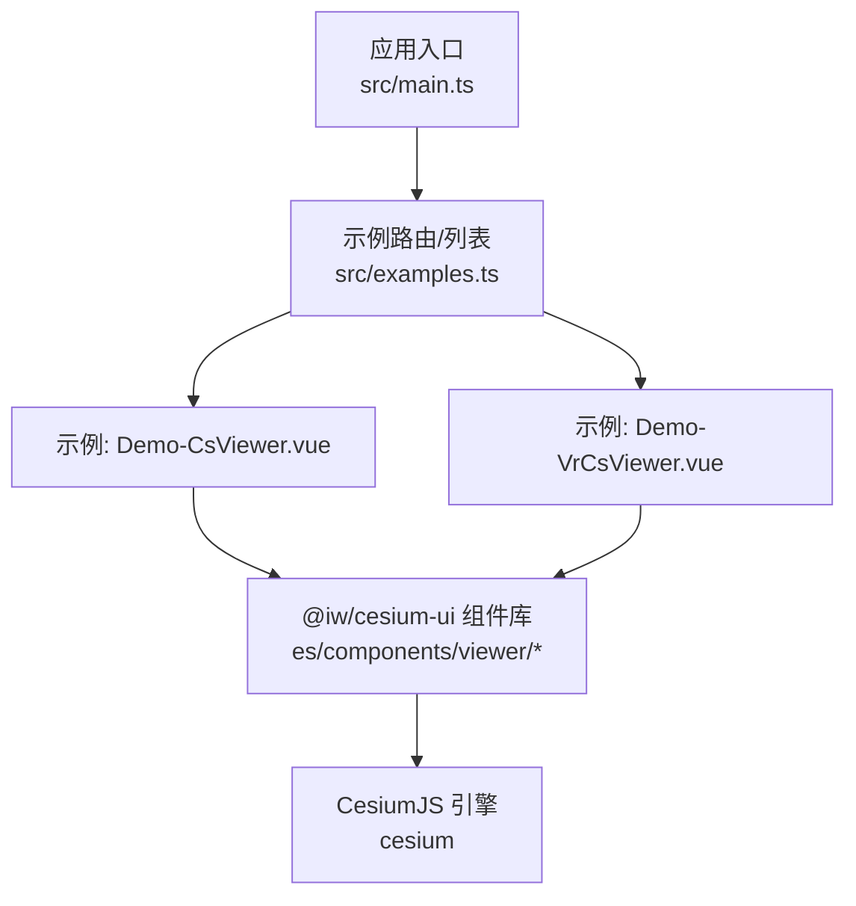
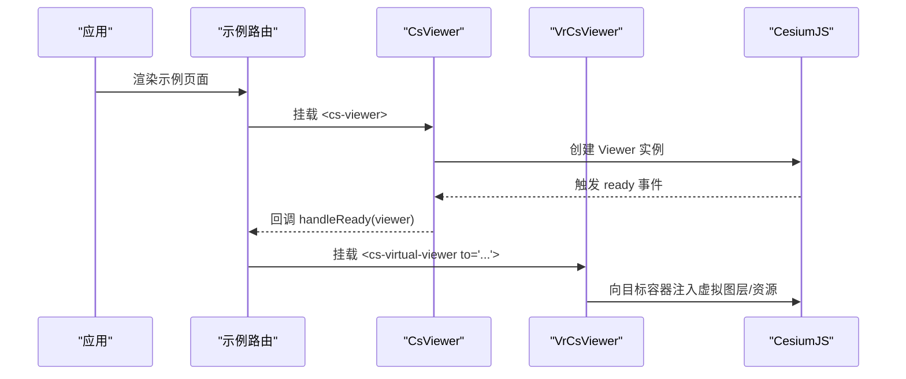
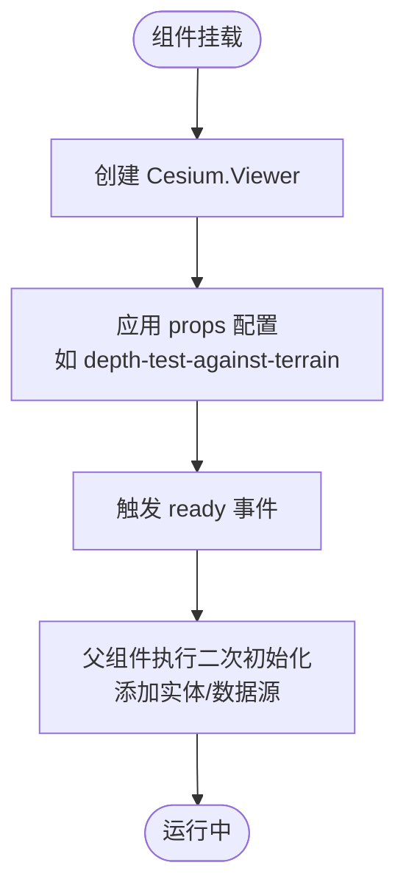
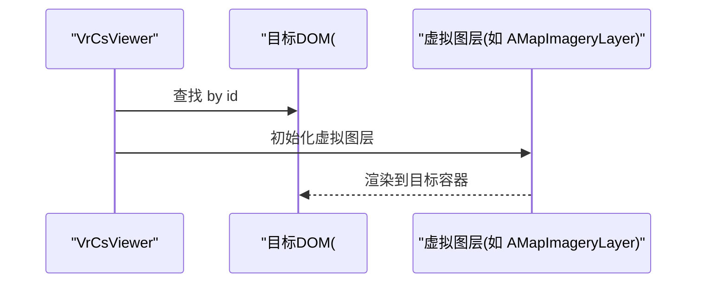
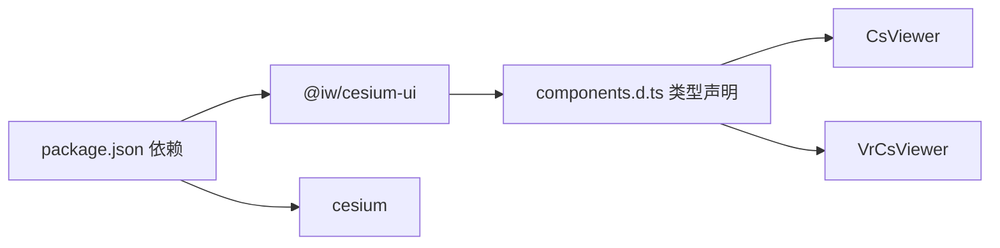

# Viewer 组件架构

<cite>
**本文引用的文件**   
- [package.json](file://package.json)
- [examples.ts](file://src/examples.ts)
- [main.ts](file://src/main.ts)
- [Demo-CsViewer.vue](file://src/components/Viewer/Demo-CsViewer.vue)
- [Demo-VrCsViewer.vue](file://src/components/Viewer/Demo-VrCsViewer.vue)
- [components.d.ts](file://components.d.ts)
- [cesium-ui viewer/index.js](file://node_modules/@iw/cesium-ui/es/components/viewer/index.js)
- [cesium-ui viewer/viewer.js](file://node_modules/@iw/cesium-ui/es/components/viewer/viewer.js)
- [cesium-ui viewer/viewer2.js](file://node_modules/@iw/cesium-ui/es/components/viewer/viewer2.js)
- [cesium-ui viewer/viewer.vue_vue_type_script_setup_true_lang.js](file://node_modules/@iw/cesium-ui/es/components/viewer/viewer/viewer.vue_vue_type_script_setup_true_lang.js)
</cite>

## 目录
1. [简介](#简介)
2. [项目结构](#项目结构)
3. [核心组件](#核心组件)
4. [架构总览](#架构总览)
5. [详细组件分析](#详细组件分析)
6. [依赖关系分析](#依赖关系分析)
7. [性能考虑](#性能考虑)
8. [故障排查指南](#故障排查指南)
9. [结论](#结论)
10. [附录：使用示例与最佳实践](#附录使用示例与最佳实践)

## 简介
本文件面向三维地球查看器（基于 CesiumJS）的 Vue 封装组件，重点解析 CsViewer 与 VrCsViewer 的设计模式、初始化流程与生命周期管理。文档同时说明三维地球查看器的配置项、事件处理机制、虚拟环境实现原理，并给出属性接口、方法调用与事件监听的使用示例。最后提供 CesiumJS 引擎集成方式与性能优化策略，以及自定义扩展与主题定制指导。

## 项目结构
本项目通过 Vite + Vue 3 构建，使用 @iw/cesium-ui 提供的 CsViewer 与 VrCsViewer 等组件，结合 cesium 引擎进行三维可视化。示例入口在 examples.ts 中注册了两个 Viewer 相关示例；主应用 main.ts 中进行了必要的初始化配置。

图表来源
- [main.ts:21-21](file://src/main.ts#L21-L21)
- [examples.ts:23-25](file://src/examples.ts#L23-L25)
- [Demo-CsViewer.vue:8-10](file://src/components/Viewer/Demo-CsViewer.vue#L8-L10)
- [Demo-VrCsViewer.vue:3-5](file://src/components/Viewer/Demo-VrCsViewer.vue#L3-L5)
- [cesium-ui viewer/index.js](file://node_modules/@iw/cesium-ui/es/components/viewer/index.js)

章节来源
- [package.json:12-17](file://package.json#L12-L17)
- [examples.ts:23-25](file://src/examples.ts#L23-L25)
- [main.ts:21-21](file://src/main.ts#L21-L21)

## 核心组件
- CsViewer：三维地球查看器容器，负责创建并管理 Cesium.Viewer 实例，暴露 ready 事件与常用属性（如地形深度测试开关），支持挂载子组件（测量、图层等）。
- VrCsViewer（虚拟查看器）：用于将一组“虚拟”图层或资源注入到指定 DOM 容器中，与真实 CsViewer 解耦，便于按需加载与切换场景。

章节来源
- [Demo-CsViewer.vue:8-10](file://src/components/Viewer/Demo-CsViewer.vue#L8-L10)
- [Demo-VrCsViewer.vue:5-5](file://src/components/Viewer/Demo-VrCsViewer.vue#L5-L5)
- [components.d.ts:20-20](file://components.d.ts#L20-L20)
- [components.d.ts:77-77](file://components.d.ts#L77-L77)

## 架构总览
下图展示了从应用入口到 CesiumJS 引擎的调用链，以及 CsViewer/VrCsViewer 的职责边界。

图表来源
- [examples.ts:23-25](file://src/examples.ts#L23-L25)
- [Demo-CsViewer.vue:20-36](file://src/components/Viewer/Demo-CsViewer.vue#L20-L36)
- [Demo-VrCsViewer.vue:22-26](file://src/components/Viewer/Demo-VrCsViewer.vue#L22-L26)

## 详细组件分析

### CsViewer 组件
- 设计模式
  - 容器型组件：负责 Cesium.Viewer 的生命周期管理（创建、销毁、更新）。
  - 事件驱动：对外暴露 ready 事件，供父组件在 Viewer 可用时执行二次初始化。
  - 组合式 API：通过 props 控制行为（如地形深度测试），并通过插槽挂载功能子组件（如测量工具）。
- 初始化流程
  1. 组件挂载后创建 Cesium.Viewer 实例。
  2. 根据 props 设置基础配置（例如 depth-test-against-terrain）。
  3. 触发 ready 事件，返回 Viewer 引用给父组件。
- 生命周期管理
  - mounted：创建 Viewer，绑定事件。
  - beforeUnmount：清理 Viewer 实例与事件监听，避免内存泄漏。
- 关键属性与方法（基于示例与类型声明推断）
  - 属性：depth-test-against-terrain（布尔，是否启用地形深度测试）。
  - 事件：ready(viewer)，在 Viewer 初始化完成后触发。
  - 方法：由父组件通过 ref 获取后调用（如 zoomTo、entities.add 等）。
- 错误处理
  - 建议在 ready 回调中进行数据加载与实体添加，确保底层引擎已就绪。
  - 对异步数据加载失败进行兜底处理（如 GeoJSON 加载失败提示）。

图表来源
- [Demo-CsViewer.vue:20-36](file://src/components/Viewer/Demo-CsViewer.vue#L20-L36)
- [cesium-ui viewer/viewer.js](file://node_modules/@iw/cesium-ui/es/components/viewer/viewer.js)
- [cesium-ui viewer/viewer2.js](file://node_modules/@iw/cesium-ui/es/components/viewer/viewer2.js)
- [cesium-ui viewer/viewer.vue_vue_type_script_setup_true_lang.js](file://node_modules/@iw/cesium-ui/es/components/viewer/viewer/viewer.vue_vue_type_script_setup_true_lang.js)

章节来源
- [Demo-CsViewer.vue:8-36](file://src/components/Viewer/Demo-CsViewer.vue#L8-L36)
- [components.d.ts:20-20](file://components.d.ts#L20-L20)
- [cesium-ui viewer/index.js](file://node_modules/@iw/cesium-ui/es/components/viewer/index.js)

### VrCsViewer（虚拟查看器）
- 设计模式
  - 虚拟容器：不直接持有 Viewer 实例，而是通过 to 属性指向目标 DOM id，将虚拟图层/资源注入该容器。
  - 解耦注入：与真实 CsViewer 分离，便于在不同场景中复用同一组虚拟资源。
- 初始化流程
  1. 解析 to 属性对应的 DOM 节点。
  2. 将内部虚拟图层（如地图影像层）注入到目标容器。
  3. 与 CsViewer 的渲染上下文协同工作。
- 典型用法
  - 在模板中使用 <cs-virtual-viewer to="cesium-viewer"> 包裹虚拟图层组件。
  - 与 CsViewer 配合，实现动态图层切换与场景编排。

图表来源
- [Demo-VrCsViewer.vue:22-26](file://src/components/Viewer/Demo-VrCsViewer.vue#L22-L26)
- [components.d.ts:77-77](file://components.d.ts#L77-L77)

章节来源
- [Demo-VrCsViewer.vue:5-26](file://src/components/Viewer/Demo-VrCsViewer.vue#L5-L26)
- [components.d.ts:77-77](file://components.d.ts#L77-L77)

### 三维地球查看器配置与事件
- 配置选项（示例可见）
  - depth-test-against-terrain：控制地形深度测试开关。
  - 其他常见配置（如 imageryProvider、terrainProvider、animation、timeline 等）可通过 Viewer 实例在 ready 回调中设置。
- 事件机制
  - ready：Viewer 初始化完成，可安全访问 Cesium API。
  - 其他 Cesium 原生事件（如 click、mousemove）可在父组件中通过 viewer 实例订阅。

章节来源
- [Demo-CsViewer.vue:20-36](file://src/components/Viewer/Demo-CsViewer.vue#L20-L36)

### 虚拟环境实现原理
- 虚拟查看器通过 to 属性定位目标 DOM，将虚拟图层渲染到该容器，从而与真实 Viewer 共享渲染上下文。
- 适用于多场景切换、按需加载图层、离线/在线资源切换等。

章节来源
- [Demo-VrCsViewer.vue:22-26](file://src/components/Viewer/Demo-VrCsViewer.vue#L22-L26)

## 依赖关系分析
- 应用依赖
  - @iw/cesium-ui：提供 CsViewer、VrCsViewer 等组件。
  - cesium：三维引擎。
  - vue：前端框架。
- 组件导出
  - components.d.ts 中自动生成的类型声明包含 CsViewer、VrCsViewer 等组件的类型映射。

图表来源
- [package.json:12-17](file://package.json#L12-L17)
- [components.d.ts:20-20](file://components.d.ts#L20-L20)
- [components.d.ts:77-77](file://components.d.ts#L77-L77)

章节来源
- [package.json:12-17](file://package.json#L12-L17)
- [components.d.ts:20-20](file://components.d.ts#L20-L20)
- [components.d.ts:77-77](file://components.d.ts#L77-L77)

## 性能考虑
- 延迟加载与懒加载
  - 示例通过 defineAsyncComponent 与 lazy 包装，减少首屏体积。
- 合理的数据加载时机
  - 在 ready 回调中加载 GeoJSON 等大型数据，避免阻塞初始渲染。
- 渲染优化建议
  - 按需开启/关闭动画、时间线、阴影等昂贵特性。
  - 合理使用 ImageryLayer 与 TerrainProvider，避免过多叠加。
  - 对大量点/面/线使用聚合或简化几何。
- 内存管理
  - 组件卸载时清理 Viewer 实例与事件监听，避免内存泄漏。

章节来源
- [examples.ts:6-18](file://src/examples.ts#L6-L18)
- [Demo-CsViewer.vue:31-35](file://src/components/Viewer/Demo-CsViewer.vue#L31-L35)

## 故障排查指南
- 常见问题
  - 在 ready 之前访问 viewer 导致报错：确保所有 Cesium API 调用在 ready 回调内执行。
  - GeoJSON 加载失败：检查路径与跨域配置，必要时增加错误提示与重试逻辑。
  - 虚拟图层未渲染：确认 to 属性对应的 DOM id 存在且未被覆盖。
- 调试建议
  - 在 ready 回调中打印 viewer 对象，验证引擎状态。
  - 使用浏览器开发者工具检查网络请求与资源加载情况。

章节来源
- [Demo-CsViewer.vue:20-36](file://src/components/Viewer/Demo-CsViewer.vue#L20-L36)
- [Demo-VrCsViewer.vue:22-26](file://src/components/Viewer/Demo-VrCsViewer.vue#L22-L26)

## 结论
CsViewer 作为 Cesium.Viewer 的容器组件，提供了稳定的初始化与生命周期管理能力，并通过 ready 事件将控制权交还给业务层。VrCsViewer 以虚拟容器的形式解耦图层注入，提升了场景编排的灵活性。结合示例中的懒加载与按需在 ready 中加载数据的模式，可以在保证性能的同时实现丰富的三维可视化能力。

## 附录：使用示例与最佳实践

### 属性接口与事件监听
- CsViewer
  - 属性：depth-test-against-terrain（布尔）
  - 事件：ready(viewer)
- VrCsViewer
  - 属性：to（字符串，目标 DOM id）
  - 作用：将虚拟图层注入到指定容器

章节来源
- [Demo-CsViewer.vue:48-48](file://src/components/Viewer/Demo-CsViewer.vue#L48-L48)
- [Demo-VrCsViewer.vue:24-26](file://src/components/Viewer/Demo-VrCsViewer.vue#L24-L26)

### 方法调用示例（通过 ref 获取 viewer 后）
- 添加点实体
  - 参考路径：[Demo-CsViewer.vue:23-29](file://src/components/Viewer/Demo-CsViewer.vue#L23-L29)
- 加载 GeoJSON 数据并缩放至数据范围
  - 参考路径：[Demo-CsViewer.vue:31-35](file://src/components/Viewer/Demo-CsViewer.vue#L31-L35)

### CesiumJS 引擎集成方式
- 在 ready 回调中直接使用 Cesium API（如 Cartesian3、Color、GeoJsonDataSource）。
- 通过 @iw/cesium-ui 提供的组件统一管理与主题样式。

章节来源
- [Demo-CsViewer.vue:8-9](file://src/components/Viewer/Demo-CsViewer.vue#L8-L9)
- [Demo-CsViewer.vue:20-36](file://src/components/Viewer/Demo-CsViewer.vue#L20-L36)

### 自定义扩展与主题定制
- 扩展
  - 在 CsViewer 插槽中插入自定义功能组件（如测量、信息窗体等）。
  - 在 ready 回调中扩展 Viewer 行为（如自定义控件、事件监听）。
- 主题
  - 使用 @iw/cesium-ui 的主题默认样式，或通过 CSS 变量覆盖默认主题。
  - 结合组件库提供的主题配置项进行全局样式定制。

章节来源
- [Demo-VrCsViewer.vue:22-26](file://src/components/Viewer/Demo-VrCsViewer.vue#L22-L26)
- [package.json:12-17](file://package.json#L12-L17)