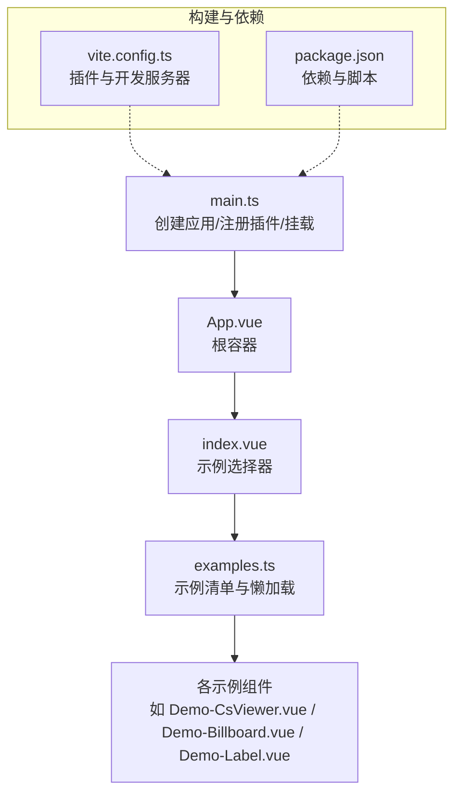
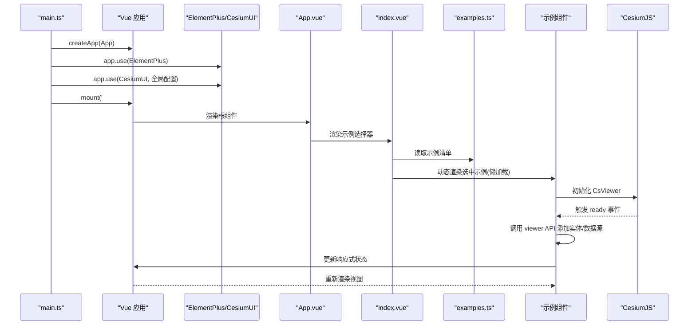
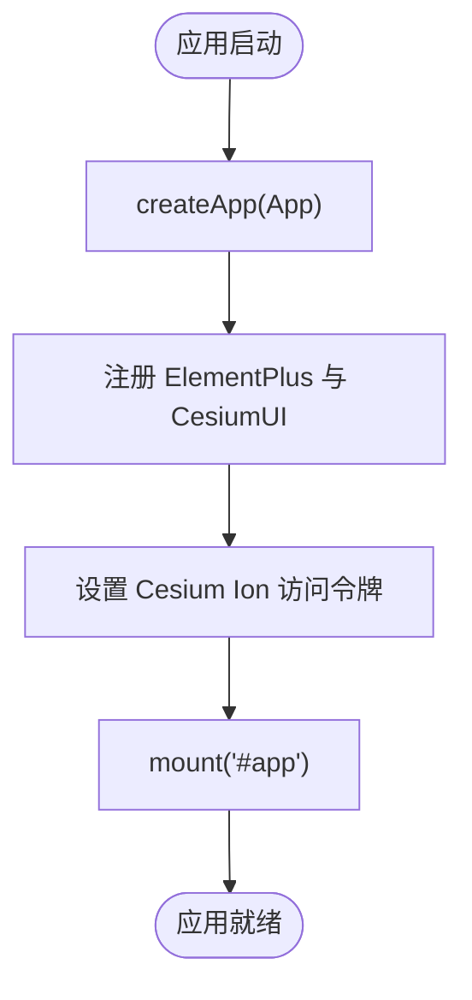
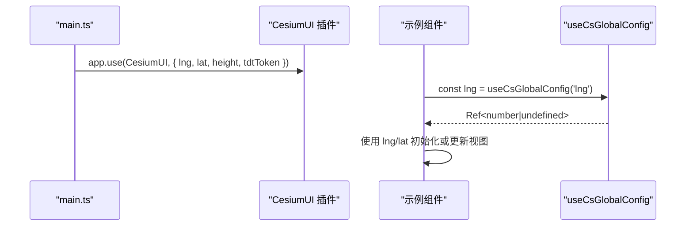
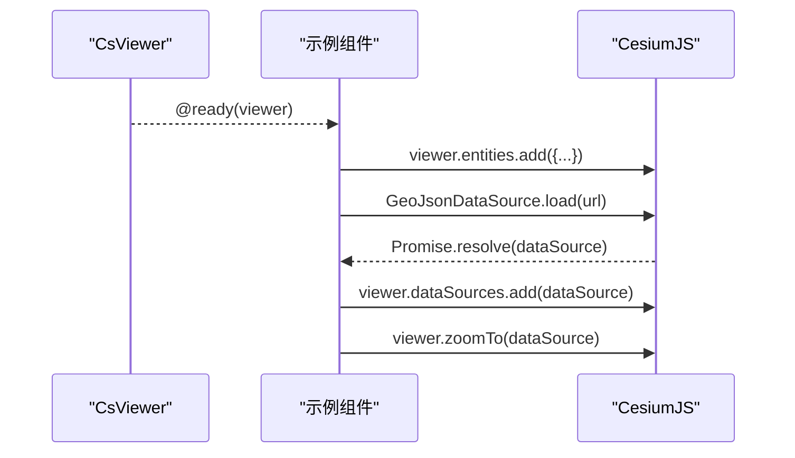
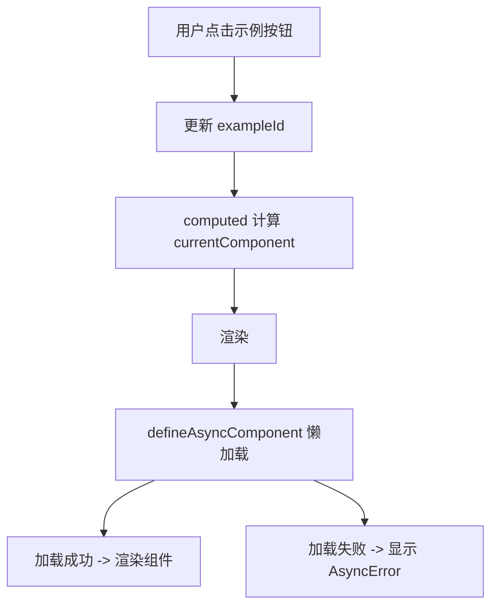
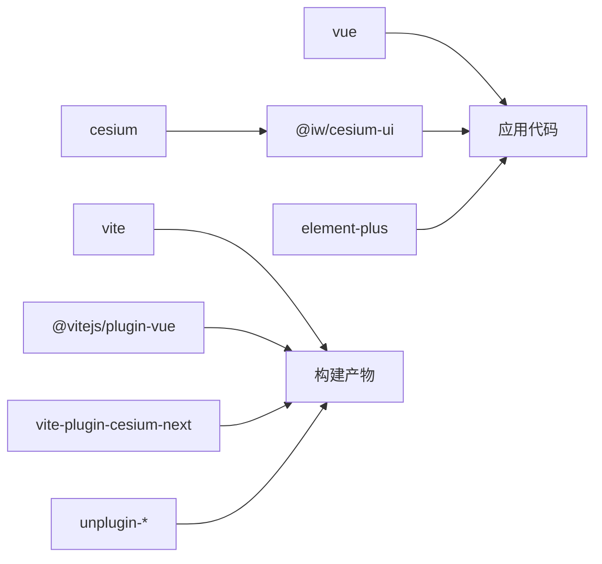

# 数据流设计

<cite>
**本文引用的文件**   
- [main.ts](file://src/main.ts)
- [App.vue](file://src/App.vue)
- [index.vue](file://src/index.vue)
- [examples.ts](file://src/examples.ts)
- [vite.config.ts](file://vite.config.ts)
- [package.json](file://package.json)
- [Demo-CsViewer.vue](file://src/components/Viewer/Demo-CsViewer.vue)
- [Demo-Billboard.vue](file://src/components/Entity/billboard/Demo-Billboard.vue)
- [Demo-Label.vue](file://src/components/Entity/Demo-Label.vue)
</cite>

## 目录
1. [简介](#简介)
2. [项目结构](#项目结构)
3. [核心组件](#核心组件)
4. [架构总览](#架构总览)
5. [详细组件分析](#详细组件分析)
6. [依赖关系分析](#依赖关系分析)
7. [性能考虑](#性能考虑)
8. [故障排查指南](#故障排查指南)
9. [结论](#结论)

## 简介
本技术文档围绕项目的数据流设计展开，重点说明：
- Vue 3 响应式系统的数据流向与组件间通信模式
- 应用启动流程、插件注册与全局配置传递
- 事件驱动架构的实现方式、异步数据处理与错误边界处理
- CesiumJS 与 Vue 组件的数据绑定模式及性能考量
- 数据流图与优化建议

该仓库基于 Vite + Vue 3 + TypeScript，使用 @iw/cesium-ui 封装的 CsViewer 等组件集成 CesiumJS，并通过 Element Plus 提供 UI 能力。示例以“示例列表”为入口，动态加载并渲染具体功能组件。

## 项目结构
- 应用入口与初始化
  - src/main.ts：创建 Vue 应用、注册插件、设置全局配置、挂载根组件
  - vite.config.ts：Vite 构建配置，启用 Vue、Cesium、自动导入与组件解析
  - package.json：依赖与脚本定义
- 根组件与示例路由
  - src/App.vue：根容器，仅承载 index.vue
  - src/index.vue：示例选择器，根据当前示例 id 动态渲染对应组件
  - src/examples.ts：示例元数据与懒加载组件映射
- 业务示例组件
  - Viewer、Entity、Provider、Measure、Drawing、GeoSot、Others 等示例组件，演示不同数据流与交互模式

图表来源
- [main.ts:1-26](file://src/main.ts#L1-L26)
- [App.vue:1-9](file://src/App.vue#L1-L9)
- [index.vue:1-55](file://src/index.vue#L1-L55)
- [examples.ts:1-59](file://src/examples.ts#L1-L59)
- [vite.config.ts:1-25](file://vite.config.ts#L1-L25)
- [package.json:1-31](file://package.json#L1-L31)

章节来源
- [main.ts:1-26](file://src/main.ts#L1-L26)
- [App.vue:1-9](file://src/App.vue#L1-L9)
- [index.vue:1-55](file://src/index.vue#L1-L55)
- [examples.ts:1-59](file://src/examples.ts#L1-L59)
- [vite.config.ts:1-25](file://vite.config.ts#L1-L25)
- [package.json:1-31](file://package.json#L1-L31)

## 核心组件
- main.ts
  - 创建 Vue 应用实例
  - 注册 ElementPlus 与 CesiumUI 插件
  - 注入全局配置（经度、纬度、初始高度、天地图 Token）
  - 挂载到 #app
- App.vue
  - 根容器，承载 index.vue
- index.vue
  - 维护当前示例 id
  - 通过 computed 计算当前示例与组件
  - 使用 <component :is="..."> 动态渲染
- examples.ts
  - 定义示例元数据（id、label、comp）
  - 使用 defineAsyncComponent 实现懒加载与错误边界（AsyncLoading/AsyncError）
- 示例组件（以 Viewer、Billboard、Label 为代表）
  - 通过 @ready 事件获取 Cesium Viewer 实例
  - 通过 props 接收位置、样式等数据
  - 通过 useCsGlobalConfig 读取全局配置

章节来源
- [main.ts:1-26](file://src/main.ts#L1-L26)
- [App.vue:1-9](file://src/App.vue#L1-L9)
- [index.vue:1-55](file://src/index.vue#L1-L55)
- [examples.ts:1-59](file://src/examples.ts#L1-L59)
- [Demo-CsViewer.vue:1-67](file://src/components/Viewer/Demo-CsViewer.vue#L1-L67)
- [Demo-Billboard.vue:1-56](file://src/components/Entity/billboard/Demo-Billboard.vue#L1-L56)
- [Demo-Label.vue:1-79](file://src/components/Entity/Demo-Label.vue#L1-L79)

## 架构总览
整体数据流遵循“应用初始化 → 插件注册 → 全局配置注入 → 示例选择 → 组件懒加载 → Cesium 初始化 → 事件回调 → 状态更新 → 视图渲染”的路径。

图表来源
- [main.ts:1-26](file://src/main.ts#L1-L26)
- [index.vue:1-55](file://src/index.vue#L1-L55)
- [examples.ts:1-59](file://src/examples.ts#L1-L59)
- [Demo-CsViewer.vue:1-67](file://src/components/Viewer/Demo-CsViewer.vue#L1-L67)

## 详细组件分析

### 应用启动与插件注册流程
- 在 main.ts 中：
  - 引入 Vue 与 Cesium Ion，设置默认访问令牌
  - 创建应用实例并挂载
  - 注册 ElementPlus 与 CesiumUI，后者接收全局配置对象（经度、纬度、高度、天地图 Token）
- 在 vite.config.ts 中：
  - 启用 @vitejs/plugin-vue、vite-plugin-cesium-next
  - 启用 unplugin-auto-import 与 unplugin-vue-components，配合 ElementPlusResolver 实现按需自动导入与组件解析
- 在 package.json 中：
  - 声明依赖 vue、cesium、@iw/cesium-ui、element-plus 等
  - 提供 dev/build/preview 脚本

图表来源
- [main.ts:1-26](file://src/main.ts#L1-L26)
- [vite.config.ts:1-25](file://vite.config.ts#L1-L25)
- [package.json:1-31](file://package.json#L1-L31)

章节来源
- [main.ts:1-26](file://src/main.ts#L1-L26)
- [vite.config.ts:1-25](file://vite.config.ts#L1-L25)
- [package.json:1-31](file://package.json#L1-L31)

### 全局配置传递与 useCsGlobalConfig
- 全局配置在 main.ts 中通过 app.use(CesiumUI, config) 注入
- 组件内通过 useCsGlobalConfig('lng' | 'lat') 获取 Ref 值，避免直接解构导致 undefined
- 典型用法：
  - Demo-CsViewer.vue：在 handleReady 中使用 lng/lat 创建点实体
  - Demo-Label.vue：在 onMounted 中读取 lng/lat，构造初始位置后延迟显示标签

图表来源
- [main.ts:18-24](file://src/main.ts#L18-L24)
- [Demo-CsViewer.vue:10-14](file://src/components/Viewer/Demo-CsViewer.vue#L10-L14)
- [Demo-Label.vue:37-47](file://src/components/Entity/Demo-Label.vue#L37-L47)

章节来源
- [main.ts:18-24](file://src/main.ts#L18-L24)
- [Demo-CsViewer.vue:10-14](file://src/components/Viewer/Demo-CsViewer.vue#L10-L14)
- [Demo-Label.vue:37-47](file://src/components/Entity/Demo-Label.vue#L37-L47)

### 事件驱动架构与 Cesium 数据绑定
- 组件通过 <cs-viewer @ready="handleReady"> 监听 Viewer 初始化完成事件
- 在 handleReady 中：
  - 获取 Viewer 实例
  - 调用 viewer.entities.add(...) 添加点、线、面等实体
  - 使用 GeoJsonDataSource.load(...) 异步加载 GeoJSON 数据并添加到 viewer.dataSources
- 子实体组件（如 billboard、label）通过 @ready 回调返回 entity 实例，便于进一步操作（如 flyTo）

图表来源
- [Demo-CsViewer.vue:20-35](file://src/components/Viewer/Demo-CsViewer.vue#L20-L35)
- [Demo-Billboard.vue:15-24](file://src/components/Entity/billboard/Demo-Billboard.vue#L15-L24)
- [Demo-Label.vue:14-30](file://src/components/Entity/Demo-Label.vue#L14-L30)

章节来源
- [Demo-CsViewer.vue:20-35](file://src/components/Viewer/Demo-CsViewer.vue#L20-L35)
- [Demo-Billboard.vue:15-24](file://src/components/Entity/billboard/Demo-Billboard.vue#L15-L24)
- [Demo-Label.vue:14-30](file://src/components/Entity/Demo-Label.vue#L14-L30)

### 示例选择与懒加载数据流
- index.vue 维护 exampleId，通过 computed 计算 currentExample 与 currentComponent
- examples.ts 使用 defineAsyncComponent 包装每个示例组件，并提供 loading/error 组件与重试策略
- 点击按钮切换示例时，动态组件被替换，触发新的懒加载与渲染

图表来源
- [index.vue:1-55](file://src/index.vue#L1-L55)
- [examples.ts:1-59](file://src/examples.ts#L1-L59)

章节来源
- [index.vue:1-55](file://src/index.vue#L1-L55)
- [examples.ts:1-59](file://src/examples.ts#L1-L59)

### 组件间通信模式
- 父到子：通过 props 传递位置、样式、布尔开关等（例如 billboard 的 position/image，viewer 的 depth-test-against-terrain）
- 子到父：通过自定义事件（如 @ready、@click）将内部状态或外部对象回传给父组件
- 跨层级共享：通过 useCsGlobalConfig 从 CesiumUI 插件提供的上下文读取全局配置
- 状态管理：示例组件内部使用 ref/computed 管理局部状态；未引入集中式状态库（如 Pinia/Vuex），适合轻量示例场景

章节来源
- [Demo-Billboard.vue:32-37](file://src/components/Entity/billboard/Demo-Billboard.vue#L32-L37)
- [Demo-CsViewer.vue:48-51](file://src/components/Viewer/Demo-CsViewer.vue#L48-L51)
- [Demo-Label.vue:54-60](file://src/components/Entity/Demo-Label.vue#L54-L60)

## 依赖关系分析
- 运行时依赖
  - vue：响应式系统与组件框架
  - cesium：三维地球引擎
  - @iw/cesium-ui：Cesium 的 Vue 封装（CsViewer、实体组件、useCsGlobalConfig 等）
  - element-plus：UI 组件库
- 构建期依赖
  - vite：构建工具
  - @vitejs/plugin-vue：Vue 支持
  - vite-plugin-cesium-next：Cesium 资源处理
  - unplugin-auto-import/unplugin-vue-components：自动导入与组件解析

图表来源
- [package.json:12-28](file://package.json#L12-L28)
- [vite.config.ts:1-25](file://vite.config.ts#L1-L25)

章节来源
- [package.json:12-28](file://package.json#L12-L28)
- [vite.config.ts:1-25](file://vite.config.ts#L1-L25)

## 性能考虑
- 懒加载与错误边界
  - 使用 defineAsyncComponent 对示例组件进行懒加载，减少首屏体积
  - 提供 AsyncLoading/AsyncError 组件，并在 onError 中实现有限次重试，提升用户体验
- 响应式最小化
  - 使用 shallowRef/shallowReactive 仅在必要时降低深度响应开销（示例中多为简单 ref，影响较小）
- Cesium 渲染优化
  - 合理控制 entities/dataSources 数量，批量添加与移除
  - 使用 viewer.zoomTo/flyTo 控制相机运动，避免频繁重绘
  - 地形与影像图层按需加载，避免一次性加载过多资源
- 构建优化
  - 使用 unplugin-auto-import 与 unplugin-vue-components 按需引入 ElementPlus，减小包体
  - 使用 vite-plugin-cesium-next 优化 Cesium 资源打包与热更新

[本节为通用指导，不直接分析具体文件]

## 故障排查指南
- Cesium Ion 访问令牌
  - 若地图或 3D Tiles 无法加载，检查 main.ts 中 Ion.defaultAccessToken 是否正确配置
- 全局配置缺失
  - 若 useCsGlobalConfig 返回 undefined，确认 main.ts 中 app.use(CesiumUI, config) 是否传入 lng/lat 等字段
- 异步加载失败
  - 检查 examples.ts 中 defineAsyncComponent 的重试策略与超时时间
  - 查看 AsyncError 组件是否显示，定位网络或路径问题
- GeoJSON 数据加载
  - 确保 public/simplestyles.geojson 可被正确访问，URL 路径无误
- 事件未触发
  - 确认 <cs-viewer @ready="..."> 绑定正确，且组件已挂载

章节来源
- [main.ts:11-13](file://src/main.ts#L11-L13)
- [main.ts:18-24](file://src/main.ts#L18-L24)
- [examples.ts:6-19](file://src/examples.ts#L6-L19)
- [Demo-CsViewer.vue:31-35](file://src/components/Viewer/Demo-CsViewer.vue#L31-L35)

## 结论
本项目采用“应用初始化 → 插件注册 → 全局配置注入 → 示例选择 → 组件懒加载 → Cesium 初始化 → 事件回调 → 状态更新 → 视图渲染”的数据流模式。通过 @iw/cesium-ui 的 CsViewer 与 useCsGlobalConfig，实现了 CesiumJS 与 Vue 组件之间的清晰数据绑定与配置共享。结合 Vite 的构建优化与 ElementPlus 的按需引入，项目在可维护性与性能之间取得平衡。建议在后续扩展中：
- 引入集中式状态管理（如 Pinia）以统一管理复杂状态
- 对大量实体与数据源进行批处理与虚拟化
- 完善错误监控与日志上报，提升可观测性