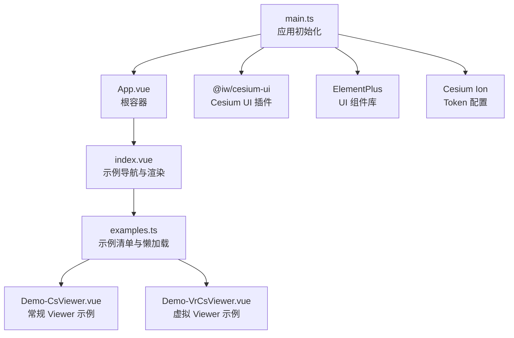
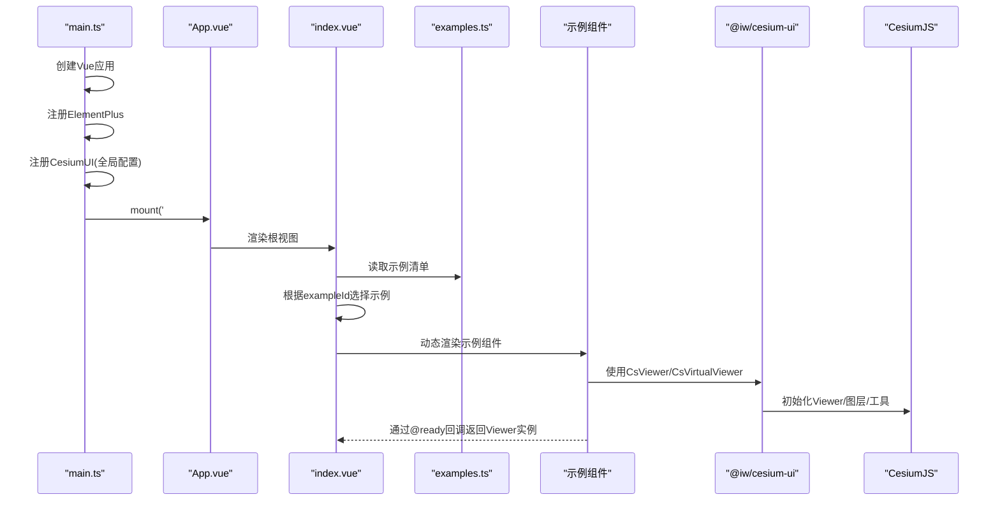
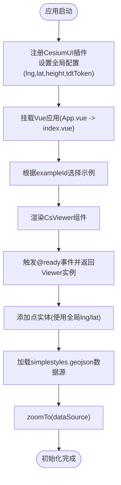
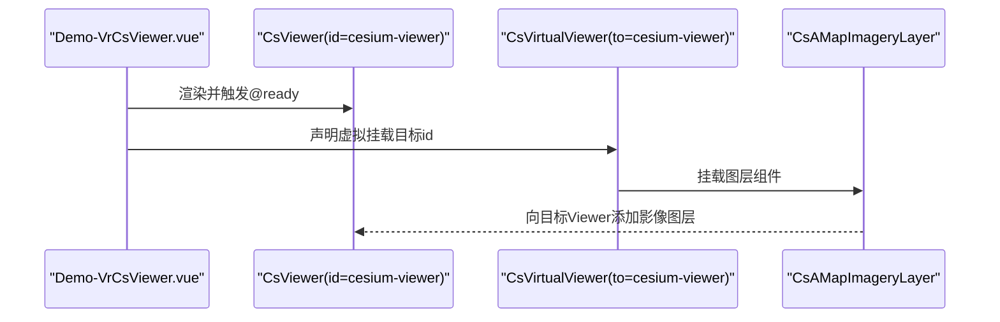
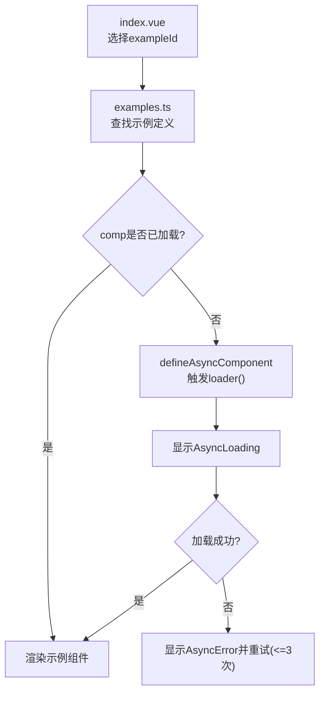
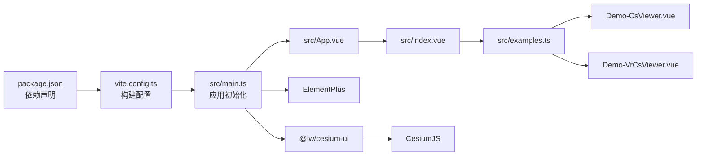

# 核心架构

<cite>
**本文引用的文件**   
- [README.md](file://README.md)
- [package.json](file://package.json)
- [vite.config.ts](file://vite.config.ts)
- [src/main.ts](file://src/main.ts)
- [src/App.vue](file://src/App.vue)
- [src/index.vue](file://src/index.vue)
- [src/examples.ts](file://src/examples.ts)
- [src/components/Viewer/Demo-CsViewer.vue](file://src/components/Viewer/Demo-CsViewer.vue)
- [src/components/Viewer/Demo-VrCsViewer.vue](file://src/components/Viewer/Demo-VrCsViewer.vue)
</cite>

## 目录
1. [简介](#简介)
2. [项目结构](#项目结构)
3. [核心组件](#核心组件)
4. [架构总览](#架构总览)
5. [详细组件分析](#详细组件分析)
6. [依赖关系分析](#依赖关系分析)
7. [性能与可维护性](#性能与可维护性)
8. [故障排查指南](#故障排查指南)
9. [结论](#结论)
10. [附录：扩展与自定义开发指南](#附录扩展与自定义开发指南)

## 简介
本项目基于 Vue 3 + TypeScript + Vite，结合 CesiumJS 与 @iw/cesium-ui 封装库，构建了一个面向三维地理可视化的示例演示平台。整体采用“应用壳 + 示例管理器 + 示例组件”的分层架构，通过插件化方式集成 Cesium 能力，并以异步加载的方式按需渲染示例页面，从而在保持轻量启动的同时，提供丰富的交互与可视化能力。

## 项目结构
- 入口与初始化
  - 应用入口 main.ts 负责创建 Vue 应用、注册 ElementPlus 与 CesiumUI 插件、设置 Cesium Ion Token 与全局配置（经纬度、初始高度、天地图 Token）。
  - App.vue 作为根容器，仅挂载 index.vue。
- 示例管理
  - index.vue 作为示例导航与动态渲染容器，根据当前示例 id 计算并渲染对应组件。
  - examples.ts 集中声明所有示例的元数据与懒加载组件工厂，统一处理加载与错误状态。
- 示例实现
  - Viewer 相关示例位于 src/components/Viewer，分别演示常规 CsViewer 与虚拟 CsVirtualViewer 的使用方式。
- 构建与工具链
  - vite.config.ts 启用 Vue、Cesium、自动导入与组件解析等插件；ElementPlus 与 cesium-ui 主题样式在 main.ts 中引入。

图表来源
- [src/main.ts:1-26](file://src/main.ts#L1-L26)
- [src/App.vue:1-9](file://src/App.vue#L1-L9)
- [src/index.vue:1-55](file://src/index.vue#L1-L55)
- [src/examples.ts:1-59](file://src/examples.ts#L1-L59)
- [src/components/Viewer/Demo-CsViewer.vue:1-67](file://src/components/Viewer/Demo-CsViewer.vue#L1-L67)
- [src/components/Viewer/Demo-VrCsViewer.vue:1-45](file://src/components/Viewer/Demo-VrCsViewer.vue#L1-L45)

章节来源
- [README.md:1-6](file://README.md#L1-L6)
- [package.json:1-31](file://package.json#L1-L31)
- [vite.config.ts:1-24](file://vite.config.ts#L1-L24)
- [src/main.ts:1-26](file://src/main.ts#L1-L26)
- [src/App.vue:1-9](file://src/App.vue#L1-L9)
- [src/index.vue:1-55](file://src/index.vue#L1-L55)
- [src/examples.ts:1-59](file://src/examples.ts#L1-L59)

## 核心组件
- CesiumUI 插件与全局配置
  - 在应用入口处使用 app.use(CesiumUI, options) 注入全局配置（经度、纬度、初始高度、天地图 Token），供后续 CsViewer 与图层组件消费。
  - 通过 useCsGlobalConfig(key) 在组件内读取响应式的全局配置值。
- CsViewer 与事件
  - 示例中使用 <cs-viewer> 组件，监听 ready 事件获取底层 Viewer 实例，用于添加实体、加载 GeoJSON 数据源、相机定位等操作。
- CsVirtualViewer 与虚拟挂载
  - 示例中使用 <cs-virtual-viewer to="cesium-viewer"> 将图层或测量工具等子组件“虚拟挂载”到指定 ID 的 Viewer 容器中，实现多容器解耦与复用。
- 示例管理器
  - 通过 defineAsyncComponent 配合统一的 loading/error 组件，对每个示例进行懒加载，提升首屏性能与可维护性。

章节来源
- [src/main.ts:11-24](file://src/main.ts#L11-L24)
- [src/components/Viewer/Demo-CsViewer.vue:10-35](file://src/components/Viewer/Demo-CsViewer.vue#L10-L35)
- [src/components/Viewer/Demo-VrCsViewer.vue:5-26](file://src/components/Viewer/Demo-VrCsViewer.vue#L5-L26)
- [src/examples.ts:1-19](file://src/examples.ts#L1-L19)

## 架构总览
本项目的架构遵循“应用壳 + 示例中心 + 示例组件”的分层模式，并通过插件机制将 Cesium 能力以 Vue 组件形式暴露。关键流程如下：
- 应用启动：main.ts 创建 Vue 应用，注册 ElementPlus 与 CesiumUI 插件，设置 Cesium Ion Token 与全局配置。
- 示例导航：index.vue 根据当前 exampleId 从 examples.ts 中查找示例定义，并使用 <component :is> 动态渲染。
- 示例执行：示例组件内部使用 CsViewer/CsVirtualViewer 等组件与 Cesium 交互，完成地图初始化、图层加载、实体绘制与交互。

图表来源
- [src/main.ts:1-26](file://src/main.ts#L1-L26)
- [src/App.vue:1-9](file://src/App.vue#L1-L9)
- [src/index.vue:1-55](file://src/index.vue#L1-L55)
- [src/examples.ts:1-59](file://src/examples.ts#L1-L59)
- [src/components/Viewer/Demo-CsViewer.vue:1-67](file://src/components/Viewer/Demo-CsViewer.vue#L1-L67)
- [src/components/Viewer/Demo-VrCsViewer.vue:1-45](file://src/components/Viewer/Demo-VrCsViewer.vue#L1-L45)

## 详细组件分析

### Viewer 组件初始化流程
- 全局配置注入
  - main.ts 中通过 app.use(CesiumUI, { lng, lat, height, tdtToken }) 注入全局配置。
  - 组件内通过 useCsGlobalConfig('lng' | 'lat') 获取响应式坐标值，避免直接解构导致 undefined。
- 示例组件中的初始化
  - Demo-CsViewer.vue 使用 <cs-viewer> 并在 @ready 回调中接收 Viewer 实例。
  - 在回调中向 viewer.entities 添加点实体，并加载 GeoJSON 数据源，随后调用 zoomTo 定位。
- 设计权衡
  - 使用插件注入全局配置，便于跨组件共享且具备响应式更新能力。
  - 在 @ready 回调中操作 Viewer，确保底层已就绪，避免空引用与初始化时序问题。

图表来源
- [src/main.ts:11-24](file://src/main.ts#L11-L24)
- [src/components/Viewer/Demo-CsViewer.vue:10-35](file://src/components/Viewer/Demo-CsViewer.vue#L10-L35)

章节来源
- [src/main.ts:11-24](file://src/main.ts#L11-L24)
- [src/components/Viewer/Demo-CsViewer.vue:10-35](file://src/components/Viewer/Demo-CsViewer.vue#L10-L35)

### 虚拟 Viewer 的实现机制
- 虚拟挂载
  - Demo-VrCsViewer.vue 使用 <cs-virtual-viewer to="cesium-viewer"> 将图层组件（如 CsAMapImageryLayer）挂载到具有 id="cesium-viewer" 的 CsViewer 容器中。
  - 该机制允许在不重复创建 Viewer 的情况下，为已有 Viewer 动态注入图层或工具（例如 CsMeasureDistance）。
- 适用场景
  - 多容器解耦：不同区域或面板复用同一 Viewer 实例，减少资源占用。
  - 条件渲染：根据业务逻辑动态挂载/卸载图层或工具，提高灵活性。

图表来源
- [src/components/Viewer/Demo-VrCsViewer.vue:5-26](file://src/components/Viewer/Demo-VrCsViewer.vue#L5-L26)

章节来源
- [src/components/Viewer/Demo-VrCsViewer.vue:5-26](file://src/components/Viewer/Demo-VrCsViewer.vue#L5-L26)

### 示例管理器的动态加载逻辑
- 示例清单
  - examples.ts 导出 ExampleDef 类型与 examples 数组，每个条目包含 id、label、comp（懒加载组件）。
- 懒加载封装
  - 通过 lazy(loader) 封装 defineAsyncComponent，统一配置 AsyncLoading 与 AsyncError，设置 delay、timeout 与重试策略（最多重试3次）。
- 运行时渲染
  - index.vue 根据当前 exampleId 计算 currentExample 与 currentComponent，使用 <component :is="currentComponent"> 动态渲染。
- 优势
  - 首屏体积小：仅在用户点击时加载对应示例代码。
  - 错误隔离：单个示例加载失败不影响其他示例。
  - 可维护性强：新增示例仅需在 examples.ts 中添加条目。

图表来源
- [src/index.vue:1-55](file://src/index.vue#L1-L55)
- [src/examples.ts:1-59](file://src/examples.ts#L1-L59)

章节来源
- [src/index.vue:1-55](file://src/index.vue#L1-L55)
- [src/examples.ts:1-59](file://src/examples.ts#L1-L59)

## 依赖关系分析
- 外部依赖
  - Vue 3、TypeScript、Vite 构成前端基础栈。
  - CesiumJS 提供三维地球与空间数据能力。
  - @iw/cesium-ui 提供 Vue 组件封装（CsViewer、CsVirtualViewer、图层与工具组件）与全局配置注入。
  - ElementPlus 提供通用 UI 组件（按钮等）。
- 构建配置
  - vite.config.ts 启用 @vitejs/plugin-vue、vite-plugin-cesium-next、unplugin-auto-import、unplugin-vue-components。
- 耦合与内聚
  - main.ts 与 index.vue 低耦合，职责清晰：前者负责应用级初始化，后者负责示例导航与渲染。
  - examples.ts 与示例组件之间通过懒加载解耦，降低模块间直接依赖。

图表来源
- [package.json:1-31](file://package.json#L1-L31)
- [vite.config.ts:1-24](file://vite.config.ts#L1-L24)
- [src/main.ts:1-26](file://src/main.ts#L1-L26)
- [src/App.vue:1-9](file://src/App.vue#L1-L9)
- [src/index.vue:1-55](file://src/index.vue#L1-L55)
- [src/examples.ts:1-59](file://src/examples.ts#L1-L59)
- [src/components/Viewer/Demo-CsViewer.vue:1-67](file://src/components/Viewer/Demo-CsViewer.vue#L1-L67)
- [src/components/Viewer/Demo-VrCsViewer.vue:1-45](file://src/components/Viewer/Demo-VrCsViewer.vue#L1-L45)

章节来源
- [package.json:1-31](file://package.json#L1-L31)
- [vite.config.ts:1-24](file://vite.config.ts#L1-L24)
- [src/main.ts:1-26](file://src/main.ts#L1-L26)
- [src/App.vue:1-9](file://src/App.vue#L1-L9)
- [src/index.vue:1-55](file://src/index.vue#L1-L55)
- [src/examples.ts:1-59](file://src/examples.ts#L1-L59)

## 性能与可维护性
- 首屏性能
  - 通过 defineAsyncComponent 与 examples.ts 的懒加载策略，显著减少初始包体体积，提升首屏加载速度。
  - 延迟显示加载态（delay: 200ms）避免闪烁，超时与重试机制提升健壮性。
- 内存与资源
  - 虚拟 Viewer 机制允许复用 Viewer 实例，避免重复初始化带来的内存与 GPU 压力。
- 可维护性
  - 示例清单集中管理，新增示例无需改动渲染逻辑，只需在 examples.ts 中添加条目。
  - 全局配置通过插件注入，避免在各组件中硬编码参数，便于统一管理与测试。

[本节为通用指导，不直接分析具体文件]

## 故障排查指南
- Cesium Ion Token 未配置或无效
  - 现象：地图瓦片无法加载或报错。
  - 排查：确认 main.ts 中 Ion.defaultAccessToken 已正确设置。
- 全局配置缺失
  - 现象：useCsGlobalConfig 返回 undefined，导致实体位置异常。
  - 排查：检查 app.use(CesiumUI, options) 是否传入 lng、lat 等必要字段。
- 示例加载失败
  - 现象：示例界面显示错误组件或一直加载中。
  - 排查：查看 examples.ts 的 lazy 配置（timeout、onError 重试次数），确认网络与路径是否正确。
- 虚拟挂载目标不存在
  - 现象：CsVirtualViewer 无法挂载图层。
  - 排查：确认 to 属性对应的 Viewer 容器 id 存在且唯一。

章节来源
- [src/main.ts:11-24](file://src/main.ts#L11-L24)
- [src/examples.ts:6-19](file://src/examples.ts#L6-L19)
- [src/components/Viewer/Demo-VrCsViewer.vue:22-26](file://src/components/Viewer/Demo-VrCsViewer.vue#L22-L26)

## 结论
本项目通过 Vue 3 + Vite 的现代前端栈与 @iw/cesium-ui 的组件化封装，实现了可扩展、高性能的三维地理可视化示例平台。核心设计包括：
- 应用壳与示例管理的分层解耦
- 插件化的全局配置与 Viewer 生命周期管理
- 虚拟挂载机制提升复用性与灵活性
- 懒加载示例清单优化首屏性能与可维护性

这些决策在保证功能完整性的同时，兼顾了性能与扩展性，适合进一步扩展更多示例与业务场景。

[本节为总结性内容，不直接分析具体文件]

## 附录：扩展与自定义开发指南
- 新增示例
  - 在 examples.ts 中添加新的 ExampleDef 条目，使用 lazy(() => import('./path/to/YourDemo.vue')) 包裹组件路径。
  - 在 components 目录下新建示例组件，遵循现有示例的结构与命名规范。
- 自定义图层或工具
  - 基于 @iw/cesium-ui 提供的组件接口，在示例中通过 <cs-viewer> 或 <cs-virtual-viewer> 挂载自定义图层或工具。
  - 如需复用多个 Viewer，优先使用虚拟挂载机制，避免重复初始化。
- 全局配置扩展
  - 在 main.ts 的 CesiumUI 插件选项中增加新字段，并在组件内通过 useCsGlobalConfig(key) 读取。
- 构建与调试
  - 使用 pnpm dev 启动本地服务，pnpm build 进行类型检查与打包预览。
  - 若遇到第三方库兼容问题，检查 vite.config.ts 的插件顺序与版本匹配。

[本节为通用指导，不直接分析具体文件]