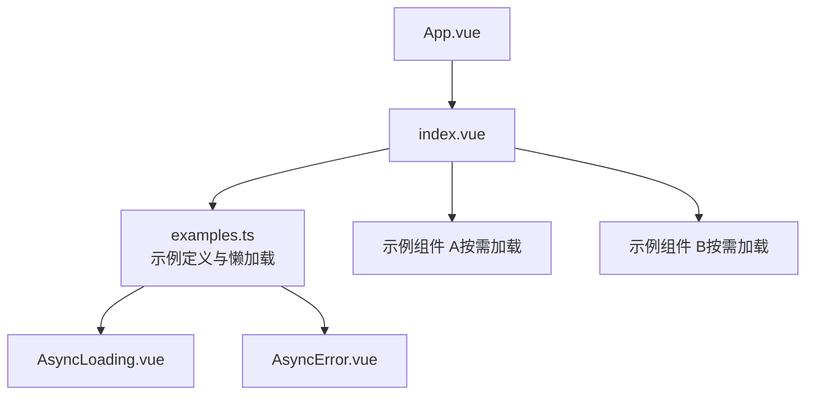
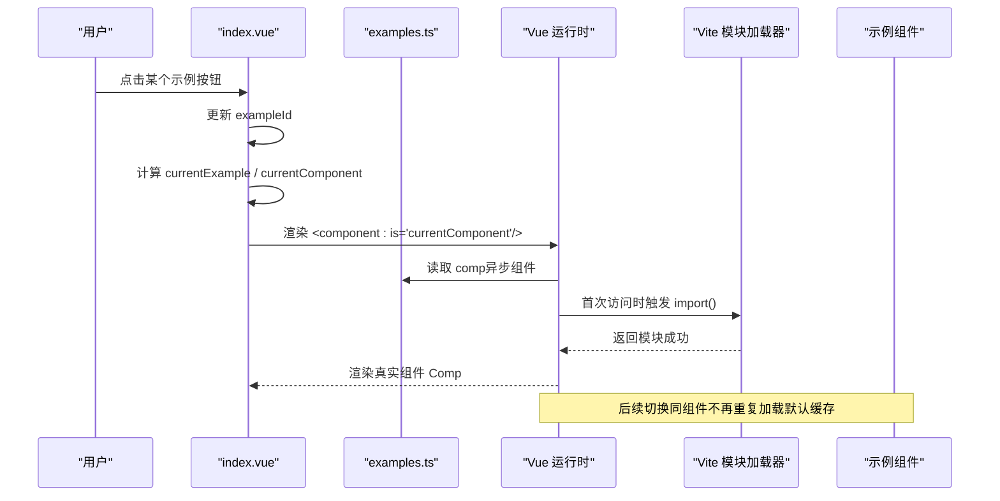
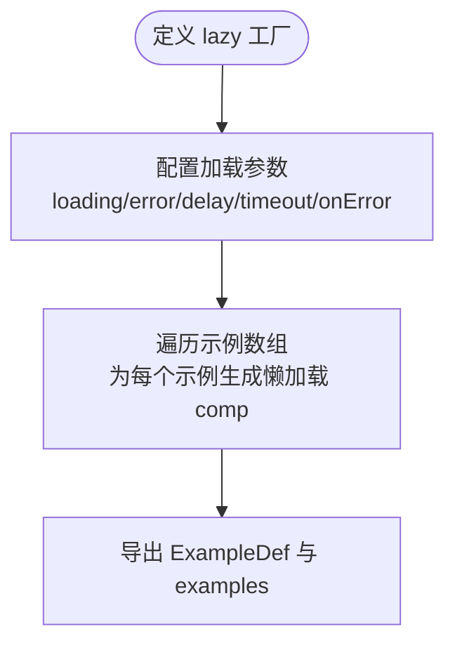
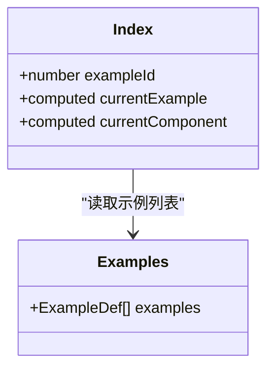
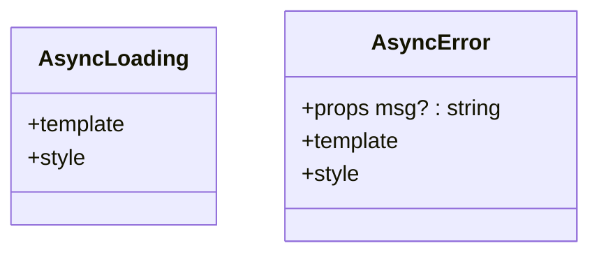
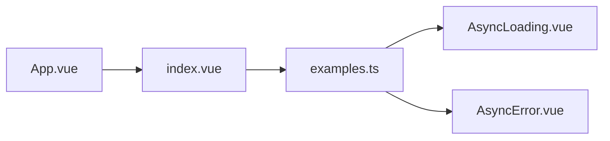
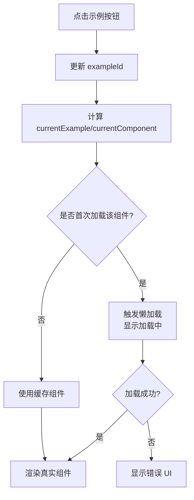

# 示例管理系统

<cite>
**本文引用的文件**   
- [examples.ts](file://src/examples.ts)
- [index.vue](file://src/index.vue)
- [App.vue](file://src/App.vue)
- [AsyncLoading.vue](file://src/components/Ui/AsyncLoading.vue)
- [AsyncError.vue](file://src/components/Ui/AsyncError.vue)
</cite>

## 目录
1. [简介](#简介)
2. [项目结构](#项目结构)
3. [核心组件与数据模型](#核心组件与数据模型)
4. [架构总览](#架构总览)
5. [详细组件分析](#详细组件分析)
6. [依赖关系分析](#依赖关系分析)
7. [性能与缓存策略](#性能与缓存策略)
8. [交互与界面设计](#交互与界面设计)
9. [添加新示例指南](#添加新示例指南)
10. [故障排查](#故障排查)
11. [结论](#结论)

## 简介
本技术文档围绕“示例管理系统”展开，重点解释以下能力：
- 动态组件加载机制：通过 Vue 的异步组件能力按需加载示例组件。
- 懒加载实现：使用统一的 lazy 封装为每个示例定义懒加载行为。
- 错误处理策略：统一的加载失败与重试逻辑，以及用户可见的错误提示。
- 示例定义结构与路由映射：examples.ts 中的 ExampleDef 类型、示例数组与 id 到组件的映射。
- 生命周期管理、缓存策略与性能优化：结合 Vite 代码分割与 Vue 异步组件默认缓存行为进行说明。
- 示例切换的交互逻辑与 UI 设计：基于按钮列表切换当前示例并渲染对应组件。
- 添加新示例的最佳实践：从组件创建到注册、命名与路径约定的完整流程。

## 项目结构
系统采用最小化的前端应用结构，核心由入口视图与示例配置组成：
- App.vue：根组件，仅承载 index.vue。
- index.vue：示例切换容器，负责根据当前示例 id 渲染对应组件。
- examples.ts：示例元数据与懒加载组件工厂。
- components/Ui/AsyncLoading.vue、AsyncError.vue：异步加载与失败的通用 UI。

图表来源
- [App.vue:1-9](file://src/App.vue#L1-L9)
- [index.vue:1-55](file://src/index.vue#L1-L55)
- [examples.ts:1-59](file://src/examples.ts#L1-L59)
- [AsyncLoading.vue:1-15](file://src/components/Ui/AsyncLoading.vue#L1-L15)
- [AsyncError.vue:1-25](file://src/components/Ui/AsyncError.vue#L1-L25)

章节来源
- [App.vue:1-9](file://src/App.vue#L1-L9)
- [index.vue:1-55](file://src/index.vue#L1-L55)
- [examples.ts:1-59](file://src/examples.ts#L1-L59)

## 核心组件与数据模型
- ExampleDef：示例定义类型，包含 id、label、comp 三个字段。
- examples：示例数组，每项为一个 ExampleDef，其中 comp 是懒加载后的异步组件实例。
- 懒加载工厂 lazy：统一封装 defineAsyncComponent，注入加载与错误 UI、延迟、超时与重试策略。

关键点
- 所有示例组件均通过 import() 动态导入，配合 Vite 的代码分割，仅在需要时下载对应 chunk。
- 异步组件默认在 Vue 内部缓存已解析的组件，避免重复网络请求。
- 加载失败时展示 AsyncError，支持可选 msg 属性用于显示错误详情。

章节来源
- [examples.ts:21-59](file://src/examples.ts#L21-L59)
- [AsyncError.vue:1-25](file://src/components/Ui/AsyncError.vue#L1-L25)

## 架构总览
下图展示了示例切换与动态组件加载的整体流程：用户点击按钮触发状态更新，容器计算当前组件并渲染；若组件尚未加载，则触发懒加载，期间显示加载 UI，成功后替换为真实组件，失败则显示错误 UI。

图表来源
- [index.vue:1-55](file://src/index.vue#L1-L55)
- [examples.ts:1-59](file://src/examples.ts#L1-L59)

## 详细组件分析

### 示例定义与懒加载（examples.ts）
- 提供 lazy 工厂函数，集中配置：
  - loadingComponent：AsyncLoading.vue
  - errorComponent：AsyncError.vue
  - delay：200ms，减少抖动
  - timeout：10000ms，防止长时间阻塞
  - onError：最多重试 3 次，超过后调用 fail
- 导出 ExampleDef 类型与 examples 数组，每个示例项将 comp 指向一个懒加载组件。

图表来源
- [examples.ts:1-59](file://src/examples.ts#L1-L59)

章节来源
- [examples.ts:1-59](file://src/examples.ts#L1-L59)

### 示例切换容器（index.vue）
- 维护当前示例 id（exampleId），通过 computed 派生当前示例对象与组件引用。
- 模板中：
  - 标题区域显示当前示例 label
  - 使用 <component :is="currentComponent"> 动态渲染
  - 按钮列表由 examples 数组生成，点击设置 exampleId
- 样式对 active 状态进行高亮，便于用户识别当前示例。

图表来源
- [index.vue:1-55](file://src/index.vue#L1-L55)
- [examples.ts:21-59](file://src/examples.ts#L21-L59)

章节来源
- [index.vue:1-55](file://src/index.vue#L1-L55)

### 异步加载与错误 UI（AsyncLoading.vue、AsyncError.vue）
- AsyncLoading.vue：简单的文本占位，表示正在加载。
- AsyncError.vue：展示“加载失败”，可选 msg 属性用于显示错误详情。
- 二者被 lazy 工厂统一注入到所有异步组件中，保证一致的加载体验。

图表来源
- [AsyncLoading.vue:1-15](file://src/components/Ui/AsyncLoading.vue#L1-L15)
- [AsyncError.vue:1-25](file://src/components/Ui/AsyncError.vue#L1-L25)

章节来源
- [AsyncLoading.vue:1-15](file://src/components/Ui/AsyncLoading.vue#L1-L15)
- [AsyncError.vue:1-25](file://src/components/Ui/AsyncError.vue#L1-L25)

## 依赖关系分析
- App.vue 仅作为壳，引入 index.vue。
- index.vue 依赖 examples.ts 提供的示例元数据与懒加载组件。
- examples.ts 依赖 Vue 的 defineAsyncComponent 与两个 UI 组件。
- 示例组件本身不反向依赖 index.vue，保持松耦合。

图表来源
- [App.vue:1-9](file://src/App.vue#L1-L9)
- [index.vue:1-55](file://src/index.vue#L1-L55)
- [examples.ts:1-59](file://src/examples.ts#L1-L59)
- [AsyncLoading.vue:1-15](file://src/components/Ui/AsyncLoading.vue#L1-L15)
- [AsyncError.vue:1-25](file://src/components/Ui/AsyncError.vue#L1-L25)

章节来源
- [App.vue:1-9](file://src/App.vue#L1-L9)
- [index.vue:1-55](file://src/index.vue#L1-L55)
- [examples.ts:1-59](file://src/examples.ts#L1-L59)

## 性能与缓存策略
- 代码分割：每个示例组件通过 import() 动态导入，Vite 会将其拆分为独立 chunk，首屏只加载必要资源。
- 默认缓存：Vue 异步组件在内部缓存已解析的组件，再次切换到同一示例不会重复加载。
- 延迟与超时：delay=200ms 降低频繁切换时的抖动；timeout=10s 避免长时间阻塞。
- 重试策略：onError 最多重试 3 次，有助于在网络波动时提升成功率。
- 建议优化：
  - 对体积较大的示例组件继续拆分或按需初始化重型逻辑。
  - 可考虑预取常用示例的 chunk（例如在页面空闲时 prefetch）。
  - 对网络错误进行埋点上报，便于监控与定位问题。

[本节为通用性能指导，不直接分析具体文件]

## 交互与界面设计
- 顶部标题：显示当前示例名称，帮助用户明确上下文。
- 主内容区：动态渲染当前示例组件。
- 底部按钮栏：以 flex 布局展示所有示例按钮，active 状态高亮当前项。
- 交互流程：
  - 点击按钮 -> 更新 exampleId -> 计算 currentComponent -> 渲染对应组件。
  - 首次加载触发懒加载，期间显示 AsyncLoading；加载失败显示 AsyncError。

[本图为概念流程图，不直接映射具体源码文件]

## 添加新示例指南
遵循以下步骤快速添加新示例：
1. 创建示例组件
   - 在合适的目录下新建 .vue 文件，例如 components/YourFeature/Demo-YourFeature.vue。
   - 确保组件职责单一，避免在示例组件中进行全局副作用。
2. 在 examples.ts 中注册
   - 使用 lazy(() => import('...')) 包裹组件路径。
   - 新增一项 ExampleDef，分配唯一 id 和易读的 label。
3. 验证
   - 启动开发服务器，确认按钮出现且可点击。
   - 检查首次加载是否显示加载 UI，切换回旧示例再切回是否命中缓存。
   - 模拟网络错误，确认错误 UI 与重试逻辑符合预期。
4. 最佳实践
   - id 保持递增且不重复。
   - label 简洁明了，体现功能语义。
   - 组件路径清晰，按功能域组织目录。
   - 如需自定义加载/错误 UI，可在 lazy 工厂基础上扩展 props 或插槽。

章节来源
- [examples.ts:21-59](file://src/examples.ts#L21-L59)

## 故障排查
常见问题与解决思路：
- 示例按钮无响应
  - 检查 index.vue 中按钮 click 是否正确更新 exampleId。
  - 确认 examples 数组中存在对应 id 的条目。
- 组件未加载或白屏
  - 查看浏览器控制台是否有 import() 报错。
  - 检查组件路径是否正确，是否存在拼写错误。
  - 确认 AsyncError 是否显示，必要时增加更详细的错误信息。
- 加载缓慢或卡顿
  - 评估组件体积，考虑进一步拆分或延迟初始化重型逻辑。
  - 检查网络状况与 CDN 可用性。
- 重复加载导致性能问题
  - 确认是否误用非缓存的组件定义方式。
  - 复用 examples.ts 中的 lazy 工厂，确保使用 Vue 异步组件默认缓存。

章节来源
- [index.vue:1-55](file://src/index.vue#L1-L55)
- [examples.ts:1-59](file://src/examples.ts#L1-L59)
- [AsyncError.vue:1-25](file://src/components/Ui/AsyncError.vue#L1-L25)

## 结论
本示例管理系统通过统一的懒加载工厂与清晰的示例定义结构，实现了可扩展、可维护的动态组件加载方案。借助 Vite 的代码分割与 Vue 异步组件的默认缓存，系统在用户体验与性能之间取得良好平衡。配合明确的交互设计与完善的错误处理，开发者可以快速扩展新的示例并保持整体一致性。