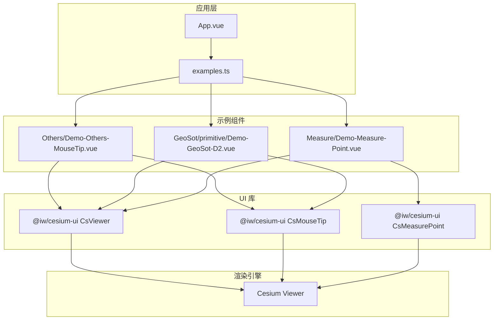
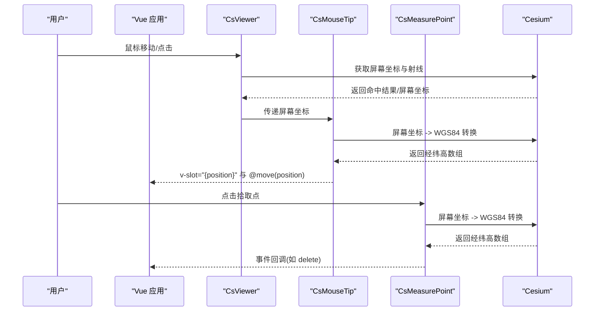
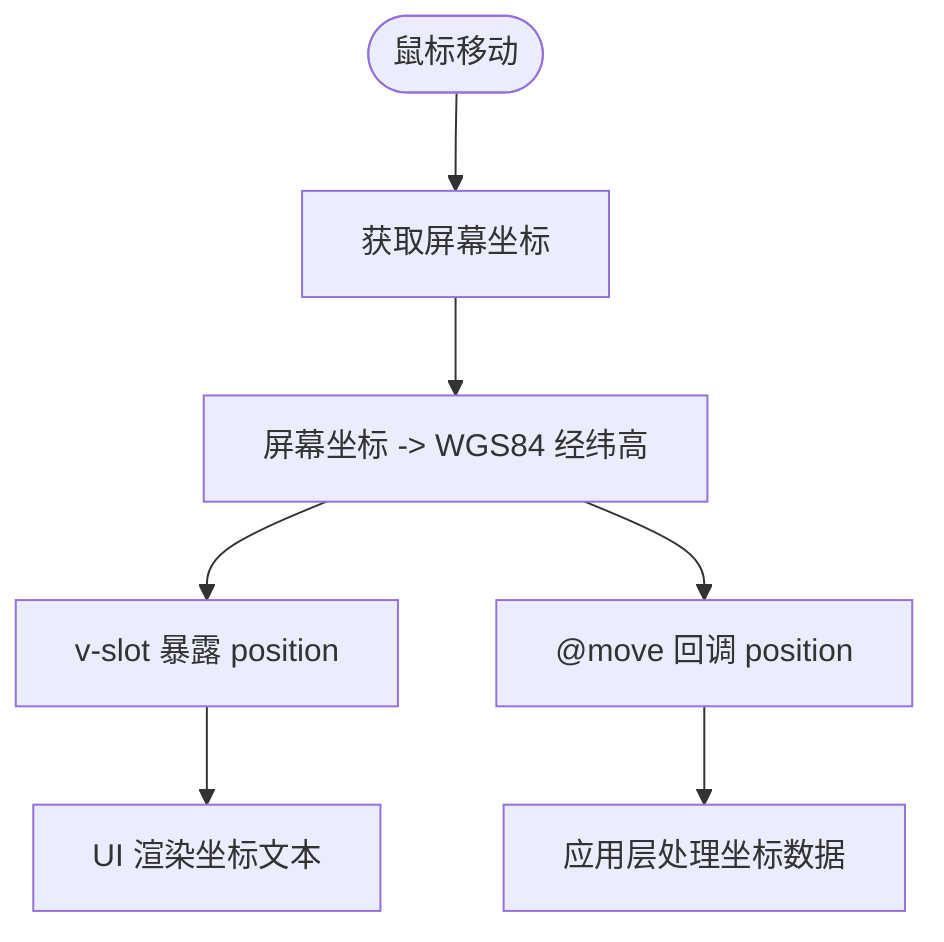
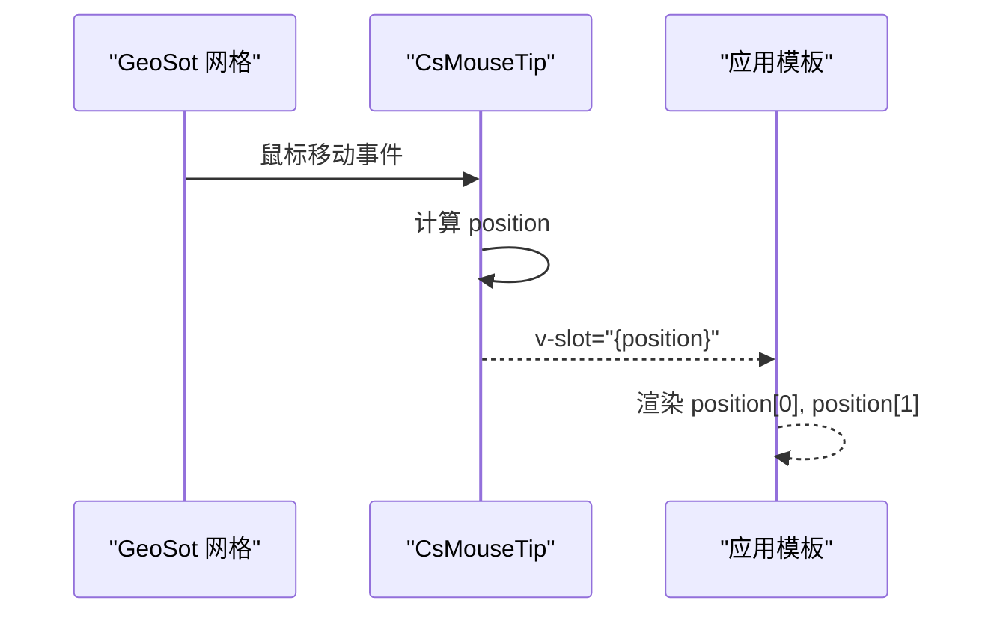
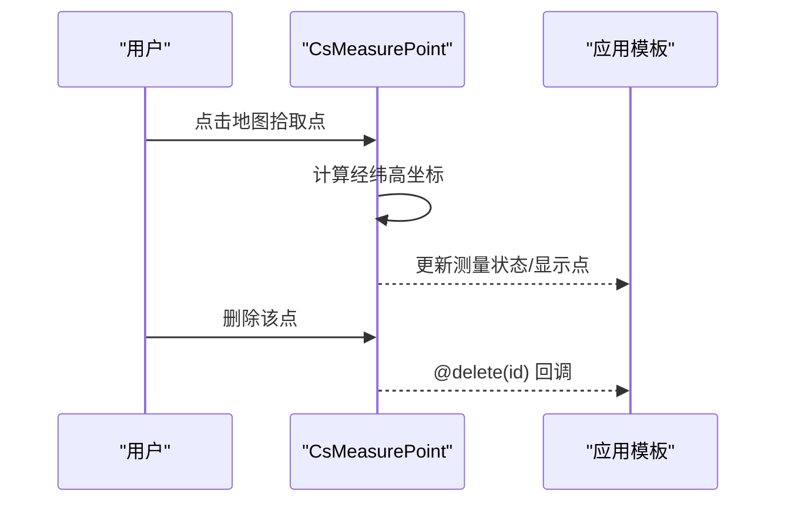
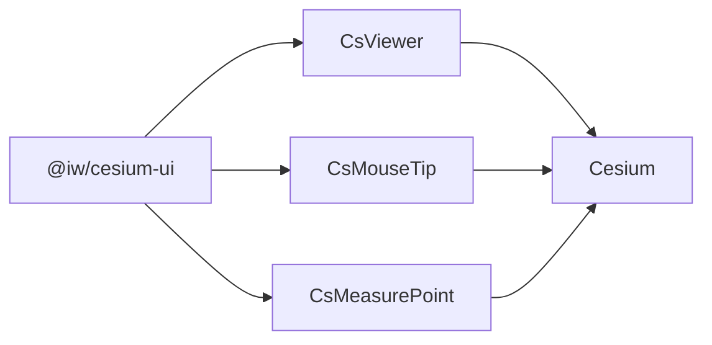

# 坐标拾取

<cite>
**本文引用的文件**   
- [Demo-Others-MouseTip.vue](file://src/components/Others/Demo-Others-MouseTip.vue)
- [Demo-GeoSot-D2.vue](file://src/components/GeoSot/primitive/Demo-GeoSot-D2.vue)
- [Demo-Measure-Point.vue](file://src/components/Measure/Demo-Measure-Point.vue)
- [package.json](file://package.json)
</cite>

## 目录
1. [简介](#简介)
2. [项目结构](#项目结构)
3. [核心组件](#核心组件)
4. [架构总览](#架构总览)
5. [详细组件分析](#详细组件分析)
6. [依赖关系分析](#依赖关系分析)
7. [性能与精度](#性能与精度)
8. [故障排查指南](#故障排查指南)
9. [结论](#结论)
10. [附录：集成示例与最佳实践](#附录集成示例与最佳实践)

## 简介
本技术文档围绕“坐标拾取”功能展开，聚焦于在基于 Cesium 的三维场景中，通过鼠标事件监听、屏幕坐标到地理坐标（WGS84）转换、以及坐标显示与验证的完整流程。本项目使用 @iw/cesium-ui 提供的 CsViewer、CsMouseTip、CsMeasurePoint 等组件封装了底层交互逻辑，开发者可通过属性配置与事件回调快速集成坐标拾取能力。

## 项目结构
仓库采用 Vue 3 + TypeScript + Vite 的工程结构，坐标拾取相关示例位于 components 目录下：
- Others 子目录提供鼠标提示组件演示（实时坐标显示）。
- GeoSot 子目录展示网格可视化与鼠标提示的组合用法。
- Measure 子目录提供点、距离、面积等测量工具，其中点测量涉及坐标拾取。

图表来源
- [Demo-Others-MouseTip.vue:1-50](file://src/components/Others/Demo-Others-MouseTip.vue#L1-L50)
- [Demo-GeoSot-D2.vue:113-155](file://src/components/GeoSot/primitive/Demo-GeoSot-D2.vue#L113-L155)
- [Demo-Measure-Point.vue:1-51](file://src/components/Measure/Demo-Measure-Point.vue#L1-L51)
- [package.json:12-17](file://package.json#L12-L17)

章节来源
- [Demo-Others-MouseTip.vue:1-50](file://src/components/Others/Demo-Others-MouseTip.vue#L1-L50)
- [Demo-GeoSot-D2.vue:113-155](file://src/components/GeoSot/primitive/Demo-GeoSot-D2.vue#L113-L155)
- [Demo-Measure-Point.vue:1-51](file://src/components/Measure/Demo-Measure-Point.vue#L1-L51)
- [package.json:12-17](file://package.json#L12-L17)

## 核心组件
- CsViewer：Cesium Viewer 的封装，负责场景初始化、图层管理与事件分发。
- CsMouseTip：鼠标移动时实时计算并输出经纬高坐标，支持插槽自定义显示内容，并提供 move 事件回调。
- CsMeasurePoint：点测量工具，内部包含坐标拾取逻辑，点击地图拾取点坐标，支持删除操作回调。

章节来源
- [Demo-Others-MouseTip.vue:1-50](file://src/components/Others/Demo-Others-MouseTip.vue#L1-L50)
- [Demo-Measure-Point.vue:1-51](file://src/components/Measure/Demo-Measure-Point.vue#L1-L51)

## 架构总览
坐标拾取的总体流程如下：
- 用户触发鼠标事件（移动或点击）。
- CsViewer/CsMouseTip/CsMeasurePoint 捕获事件并调用 Cesium 的拾取接口。
- 将屏幕像素坐标转换为地理坐标（WGS84），必要时进行投影变换与格式化。
- 通过事件回调或插槽向应用层暴露坐标数据，供 UI 显示或业务处理。

图表来源
- [Demo-Others-MouseTip.vue:17-30](file://src/components/Others/Demo-Others-MouseTip.vue#L17-L30)
- [Demo-Measure-Point.vue:19-34](file://src/components/Measure/Demo-Measure-Point.vue#L19-L34)

## 详细组件分析

### CsMouseTip 组件（实时坐标显示）
- 作用：监听鼠标移动，实时计算当前鼠标位置对应的经纬高坐标，并通过插槽与事件向外暴露。
- 关键行为：
  - 通过 v-slot="{position}" 获取 position 数组（经度、纬度、高度）。
  - 通过 @move="handleMove" 接收可选的经纬高数组参数。
- 典型用法：在模板中直接渲染 position[0] 与 position[1]，实现实时坐标显示。

图表来源
- [Demo-Others-MouseTip.vue:17-30](file://src/components/Others/Demo-Others-MouseTip.vue#L17-L30)

章节来源
- [Demo-Others-MouseTip.vue:17-30](file://src/components/Others/Demo-Others-MouseTip.vue#L17-L30)

### GeoSot 网格与 CsMouseTip 组合
- 作用：在 GeoSot 二维网格可视化中叠加 CsMouseTip，用于观察网格单元上的实时坐标。
- 关键点：
  - 网格元素可设置 allow-picking 控制是否参与拾取。
  - 通过 cs-mouse-tip 插槽显示 position 的经纬度值。

图表来源
- [Demo-GeoSot-D2.vue:136-141](file://src/components/GeoSot/primitive/Demo-GeoSot-D2.vue#L136-L141)

章节来源
- [Demo-GeoSot-D2.vue:136-141](file://src/components/GeoSot/primitive/Demo-GeoSot-D2.vue#L136-L141)

### CsMeasurePoint 组件（点测量与坐标拾取）
- 作用：提供点测量能力，内部实现点击拾取坐标，并在删除时触发回调。
- 关键行为：
  - 通过 id 标识实例，便于管理多个测量工具。
  - 通过 @delete="handleDelete" 回调处理删除动作。

图表来源
- [Demo-Measure-Point.vue:19-34](file://src/components/Measure/Demo-Measure-Point.vue#L19-L34)

章节来源
- [Demo-Measure-Point.vue:19-34](file://src/components/Measure/Demo-Measure-Point.vue#L19-L34)

## 依赖关系分析
- 运行时依赖：
  - cesium：三维地球渲染与坐标系统基础。
  - @iw/cesium-ui：封装 CsViewer、CsMouseTip、CsMeasurePoint 等组件。
- 组件耦合：
  - CsMouseTip 与 CsViewer 解耦，仅依赖 Cesium 的坐标转换能力。
  - CsMeasurePoint 与 CsViewer 解耦，独立管理测量状态与事件。

图表来源
- [package.json:12-17](file://package.json#L12-L17)

章节来源
- [package.json:12-17](file://package.json#L12-L17)

## 性能与精度
- 性能建议：
  - 避免在高频 mousemove 回调中进行重计算或 DOM 更新；可使用防抖/节流策略减少渲染压力。
  - 仅在需要时启用 CsMouseTip 或 CsMeasurePoint，关闭不必要的拾取以提升帧率。
- 精度控制：
  - 经纬度显示位数可根据业务需求调整（例如保留小数点后 6 位约对应米级精度）。
  - 高程精度受地形分辨率影响，建议在需要高精度高程的场景加载相应地形数据。
- 坐标系统与投影：
  - 默认使用 WGS84 经纬度坐标；如需投影坐标（如 UTM），应在应用层进行二次转换与格式化。
  - 注意不同投影带与中央经线的选择对精度的影响。

[本节为通用指导，不直接分析具体文件]

## 故障排查指南
- 坐标未更新：
  - 检查 CsMouseTip 是否正确挂载在 CsViewer 内，且未被其他遮罩层拦截鼠标事件。
  - 确认网格或其他图层的 allow-picking 设置不会阻止拾取。
- 坐标异常或偏移：
  - 检查是否启用了地形或影像底图的坐标系配置，确保与业务期望一致。
  - 若使用投影坐标，确认投影参数（中央经线、分带）正确。
- 删除测量点无响应：
  - 确认 @delete 回调已绑定，且实例 id 唯一。
  - 在切换显示状态时使用 nextTick 确保 DOM 更新后再执行逻辑。

章节来源
- [Demo-GeoSot-D2.vue:136-141](file://src/components/GeoSot/primitive/Demo-GeoSot-D2.vue#L136-L141)
- [Demo-Measure-Point.vue:19-34](file://src/components/Measure/Demo-Measure-Point.vue#L19-L34)

## 结论
本项目通过 @iw/cesium-ui 提供的 CsViewer、CsMouseTip、CsMeasurePoint 组件，实现了从鼠标事件监听到屏幕坐标到 WGS84 地理坐标转换、再到坐标显示与验证的完整流程。开发者可在应用中灵活配置属性、订阅事件回调，并根据业务需求进行坐标格式化和精度控制。结合合理的性能优化与错误处理策略，可获得稳定高效的坐标拾取体验。

[本节为总结性内容，不直接分析具体文件]

## 附录：集成示例与最佳实践

- 实时坐标显示（CsMouseTip）
  - 在 CsViewer 内插入 CsMouseTip，使用 v-slot 获取 position 并渲染经纬度。
  - 通过 @move 事件回调处理坐标数据，便于日志记录或业务联动。
  - 参考路径：[Demo-Others-MouseTip.vue:17-30](file://src/components/Others/Demo-Others-MouseTip.vue#L17-L30)

- 网格可视化叠加坐标提示（GeoSot + CsMouseTip）
  - 在网格组件上设置 allow-picking 控制拾取行为。
  - 使用 CsMouseTip 插槽显示 position 的经纬度值。
  - 参考路径：[Demo-GeoSot-D2.vue:136-141](file://src/components/GeoSot/primitive/Demo-GeoSot-D2.vue#L136-L141)

- 点测量与坐标拾取（CsMeasurePoint）
  - 通过 id 标识测量实例，使用 @delete 回调处理删除逻辑。
  - 在切换显示状态时使用 nextTick 确保 DOM 更新后再执行业务逻辑。
  - 参考路径：[Demo-Measure-Point.vue:19-34](file://src/components/Measure/Demo-Measure-Point.vue#L19-L34)

- 坐标精度与格式化
  - 根据业务需求对经纬度小数位数进行四舍五入或截断。
  - 如需投影坐标，在应用层调用相应的投影转换函数进行二次处理。

- 性能优化建议
  - 对 mousemove 回调进行防抖/节流，降低频繁渲染开销。
  - 按需启用/禁用 CsMouseTip 与 CsMeasurePoint，减少不必要的拾取计算。

[本节为实践指导，不直接分析具体文件]