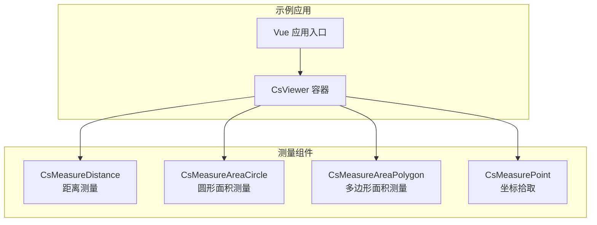
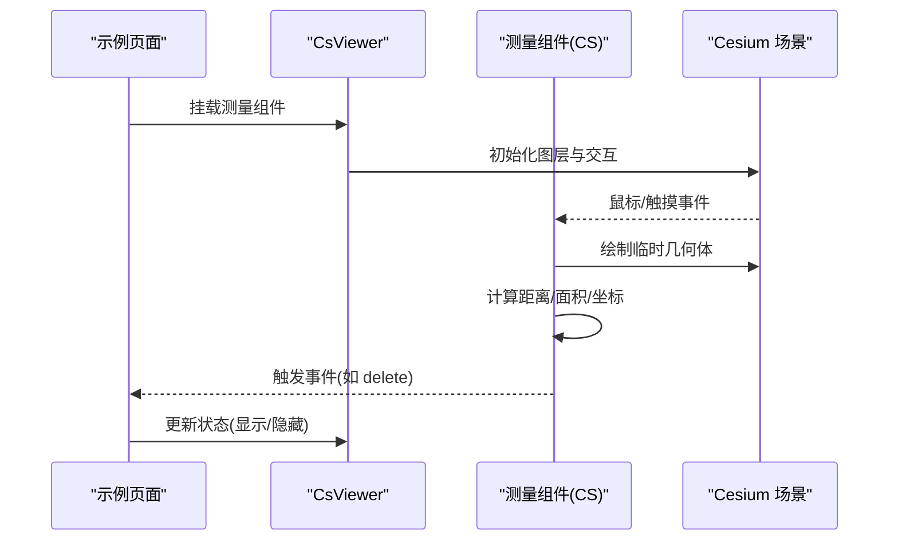
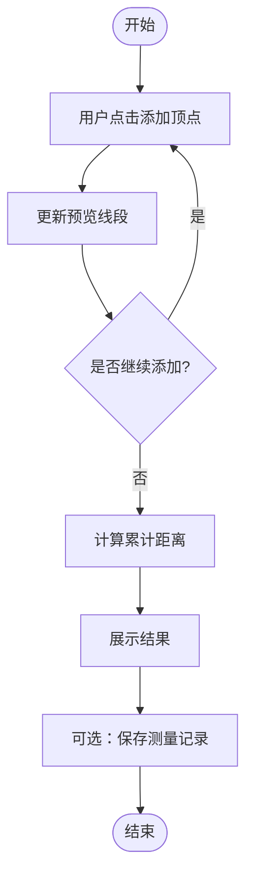
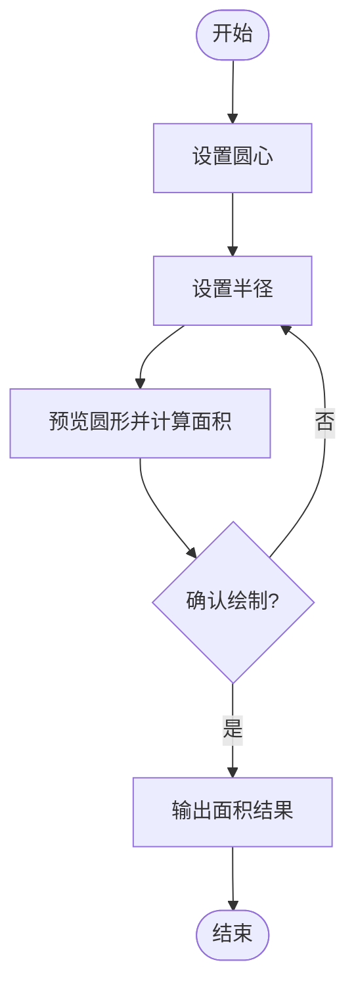
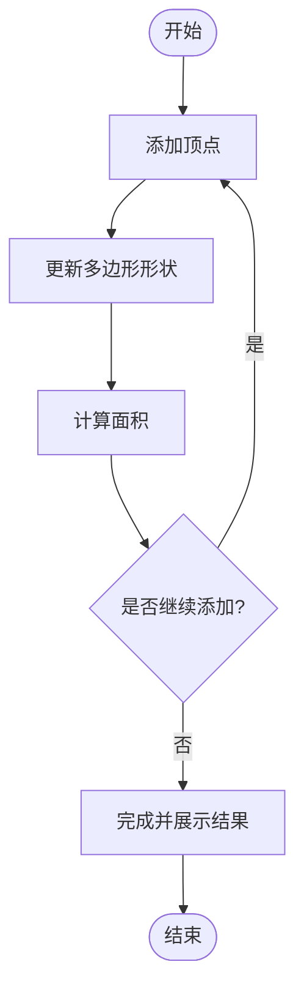
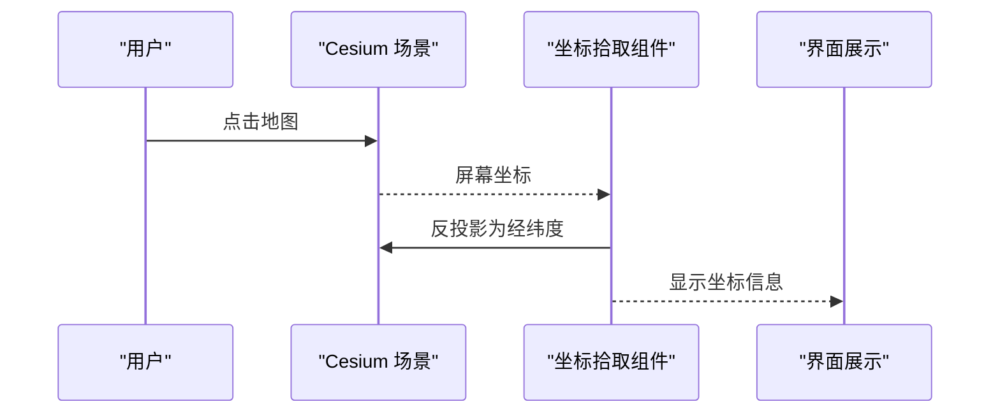
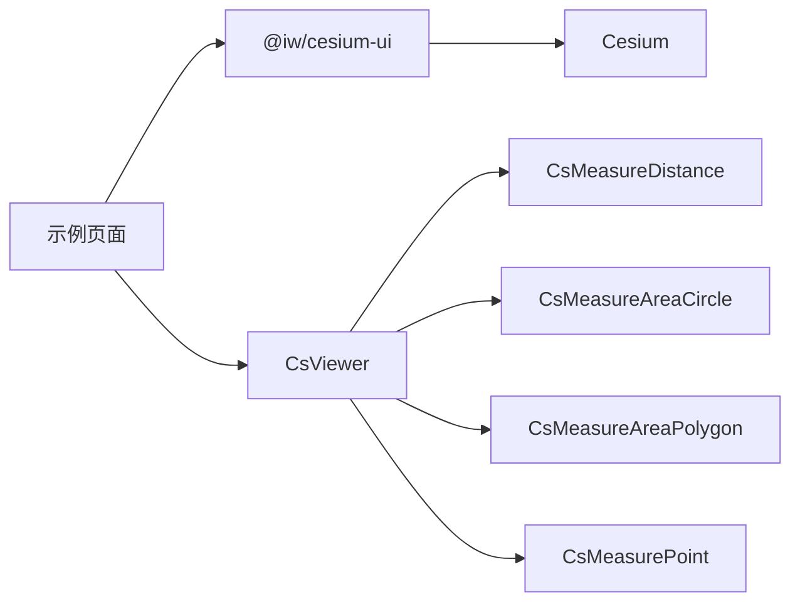

# 测量工具

<cite>
**本文引用的文件**   
- [package.json](file://package.json)
- [src/components/Measure/Demo-Measure-Distance.vue](file://src/components/Measure/Demo-Measure-Distance.vue)
- [src/components/Measure/Area/Demo-Measure-AreaCircle.vue](file://src/components/Measure/Area/Demo-Measure-AreaCircle.vue)
- [src/components/Measure/Area/Demo-Measure-AreaPolygon.vue](file://src/components/Measure/Area/Demo-Measure-AreaPolygon.vue)
- [src/components/Measure/Demo-Measure-Point.vue](file://src/components/Measure/Demo-Measure-Point.vue)
</cite>

## 目录
1. [简介](#简介)
2. [项目结构](#项目结构)
3. [核心组件](#核心组件)
4. [架构总览](#架构总览)
5. [详细组件分析](#详细组件分析)
6. [依赖关系分析](#依赖关系分析)
7. [性能与精度](#性能与精度)
8. [故障排查指南](#故障排查指南)
9. [结论](#结论)

## 简介
本技术文档围绕“测量工具”功能，说明距离测量、面积测量（圆形与多边形）以及坐标拾取功能的实现原理与使用方法。该示例工程通过 Vue 3 + TypeScript + Vite 构建，使用第三方库 @iw/cesium-ui 提供的测量组件，并在 Cesium Viewer 中集成展示。本文重点从代码组织、交互流程、数据流、精度控制与单位转换、存储导出策略、优化与排错等维度进行系统化阐述，帮助开发者快速理解并扩展测量能力。

## 项目结构
仓库中与测量相关的示例位于 src/components/Measure 目录下，包含：
- 距离测量示例：Demo-Measure-Distance.vue
- 面积测量示例（圆形）：Area/Demo-Measure-AreaCircle.vue
- 面积测量示例（多边形）：Area/Demo-Measure-AreaPolygon.vue
- 坐标拾取示例：Demo-Measure-Point.vue

这些示例统一在 CsViewer 容器中挂载对应的测量组件，并通过事件回调处理删除等操作。

图表来源
- [src/components/Measure/Demo-Measure-Distance.vue:1-50](file://src/components/Measure/Demo-Measure-Distance.vue#L1-L50)
- [src/components/Measure/Area/Demo-Measure-AreaCircle.vue:1-49](file://src/components/Measure/Area/Demo-Measure-AreaCircle.vue#L1-L49)
- [src/components/Measure/Area/Demo-Measure-AreaPolygon.vue:1-47](file://src/components/Measure/Area/Demo-Measure-AreaPolygon.vue#L1-L47)
- [src/components/Measure/Demo-Measure-Point.vue:1-51](file://src/components/Measure/Demo-Measure-Point.vue#L1-L51)

章节来源
- [src/components/Measure/Demo-Measure-Distance.vue:1-50](file://src/components/Measure/Demo-Measure-Distance.vue#L1-L50)
- [src/components/Measure/Area/Demo-Measure-AreaCircle.vue:1-49](file://src/components/Measure/Area/Demo-Measure-AreaCircle.vue#L1-L49)
- [src/components/Measure/Area/Demo-Measure-AreaPolygon.vue:1-47](file://src/components/Measure/Area/Demo-Measure-AreaPolygon.vue#L1-L47)
- [src/components/Measure/Demo-Measure-Point.vue:1-51](file://src/components/Measure/Demo-Measure-Point.vue#L1-L51)

## 核心组件
- CsMeasureDistance：用于交互式绘制折线并计算两点或多点之间的累计距离。
- CsMeasureAreaCircle：用于交互式绘制圆形并计算其面积。
- CsMeasureAreaPolygon：用于交互式绘制多边形并计算其面积。
- CsMeasurePoint：用于在地图上拾取坐标点，常用于标注或后续分析。

这些组件均从 @iw/cesium-ui 引入，并在 CsViewer 中使用。示例页面通过 v-if 控制显示，并通过 delete 事件触发销毁逻辑。

章节来源
- [src/components/Measure/Demo-Measure-Distance.vue:1-50](file://src/components/Measure/Demo-Measure-Distance.vue#L1-L50)
- [src/components/Measure/Area/Demo-Measure-AreaCircle.vue:1-49](file://src/components/Measure/Area/Demo-Measure-AreaCircle.vue#L1-L49)
- [src/components/Measure/Area/Demo-Measure-AreaPolygon.vue:1-47](file://src/components/Measure/Area/Demo-Measure-AreaPolygon.vue#L1-L47)
- [src/components/Measure/Demo-Measure-Point.vue:1-51](file://src/components/Measure/Demo-Measure-Point.vue#L1-L51)

## 架构总览
测量功能采用“容器 + 组件”的解耦设计：
- CsViewer 提供地图渲染与交互上下文。
- 各测量组件订阅鼠标/触摸事件，在地图上绘制临时图形（线段、圆、多边形），实时计算结果并展示。
- 父组件通过事件（如 delete）管理测量实例的生命周期。

图表来源
- [src/components/Measure/Demo-Measure-Distance.vue:1-50](file://src/components/Measure/Demo-Measure-Distance.vue#L1-L50)
- [src/components/Measure/Area/Demo-Measure-AreaCircle.vue:1-49](file://src/components/Measure/Area/Demo-Measure-AreaCircle.vue#L1-L49)
- [src/components/Measure/Area/Demo-Measure-AreaPolygon.vue:1-47](file://src/components/Measure/Area/Demo-Measure-AreaPolygon.vue#L1-L47)
- [src/components/Measure/Demo-Measure-Point.vue:1-51](file://src/components/Measure/Demo-Measure-Point.vue#L1-L51)

## 详细组件分析

### 距离测量（CsMeasureDistance）
- 交互流程
  - 用户在地图上点击添加顶点，移动时实时更新预览线段。
  - 双击或结束绘制后，计算累计距离并展示结果。
- 数学原理
  - 基于地球椭球模型（WGS84）的大地线距离计算；多点路径为相邻点间距离累加。
- 精度控制
  - 建议开启高精度地形与投影；避免在小比例尺下直接读取像素坐标。
  - 对经纬度到平面坐标的转换需考虑局部投影误差，必要时使用区域投影。
- 单位转换
  - 内部通常以米为单位计算，展示层可按需转换为千米、英里等。
- 结果展示
  - 在绘制过程中动态显示当前段长度与累计长度；完成后可持久化保存。

图表来源
- [src/components/Measure/Demo-Measure-Distance.vue:1-50](file://src/components/Measure/Demo-Measure-Distance.vue#L1-L50)

章节来源
- [src/components/Measure/Demo-Measure-Distance.vue:1-50](file://src/components/Measure/Demo-Measure-Distance.vue#L1-L50)

### 圆形面积测量（CsMeasureAreaCircle）
- 交互流程
  - 用户确定圆心与半径（拖拽或输入），实时预览圆形并显示面积。
- 数学原理
  - 在 WGS84 椭球上按半径（米）生成近似圆边界，再计算面积。
- 精度控制
  - 小范围区域可使用平面近似；大范围建议使用地理算法与椭球积分。
- 单位转换
  - 内部以平方米计算，展示层可转换为公顷、平方公里等。
- 结果展示
  - 实时显示面积值；支持导出为 GeoJSON 或 CSV。

图表来源
- [src/components/Measure/Area/Demo-Measure-AreaCircle.vue:1-49](file://src/components/Measure/Area/Demo-Measure-AreaCircle.vue#L1-L49)

章节来源
- [src/components/Measure/Area/Demo-Measure-AreaCircle.vue:1-49](file://src/components/Measure/Area/Demo-Measure-AreaCircle.vue#L1-L49)

### 多边形面积测量（CsMeasureAreaPolygon）
- 交互流程
  - 用户依次点击顶点形成多边形，实时预览并计算面积。
- 数学原理
  - 使用球面/椭球上的多边形面积算法（如鞋带公式的地理版本）。
- 精度控制
  - 顶点数量越多越精确；复杂自相交多边形需做拓扑校验。
- 单位转换
  - 内部以平方米计算，展示层按需换算。
- 结果展示
  - 实时显示面积；支持导出矢量数据。

图表来源
- [src/components/Measure/Area/Demo-Measure-AreaPolygon.vue:1-47](file://src/components/Measure/Area/Demo-Measure-AreaPolygon.vue#L1-L47)

章节来源
- [src/components/Measure/Area/Demo-Measure-AreaPolygon.vue:1-47](file://src/components/Measure/Area/Demo-Measure-AreaPolygon.vue#L1-L47)

### 坐标拾取（CsMeasurePoint）
- 交互流程
  - 用户在地图上点击拾取坐标点，可在 UI 中查看经纬度、高程等信息。
- 数学原理
  - 将屏幕坐标反投影为地理坐标（经纬度），并可结合地形获取高程。
- 精度控制
  - 注意视口缩放级别与投影方式对拾取精度的影响。
- 结果展示
  - 在信息窗体或侧边栏展示坐标；支持复制与批量导出。

图表来源
- [src/components/Measure/Demo-Measure-Point.vue:1-51](file://src/components/Measure/Demo-Measure-Point.vue#L1-L51)

章节来源
- [src/components/Measure/Demo-Measure-Point.vue:1-51](file://src/components/Measure/Demo-Measure-Point.vue#L1-L51)

## 依赖关系分析
- 外部依赖
  - cesium：三维地球引擎，提供地理坐标、投影、地形与可视化能力。
  - @iw/cesium-ui：封装了 CsViewer 与各测量组件，简化集成。
- 组件耦合
  - 示例页面仅负责挂载与生命周期管理，具体测量逻辑由 @iw/cesium-ui 内部实现。
  - 示例页面通过事件（如 delete）与测量组件通信，保持松耦合。

图表来源
- [package.json:12-17](file://package.json#L12-L17)
- [src/components/Measure/Demo-Measure-Distance.vue:1-50](file://src/components/Measure/Demo-Measure-Distance.vue#L1-L50)
- [src/components/Measure/Area/Demo-Measure-AreaCircle.vue:1-49](file://src/components/Measure/Area/Demo-Measure-AreaCircle.vue#L1-L49)
- [src/components/Measure/Area/Demo-Measure-AreaPolygon.vue:1-47](file://src/components/Measure/Area/Demo-Measure-AreaPolygon.vue#L1-L47)
- [src/components/Measure/Demo-Measure-Point.vue:1-51](file://src/components/Measure/Demo-Measure-Point.vue#L1-L51)

章节来源
- [package.json:12-17](file://package.json#L12-L17)
- [src/components/Measure/Demo-Measure-Distance.vue:1-50](file://src/components/Measure/Demo-Measure-Distance.vue#L1-L50)
- [src/components/Measure/Area/Demo-Measure-AreaCircle.vue:1-49](file://src/components/Measure/Area/Demo-Measure-AreaCircle.vue#L1-L49)
- [src/components/Measure/Area/Demo-Measure-AreaPolygon.vue:1-47](file://src/components/Measure/Area/Demo-Measure-AreaPolygon.vue#L1-L47)
- [src/components/Measure/Demo-Measure-Point.vue:1-51](file://src/components/Measure/Demo-Measure-Point.vue#L1-L51)

## 性能与精度
- 计算优化
  - 增量计算：在绘制过程中仅对新增段或变更部分重算，避免全量重绘。
  - 几何简化：对多边形顶点进行抽稀（如 Douglas–Peucker）以减少计算量。
  - 缓存结果：对已完成的测量结果进行缓存，切换视图时复用。
- 渲染优化
  - 使用轻量级临时实体（如 PolylineGraphics、EllipseGraphics）减少内存占用。
  - 及时销毁不再使用的测量实例，释放资源。
- 精度控制
  - 使用 WGS84 椭球模型与合适的投影；在大范围场景中避免平面近似带来的误差。
  - 在高程敏感场景启用高精度地形，并确保采样间隔合理。
- 单位转换
  - 内部统一以米/平方米为基准单位，展示层根据业务需求进行换算，避免多次转换带来的累积误差。

[本节为通用指导，不直接分析具体文件]

## 故障排查指南
- 常见问题
  - 测量结果异常：检查是否启用了正确的坐标系与投影；确认地形加载正常。
  - 交互卡顿：减少同时存在的测量实例数量；避免在高频事件中执行重型计算。
  - 删除无效：确保通过事件回调正确销毁组件实例，并重置显示状态。
- 定位方法
  - 在 handleReady 中打印 Viewer 对象，确认地图初始化成功。
  - 在 delete 回调中打印 id，确认事件触发与组件销毁顺序。
  - 使用浏览器控制台观察内存增长与渲染帧率，定位瓶颈。

章节来源
- [src/components/Measure/Demo-Measure-Distance.vue:1-50](file://src/components/Measure/Demo-Measure-Distance.vue#L1-L50)
- [src/components/Measure/Area/Demo-Measure-AreaCircle.vue:1-49](file://src/components/Measure/Area/Demo-Measure-AreaCircle.vue#L1-L49)
- [src/components/Measure/Area/Demo-Measure-AreaPolygon.vue:1-47](file://src/components/Measure/Area/Demo-Measure-AreaPolygon.vue#L1-L47)
- [src/components/Measure/Demo-Measure-Point.vue:1-51](file://src/components/Measure/Demo-Measure-Point.vue#L1-L51)

## 结论
本示例通过 @iw/cesium-ui 提供的测量组件，在 Cesium 场景中实现了距离、面积（圆形与多边形）与坐标拾取的完整交互流程。示例页面专注于容器挂载与生命周期管理，测量逻辑由第三方库封装，便于快速集成与扩展。建议在业务中结合增量计算、几何简化与结果缓存提升性能，并根据实际区域选择合适的投影与精度策略。对于数据存储与导出，可在示例基础上对接后端服务或本地存储，实现测量记录的持久化与共享。