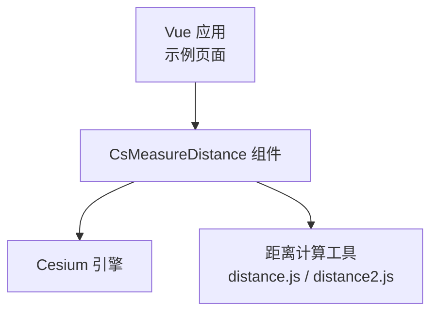
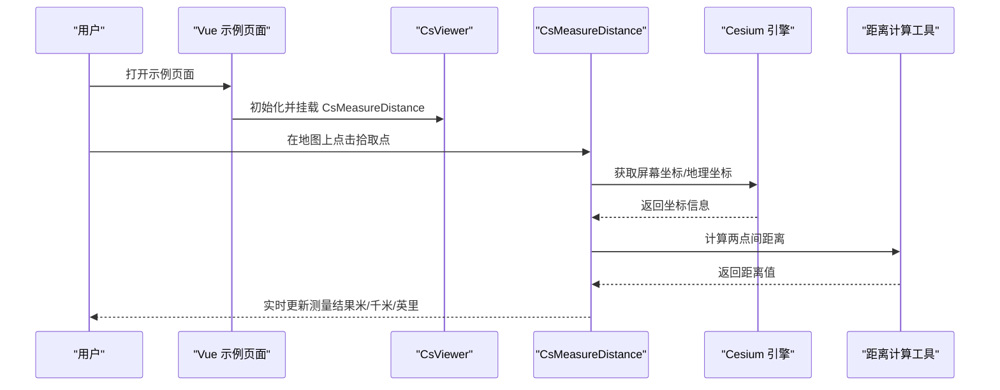
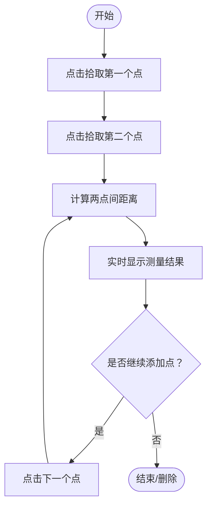
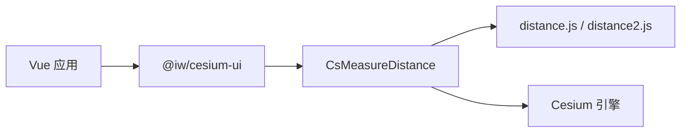

# 距离测量

<cite>
**本文引用的文件**   
- [Demo-Measure-Distance.vue](file://src/components/Measure/Demo-Measure-Distance.vue)
- [package.json](file://package.json)
- [distance.js](file://node_modules/@iw/cesium-ui/es/components/measure/distance/distance.js)
- [distance2.js](file://node_modules/@iw/cesium-ui/es/components/measure/distance/distance2.js)
- [index.js（measure/distance）](file://node_modules/@iw/cesium-ui/es/components/measure/distance/index.js)
</cite>

## 目录
1. [简介](#简介)
2. [项目结构](#项目结构)
3. [核心组件](#核心组件)
4. [架构总览](#架构总览)
5. [详细组件分析](#详细组件分析)
6. [依赖关系分析](#依赖关系分析)
7. [性能考虑](#性能考虑)
8. [故障排查指南](#故障排查指南)
9. [结论](#结论)
10. [附录](#附录)

## 简介
本技术文档聚焦于“距离测量”功能，围绕 CsMeasureDistance 组件在 Vue + Cesium 环境中的集成与使用进行说明。文档涵盖：
- 两点间距离计算算法、地球曲率补偿与精度控制
- 组件属性配置、事件处理与生命周期管理
- 交互式测量流程（点击拾取点、实时显示结果）
- 距离单位转换（米、千米、英里）与坐标系统处理
- 实际使用示例与代码片段路径
- 性能优化建议与常见问题解决方案

## 项目结构
本项目通过第三方库 @iw/cesium-ui 提供 CsMeasureDistance 组件，并在 Vue 应用中以示例页面进行集成演示。关键位置如下：
- 示例页面：src/components/Measure/Demo-Measure-Distance.vue
- 第三方库实现：node_modules/@iw/cesium-ui/es/components/measure/distance/*

图表来源
- [Demo-Measure-Distance.vue:1-50](file://src/components/Measure/Demo-Measure-Distance.vue#L1-L50)
- [distance.js](file://node_modules/@iw/cesium-ui/es/components/measure/distance/distance.js)
- [distance2.js](file://node_modules/@iw/cesium-ui/es/components/measure/distance/distance2.js)

章节来源
- [Demo-Measure-Distance.vue:1-50](file://src/components/Measure/Demo-Measure-Distance.vue#L1-L50)
- [package.json:12-17](file://package.json#L12-L17)

## 核心组件
- CsMeasureDistance：基于 @iw/cesium-ui 提供的距离测量交互组件，挂载到 CsViewer 内部后，可在地图上通过鼠标交互完成两点或多点的距离测量，并实时显示测量结果。
- 依赖关系：
  - Vue 3 作为前端框架
  - Cesium 作为三维地图引擎
  - @iw/cesium-ui 提供 CsMeasureDistance 及其底层距离计算逻辑

章节来源
- [Demo-Measure-Distance.vue:1-50](file://src/components/Measure/Demo-Measure-Distance.vue#L1-L50)
- [package.json:12-17](file://package.json#L12-L17)

## 架构总览
下图展示 CsMeasureDistance 在 Vue 应用中的整体交互架构：用户操作由 Vue 层触发，组件内部监听 Cesium 的鼠标事件，调用距离计算工具进行几何计算，最终将结果渲染到地图上。

图表来源
- [Demo-Measure-Distance.vue:1-50](file://src/components/Measure/Demo-Measure-Distance.vue#L1-L50)
- [distance.js](file://node_modules/@iw/cesium-ui/es/components/measure/distance/distance.js)
- [distance2.js](file://node_modules/@iw/cesium-ui/es/components/measure/distance/distance2.js)

## 详细组件分析

### 组件属性与配置
- 基本用法：在 CsViewer 内直接引入并使用 CsMeasureDistance 即可启用距离测量。
- 常用配置项（根据示例页面的使用方式推断）：
  - id：用于标识实例，便于后续删除或管理
  - 其他属性（如单位、样式等）未在示例中显式声明，具体以 @iw/cesium-ui 的类型定义为准

章节来源
- [Demo-Measure-Distance.vue:31-35](file://src/components/Measure/Demo-Measure-Distance.vue#L31-L35)

### 事件处理
- delete 事件：当用户结束一次测量或主动删除测量结果时，组件会触发 delete 事件，回调参数包含实例 id，可用于清理状态或提示用户。
- 示例中通过 handleDelete 函数接收该事件，并进行 DOM 重绘与提示。

章节来源
- [Demo-Measure-Distance.vue:17-26](file://src/components/Measure/Demo-Measure-Distance.vue#L17-L26)

### 生命周期管理
- 挂载与销毁：
  - 挂载：在 CsViewer 内声明 CsMeasureDistance 后，组件自动绑定到当前 Viewer 实例并开始监听交互事件。
  - 销毁：通过 v-if 切换 isShow 可触发组件的卸载与重建；示例中使用 nextTick 确保 DOM 更新后再恢复显示。
- 与 Viewer 就绪事件配合：示例页面监听 CsViewer 的 ready 事件，用于在地图加载完成后执行额外逻辑。

章节来源
- [Demo-Measure-Distance.vue:13-15](file://src/components/Measure/Demo-Measure-Distance.vue#L13-L15)
- [Demo-Measure-Distance.vue:17-26](file://src/components/Measure/Demo-Measure-Distance.vue#L17-L26)

### 交互式测量流程
典型的用户操作流程如下：
1. 用户在地图上点击第一个点，组件记录起点坐标。
2. 用户点击第二个点，组件计算两点间的距离并实时显示。
3. 用户可继续点击更多点，形成多点折线并累计总距离。
4. 用户双击或右键结束测量，或选择删除，触发 delete 事件。

[此图为概念流程图，不直接映射具体源码文件]

### 距离计算算法、地球曲率补偿与精度控制
- 算法要点：
  - 两点间距离通常采用球面三角公式（例如 Haversine 或 Vincenty），以考虑地球曲率带来的偏差。
  - 若需要更高精度，可使用椭球模型（WGS84）进行大地测量计算。
- 地球曲率补偿：
  - 在长距离测量时，平面欧氏距离误差显著，需采用球面/椭球模型进行补偿。
- 精度控制：
  - 可通过四舍五入或保留小数位数控制显示精度。
  - 内部计算建议使用高精度浮点运算，避免累积误差。

章节来源
- [distance.js](file://node_modules/@iw/cesium-ui/es/components/measure/distance/distance.js)
- [distance2.js](file://node_modules/@iw/cesium-ui/es/components/measure/distance/distance2.js)

### 距离单位转换（米、千米、英里）
- 常见单位：
  - 米（m）
  - 千米（km）= 米 / 1000
  - 英里（mi）≈ 米 / 1609.344
- 实现建议：
  - 在显示层根据用户选择或默认设置进行单位换算。
  - 内部统一以米为基准单位进行计算，再按需转换为其他单位。

章节来源
- [distance.js](file://node_modules/@iw/cesium-ui/es/components/measure/distance/distance.js)
- [distance2.js](file://node_modules/@iw/cesium-ui/es/components/measure/distance/distance2.js)

### 坐标系统处理
- 输入坐标：
  - 从 Cesium 的屏幕坐标（屏幕像素）反投影为地理坐标（经纬度）。
- 输出坐标：
  - 将地理坐标转换为地心直角坐标（Cartesian3）用于三维可视化。
- 注意事项：
  - 不同坐标系之间的转换需考虑高程与椭球体参数。
  - 在高程变化较大的区域，应结合地形数据提升测量准确性。

章节来源
- [distance.js](file://node_modules/@iw/cesium-ui/es/components/measure/distance/distance.js)
- [distance2.js](file://node_modules/@iw/cesium-ui/es/components/measure/distance/distance2.js)

### 实际使用示例与代码片段路径
- 在 Vue 应用中引入并使用 CsMeasureDistance：
  - 参考示例页面：src/components/Measure/Demo-Measure-Distance.vue
  - 关键步骤：
    - 导入 CsViewer 与 CsMeasureDistance
    - 在模板中将 CsMeasureDistance 置于 CsViewer 内部
    - 监听 delete 事件以处理删除逻辑

章节来源
- [Demo-Measure-Distance.vue:1-50](file://src/components/Measure/Demo-Measure-Distance.vue#L1-L50)

## 依赖关系分析
- 应用层依赖：
  - Vue 3：组件化与响应式数据驱动
  - @iw/cesium-ui：提供 CsMeasureDistance 组件及距离计算工具
  - Cesium：三维地图引擎与坐标系统支持
- 组件内部依赖：
  - distance.js / distance2.js：封装距离计算与单位转换逻辑
  - index.js（measure/distance）：导出组件入口

图表来源
- [package.json:12-17](file://package.json#L12-L17)
- [index.js（measure/distance）](file://node_modules/@iw/cesium-ui/es/components/measure/distance/index.js)
- [distance.js](file://node_modules/@iw/cesium-ui/es/components/measure/distance/distance.js)
- [distance2.js](file://node_modules/@iw/cesium-ui/es/components/measure/distance/distance2.js)

章节来源
- [package.json:12-17](file://package.json#L12-L17)
- [index.js（measure/distance）](file://node_modules/@iw/cesium-ui/es/components/measure/distance/index.js)

## 性能考虑
- 减少不必要的重渲染：
  - 使用 v-if 控制组件挂载与卸载，避免频繁创建销毁。
  - 在 handleDelete 中使用 nextTick 确保 DOM 更新后再恢复显示，降低抖动。
- 计算优化：
  - 距离计算尽量复用中间变量，避免重复计算。
  - 对大量点的测量结果进行节流或防抖，减少 UI 刷新频率。
- 内存管理：
  - 及时清理事件监听器与临时对象，防止内存泄漏。
- 渲染优化：
  - 合理设置 Cesium 的绘制层级与可见性，避免无关实体参与渲染。

[本节为通用性能建议，不直接分析具体源码文件]

## 故障排查指南
- 组件未生效：
  - 确认已在 CsViewer 内部正确引入 CsMeasureDistance。
  - 检查浏览器控制台是否有 Cesium 相关错误。
- 删除后无法恢复：
  - 检查 v-if 与 nextTick 的使用是否正确，确保 DOM 更新后再重新挂载。
- 距离结果异常：
  - 检查坐标系统转换是否正确，尤其是高程与椭球体参数。
  - 确认单位换算逻辑是否符合预期。
- 性能问题：
  - 观察是否存在频繁的 re-render 或大量实体渲染。
  - 适当增加计算间隔或使用节流策略。

章节来源
- [Demo-Measure-Distance.vue:17-26](file://src/components/Measure/Demo-Measure-Distance.vue#L17-L26)

## 结论
CsMeasureDistance 组件在 Vue + Cesium 环境中提供了便捷的距离测量能力。通过合理的属性配置、事件处理与生命周期管理，开发者可以快速集成并定制测量功能。结合距离计算工具与坐标系统处理，可实现高精度的地球曲率补偿与单位转换。在实际项目中，建议关注性能优化与常见问题排查，以确保用户体验与稳定性。

[本节为总结性内容，不直接分析具体源码文件]

## 附录
- 依赖版本：
  - @iw/cesium-ui: 1.13.1
  - cesium: ^1.139.1
  - vue: ^3.5.30

章节来源
- [package.json:12-17](file://package.json#L12-L17)