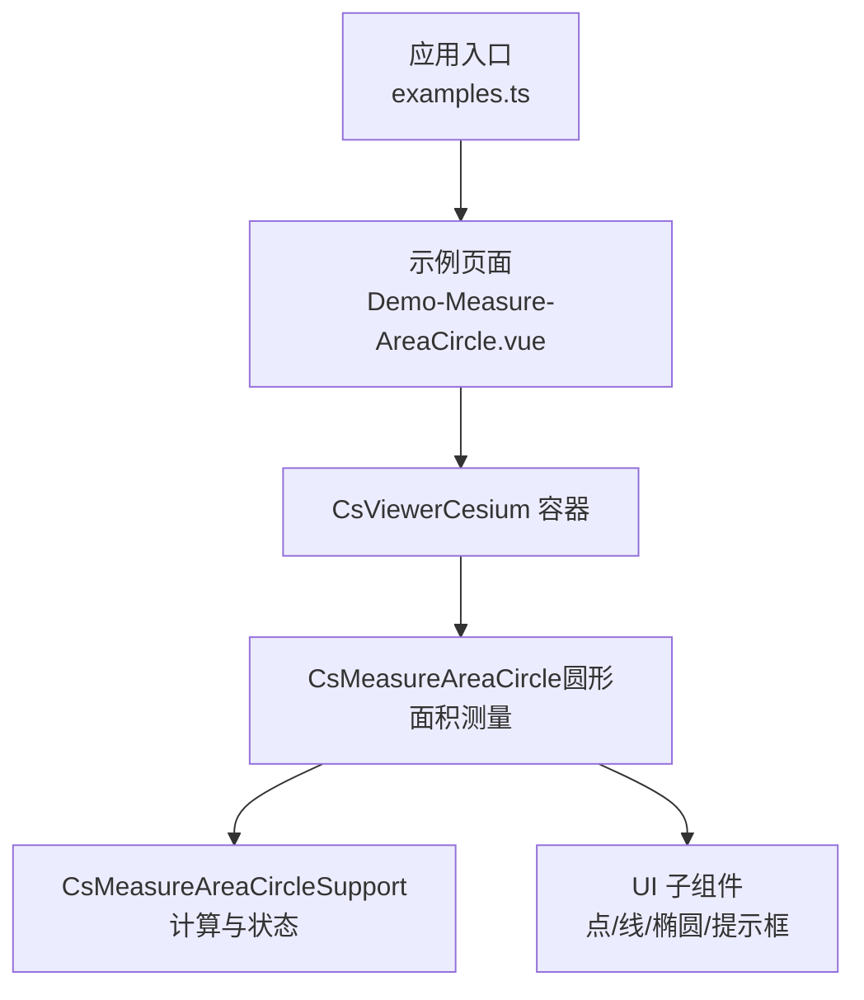
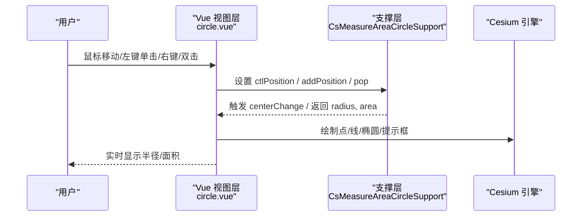
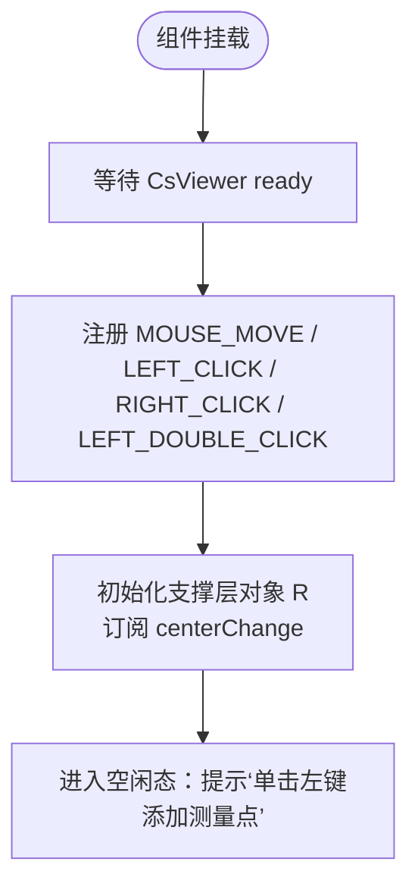
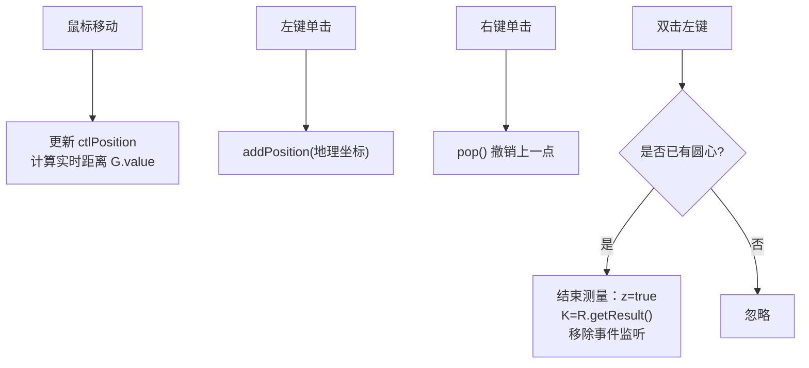
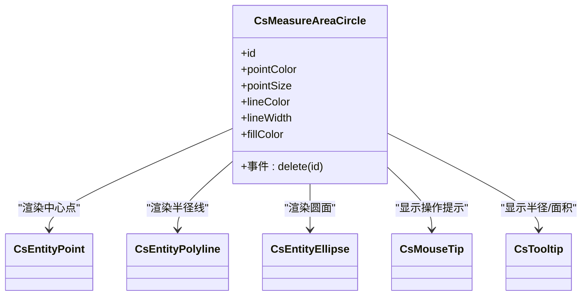
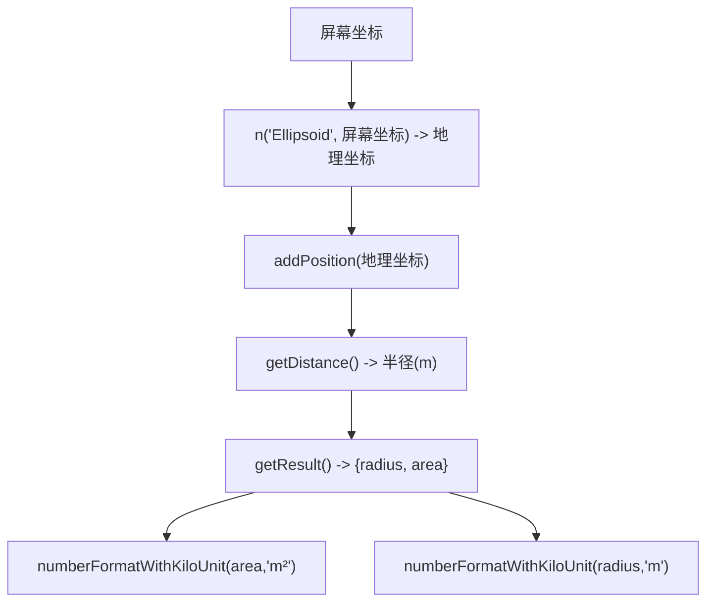
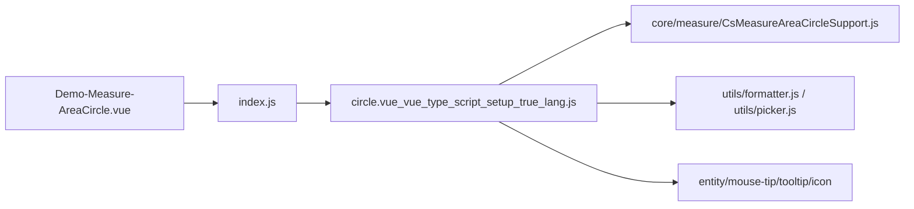
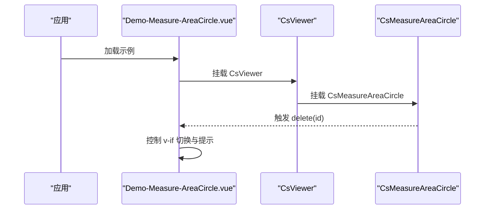

# 圆形面积测量

<cite>
**本文引用的文件**   
- [Demo-Measure-AreaCircle.vue](file://src/components/Measure/Area/Demo-Measure-AreaCircle.vue)
- [examples.ts](file://src/examples.ts)
- [circle.js（属性与事件定义）](file://node_modules/@iw/cesium-ui/es/components/measure/area/circle/circle.js)
- [index.js（模块导出）](file://node_modules/@iw/cesium-ui/es/components/measure/area/circle/index.js)
- [circle.vue_vue_type_script_setup_true_lang.js（组件实现）](file://node_modules/@iw/cesium-ui/es/components/measure/area/circle/circle.vue_vue_type_script_setup_true_lang.js)
</cite>

## 目录
1. [简介](#简介)
2. [项目结构](#项目结构)
3. [核心组件](#核心组件)
4. [架构总览](#架构总览)
5. [详细组件分析](#详细组件分析)
6. [依赖关系分析](#依赖关系分析)
7. [性能考虑](#性能考虑)
8. [故障排查指南](#故障排查指南)
9. [结论](#结论)
10. [附录：使用示例与最佳实践](#附录使用示例与最佳实践)

## 简介
本技术文档围绕“圆形面积测量”功能，系统性解析 CsMeasureAreaCircle 组件的实现原理、交互流程、可视化绘制、单位换算与精度控制。该组件基于 Cesium 三维地球场景，提供“点击确定圆心、拖动确定半径、实时显示面积结果”的完整测量体验，并支持删除已测图形、样式定制与事件回调。

## 项目结构
- 示例页面通过引入 @iw/cesium-ui 提供的 CsMeasureAreaCircle 组件，在 CsViewer 中启用圆形面积测量能力。
- 示例路由注册于 examples.ts，便于在应用菜单中切换不同测量与绘制示例。

**图表来源**
- [examples.ts:42-43](file://src/examples.ts#L42-L43)
- [Demo-Measure-AreaCircle.vue:6-33](file://src/components/Measure/Area/Demo-Measure-AreaCircle.vue#L6-L33)

**章节来源**
- [examples.ts:42-43](file://src/examples.ts#L42-L43)
- [Demo-Measure-AreaCircle.vue:1-33](file://src/components/Measure/Area/Demo-Measure-AreaCircle.vue#L1-L33)

## 核心组件
- 组件名称：CsMeasureAreaCircle
- 职责：在 Cesium 场景中完成圆形面积测量的交互、绘制与结果展示；对外暴露属性与事件，供上层业务集成。
- 关键能力：
  - 交互：鼠标移动、左键单击、右键取消、双击确认。
  - 绘制：中心点、半径线段、填充圆面、实时距离与最终结果提示。
  - 计算：半径与面积计算、单位格式化输出。
  - 事件：delete 事件通知上层删除当前测量结果。

**章节来源**
- [circle.vue_vue_type_script_setup_true_lang.js:24-56](file://node_modules/@iw/cesium-ui/es/components/measure/area/circle/circle.vue_vue_type_script_setup_true_lang.js#L24-L56)
- [circle.js:4-31](file://node_modules/@iw/cesium-ui/es/components/measure/area/circle/circle.js#L4-L31)

## 架构总览
组件内部由 Vue 视图层与核心计算支撑层协作：
- 视图层：监听屏幕空间事件，驱动几何绘制与提示框更新。
- 支撑层：维护测量状态（中心位置、半径、结果），提供属性访问与事件回调。

**图表来源**
- [circle.vue_vue_type_script_setup_true_lang.js:30-56](file://node_modules/@iw/cesium-ui/es/components/measure/area/circle/circle.vue_vue_type_script_setup_true_lang.js#L30-L56)

## 详细组件分析

### 初始化与配置
- 生命周期：组件挂载后等待 CsViewer ready，再注册屏幕空间事件监听。
- 命名空间：通过 useIwNamespace 获取统一前缀，保证 UI 类名一致性。
- 依赖注入：useCsViewer 获取 viewer 实例；useCsScreenSpaceEvent 提供事件注册/移除能力。

**图表来源**
- [circle.vue_vue_type_script_setup_true_lang.js:30-37](file://node_modules/@iw/cesium-ui/es/components/measure/area/circle/circle.vue_vue_type_script_setup_true_lang.js#L30-L37)

**章节来源**
- [circle.vue_vue_type_script_setup_true_lang.js:30-37](file://node_modules/@iw/cesium-ui/es/components/measure/area/circle/circle.vue_vue_type_script_setup_true_lang.js#L30-L37)

### 属性参数（Props）
- id：测量实例唯一标识，默认使用 Cesium 的 createGuid 生成。
- pointColor：中心点颜色，支持字符串或对象。
- pointSize：中心点像素大小。
- lineColor：半径线与轮廓线颜色。
- lineWidth：线条宽度。
- fillColor：圆面填充色，默认半透明。

| 属性 | 类型 | 默认值 | 说明 |
|---|---|---|---|
| id | String | 随机 GUID | 测量实例 ID |
| pointColor | Object/String | "#FFFFFF" | 中心点颜色 |
| pointSize | Number | 6 | 中心点像素尺寸 |
| lineColor | Object/String | "#FF787A" | 线条颜色 |
| lineWidth | Number | 1 | 线条宽度 |
| fillColor | Object/String | "rgba(255,162,29,0.3)" | 圆面填充色 |

**章节来源**
- [circle.js:4-29](file://node_modules/@iw/cesium-ui/es/components/measure/area/circle/circle.js#L4-L29)

### 事件机制（Emits）
- delete(id)：当用户关闭最终结果提示框时触发，用于上层清理或二次处理。

**章节来源**
- [circle.js:29-31](file://node_modules/@iw/cesium-ui/es/components/measure/area/circle/circle.js#L29-L31)
- [circle.vue_vue_type_script_setup_true_lang.js:54-56](file://node_modules/@iw/cesium-ui/es/components/measure/area/circle/circle.vue_vue_type_script_setup_true_lang.js#L54-L56)

### 用户交互流程
- 鼠标移动：根据光标位置更新控件位置 ctlPosition，并实时计算当前半径距离。
- 左键单击：将拾取到的地理坐标加入测量序列，作为圆心。
- 右键单击：撤销上一个点（回退）。
- 双击左键：若已有圆心，则结束测量，锁定状态，显示最终半径与面积结果提示框。

**图表来源**
- [circle.vue_vue_type_script_setup_true_lang.js:41-53](file://node_modules/@iw/cesium-ui/es/components/measure/area/circle/circle.vue_vue_type_script_setup_true_lang.js#L41-L53)

**章节来源**
- [circle.vue_vue_type_script_setup_true_lang.js:41-53](file://node_modules/@iw/cesium-ui/es/components/measure/area/circle/circle.vue_vue_type_script_setup_true_lang.js#L41-L53)

### 圆形绘制算法与可视化
- 中心点：使用 CsEntityPoint 渲染，位置来自支撑层的 centerPosition。
- 半径线段：使用 CsEntityPolyline 连接中心与控件位置，颜色与宽度受 props 控制。
- 圆面：使用 CsEntityEllipse 以相同长短轴绘制圆形，高度为 0，材质为 fillColor，带轮廓线。
- 提示框：
  - 测量中：CsMouseTip 显示鼠标经纬度与操作提示。
  - 测量中：CsTooltip 显示实时半径长度（米）。
  - 完成后：CsTooltip 显示半径与面积，并提供关闭按钮触发 delete 事件。

**图表来源**
- [circle.vue_vue_type_script_setup_true_lang.js:57-135](file://node_modules/@iw/cesium-ui/es/components/measure/area/circle/circle.vue_vue_type_script_setup_true_lang.js#L57-L135)
- [circle.js:4-29](file://node_modules/@iw/cesium-ui/es/components/measure/area/circle/circle.js#L4-L29)

**章节来源**
- [circle.vue_vue_type_script_setup_true_lang.js:57-135](file://node_modules/@iw/cesium-ui/es/components/measure/area/circle/circle.vue_vue_type_script_setup_true_lang.js#L57-L135)

### 半径计算与面积公式（含地球曲率影响）
- 半径来源：支撑层 R.getRadiusProperty() 返回半径属性；R.getDistance() 返回当前鼠标到圆心的球面距离。
- 面积计算：支撑层 R.getResult() 返回包含 area 与 radius 的结果对象。
- 单位换算：
  - 半径与面积数值通过 numberFormatWithKiloUnit 进行千分位格式化，并附加单位 m 与 m²。
  - 经纬度坐标通过 numberFormat 保留小数位数，提升可读性。
- 地球曲率：
  - 坐标拾取使用 n("Ellipsoid", ...) 将屏幕坐标投影到椭球体表面，确保在三维地球上的几何正确性。
  - 半径基于球面距离，面积由支撑层按椭球模型计算，避免平面近似误差。

**图表来源**
- [circle.vue_vue_type_script_setup_true_lang.js:41-53](file://node_modules/@iw/cesium-ui/es/components/measure/area/circle/circle.vue_vue_type_script_setup_true_lang.js#L41-L53)
- [circle.vue_vue_type_script_setup_true_lang.js:57-135](file://node_modules/@iw/cesium-ui/es/components/measure/area/circle/circle.vue_vue_type_script_setup_true_lang.js#L57-L135)

**章节来源**
- [circle.vue_vue_type_script_setup_true_lang.js:41-53](file://node_modules/@iw/cesium-ui/es/components/measure/area/circle/circle.vue_vue_type_script_setup_true_lang.js#L41-L53)
- [circle.vue_vue_type_script_setup_true_lang.js:57-135](file://node_modules/@iw/cesium-ui/es/components/measure/area/circle/circle.vue_vue_type_script_setup_true_lang.js#L57-L135)

### 精度控制与用户体验优化
- 坐标精度：经纬度显示保留 6 位小数，平衡精度与可读性。
- 数值格式化：半径与面积采用千分位格式化，单位明确。
- 交互反馈：
  - 测量中显示鼠标坐标与操作提示。
  - 实时显示半径长度，帮助用户快速调整。
  - 完成后弹出结果提示框，支持一键删除。
- 状态管理：
  - z 标记测量是否结束，结束后移除事件监听，避免重复触发。
  - 通过 nextTick 控制组件销毁与重建时的时序，确保 DOM 更新稳定。

**章节来源**
- [circle.vue_vue_type_script_setup_true_lang.js:57-135](file://node_modules/@iw/cesium-ui/es/components/measure/area/circle/circle.vue_vue_type_script_setup_true_lang.js#L57-L135)
- [Demo-Measure-AreaCircle.vue:17-25](file://src/components/Measure/Area/Demo-Measure-AreaCircle.vue#L17-L25)

## 依赖关系分析
- 组件导出：index.js 将 CsMeasureAreaCircle 及其 props/emits 重新导出，供外部按需引入。
- 组件实现：circle.vue_vue_type_script_setup_true_lang.js 负责视图与交互逻辑，依赖 core 支撑层与 UI 子组件。
- 示例集成：Demo 页面仅负责挂载组件与处理 delete 事件，保持轻量。

**图表来源**
- [index.js:1-7](file://node_modules/@iw/cesium-ui/es/components/measure/area/circle/index.js#L1-L7)
- [circle.vue_vue_type_script_setup_true_lang.js:1-18](file://node_modules/@iw/cesium-ui/es/components/measure/area/circle/circle.vue_vue_type_script_setup_true_lang.js#L1-L18)
- [Demo-Measure-AreaCircle.vue:6-33](file://src/components/Measure/Area/Demo-Measure-AreaCircle.vue#L6-L33)

**章节来源**
- [index.js:1-7](file://node_modules/@iw/cesium-ui/es/components/measure/area/circle/index.js#L1-L7)
- [circle.vue_vue_type_script_setup_true_lang.js:1-18](file://node_modules/@iw/cesium-ui/es/components/measure/area/circle/circle.vue_vue_type_script_setup_true_lang.js#L1-L18)
- [Demo-Measure-AreaCircle.vue:6-33](file://src/components/Measure/Area/Demo-Measure-AreaCircle.vue#L6-L33)

## 性能考虑
- 事件监听最小化：测量结束后立即移除屏幕空间事件监听，避免无谓开销。
- 渲染对象复用：点、线、椭圆等实体仅在需要时创建与更新，减少频繁销毁重建。
- 数值计算节流：半径与面积计算由支撑层集中处理，视图层仅消费结果，降低重复计算。
- 格式化输出：仅在提示框渲染时进行单位格式化，避免高频重绘。

[本节为通用性能建议，不直接分析具体文件]

## 故障排查指南
- 无法开始测量：
  - 检查 CsViewer 是否已 ready，事件监听是否在 ready 后注册。
  - 确认屏幕空间事件未被其他组件覆盖。
- 半径/面积为空：
  - 确认已成功单击确定圆心；双击结束时需存在圆心。
  - 检查支撑层 getResult 返回值是否有效。
- 样式不生效：
  - 校验 props 传入的颜色与宽度是否符合预期。
  - 注意 fillColor 透明度对视觉效果的影响。
- 删除后异常：
  - 使用 nextTick 控制 v-if 切换，确保 DOM 更新顺序正确。
  - 监听 delete 事件后及时清理上层状态。

**章节来源**
- [circle.vue_vue_type_script_setup_true_lang.js:30-56](file://node_modules/@iw/cesium-ui/es/components/measure/area/circle/circle.vue_vue_type_script_setup_true_lang.js#L30-L56)
- [Demo-Measure-AreaCircle.vue:17-25](file://src/components/Measure/Area/Demo-Measure-AreaCircle.vue#L17-L25)

## 结论
CsMeasureAreaCircle 组件通过清晰的职责划分与稳健的事件驱动模型，提供了完整的圆形面积测量能力。其结合 Cesium 的椭球模型与工具函数，确保了在三维地球场景下的几何准确性与用户体验。开发者可通过 props 灵活定制外观，并通过 delete 事件与上层业务无缝集成。

[本节为总结性内容，不直接分析具体文件]

## 附录：使用示例与最佳实践

### 基本用法
- 在 CsViewer 中引入 CsMeasureAreaCircle，绑定 delete 事件处理删除逻辑。
- 示例路由在 examples.ts 中注册，便于在应用中切换。

**图表来源**
- [Demo-Measure-AreaCircle.vue:6-33](file://src/components/Measure/Area/Demo-Measure-AreaCircle.vue#L6-L33)
- [examples.ts:42-43](file://src/examples.ts#L42-L43)

**章节来源**
- [Demo-Measure-AreaCircle.vue:6-33](file://src/components/Measure/Area/Demo-Measure-AreaCircle.vue#L6-L33)
- [examples.ts:42-43](file://src/examples.ts#L42-L43)

### 常见场景与扩展建议
- 批量测量：在上层维护测量结果列表，支持多实例共存与统一管理。
- 主题适配：通过 props 传入主题色，统一视觉风格。
- 精度调节：根据业务需求调整经纬度显示位数与数值格式化策略。
- 国际化：将提示文案与单位文本抽离为可配置项，便于多语言支持。

[本节为概念性指导，不直接分析具体文件]