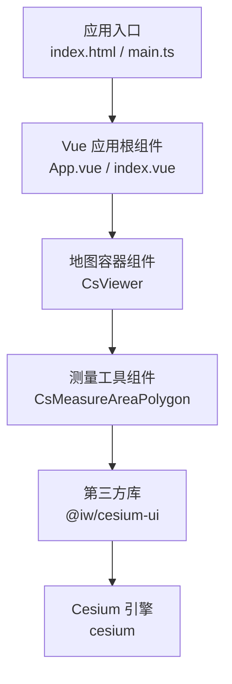
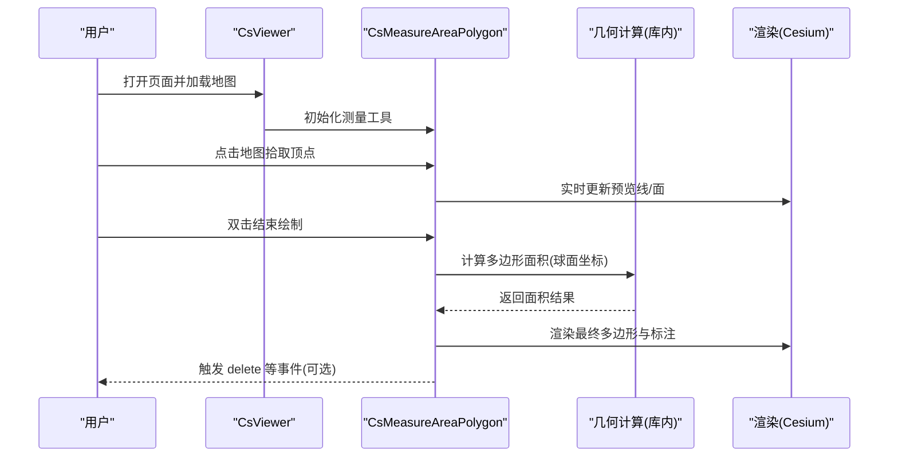
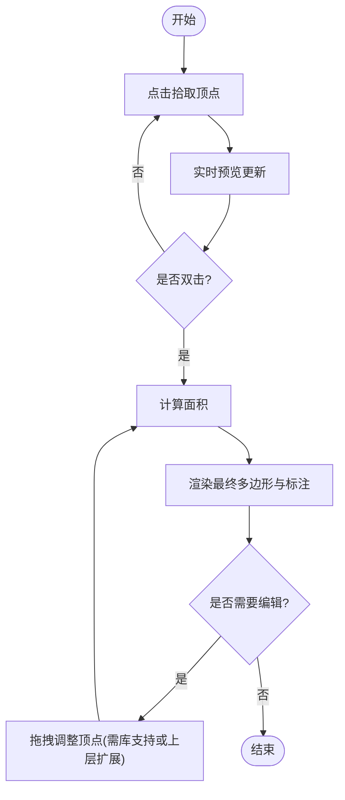
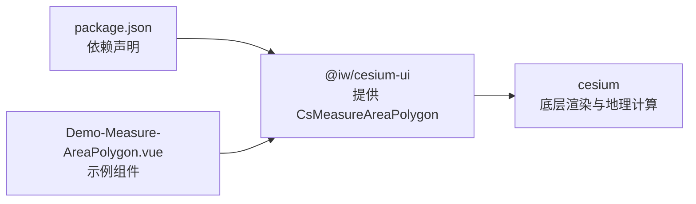

# 多边形面积测量

<cite>
**本文引用的文件**   
- [Demo-Measure-AreaPolygon.vue](file://src/components/Measure/Area/Demo-Measure-AreaPolygon.vue)
- [package.json](file://package.json)
</cite>

## 目录
1. [简介](#简介)
2. [项目结构](#项目结构)
3. [核心组件](#核心组件)
4. [架构总览](#架构总览)
5. [详细组件分析](#详细组件分析)
6. [依赖关系分析](#依赖关系分析)
7. [性能与优化](#性能与优化)
8. [故障排查指南](#故障排查指南)
9. [结论](#结论)
10. [附录：使用示例与最佳实践](#附录使用示例与最佳实践)

## 简介
本文面向“多边形面积测量”功能，围绕 CsMeasureAreaPolygon 组件的使用与集成进行技术说明。由于该组件来自第三方库 @iw/cesium-ui，本仓库仅包含其使用示例与依赖声明，不包含内部实现源码。因此，本文在“实现原理、算法细节、高级特性”等章节以“概念性说明”为主，并结合仓库中的实际用法给出可操作的集成方式、交互流程建议与性能调优策略。

## 项目结构
本项目基于 Vue 3 + Vite + Cesium，通过 @iw/cesium-ui 提供地图可视化与测量能力。多边形面积测量的示例位于 Measure/Area 目录下，通过引入 CsMeasureAreaPolygon 并在 CsViewer 中使用完成集成。

图表来源
- [package.json:12-17](file://package.json#L12-L17)
- [Demo-Measure-AreaPolygon.vue:1-31](file://src/components/Measure/Area/Demo-Measure-AreaPolygon.vue#L1-L31)

章节来源
- [package.json:12-17](file://package.json#L12-L17)
- [Demo-Measure-AreaPolygon.vue:1-31](file://src/components/Measure/Area/Demo-Measure-AreaPolygon.vue#L1-L31)

## 核心组件
- CsViewer：Cesium 的封装视图容器，负责初始化 Viewer、图层、事件总线等。
- CsMeasureAreaPolygon：多边形面积测量工具，提供多点拾取、实时预览、双击完成绘制、删除等操作（具体行为由第三方库实现）。
- 示例组件 Demo-Measure-AreaPolygon.vue：演示如何在 CsViewer 中挂载 CsMeasureAreaPolygon，并处理删除回调。

章节来源
- [Demo-Measure-AreaPolygon.vue:1-31](file://src/components/Measure/Area/Demo-Measure-AreaPolygon.vue#L1-L31)

## 架构总览
下图展示了从用户交互到最终面积计算与渲染的整体流程。由于 CsMeasureAreaPolygon 的实现位于第三方库内，本节为概念性流程图，用于帮助理解典型的数据流与控制流。

[本图为概念性流程图，不直接映射具体源码文件]

## 详细组件分析

### 组件集成与事件
- 在 CsViewer 中直接引入并使用 CsMeasureAreaPolygon。
- 支持通过属性 id 标识实例，并通过事件（如 delete）接收删除回调，便于上层业务逻辑处理。

章节来源
- [Demo-Measure-AreaPolygon.vue:6-31](file://src/components/Measure/Area/Demo-Measure-AreaPolygon.vue#L6-L31)

### 用户交互流程（概念性）
- 多点拾取：用户在地图上依次点击，形成临时折线/面。
- 实时预览：每次点击后即时更新预览图形，提升交互反馈。
- 双击完成绘制：双击地图确认多边形闭合，触发面积计算与最终渲染。
- 编辑顶点：根据第三方库能力，可能支持拖拽调整顶点位置；若未内置，可在上层自行扩展。
- 撤销重做：若第三方库未内置，可通过维护操作历史栈在上层实现。

[本图为概念性流程图，不直接映射具体源码文件]

### 几何算法与面积计算（概念性）
- 鞋带公式在球面坐标下的应用：对经纬度点序列按顺序求和，得到近似平面面积；在地球曲率下需结合椭球模型或局部投影修正。
- 自相交多边形处理：检测边交叉并进行拓扑修复（如分解为多个简单多边形），再分别计算面积后合并。
- 面积修正：考虑高程变化、地形起伏与椭球体模型，采用更精确的球面三角法或分块投影方法。

[本节为概念性说明，不涉及具体源码]

### 高级特性（概念性）
- 撤销/重做：维护操作历史栈，记录每次顶点增删与移动，支持回滚与重放。
- 顶点拖拽调整：监听鼠标事件，更新对应顶点坐标并重新计算面积。
- 多边形分割/合并：基于几何布尔运算或网格化方法，将复杂多边形拆分为若干简单子多边形，或将相邻多边形合并。

[本节为概念性说明，不涉及具体源码]

## 依赖关系分析
项目通过 package.json 声明了对 @iw/cesium-ui 与 cesium 的依赖，示例组件通过 import 引入 CsMeasureAreaPolygon 并在模板中使用。

图表来源
- [package.json:12-17](file://package.json#L12-L17)
- [Demo-Measure-AreaPolygon.vue:6-31](file://src/components/Measure/Area/Demo-Measure-AreaPolygon.vue#L6-L31)

章节来源
- [package.json:12-17](file://package.json#L12-L17)
- [Demo-Measure-AreaPolygon.vue:6-31](file://src/components/Measure/Area/Demo-Measure-AreaPolygon.vue#L6-L31)

## 性能与优化
- 大数据量优化
  - 顶点数量控制：限制单次绘制的最大顶点数，避免过多线段导致渲染卡顿。
  - 增量计算：仅在顶点变更时重新计算面积，避免全量重算。
  - 分块与延迟加载：对超大区域采用分块计算与按需渲染。
- 内存管理
  - 及时释放临时对象：在绘制完成后清理中间几何数据。
  - 复用几何对象：减少频繁创建销毁带来的 GC 压力。
- 渲染性能调优
  - 降低预览频率：在高频输入场景下节流预览更新。
  - 使用轻量标注：面积文本标注尽量简化样式与动画。
  - 关闭不必要的阴影/光照：在测量模式下禁用高开销渲染效果。

[本节为通用指导，不涉及具体源码]

## 故障排查指南
- 组件未显示或无响应
  - 检查 CsViewer 是否正确初始化且已就绪。
  - 确认 CsMeasureAreaPolygon 是否在 CsViewer 内部正确挂载。
- 删除事件未触发
  - 检查模板中是否正确绑定 delete 事件处理器。
  - 确认第三方库版本是否支持该事件。
- 面积计算异常
  - 检查顶点顺序是否为顺时针或逆时针一致。
  - 验证是否存在自相交或重复顶点，必要时进行几何预处理。

章节来源
- [Demo-Measure-AreaPolygon.vue:16-23](file://src/components/Measure/Area/Demo-Measure-AreaPolygon.vue#L16-L23)

## 结论
在本仓库中，CsMeasureAreaPolygon 作为第三方库提供的测量工具被集成到 CsViewer 中，示例组件展示了基本的使用方法。由于内部实现位于 @iw/cesium-ui，本文以概念性方式说明了多边形面积测量的典型流程、算法要点与性能优化策略。对于高级特性（如撤销重做、顶点拖拽、多边形分割合并），若第三方库未内置，可在上层业务中进行扩展实现。

## 附录：使用示例与最佳实践
- 基础集成
  - 在 CsViewer 中引入并使用 CsMeasureAreaPolygon，并为实例设置唯一 id。
  - 监听 delete 事件以处理删除后的业务逻辑。
- 复杂地形与不规则形状
  - 建议在绘制前启用地形图层，确保高程信息参与计算。
  - 对不规则形状，建议先进行几何清洗（去重、排序、自相交修复）。
- 用户体验优化
  - 提供清晰的提示文案，引导用户双击完成绘制。
  - 在移动端适配触摸事件，保证多点拾取的流畅性。
  - 提供撤销/重做按钮，增强容错能力。

章节来源
- [Demo-Measure-AreaPolygon.vue:6-31](file://src/components/Measure/Area/Demo-Measure-AreaPolygon.vue#L6-L31)