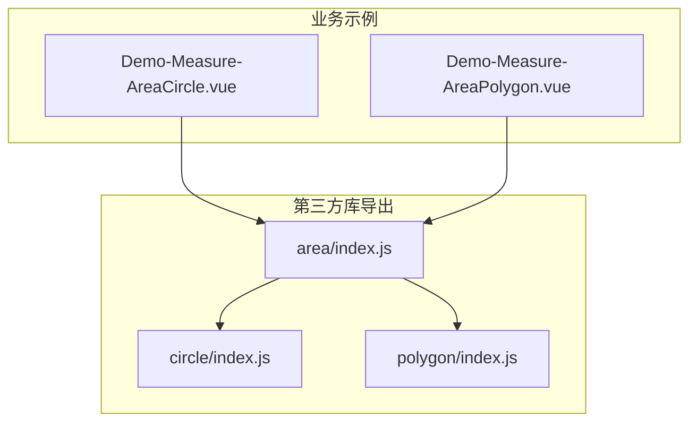
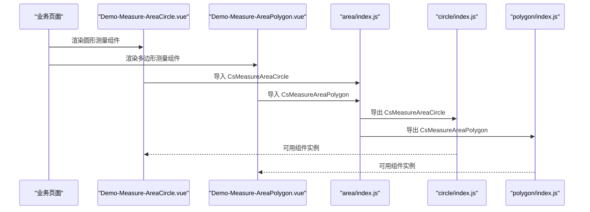
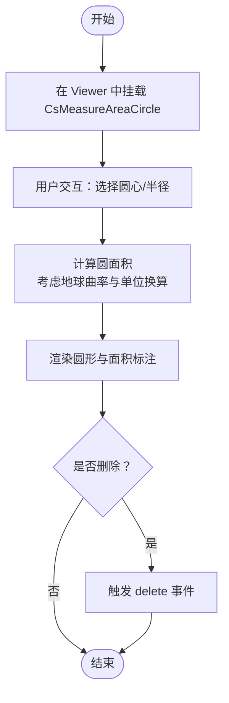
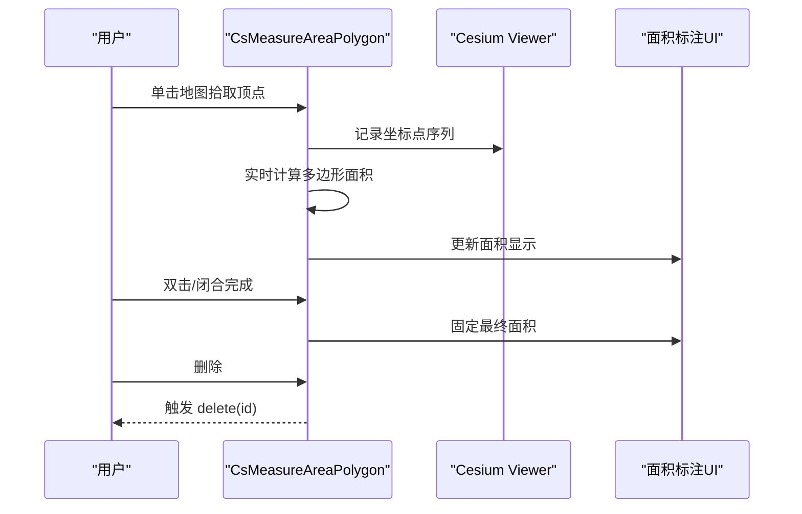
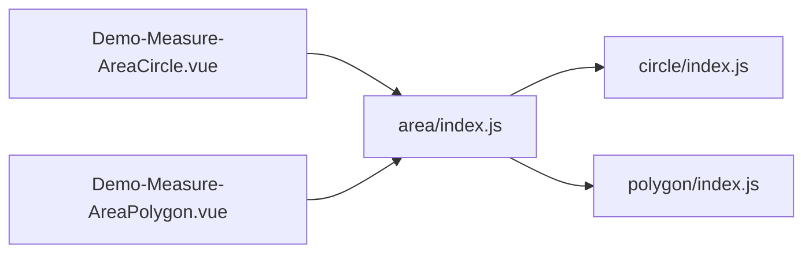

# 面积测量

<cite>
**本文引用的文件**   
- [Demo-Measure-AreaCircle.vue](file://src/components/Measure/Area/Demo-Measure-AreaCircle.vue)
- [Demo-Measure-AreaPolygon.vue](file://src/components/Measure/Area/Demo-Measure-AreaPolygon.vue)
- [area/index.js](file://node_modules/@iw/cesium-ui/es/components/measure/area/index.js)
- [circle/index.js](file://node_modules/@iw/cesium-ui/es/components/measure/area/circle/index.js)
- [polygon/index.js](file://node_modules/@iw/cesium-ui/es/components/measure/area/polygon/index.js)
</cite>

## 目录
1. [简介](#简介)
2. [项目结构](#项目结构)
3. [核心组件](#核心组件)
4. [架构总览](#架构总览)
5. [详细组件分析](#详细组件分析)
6. [依赖关系分析](#依赖关系分析)
7. [性能与内存优化](#性能与内存优化)
8. [故障排查指南](#故障排查指南)
9. [结论](#结论)
10. [附录：使用示例与最佳实践](#附录使用示例与最佳实践)

## 简介
本技术文档围绕“面积测量”功能，聚焦圆形与多边形两种几何类型的面积计算与交互实现。文档从系统架构、组件接口、事件模型、几何算法与单位换算、地球曲率影响、复杂多边形处理策略、自相交检测与高精度优化等维度展开说明，并提供可落地的集成方式与性能建议。

## 项目结构
本项目在业务层通过 Vue 组件引入第三方库 @iw/cesium-ui 提供的面积测量能力，并在 Cesium Viewer 中挂载使用。核心文件包括：
- 业务示例组件：用于演示如何引入和配置 CsMeasureAreaCircle 与 CsMeasureAreaPolygon。
- 第三方库导出入口：暴露 CsMeasureAreaCircle 与 CsMeasureAreaPolygon 及其属性与事件类型。

图表来源
- [area/index.js:1-6](file://node_modules/@iw/cesium-ui/es/components/measure/area/index.js#L1-L6)
- [circle/index.js:1-8](file://node_modules/@iw/cesium-ui/es/components/measure/area/circle/index.js#L1-L8)
- [polygon/index.js:1-8](file://node_modules/@iw/cesium-ui/es/components/measure/area/polygon/index.js#L1-L8)

章节来源
- [Demo-Measure-AreaCircle.vue:1-50](file://src/components/Measure/Area/Demo-Measure-AreaCircle.vue#L1-L50)
- [Demo-Measure-AreaPolygon.vue:1-48](file://src/components/Measure/Area/Demo-Measure-AreaPolygon.vue#L1-L48)
- [area/index.js:1-6](file://node_modules/@iw/cesium-ui/es/components/measure/area/index.js#L1-L6)
- [circle/index.js:1-8](file://node_modules/@iw/cesium-ui/es/components/measure/area/circle/index.js#L1-L8)
- [polygon/index.js:1-8](file://node_modules/@iw/cesium-ui/es/components/measure/area/polygon/index.js#L1-L8)

## 核心组件
- CsMeasureAreaCircle：圆形面积测量组件，提供基于半径的圆形区域绘制与面积计算。
- CsMeasureAreaPolygon：多边形面积测量组件，支持顶点拾取、实时面积计算与结果展示。

两个组件均通过 @iw/cesium-ui 暴露，并可在 Cesium Viewer 中以子组件形式挂载。

章节来源
- [area/index.js:1-6](file://node_modules/@iw/cesium-ui/es/components/measure/area/index.js#L1-L6)
- [circle/index.js:1-8](file://node_modules/@iw/cesium-ui/es/components/measure/area/circle/index.js#L1-L8)
- [polygon/index.js:1-8](file://node_modules/@iw/cesium-ui/es/components/measure/area/polygon/index.js#L1-L8)

## 架构总览
下图展示了业务示例组件与第三方库导出之间的关系，以及组件在 Viewer 中的挂载方式。

图表来源
- [Demo-Measure-AreaCircle.vue:1-50](file://src/components/Measure/Area/Demo-Measure-AreaCircle.vue#L1-L50)
- [Demo-Measure-AreaPolygon.vue:1-48](file://src/components/Measure/Area/Demo-Measure-AreaPolygon.vue#L1-L48)
- [area/index.js:1-6](file://node_modules/@iw/cesium-ui/es/components/measure/area/index.js#L1-L6)
- [circle/index.js:1-8](file://node_modules/@iw/cesium-ui/es/components/measure/area/circle/index.js#L1-L8)
- [polygon/index.js:1-8](file://node_modules/@iw/cesium-ui/es/components/measure/area/polygon/index.js#L1-L8)

## 详细组件分析

### CsMeasureAreaCircle（圆形面积测量）
- 作用：在地图上以点击或拖拽方式确定圆心与半径，绘制圆形并计算面积。
- 集成方式：作为子组件挂载到 CsViewer 内部。
- 生命周期与事件：
  - delete：当用户删除当前圆形测量结果时触发，回调参数为被删除元素的标识符。
- 典型用法要点：
  - 通过 v-if 控制显示/隐藏以销毁/重建实例。
  - 监听 delete 事件进行清理或提示。

图表来源
- [Demo-Measure-AreaCircle.vue:1-50](file://src/components/Measure/Area/Demo-Measure-AreaCircle.vue#L1-L50)

章节来源
- [Demo-Measure-AreaCircle.vue:1-50](file://src/components/Measure/Area/Demo-Measure-AreaCircle.vue#L1-L50)

### CsMeasureAreaPolygon（多边形面积测量）
- 作用：通过多点拾取构建多边形，实时计算面积并显示。
- 集成方式：作为子组件挂载到 CsViewer 内部。
- 生命周期与事件：
  - delete：当用户删除当前多边形测量结果时触发，回调参数为被删除元素的标识符。
- 交互流程：
  - 单击添加顶点；双击或闭合操作完成多边形；实时更新面积。
  - 支持对复杂多边形（含孔洞、自相交）的处理策略与精度优化。

图表来源
- [Demo-Measure-AreaPolygon.vue:1-48](file://src/components/Measure/Area/Demo-Measure-AreaPolygon.vue#L1-L48)

章节来源
- [Demo-Measure-AreaPolygon.vue:1-48](file://src/components/Measure/Area/Demo-Measure-AreaPolygon.vue#L1-L48)

## 依赖关系分析
- 业务示例组件仅依赖 @iw/cesium-ui 导出的组件与类型定义，不直接耦合底层实现。
- area/index.js 统一聚合 circle 与 polygon 模块的导出，便于按需引用。

图表来源
- [area/index.js:1-6](file://node_modules/@iw/cesium-ui/es/components/measure/area/index.js#L1-L6)
- [circle/index.js:1-8](file://node_modules/@iw/cesium-ui/es/components/measure/area/circle/index.js#L1-L8)
- [polygon/index.js:1-8](file://node_modules/@iw/cesium-ui/es/components/measure/area/polygon/index.js#L1-L8)

章节来源
- [area/index.js:1-6](file://node_modules/@iw/cesium-ui/es/components/measure/area/index.js#L1-L6)
- [circle/index.js:1-8](file://node_modules/@iw/cesium-ui/es/components/measure/area/circle/index.js#L1-L8)
- [polygon/index.js:1-8](file://node_modules/@iw/cesium-ui/es/components/measure/area/polygon/index.js#L1-L8)

## 性能与内存优化
- 实时计算节流：在多边形顶点频繁变更场景下，对面积计算进行节流或防抖，避免每帧重算导致卡顿。
- 增量更新：仅在新增/移动顶点时局部更新面积标注，减少 DOM 重绘。
- 大数据量处理：
  - 对大规模顶点集合采用分片计算与异步任务队列，避免主线程阻塞。
  - 对极长路径的多边形进行简化（如 Douglas-Peucker），在保证视觉精度的前提下降低计算复杂度。
- 内存管理：
  - 及时释放已删除图元的中间数据与缓存。
  - 避免在事件回调中创建大对象，复用缓冲区。
- 精度与稳定性：
  - 使用双精度浮点运算，必要时对坐标进行归一化以减少舍入误差。
  - 对自相交多边形进行拓扑修复后再计算面积，保证结果稳定。

[本节为通用指导，不涉及具体文件]

## 故障排查指南
- 组件未渲染：
  - 检查是否在 CsViewer 内部正确挂载组件。
  - 确认 v-if 条件未意外置为 false。
- 事件未触发：
  - 确认绑定的是 delete 事件而非其他名称。
  - 检查父组件是否正确声明并处理该事件。
- 面积异常：
  - 检查输入坐标是否为经纬度且顺序正确。
  - 对于复杂多边形，先进行自相交检测与修复。
- 性能问题：
  - 观察浏览器性能面板，定位是否因频繁重绘或计算导致掉帧。
  - 适当降低实时计算的频率或简化顶点数量。

章节来源
- [Demo-Measure-AreaCircle.vue:1-50](file://src/components/Measure/Area/Demo-Measure-AreaCircle.vue#L1-L50)
- [Demo-Measure-AreaPolygon.vue:1-48](file://src/components/Measure/Area/Demo-Measure-AreaPolygon.vue#L1-L48)

## 结论
通过 @iw/cesium-ui 提供的 CsMeasureAreaCircle 与 CsMeasureAreaPolygon，可以在 Cesium 场景中快速实现圆形与多边形的面积测量。结合合理的交互设计、事件处理与性能优化策略，能够覆盖从简单到复杂的多种业务场景。建议在集成时关注地球曲率影响、单位换算与复杂多边形处理，以获得准确且流畅的用户体验。

[本节为总结性内容，不涉及具体文件]

## 附录：使用示例与最佳实践

### 圆形面积测量示例
- 在页面中引入 CsMeasureAreaCircle 并挂载到 CsViewer。
- 监听 delete 事件以处理删除逻辑。
- 通过 v-if 控制组件显隐以销毁/重建实例。

章节来源
- [Demo-Measure-AreaCircle.vue:1-50](file://src/components/Measure/Area/Demo-Measure-AreaCircle.vue#L1-L50)

### 多边形面积测量示例
- 在页面中引入 CsMeasureAreaPolygon 并挂载到 CsViewer。
- 监听 delete 事件以处理删除逻辑。
- 通过多次点击拾取顶点，自动实时计算并显示面积。

章节来源
- [Demo-Measure-AreaPolygon.vue:1-48](file://src/components/Measure/Area/Demo-Measure-AreaPolygon.vue#L1-L48)

### 几何计算与单位换算要点
- 圆形面积：基于半径计算，需考虑地球曲率对投影的影响，输出单位通常为平方米或平方公里。
- 多边形面积：采用球面多边形面积公式（如鞋带公式的球面修正），对自相交与孔洞进行拓扑处理。
- 单位换算：根据业务需求将平方米转换为公顷、平方公里等常用单位。

[本节为概念性说明，不涉及具体文件]