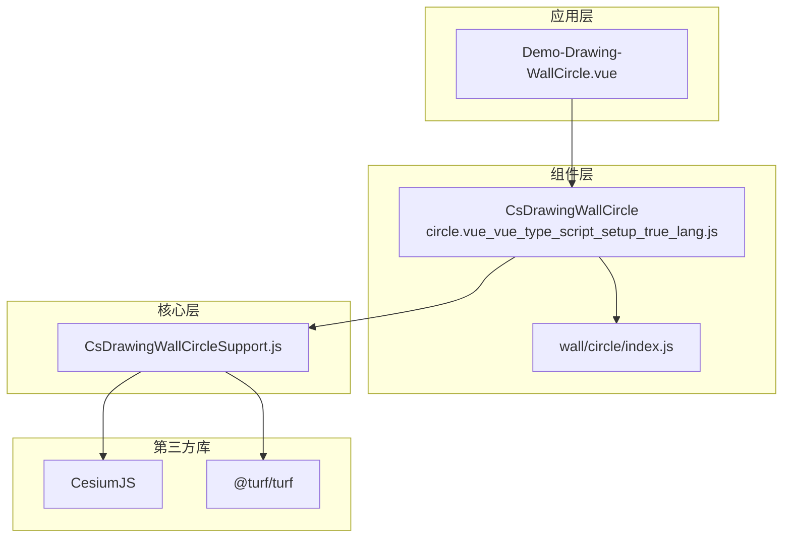
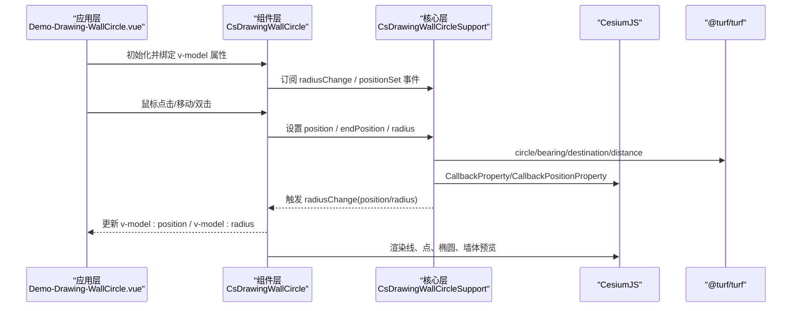
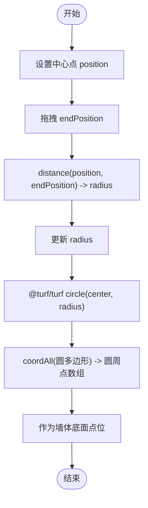
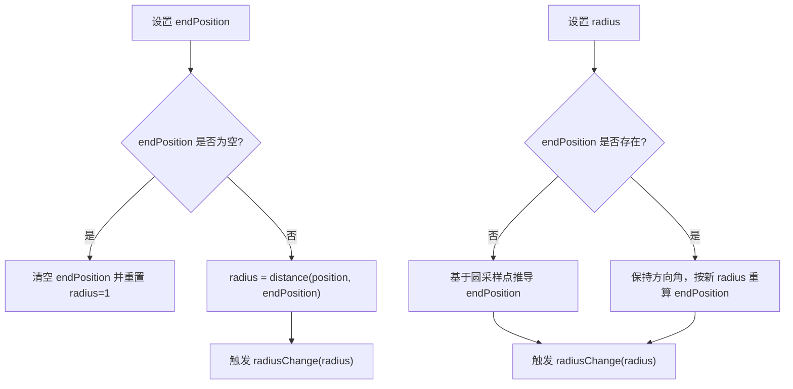
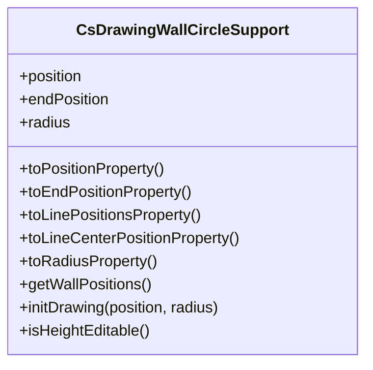
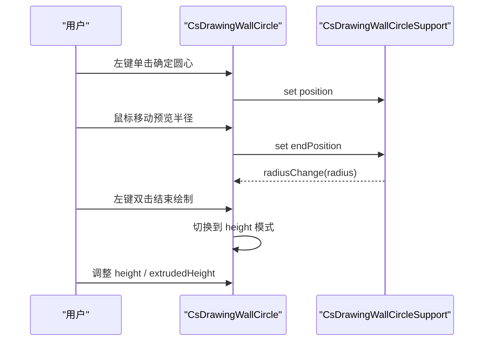
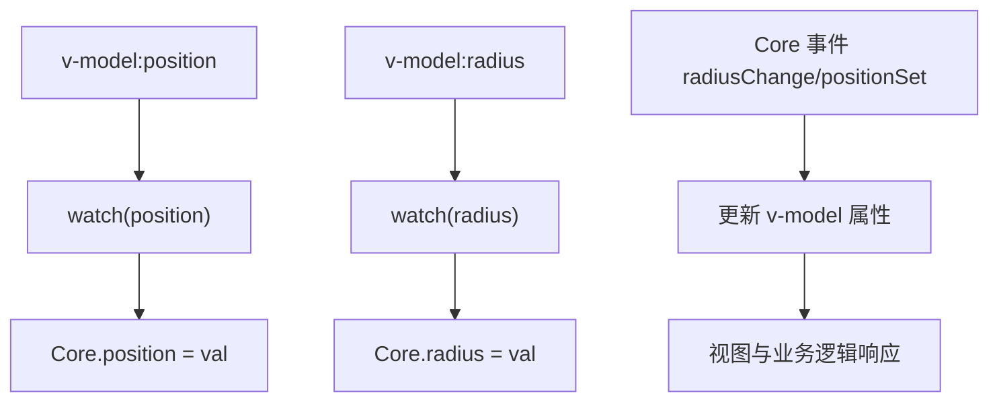
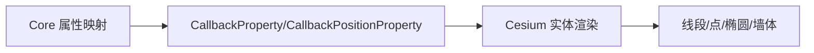
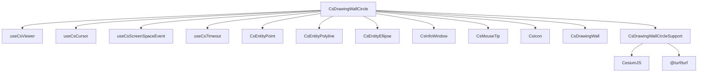

# 圆形墙体绘制

<cite>
**本文引用的文件**   
- [Demo-Drawing-WallCircle.vue](file://src/components/Drawing/Wall/Demo-Drawing-WallCircle.vue)
- [circle.vue_vue_type_script_setup_true_lang.js](file://node_modules/@iw/cesium-ui/es/components/drawing/wall/circle/circle.vue_vue_type_script_setup_true_lang.js)
- [index.js（wall/circle）](file://node_modules/@iw/cesium-ui/es/components/drawing/wall/circle/index.js)
- [CsDrawingWallCircleSupport.js](file://node_modules/@iw/cesium-ui/es/core/drawing/CsDrawingWallCircleSupport.js)
</cite>

## 目录
1. [简介](#简介)
2. [项目结构](#项目结构)
3. [核心组件](#核心组件)
4. [架构总览](#架构总览)
5. [详细组件分析](#详细组件分析)
6. [依赖关系分析](#依赖关系分析)
7. [性能考虑](#性能考虑)
8. [故障排查指南](#故障排查指南)
9. [结论](#结论)
10. [附录：使用示例与最佳实践](#附录使用示例与最佳实践)

## 简介
本技术文档围绕“圆形墙体绘制”功能，系统性解析 CsDrawingWallCircle 组件的实现原理、数学计算、交互流程、属性绑定机制以及与 CesiumJS 的集成方式。重点包括：
- 圆形几何体的数学计算与圆周点生成逻辑
- 半径控制算法与端点位置推导
- 三维空间表示（中心点、半径、高度、挤出高度）
- 用户交互流程（确定圆心、拖拽调整半径、实时预览）
- v-model 属性绑定与数据同步策略
- 与 CesiumJS 底层 API 的集成与性能优化建议

## 项目结构
该功能由一个演示页面与库内组件及核心支持类共同构成：
- 演示页面负责绑定 v-model 属性并监听变化
- 组件层封装交互、事件、UI 提示与可视化元素
- 核心支持类提供几何计算、属性映射与事件分发

**图表来源**
- [Demo-Drawing-WallCircle.vue:1-55](file://src/components/Drawing/Wall/Demo-Drawing-WallCircle.vue#L1-L55)
- [circle.vue_vue_type_script_setup_true_lang.js:1-279](file://node_modules/@iw/cesium-ui/es/components/drawing/wall/circle/circle.vue_vue_type_script_setup_true_lang.js#L1-L279)
- [index.js（wall/circle）:1-8](file://node_modules/@iw/cesium-ui/es/components/drawing/wall/circle/index.js#L1-L8)
- [CsDrawingWallCircleSupport.js:1-83](file://node_modules/@iw/cesium-ui/es/core/drawing/CsDrawingWallCircleSupport.js#L1-L83)

**章节来源**
- [Demo-Drawing-WallCircle.vue:1-55](file://src/components/Drawing/Wall/Demo-Drawing-WallCircle.vue#L1-L55)
- [circle.vue_vue_type_script_setup_true_lang.js:1-279](file://node_modules/@iw/cesium-ui/es/components/drawing/wall/circle/circle.vue_vue_type_script_setup_true_lang.js#L1-L279)
- [index.js（wall/circle）:1-8](file://node_modules/@iw/cesium-ui/es/components/drawing/wall/circle/index.js#L1-L8)
- [CsDrawingWallCircleSupport.js:1-83](file://node_modules/@iw/cesium-ui/es/core/drawing/CsDrawingWallCircleSupport.js#L1-L83)

## 核心组件
- CsDrawingWallCircle：封装圆形墙体的绘制交互、状态管理、UI 提示与可视化元素，并通过 v-model 暴露 position、radius、height、extrudedHeight 等属性。
- CsDrawingWallCircleSupport：提供几何计算、属性映射（CallbackProperty/CallbackPositionProperty）、事件分发（radiusChange、positionSet）以及圆周点生成。
- 演示页面：通过 v-model 双向绑定属性，并在必要时监听坐标变化以进行业务处理。

关键职责划分：
- 组件层：负责 UI 渲染、鼠标事件、编辑模式切换、信息窗体展示
- 核心层：负责数学计算、坐标转换、属性代理、事件通知
- 应用层：负责数据绑定、业务监听与二次开发

**章节来源**
- [circle.vue_vue_type_script_setup_true_lang.js:27-79](file://node_modules/@iw/cesium-ui/es/components/drawing/wall/circle/circle.vue_vue_type_script_setup_true_lang.js#L27-L79)
- [CsDrawingWallCircleSupport.js:7-83](file://node_modules/@iw/cesium-ui/es/core/drawing/CsDrawingWallCircleSupport.js#L7-L83)
- [Demo-Drawing-WallCircle.vue:8-38](file://src/components/Drawing/Wall/Demo-Drawing-WallCircle.vue#L8-L38)

## 架构总览
下图展示了从应用层到核心层的调用链与数据流，以及 CesiumJS 和 @turf/turf 的集成点。

**图表来源**
- [circle.vue_vue_type_script_setup_true_lang.js:59-131](file://node_modules/@iw/cesium-ui/es/components/drawing/wall/circle/circle.vue_vue_type_script_setup_true_lang.js#L59-L131)
- [CsDrawingWallCircleSupport.js:35-76](file://node_modules/@iw/cesium-ui/es/core/drawing/CsDrawingWallCircleSupport.js#L35-L76)
- [Demo-Drawing-WallCircle.vue:31-39](file://src/components/Drawing/Wall/Demo-Drawing-WallCircle.vue#L31-L39)

## 详细组件分析

### 圆形几何与数学计算
- 中心点与半径：通过 position 与 radius 定义圆；endPosition 用于交互时动态确定半径。
- 圆周点生成：使用 @turf/turf 的 circle 函数生成多边形轮廓，再通过 coordAll 提取经纬度数组作为墙体底面点位。
- 角度与目标点：使用 bearing 与 destination 根据当前半径与方向角推算 endPosition，保证拖拽时半径不变且方向一致。
- 距离计算：使用 distance 计算 position 与 endPosition 之间的球面距离，作为半径值。

**图表来源**
- [CsDrawingWallCircleSupport.js:35-76](file://node_modules/@iw/cesium-ui/es/core/drawing/CsDrawingWallCircleSupport.js#L35-L76)

**章节来源**
- [CsDrawingWallCircleSupport.js:35-76](file://node_modules/@iw/cesium-ui/es/core/drawing/CsDrawingWallCircleSupport.js#L35-L76)

### 半径控制算法与端点推导
- 当 endPosition 被设置时，自动计算 radius = distance(position, endPosition)，并触发 radiusChange 事件。
- 当 radius 被设置时，若 endPosition 不存在则基于圆上固定采样点推导 endPosition；若已存在则保持方向角不变，沿半径方向重新定位 endPosition。
- 提供 isHeightEditable() 判断是否可进入高度编辑模式。

**图表来源**
- [CsDrawingWallCircleSupport.js:51-76](file://node_modules/@iw/cesium-ui/es/core/drawing/CsDrawingWallCircleSupport.js#L51-L76)

**章节来源**
- [CsDrawingWallCircleSupport.js:51-76](file://node_modules/@iw/cesium-ui/es/core/drawing/CsDrawingWallCircleSupport.js#L51-L76)

### 三维空间表示与属性
- 中心点坐标：position（经度、纬度），单位通常为度。
- 半径参数：radius（米），由 endPosition 与 position 的距离决定。
- 高度设置：height（相对椭球或地形的高度）。
- 挤出高度：extrudedHeight（墙体顶部高度），与 height 组合形成墙体厚度。
- 属性映射：通过 CallbackPositionProperty 与 CallbackProperty 将内部状态映射为 Cesium 所需的属性对象，实现响应式更新。

**图表来源**
- [CsDrawingWallCircleSupport.js:11-44](file://node_modules/@iw/cesium-ui/es/core/drawing/CsDrawingWallCircleSupport.js#L11-L44)

**章节来源**
- [CsDrawingWallCircleSupport.js:11-44](file://node_modules/@iw/cesium-ui/es/core/drawing/CsDrawingWallCircleSupport.js#L11-L44)

### 用户交互流程
- 新建模式（new）：
  - 左键单击：确定圆心 position
  - 鼠标移动：实时预览半径与辅助线
  - 左键双击：结束绘制，进入高度编辑模式
  - 右键单击：取消当前操作，重新选择圆心
- 编辑模式（edit）：
  - 拖拽中心点或端点调整形状
  - 工具提示提供“移动节点”“删除所有节点”等操作
- 高度编辑模式（height）：
  - 在确认圆心与半径后，进入高度编辑界面，调整 height 与 extrudedHeight

**图表来源**
- [circle.vue_vue_type_script_setup_true_lang.js:76-131](file://node_modules/@iw/cesium-ui/es/components/drawing/wall/circle/circle.vue_vue_type_script_setup_true_lang.js#L76-L131)

**章节来源**
- [circle.vue_vue_type_script_setup_true_lang.js:76-131](file://node_modules/@iw/cesium-ui/es/components/drawing/wall/circle/circle.vue_vue_type_script_setup_true_lang.js#L76-L131)

### 属性绑定机制与数据同步
- v-model:position：双向绑定中心点坐标，组件内部通过 watch 监听并同步至 Core.position。
- v-model:radius：双向绑定半径，组件内部通过 watch 监听并同步至 Core.radius。
- v-model:height：双向绑定基础高度。
- v-model:extrudedHeight：双向绑定挤出高度。
- 事件驱动：Core 触发 radiusChange 与 positionSet，组件更新对应 v-model 属性，进而驱动视图与业务逻辑。

**图表来源**
- [circle.vue_vue_type_script_setup_true_lang.js:59-79](file://node_modules/@iw/cesium-ui/es/components/drawing/wall/circle/circle.vue_vue_type_script_setup_true_lang.js#L59-L79)
- [Demo-Drawing-WallCircle.vue:23-38](file://src/components/Drawing/Wall/Demo-Drawing-WallCircle.vue#L23-L38)

**章节来源**
- [circle.vue_vue_type_script_setup_true_lang.js:59-79](file://node_modules/@iw/cesium-ui/es/components/drawing/wall/circle/circle.vue_vue_type_script_setup_true_lang.js#L59-L79)
- [Demo-Drawing-WallCircle.vue:23-38](file://src/components/Drawing/Wall/Demo-Drawing-WallCircle.vue#L23-L38)

### 与 CesiumJS 的集成
- 属性映射：使用 Cesium 的 CallbackPositionProperty 与 CallbackProperty 将内部状态转换为 Cesium 所需属性，确保实时更新。
- 可视元素：
  - 线段：显示中心点到端点的连线
  - 点：中心点与端点标记
  - 椭圆：半径预览
  - 墙体：最终绘制的三维墙体实体
- 拾取与碰撞：结合 scene.pick 与 ID 前缀识别编辑点，提升交互体验。

**图表来源**
- [CsDrawingWallCircleSupport.js:11-31](file://node_modules/@iw/cesium-ui/es/core/drawing/CsDrawingWallCircleSupport.js#L11-L31)
- [circle.vue_vue_type_script_setup_true_lang.js:135-234](file://node_modules/@iw/cesium-ui/es/components/drawing/wall/circle/circle.vue_vue_type_script_setup_true_lang.js#L135-L234)

**章节来源**
- [CsDrawingWallCircleSupport.js:11-31](file://node_modules/@iw/cesium-ui/es/core/drawing/CsDrawingWallCircleSupport.js#L11-L31)
- [circle.vue_vue_type_script_setup_true_lang.js:135-234](file://node_modules/@iw/cesium-ui/es/components/drawing/wall/circle/circle.vue_vue_type_script_setup_true_lang.js#L135-L234)

## 依赖关系分析
- 组件对外导出：
  - CsDrawingWallCircle：组件默认导出
  - drawingWallCircleProps：组件属性定义
- 内部依赖：
  - useCsViewer/useCsCursor/useCsScreenSpaceEvent/useCsTimeout：视口、光标、屏幕事件与定时器能力
  - CsEntityPoint/CsEntityPolyline/CsEntityEllipse：点、线、椭圆实体
  - CsInfoWindow/CsMouseTip/CsIcon：信息窗体、鼠标提示、图标
  - CsDrawingWall：墙体绘制子组件（高度编辑时使用）
- 核心依赖：
  - CesiumJS：CallbackProperty、Cartesian3、HeightReference、ScreenSpaceEventType
  - @turf/turf：circle、bearing、destination、distance、coordAll

**图表来源**
- [circle.vue_vue_type_script_setup_true_lang.js:1-21](file://node_modules/@iw/cesium-ui/es/components/drawing/wall/circle/circle.vue_vue_type_script_setup_true_lang.js#L1-L21)
- [index.js（wall/circle）:1-8](file://node_modules/@iw/cesium-ui/es/components/drawing/wall/circle/index.js#L1-L8)
- [CsDrawingWallCircleSupport.js:1-5](file://node_modules/@iw/cesium-ui/es/core/drawing/CsDrawingWallCircleSupport.js#L1-L5)

**章节来源**
- [circle.vue_vue_type_script_setup_true_lang.js:1-21](file://node_modules/@iw/cesium-ui/es/components/drawing/wall/circle/circle.vue_vue_type_script_setup_true_lang.js#L1-L21)
- [index.js（wall/circle）:1-8](file://node_modules/@iw/cesium-ui/es/components/drawing/wall/circle/index.js#L1-L8)
- [CsDrawingWallCircleSupport.js:1-5](file://node_modules/@iw/cesium-ui/es/core/drawing/CsDrawingWallCircleSupport.js#L1-L5)

## 性能考虑
- 圆周点数量：生成圆周点时使用 steps=500，保证精度但可能带来较大顶点数；可根据场景缩放级别与需求调优。
- 属性更新频率：CallbackProperty/CallbackPositionProperty 在每次取值时执行回调，频繁交互时应避免复杂计算放入回调中。
- 事件监听：屏幕空间事件（LEFT_CLICK、MOUSE_MOVE、RIGHT_DOWN、LEFT_DOUBLE_CLICK）需合理注册与注销，避免内存泄漏。
- 渲染层级：点与线的像素大小、深度测试距离等参数影响渲染性能与可见性，应根据场景调整。
- 地形贴合：clampToTerrain 开启会增加计算开销，建议在需要时启用。

[本节为通用性能指导，不直接分析具体文件]

## 故障排查指南
- 绘制完成后显示二维图形而非墙体：
  - 现象：完成绘制后仅看到二维圆或线，未出现三维墙体
  - 原因：高度编辑模式未正确进入或未设置 height/extrudedHeight
  - 解决：确保在双击结束后进入 height 模式，并配置 height 与 extrudedHeight
- 坐标变化无事件回调：
  - 现象：组件未提供 change 事件，无法直接监听
  - 解决：使用 watch 监听 v-model:position 的变化
- 端点拖拽无效：
  - 现象：拖拽端点不改变半径或形状
  - 原因：未正确设置 endPosition 或未触发 radiusChange
  - 解决：检查鼠标事件处理与 Core.endPosition 的设置逻辑

**章节来源**
- [Demo-Drawing-WallCircle.vue:21-26](file://src/components/Drawing/Wall/Demo-Drawing-WallCircle.vue#L21-L26)
- [circle.vue_vue_type_script_setup_true_lang.js:108-131](file://node_modules/@iw/cesium-ui/es/components/drawing/wall/circle/circle.vue_vue_type_script_setup_true_lang.js#L108-L131)

## 结论
CsDrawingWallCircle 通过组件层与核心层的清晰分工，实现了圆形墙体的完整绘制流程。其数学计算依托 @turf/turf，渲染与属性映射依托 CesiumJS，交互流程覆盖从确定圆心到调整半径、再到高度编辑的全链路。通过 v-model 属性绑定与事件驱动的数据同步，开发者可以便捷地扩展样式与行为，满足多样化的三维建模需求。

[本节为总结性内容，不直接分析具体文件]

## 附录：使用示例与最佳实践
- 创建圆形墙体：
  - 在模板中使用 CsDrawingWallCircle，并通过 v-model 绑定 position、radius、height、extrudedHeight
  - 在脚本中声明 ref 变量并初始化为合适的默认值
- 编辑圆形墙体：
  - 在绘制完成后进入高度编辑模式，调整 height 与 extrudedHeight
  - 使用 watch 监听 position 变化，记录或提交绘制结果
- 样式定制：
  - 通过组件提供的 fillColor、lineColor、pointColor、lineWidth 等属性定制外观
  - 根据场景调整 clampToTerrain、wallColor 等参数

参考路径：
- [Demo-Drawing-WallCircle.vue:8-38](file://src/components/Drawing/Wall/Demo-Drawing-WallCircle.vue#L8-L38)
- [circle.vue_vue_type_script_setup_true_lang.js:30-49](file://node_modules/@iw/cesium-ui/es/components/drawing/wall/circle/circle.vue_vue_type_script_setup_true_lang.js#L30-L49)

**章节来源**
- [Demo-Drawing-WallCircle.vue:8-38](file://src/components/Drawing/Wall/Demo-Drawing-WallCircle.vue#L8-L38)
- [circle.vue_vue_type_script_setup_true_lang.js:30-49](file://node_modules/@iw/cesium-ui/es/components/drawing/wall/circle/circle.vue_vue_type_script_setup_true_lang.js#L30-L49)