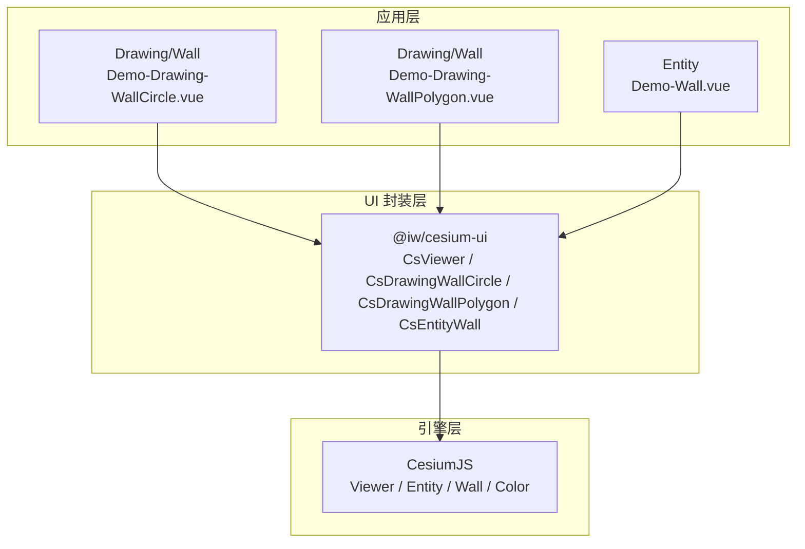
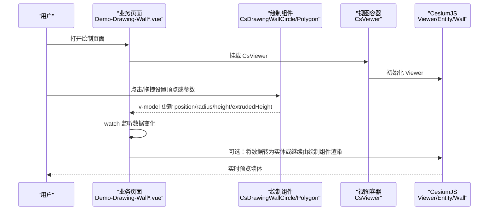
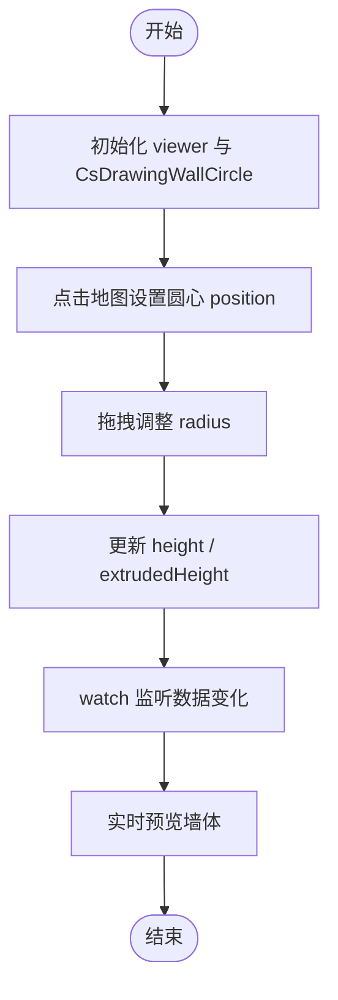
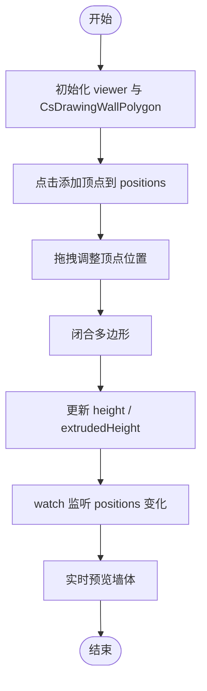
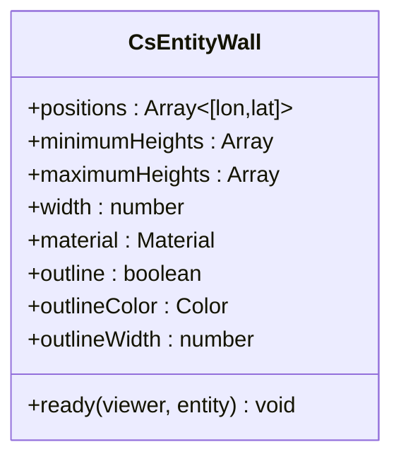
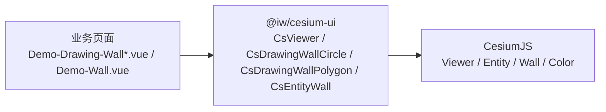

# 墙体绘制

<cite>
**本文引用的文件**   
- [Demo-Drawing-WallCircle.vue](file://src/components/Drawing/Wall/Demo-Drawing-WallCircle.vue)
- [Demo-Drawing-WallPolygon.vue](file://src/components/Drawing/Wall/Demo-Drawing-WallPolygon.vue)
- [Demo-Wall.vue](file://src/components/Entity/Demo-Wall.vue)
- [package.json](file://package.json)
</cite>

## 目录
1. [简介](#简介)
2. [项目结构](#项目结构)
3. [核心组件](#核心组件)
4. [架构总览](#架构总览)
5. [详细组件分析](#详细组件分析)
6. [依赖关系分析](#依赖关系分析)
7. [性能考虑](#性能考虑)
8. [故障排查指南](#故障排查指南)
9. [结论](#结论)
10. [附录：示例与最佳实践](#附录示例与最佳实践)

## 简介
本技术文档围绕“墙体绘制”功能，系统说明圆形墙体与多边形墙体的绘制实现机制、几何计算、高度控制、材质渲染与边界检测思路；解释墙体实体在三维空间中的表示方式、坐标系统与视觉呈现；梳理用户交互流程（点击设置顶点、拖拽调整形状、实时更新预览）；详述墙体高度属性配置、透明度与样式定制；给出不同墙体类型的创建与编辑方法示例路径；说明数据的保存、加载与编辑；并解释与 CesiumJS 底层 API 的集成方式与性能优化策略。

## 项目结构
本项目基于 Vue 3 + Vite，使用 @iw/cesium-ui 封装的绘图与实体组件，结合 CesiumJS 进行三维可视化。与墙体绘制直接相关的代码位于以下位置：
- 绘制组件示例：src/components/Drawing/Wall
- 实体展示示例：src/components/Entity/Demo-Wall.vue
- 依赖声明：package.json

图表来源
- [Demo-Drawing-WallCircle.vue:1-55](file://src/components/Drawing/Wall/Demo-Drawing-WallCircle.vue#L1-L55)
- [Demo-Drawing-WallPolygon.vue:1-53](file://src/components/Drawing/Wall/Demo-Drawing-WallPolygon.vue#L1-L53)
- [Demo-Wall.vue:1-73](file://src/components/Entity/Demo-Wall.vue#L1-L73)
- [package.json:12-17](file://package.json#L12-L17)

章节来源
- [Demo-Drawing-WallCircle.vue:1-55](file://src/components/Drawing/Wall/Demo-Drawing-WallCircle.vue#L1-L55)
- [Demo-Drawing-WallPolygon.vue:1-53](file://src/components/Drawing/Wall/Demo-Drawing-WallPolygon.vue#L1-L53)
- [Demo-Wall.vue:1-73](file://src/components/Entity/Demo-Wall.vue#L1-L73)
- [package.json:12-17](file://package.json#L12-L17)

## 核心组件
- CsDrawingWallCircle：用于交互式绘制圆形墙体，支持中心点、半径、底部高度与拉伸高度的双向绑定。
- CsDrawingWallPolygon：用于交互式绘制多边形墙体，支持顶点数组、底部高度与拉伸高度的双向绑定。
- CsEntityWall：用于以 Cesium Entity 形式渲染墙体，支持顶点、最小/最大高度、宽度、材质、描边等属性。

这些组件通过 v-model 暴露可绑定的数据字段，便于上层业务组件监听变化、持久化或二次处理。

章节来源
- [Demo-Drawing-WallCircle.vue:1-55](file://src/components/Drawing/Wall/Demo-Drawing-WallCircle.vue#L1-L55)
- [Demo-Drawing-WallPolygon.vue:1-53](file://src/components/Drawing/Wall/Demo-Drawing-WallPolygon.vue#L1-L53)
- [Demo-Wall.vue:1-73](file://src/components/Entity/Demo-Wall.vue#L1-L73)

## 架构总览
整体调用链自上而下为：业务页面 → UI 封装组件 → CesiumJS 引擎。

图表来源
- [Demo-Drawing-WallCircle.vue:1-55](file://src/components/Drawing/Wall/Demo-Drawing-WallCircle.vue#L1-L55)
- [Demo-Drawing-WallPolygon.vue:1-53](file://src/components/Drawing/Wall/Demo-Drawing-WallPolygon.vue#L1-L53)
- [Demo-Wall.vue:1-73](file://src/components/Entity/Demo-Wall.vue#L1-L73)

## 详细组件分析

### 圆形墙体绘制（CsDrawingWallCircle）
- 输入与状态
  - position：圆心经纬度（度数），v-model 双向绑定
  - radius：半径（单位由封装组件定义）
  - height：底部高度
  - extrudedHeight：拉伸高度（墙体顶面相对底部的高度）
- 交互流程
  - 用户在地图上点击确定圆心，随后通过拖拽或滚轮调整半径
  - 绘制过程中实时同步 position/radius/height/extrudedHeight
  - 业务侧通过 watch 监听数据变化，可用于日志记录或二次处理
- 注意事项
  - 当前版本（1.13.1）未提供 change 事件，需通过 v-model 监听数据变化
  - 绘制完成后可能显示二维图形而非三维墙体，属于已知待办项

图表来源
- [Demo-Drawing-WallCircle.vue:1-55](file://src/components/Drawing/Wall/Demo-Drawing-WallCircle.vue#L1-L55)

章节来源
- [Demo-Drawing-WallCircle.vue:1-55](file://src/components/Drawing/Wall/Demo-Drawing-WallCircle.vue#L1-L55)

### 多边形墙体绘制（CsDrawingWallPolygon）
- 输入与状态
  - positions：顶点经纬度数组（度数），v-model 双向绑定
  - height：底部高度
  - extrudedHeight：拉伸高度
- 交互流程
  - 点击添加顶点，拖拽移动顶点，闭合形成多边形
  - 绘制过程中实时同步 positions/height/extrudedHeight
  - 业务侧通过 watch 监听 positions 变化，用于日志或后续处理
- 注意事项
  - 当前版本（1.13.1）未提供 change 事件，需通过 v-model 监听数据变化
  - 绘制完成后可能显示二维图形而非三维墙体，属于已知待办项

图表来源
- [Demo-Drawing-WallPolygon.vue:1-53](file://src/components/Drawing/Wall/Demo-Drawing-WallPolygon.vue#L1-L53)

章节来源
- [Demo-Drawing-WallPolygon.vue:1-53](file://src/components/Drawing/Wall/Demo-Drawing-WallPolygon.vue#L1-L53)

### 墙体实体渲染（CsEntityWall）
- 能力概述
  - 通过 Cesium Entity.Wall 渲染墙体，支持：
    - positions：顶点经纬度数组
    - minimum-heights：各顶点的最小高度数组
    - maximum-heights：各顶点的最大高度数组
    - width：线宽
    - material：材质（含透明度）
    - outline/outline-color/outline-width：描边样式
- 典型用法
  - 传入一组经纬度顶点与对应的高度数组，即可生成三维墙体
  - 可通过 ready 回调获取创建的 Entity，并进行 flyTo 等操作

图表来源
- [Demo-Wall.vue:1-73](file://src/components/Entity/Demo-Wall.vue#L1-L73)

章节来源
- [Demo-Wall.vue:1-73](file://src/components/Entity/Demo-Wall.vue#L1-L73)

## 依赖关系分析
- 运行时依赖
  - cesium：三维地球引擎
  - @iw/cesium-ui：封装了 CsViewer、CsDrawingWallCircle、CsDrawingWallPolygon、CsEntityWall 等组件
- 组件耦合
  - 业务页面仅依赖 @iw/cesium-ui 提供的组件接口，不直接操作 CesiumJS
  - 通过 v-model 与事件回调解耦数据流与控制流

图表来源
- [package.json:12-17](file://package.json#L12-L17)
- [Demo-Drawing-WallCircle.vue:1-55](file://src/components/Drawing/Wall/Demo-Drawing-WallCircle.vue#L1-L55)
- [Demo-Drawing-WallPolygon.vue:1-53](file://src/components/Drawing/Wall/Demo-Drawing-WallPolygon.vue#L1-L53)
- [Demo-Wall.vue:1-73](file://src/components/Entity/Demo-Wall.vue#L1-L73)

章节来源
- [package.json:12-17](file://package.json#L12-L17)

## 性能考虑
- 减少不必要的重绘
  - 使用 v-model 监听数据变化时，避免在高频回调中执行昂贵计算
  - 仅在必要时机（如绘制完成）触发持久化或复杂逻辑
- 合理设置材质与描边
  - 半透明材质会增加混合开销，建议按需启用
  - 描边宽度不宜过大，避免过度增加 GPU 压力
- 控制顶点数量
  - 多边形墙体顶点过多会显著增加三角剖分与渲染成本
  - 对长距离或大范围区域，适当简化顶点或使用分段墙体
- 利用 Cesium 特性
  - 合理使用 minimum-heights/maximum-heights 控制地形贴合与遮挡
  - 使用合适的视距与缩放级别，避免在极小或极大视距下渲染大量细节

[本节为通用指导，不直接分析具体文件]

## 故障排查指南
- 绘制完成后显示二维图形而非墙体
  - 现象：圆形或多边形绘制结束后，场景中出现的是平面图形
  - 原因：当前版本（1.13.1）的绘制组件存在待办项，尚未自动转换为三维墙体
  - 解决思路：
    - 使用 CsEntityWall 将已收集的 positions/height/extrudedHeight 转为实体墙体
    - 或在业务层自行调用 CesiumJS 的 Wall 几何构建逻辑
  - 参考示例：
    - [Demo-Drawing-WallCircle.vue:21-26](file://src/components/Drawing/Wall/Demo-Drawing-WallCircle.vue#L21-L26)
    - [Demo-Drawing-WallPolygon.vue:12-25](file://src/components/Drawing/Wall/Demo-Drawing-WallPolygon.vue#L12-L25)
- 无法通过事件监听绘制变化
  - 现象：change 事件不可用
  - 原因：当前版本未提供 change 事件
  - 解决思路：使用 v-model 监听 position/positions 等数据变化
  - 参考示例：
    - [Demo-Drawing-WallCircle.vue:23-26](file://src/components/Drawing/Wall/Demo-Drawing-WallCircle.vue#L23-L26)
    - [Demo-Drawing-WallPolygon.vue:22-25](file://src/components/Drawing/Wall/Demo-Drawing-WallPolygon.vue#L22-L25)
- 墙体高度异常或贴地不正确
  - 检查 height 与 extrudedHeight 的设置是否合理
  - 若需要贴合地形，使用 minimum-heights/maximum-heights 控制每个顶点的高度范围
  - 参考示例：
    - [Demo-Wall.vue:46-47](file://src/components/Entity/Demo-Wall.vue#L46-L47)
- 材质透明度无效或颜色异常
  - 确认传入的 material 是有效的 Cesium 材质对象，且包含 alpha 通道
  - 参考示例：
    - [Demo-Wall.vue:49](file://src/components/Entity/Demo-Wall.vue#L49)

章节来源
- [Demo-Drawing-WallCircle.vue:21-26](file://src/components/Drawing/Wall/Demo-Drawing-WallCircle.vue#L21-L26)
- [Demo-Drawing-WallPolygon.vue:12-25](file://src/components/Drawing/Wall/Demo-Drawing-WallPolygon.vue#L12-L25)
- [Demo-Wall.vue:46-49](file://src/components/Entity/Demo-Wall.vue#L46-L49)

## 结论
本项目通过 @iw/cesium-ui 提供了便捷的墙体绘制与实体渲染能力。圆形与多边形墙体在绘制阶段通过 v-model 暴露关键参数，便于业务层监听与处理；当需要稳定的三维墙体展示时，可使用 CsEntityWall 将数据转为实体，获得更丰富的样式与行为控制。针对当前版本的已知限制（如缺少 change 事件、绘制后显示二维图形），可通过数据监听与实体转换的方式规避。在实际工程中，应关注顶点数量、材质与描边的性能影响，并结合地形与视距进行优化。

[本节为总结性内容，不直接分析具体文件]

## 附录：示例与最佳实践

### 创建圆形墙体的步骤
- 在页面中引入 CsDrawingWallCircle，并通过 v-model 绑定 position、radius、height、extrudedHeight
- 监听数据变化，用于日志或二次处理
- 如需三维墙体，可将最终数据交给 CsEntityWall 或自行构建 Cesium Wall

参考示例路径
- [Demo-Drawing-WallCircle.vue:1-55](file://src/components/Drawing/Wall/Demo-Drawing-WallCircle.vue#L1-L55)

### 创建多边形墙体的步骤
- 在页面中引入 CsDrawingWallPolygon，并通过 v-model 绑定 positions、height、extrudedHeight
- 监听 positions 变化，用于日志或二次处理
- 如需三维墙体，可将最终数据交给 CsEntityWall 或自行构建 Cesium Wall

参考示例路径
- [Demo-Drawing-WallPolygon.vue:1-53](file://src/components/Drawing/Wall/Demo-Drawing-WallPolygon.vue#L1-L53)

### 使用实体渲染墙体的步骤
- 准备 positions、minimum-heights、maximum-heights、width、material、outline 等属性
- 通过 CsEntityWall 渲染，并在 ready 回调中进行相机定位等操作

参考示例路径
- [Demo-Wall.vue:1-73](file://src/components/Entity/Demo-Wall.vue#L1-L73)

### 数据保存、加载与编辑
- 保存
  - 在绘制完成或变更稳定后，将 position/positions、height、extrudedHeight 序列化存储
- 加载
  - 从存储读取数据，回填至 v-model 对应的字段
- 编辑
  - 再次进入绘制流程，允许用户调整顶点或参数，最后重新保存

参考示例路径
- [Demo-Drawing-WallCircle.vue:8-11](file://src/components/Drawing/Wall/Demo-Drawing-WallCircle.vue#L8-L11)
- [Demo-Drawing-WallPolygon.vue:8-10](file://src/components/Drawing/Wall/Demo-Drawing-WallPolygon.vue#L8-L10)

### 与 CesiumJS 的集成要点
- 使用 CsViewer 作为容器，内部维护 Cesium Viewer
- 使用 CsEntityWall 时，可直接传入 Cesium.Color 与材质对象
- 在 ready 回调中获取 Entity，进行 flyTo 等交互

参考示例路径
- [Demo-Wall.vue:4-6](file://src/components/Entity/Demo-Wall.vue#L4-L6)
- [Demo-Wall.vue:23-30](file://src/components/Entity/Demo-Wall.vue#L23-L30)