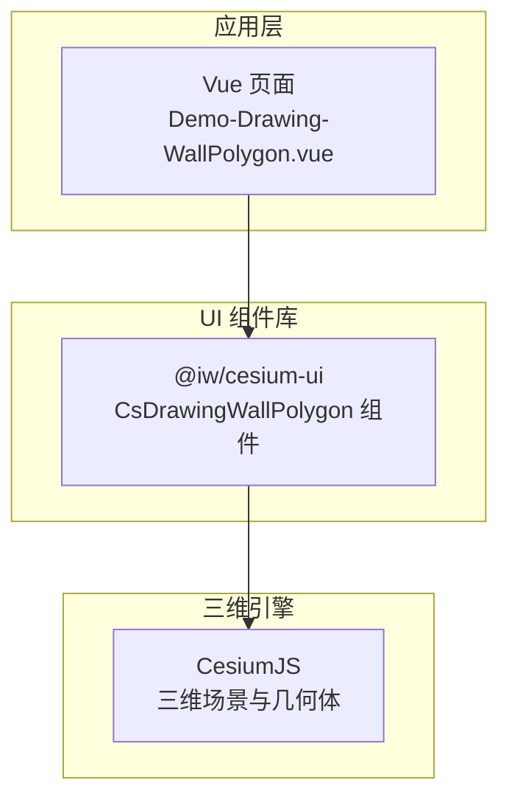
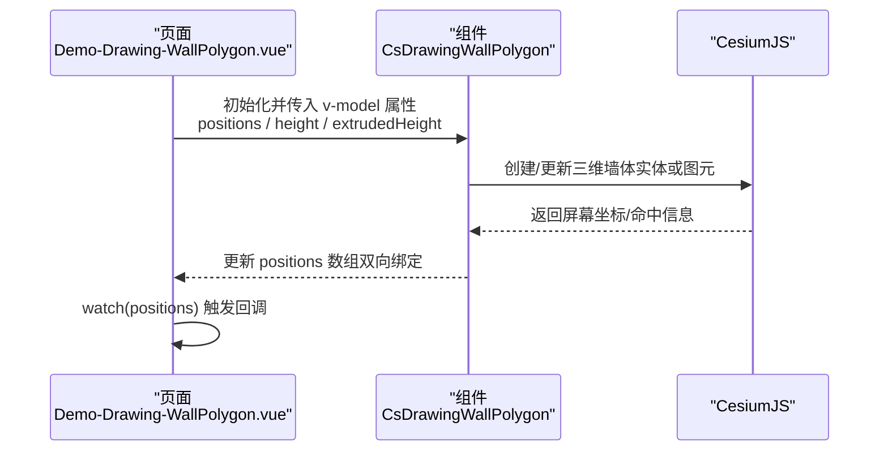
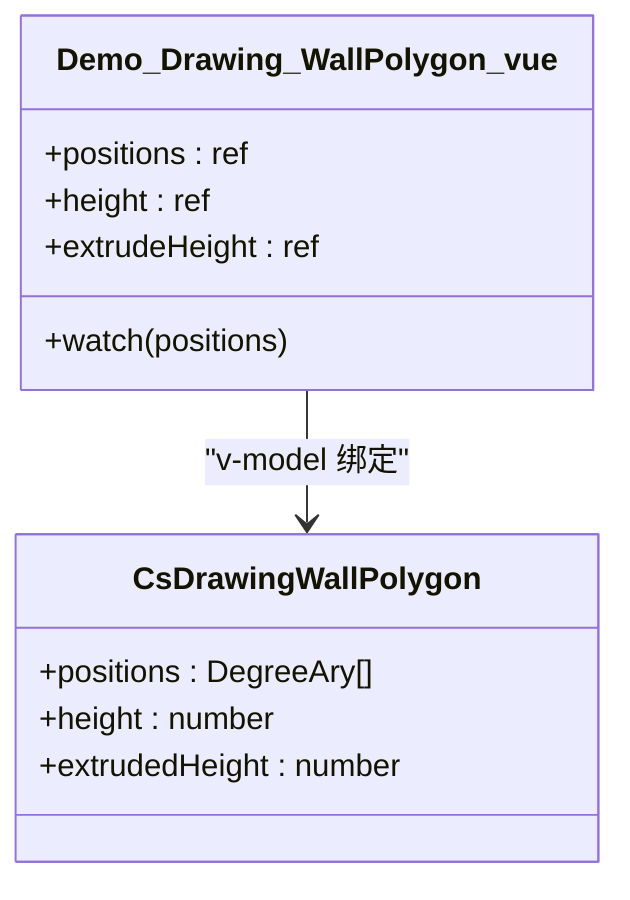
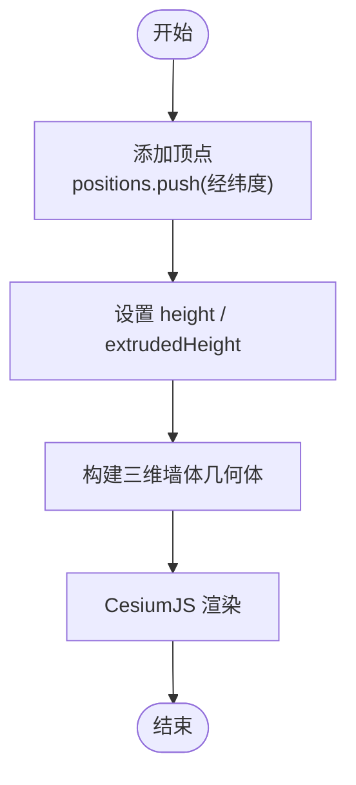
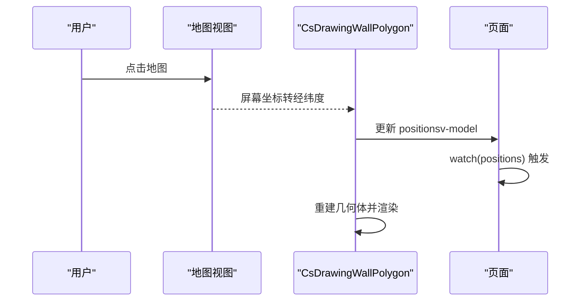
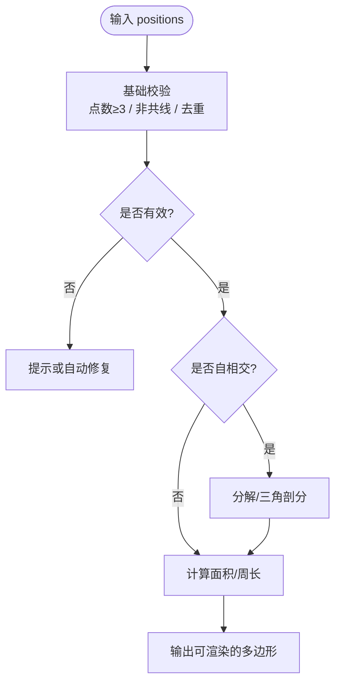
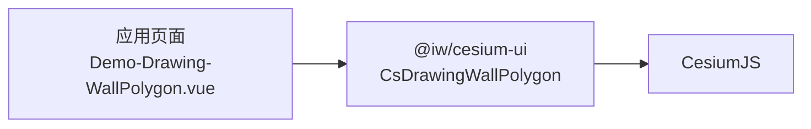

# 多边形墙体绘制

<cite>
**本文引用的文件**   
- [Demo-Drawing-WallPolygon.vue](file://src/components/Drawing/Wall/Demo-Drawing-WallPolygon.vue)
- [package.json](file://package.json)
- [index.js](file://node_modules/@iw/cesium-ui/es/components/drawing/wall/polygon/index.js)
- [polygon.js](file://node_modules/@iw/cesium-ui/es/components/drawing/wall/polygon/polygon.js)
- [polygon2.js](file://node_modules/@iw/cesium-ui/es/components/drawing/wall/polygon/polygon2.js)
</cite>

## 目录
1. [简介](#简介)
2. [项目结构](#项目结构)
3. [核心组件](#核心组件)
4. [架构总览](#架构总览)
5. [详细组件分析](#详细组件分析)
6. [依赖关系分析](#依赖关系分析)
7. [性能考虑](#性能考虑)
8. [故障排查指南](#故障排查指南)
9. [结论](#结论)
10. [附录](#附录)

## 简介
本技术文档围绕“多边形墙体绘制”功能，系统性说明 CsDrawingWallPolygon 组件在 Vue + CesiumJS 环境中的使用方式、数据模型与交互流程。重点包括：
- 多边形顶点管理、边界计算与形状变换逻辑
- 三维空间表示（顶点坐标数组、边线连接、高度控制与挤出效果）
- 用户交互流程（点击添加顶点、拖拽移动、双击完成、实时预览）
- 数据结构设计、坐标管理与形状验证机制
- 复杂多边形处理、自相交检测与面积计算思路
- 与 CesiumJS 的集成方式与渲染优化策略

## 项目结构
本项目为基于 Vite + Vue 3 的前端示例工程，通过 npm 包 @iw/cesium-ui 提供 CsDrawingWallPolygon 等绘图组件，底层由 CesiumJS 驱动三维渲染。

图表来源
- [Demo-Drawing-WallPolygon.vue:1-53](file://src/components/Drawing/Wall/Demo-Drawing-WallPolygon.vue#L1-L53)
- [package.json:12-17](file://package.json#L12-L17)

章节来源
- [Demo-Drawing-WallPolygon.vue:1-53](file://src/components/Drawing/Wall/Demo-Drawing-WallPolygon.vue#L1-L53)
- [package.json:12-17](file://package.json#L12-L17)

## 核心组件
- CsDrawingWallPolygon：用于交互式绘制多边形墙体，暴露 positions、height、extrudedHeight 等双向绑定属性，便于上层业务获取并展示绘制结果。
- Demo-Drawing-WallPolygon.vue：示例页面，演示如何引入并使用 CsDrawingWallPolygon，并通过 watch 监听坐标变化以进行后续处理。

章节来源
- [Demo-Drawing-WallPolygon.vue:1-53](file://src/components/Drawing/Wall/Demo-Drawing-WallPolygon.vue#L1-L53)

## 架构总览
下图展示了从页面到组件再到 CesiumJS 的数据流与控制流。

图表来源
- [Demo-Drawing-WallPolygon.vue:1-53](file://src/components/Drawing/Wall/Demo-Drawing-WallPolygon.vue#L1-L53)

## 详细组件分析

### 组件接口与数据模型
- 输入/输出属性
  - positions：二维平面上的多边形顶点数组（经纬度），用于定义墙体的底面轮廓。
  - height：墙体底部海拔高度。
  - extrudedHeight：墙体挤出高度（相对 height）。
- 数据类型
  - DegreeAry：经纬度坐标类型（具体实现位于第三方库中）。
- 状态同步
  - 通过 v-model 将 positions、height、extrudedHeight 与页面 state 双向绑定。
  - 由于该版本未提供 change 事件，页面侧通过 watch 监听 positions 的变化以执行自定义逻辑。

图表来源
- [Demo-Drawing-WallPolygon.vue:1-53](file://src/components/Drawing/Wall/Demo-Drawing-WallPolygon.vue#L1-L53)

章节来源
- [Demo-Drawing-WallPolygon.vue:1-53](file://src/components/Drawing/Wall/Demo-Drawing-WallPolygon.vue#L1-L53)

### 三维空间表示与挤出效果
- 顶点坐标数组：positions 描述多边形在水平面上的投影轮廓。
- 边线连接关系：按顺序连接相邻顶点形成闭合环；首尾点通常自动闭合。
- 高度控制：
  - height：墙体底部离地高度。
  - extrudedHeight：墙体厚度（挤出方向的高度）。
- 挤出效果：根据 positions 与高度参数生成三维墙体几何体，供 CesiumJS 渲染。

图表来源
- [Demo-Drawing-WallPolygon.vue:1-53](file://src/components/Drawing/Wall/Demo-Drawing-WallPolygon.vue#L1-L53)

### 用户交互流程
- 点击添加顶点：用户在地图上点击，组件向 positions 追加新顶点。
- 拖拽移动顶点：选中某顶点后拖拽更新其经纬度。
- 双击完成绘制：双击地图确认多边形闭合，停止继续添加顶点。
- 实时更新预览：每次 positions 变更，组件立即重建几何体并刷新渲染。

图表来源
- [Demo-Drawing-WallPolygon.vue:1-53](file://src/components/Drawing/Wall/Demo-Drawing-WallPolygon.vue#L1-L53)

### 形状验证与复杂多边形处理
- 基本校验
  - 至少需要三个不共线的顶点才能构成有效多边形。
  - 建议对重复点、极近点进行去重与合并。
- 复杂多边形
  - 自相交检测：当多边形存在自相交时，需采用三角剖分或布尔运算策略生成可渲染的墙体。
  - 孔洞处理：若存在内环（孔洞），应正确区分内外环方向并按约定排序。
- 面积计算
  - 可使用球面多边形面积算法（如鞋带公式的球面修正）估算投影面积。
  - 对于高精度需求，建议使用 CesiumJS 提供的几何工具函数。

图表来源
- [Demo-Drawing-WallPolygon.vue:1-53](file://src/components/Drawing/Wall/Demo-Drawing-WallPolygon.vue#L1-L53)

### 与 CesiumJS 的集成与渲染优化
- 集成方式
  - 通过 @iw/cesium-ui 的 CsDrawingWallPolygon 封装 CesiumJS 的几何体创建与更新逻辑。
  - 页面侧仅维护 positions、height、extrudedHeight 等高层数据。
- 渲染优化建议
  - 增量更新：仅在 positions 或高度发生变化时重建几何体。
  - 批处理：批量更新多个顶点后再触发一次重建。
  - 视距控制：远距离时降低顶点密度或简化几何体。
  - 材质与深度：合理设置材质透明度与深度测试以减少过绘。

章节来源
- [Demo-Drawing-WallPolygon.vue:1-53](file://src/components/Drawing/Wall/Demo-Drawing-WallPolygon.vue#L1-L53)

## 依赖关系分析
- 外部依赖
  - cesium：三维地理可视化引擎。
  - @iw/cesium-ui：提供 CsDrawingWallPolygon 等绘图组件。
- 组件内部文件
  - index.js：模块入口，导出 CsDrawingWallPolygon。
  - polygon.js / polygon2.js：组件核心逻辑与模板编译产物。

图表来源
- [package.json:12-17](file://package.json#L12-L17)
- [Demo-Drawing-WallPolygon.vue:1-53](file://src/components/Drawing/Wall/Demo-Drawing-WallPolygon.vue#L1-L53)

章节来源
- [package.json:12-17](file://package.json#L12-L17)
- [index.js](file://node_modules/@iw/cesium-ui/es/components/drawing/wall/polygon/index.js)
- [polygon.js](file://node_modules/@iw/cesium-ui/es/components/drawing/wall/polygon/polygon.js)
- [polygon2.js](file://node_modules/@iw/cesium-ui/es/components/drawing/wall/polygon/polygon2.js)

## 性能考虑
- 数据层面
  - 避免频繁小步更新 positions，尽量批量更新后一次性提交。
  - 对顶点进行抽稀与去重，减少几何复杂度。
- 渲染层面
  - 合理使用材质与透明度，避免不必要的透明混合开销。
  - 在低帧率场景下降低几何精度或关闭部分后处理。
- 交互层面
  - 拖拽过程中使用节流/防抖，限制高频更新频率。
  - 预览态与最终态分离，预览态使用简化几何体。

## 故障排查指南
- 现象：绘制完成后显示的是二维图形而非墙体
  - 可能原因：height 或 extrudedHeight 未正确设置，或 CesiumJS 渲染管线未启用三维墙体模式。
  - 排查步骤：
    - 检查页面绑定的 height 与 extrudedHeight 是否为正数。
    - 确认 CesiumJS 场景已启用地形与高程。
    - 查看浏览器控制台是否有相关警告或错误。
- 现象：positions 未触发更新
  - 可能原因：当前版本未提供 change 事件。
  - 解决方案：使用 watch 监听 v-model 的 positions 变化。
- 现象：多边形无法闭合或出现异常
  - 可能原因：顶点数量不足、共线或自相交。
  - 解决方案：增加校验逻辑，必要时进行几何分解或提示用户修正。

章节来源
- [Demo-Drawing-WallPolygon.vue:1-53](file://src/components/Drawing/Wall/Demo-Drawing-WallPolygon.vue#L1-L53)

## 结论
CsDrawingWallPolygon 通过高层 API 屏蔽了 CesiumJS 的复杂细节，使开发者可以专注于业务数据（positions、height、extrudedHeight）的管理。结合合理的校验、优化与交互策略，可在保证用户体验的同时获得稳定的三维墙体绘制能力。

## 附录

### 代码示例路径（创建、编辑、删除、样式定制）
- 创建多边形墙体
  - 参考示例页面：[Demo-Drawing-WallPolygon.vue:30-37](file://src/components/Drawing/Wall/Demo-Drawing-WallPolygon.vue#L30-L37)
- 编辑多边形墙体
  - 通过 v-model 双向绑定 positions、height、extrudedHeight，并在 watch 中处理变更逻辑。
  - 参考示例页面：[Demo-Drawing-WallPolygon.vue:22-25](file://src/components/Drawing/Wall/Demo-Drawing-WallPolygon.vue#L22-L25)
- 删除多边形墙体
  - 清空 positions 数组或重置 height/extrudedHeight 即可移除墙体。
  - 参考示例页面：[Demo-Drawing-WallPolygon.vue:8-10](file://src/components/Drawing/Wall/Demo-Drawing-WallPolygon.vue#L8-L10)
- 样式定制
  - 通过 CesiumJS 的材质与外观属性进行定制（颜色、透明度、描边等）。
  - 具体样式配置请参考 CesiumJS 官方文档与 @iw/cesium-ui 组件文档。

章节来源
- [Demo-Drawing-WallPolygon.vue:8-10](file://src/components/Drawing/Wall/Demo-Drawing-WallPolygon.vue#L8-L10)
- [Demo-Drawing-WallPolygon.vue:22-25](file://src/components/Drawing/Wall/Demo-Drawing-WallPolygon.vue#L22-L25)
- [Demo-Drawing-WallPolygon.vue:30-37](file://src/components/Drawing/Wall/Demo-Drawing-WallPolygon.vue#L30-L37)