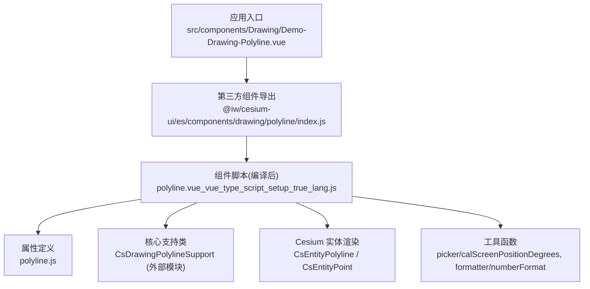
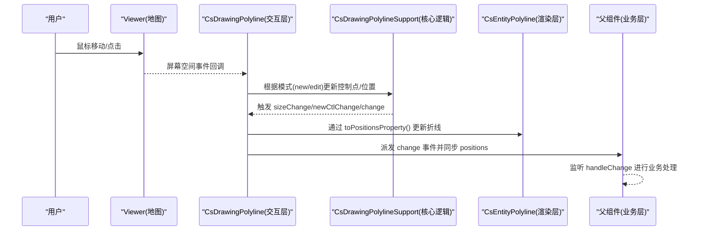
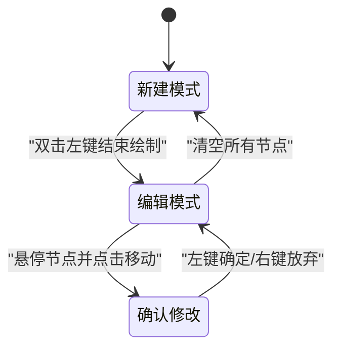
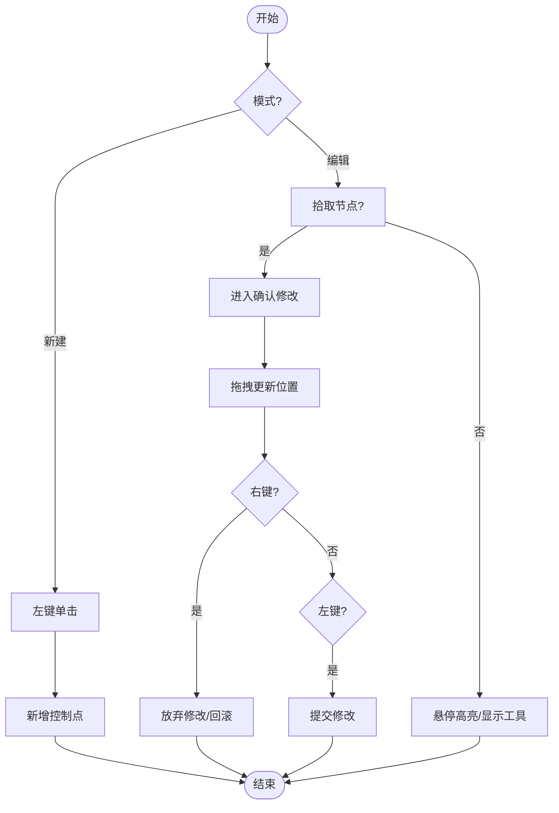
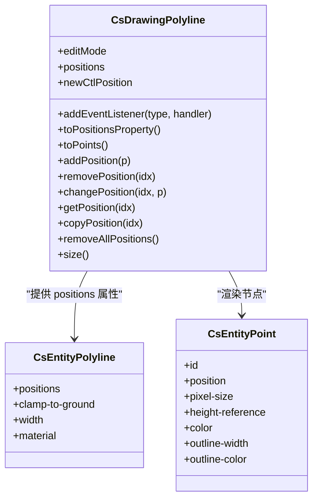
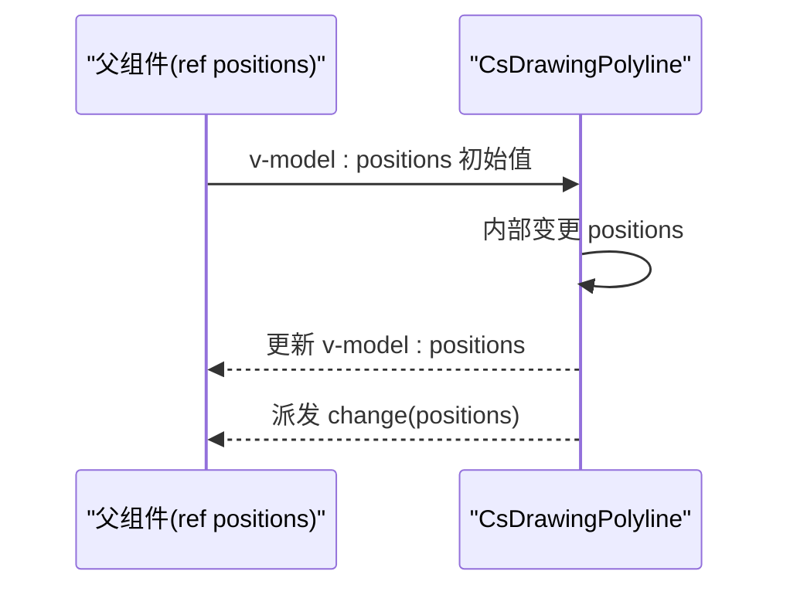
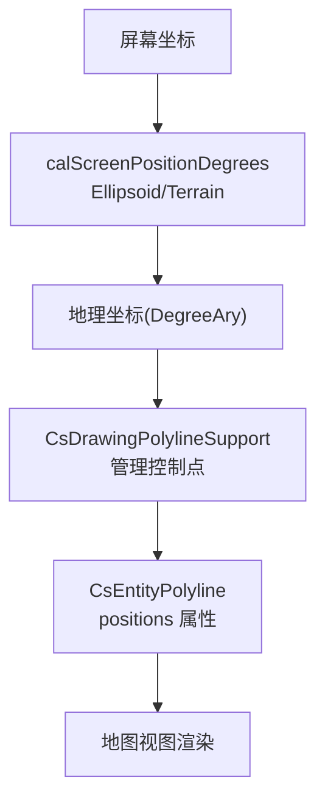
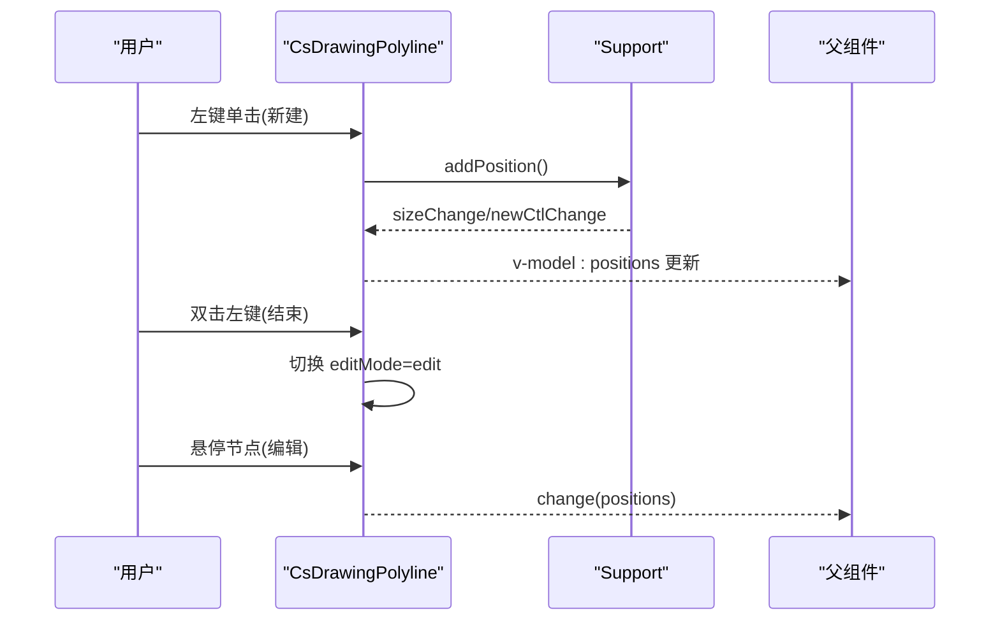
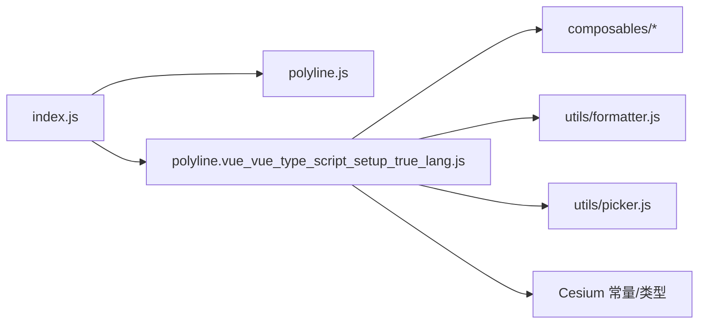

# 折线绘制

<cite>
**本文引用的文件**   
- [src/components/Drawing/Demo-Drawing-Polyline.vue](file://src/components/Drawing/Demo-Drawing-Polyline.vue)
- [node_modules/@iw/cesium-ui/es/components/drawing/polyline/polyline.vue_vue_type_script_setup_true_lang.js](file://node_modules/@iw/cesium-ui/es/components/drawing/polyline/polyline.vue_vue_type_script_setup_true_lang.js)
- [node_modules/@iw/cesium-ui/es/components/drawing/polyline/polyline.js](file://node_modules/@iw/cesium-ui/es/components/drawing/polyline/polyline.js)
- [node_modules/@iw/cesium-ui/es/components/drawing/polyline/index.js](file://node_modules/@iw/cesium-ui/es/components/drawing/polyline/index.js)
- [package.json](file://package.json)
</cite>

## 目录
1. [简介](#简介)
2. [项目结构](#项目结构)
3. [核心组件](#核心组件)
4. [架构总览](#架构总览)
5. [详细组件分析](#详细组件分析)
6. [依赖关系分析](#依赖关系分析)
7. [性能考虑](#性能考虑)
8. [故障排查指南](#故障排查指南)
9. [结论](#结论)
10. [附录](#附录)

## 简介
本文围绕“折线绘制”功能，系统性解析 CsDrawingPolyline 组件的实现原理与交互流程。重点包括：
- 鼠标点击事件处理（左键添加点、双击结束、右键删除前一点）
- 实时折线预览与坐标点收集管理
- DegreeAry 类型与 positions 双向绑定机制
- change 事件的触发时机
- 几何计算、坐标变换与屏幕投影转换
- 性能优化建议与常见问题解决方案

## 项目结构
本仓库使用 Vue 3 + Vite 构建，并通过 @iw/cesium-ui 提供地图可视化能力。折线绘制示例位于 Drawing 目录下，实际实现由第三方库提供。

图表来源
- [src/components/Drawing/Demo-Drawing-Polyline.vue:1-49](file://src/components/Drawing/Demo-Drawing-Polyline.vue#L1-L49)
- [node_modules/@iw/cesium-ui/es/components/drawing/polyline/index.js:1-8](file://node_modules/@iw/cesium-ui/es/components/drawing/polyline/index.js#L1-L8)
- [node_modules/@iw/cesium-ui/es/components/drawing/polyline/polyline.vue_vue_type_script_setup_true_lang.js:1-201](file://node_modules/@iw/cesium-ui/es/components/drawing/polyline/polyline.vue_vue_type_script_setup_true_lang.js#L1-L201)
- [node_modules/@iw/cesium-ui/es/components/drawing/polyline/polyline.js:1-27](file://node_modules/@iw/cesium-ui/es/components/drawing/polyline/polyline.js#L1-L27)

章节来源
- [src/components/Drawing/Demo-Drawing-Polyline.vue:1-49](file://src/components/Drawing/Demo-Drawing-Polyline.vue#L1-L49)
- [package.json:12-17](file://package.json#L12-L17)

## 核心组件
- CsDrawingPolyline：折线绘制与编辑的交互组件，封装了鼠标事件、状态机、坐标管理与变更事件。
- 属性与样式：
  - lineColor：线条颜色
  - lineWidth：线条宽度
  - pointColor：节点颜色
  - scale：缩放比例（影响交互灵敏度）
  - clampToGround：是否贴地
- 事件：
  - change：当内部坐标数组变化时触发，向父组件同步最新 positions
- 双向绑定：
  - v-model:positions：将内部坐标数组与父组件 ref 变量双向同步

章节来源
- [node_modules/@iw/cesium-ui/es/components/drawing/polyline/polyline.js:1-27](file://node_modules/@iw/cesium-ui/es/components/drawing/polyline/polyline.js#L1-L27)
- [node_modules/@iw/cesium-ui/es/components/drawing/polyline/polyline.vue_vue_type_script_setup_true_lang.js:25-34](file://node_modules/@iw/cesium-ui/es/components/drawing/polyline/polyline.vue_vue_type_script_setup_true_lang.js#L25-L34)

## 架构总览
下图展示从用户交互到数据更新再到视图渲染的完整链路。

图表来源
- [node_modules/@iw/cesium-ui/es/components/drawing/polyline/polyline.vue_vue_type_script_setup_true_lang.js:36-49](file://node_modules/@iw/cesium-ui/es/components/drawing/polyline/polyline.vue_vue_type_script_setup_true_lang.js#L36-L49)
- [node_modules/@iw/cesium-ui/es/components/drawing/polyline/polyline.vue_vue_type_script_setup_true_lang.js:100-113](file://node_modules/@iw/cesium-ui/es/components/drawing/polyline/polyline.vue_vue_type_script_setup_true_lang.js#L100-L113)
- [src/components/Drawing/Demo-Drawing-Polyline.vue:31-33](file://src/components/Drawing/Demo-Drawing-Polyline.vue#L31-L33)

## 详细组件分析

### 交互模式与状态机
- 两种模式：
  - new：新建折线，左键添加点，双击结束，右键删除上一个点
  - edit：编辑已有折线，悬停显示工具栏，支持移动/插入/删除节点
- 关键状态：
  - editMode：new | edit
  - q：是否处于“确认修改”状态（移动节点时）
  - J/G/Y：当前选中节点索引、临时保存的原位置、工具提示关联位置

图表来源
- [node_modules/@iw/cesium-ui/es/components/drawing/polyline/polyline.vue_vue_type_script_setup_true_lang.js:43-49](file://node_modules/@iw/cesium-ui/es/components/drawing/polyline/polyline.vue_vue_type_script_setup_true_lang.js#L43-L49)
- [node_modules/@iw/cesium-ui/es/components/drawing/polyline/polyline.vue_vue_type_script_setup_true_lang.js:82-99](file://node_modules/@iw/cesium-ui/es/components/drawing/polyline/polyline.vue_vue_type_script_setup_true_lang.js#L82-L99)

章节来源
- [node_modules/@iw/cesium-ui/es/components/drawing/polyline/polyline.vue_vue_type_script_setup_true_lang.js:43-99](file://node_modules/@iw/cesium-ui/es/components/drawing/polyline/polyline.vue_vue_type_script_setup_true_lang.js#L43-L99)

### 鼠标事件处理与实时预览
- 左键单击：
  - 新建模式：拾取地面或椭球体坐标，新增控制点
  - 编辑模式：若命中节点，进入“确认修改”状态
- 鼠标移动：
  - 新建模式：实时更新 newCtlPosition，用于预览下一段线段
  - 编辑模式：悬停节点高亮并显示工具提示；在“确认修改”状态下实时拖动更新
- 右键按下：
  - 新建模式：删除最后一个点
  - 编辑模式：取消“确认修改”，必要时回滚或丢弃更改
- 双击左键：
  - 新建模式：结束绘制，切换到编辑模式

图表来源
- [node_modules/@iw/cesium-ui/es/components/drawing/polyline/polyline.vue_vue_type_script_setup_true_lang.js:50-87](file://node_modules/@iw/cesium-ui/es/components/drawing/polyline/polyline.vue_vue_type_script_setup_true_lang.js#L50-L87)

章节来源
- [node_modules/@iw/cesium-ui/es/components/drawing/polyline/polyline.vue_vue_type_script_setup_true_lang.js:50-87](file://node_modules/@iw/cesium-ui/es/components/drawing/polyline/polyline.vue_vue_type_script_setup_true_lang.js#L50-L87)

### 坐标点收集与管理机制
- 内部维护一个支持类实例 CsDrawingPolylineSupport，负责：
  - 新增/删除/复制/清空控制点
  - 获取/修改指定索引位置的坐标
  - 生成 Cesium 可消费的 positions 属性
- 通过事件订阅：
  - sizeChange/newCtlChange：刷新 UI 上的节点列表
  - change：同步 positions 到父组件并派发 change 事件

图表来源
- [node_modules/@iw/cesium-ui/es/components/drawing/polyline/polyline.vue_vue_type_script_setup_true_lang.js:36-49](file://node_modules/@iw/cesium-ui/es/components/drawing/polyline/polyline.vue_vue_type_script_setup_true_lang.js#L36-L49)
- [node_modules/@iw/cesium-ui/es/components/drawing/polyline/polyline.vue_vue_type_script_setup_true_lang.js:100-133](file://node_modules/@iw/cesium-ui/es/components/drawing/polyline/polyline.vue_vue_type_script_setup_true_lang.js#L100-L133)

章节来源
- [node_modules/@iw/cesium-ui/es/components/drawing/polyline/polyline.vue_vue_type_script_setup_true_lang.js:36-49](file://node_modules/@iw/cesium-ui/es/components/drawing/polyline/polyline.vue_vue_type_script_setup_true_lang.js#L36-L49)
- [node_modules/@iw/cesium-ui/es/components/drawing/polyline/polyline.vue_vue_type_script_setup_true_lang.js:100-133](file://node_modules/@iw/cesium-ui/es/components/drawing/polyline/polyline.vue_vue_type_script_setup_true_lang.js#L100-L133)

### DegreeAry 类型与 positions 双向绑定
- DegreeAry：表示经纬度坐标的数组类型（通常为 [经度, 纬度, 高度?]），由第三方库导出并在示例中作为 ref 的类型约束。
- v-model:positions：
  - 子组件内部通过 useModel 建立双向绑定
  - 当内部坐标变化时，自动更新父组件的 positions 变量
  - 同时派发 change 事件，便于父组件做额外处理

图表来源
- [src/components/Drawing/Demo-Drawing-Polyline.vue:8-33](file://src/components/Drawing/Demo-Drawing-Polyline.vue#L8-L33)
- [node_modules/@iw/cesium-ui/es/components/drawing/polyline/polyline.vue_vue_type_script_setup_true_lang.js:34-39](file://node_modules/@iw/cesium-ui/es/components/drawing/polyline/polyline.vue_vue_type_script_setup_true_lang.js#L34-L39)

章节来源
- [src/components/Drawing/Demo-Drawing-Polyline.vue:8-33](file://src/components/Drawing/Demo-Drawing-Polyline.vue#L8-L33)
- [node_modules/@iw/cesium-ui/es/components/drawing/polyline/polyline.vue_vue_type_script_setup_true_lang.js:34-39](file://node_modules/@iw/cesium-ui/es/components/drawing/polyline/polyline.vue_vue_type_script_setup_true_lang.js#L34-L39)

### 几何计算、坐标变换与屏幕投影
- 屏幕坐标转地理坐标：
  - 使用 picker.calScreenPositionDegrees 将屏幕坐标转换为经纬度（支持地形或椭球体）
- 贴地选项：
  - clampToGround=true 时，坐标会贴合地形；否则基于椭球体
- 节点渲染：
  - 每个节点以 CsEntityPoint 渲染，并根据 clampToGround 设置 HeightReference
- 折线渲染：
  - 通过 CsEntityPolyline 的 positions 属性驱动，支持 width、material、clamp-to-ground

图表来源
- [node_modules/@iw/cesium-ui/es/components/drawing/polyline/polyline.vue_vue_type_script_setup_true_lang.js:1-3](file://node_modules/@iw/cesium-ui/es/components/drawing/polyline/polyline.vue_vue_type_script_setup_true_lang.js#L1-L3)
- [node_modules/@iw/cesium-ui/es/components/drawing/polyline/polyline.vue_vue_type_script_setup_true_lang.js:50-66](file://node_modules/@iw/cesium-ui/es/components/drawing/polyline/polyline.vue_vue_type_script_setup_true_lang.js#L50-L66)
- [node_modules/@iw/cesium-ui/es/components/drawing/polyline/polyline.vue_vue_type_script_setup_true_lang.js:100-113](file://node_modules/@iw/cesium-ui/es/components/drawing/polyline/polyline.vue_vue_type_script_setup_true_lang.js#L100-L113)

章节来源
- [node_modules/@iw/cesium-ui/es/components/drawing/polyline/polyline.vue_vue_type_script_setup_true_lang.js:1-3](file://node_modules/@iw/cesium-ui/es/components/drawing/polyline/polyline.vue_vue_type_script_setup_true_lang.js#L1-L3)
- [node_modules/@iw/cesium-ui/es/components/drawing/polyline/polyline.vue_vue_type_script_setup_true_lang.js:50-66](file://node_modules/@iw/cesium-ui/es/components/drawing/polyline/polyline.vue_vue_type_script_setup_true_lang.js#L50-L66)
- [node_modules/@iw/cesium-ui/es/components/drawing/polyline/polyline.vue_vue_type_script_setup_true_lang.js:100-113](file://node_modules/@iw/cesium-ui/es/components/drawing/polyline/polyline.vue_vue_type_script_setup_true_lang.js#L100-L113)

### 完整交互流程（从开始绘制到完成编辑）
1. 初始化：
   - 组件挂载后注册 Viewer ready 回调
   - 若为新建模式，设置十字准星光标并注册屏幕空间事件
2. 新建折线：
   - 左键单击添加第一个点
   - 鼠标移动实时预览下一段线段
   - 双击左键结束绘制，切换至编辑模式
   - 右键删除上一个点
3. 编辑折线：
   - 悬停节点显示工具栏（移动/插入/删除/清空）
   - 移动节点：进入“确认修改”，左键确定、右键放弃
   - 插入节点：在当前节点处插入新点
   - 删除节点：移除指定节点
   - 清空所有节点：回到新建模式
4. 数据同步：
   - 任何导致 positions 变化的操作都会触发 change 事件
   - 父组件可通过 v-model:positions 与 @change 监听最新坐标

图表来源
- [node_modules/@iw/cesium-ui/es/components/drawing/polyline/polyline.vue_vue_type_script_setup_true_lang.js:43-49](file://node_modules/@iw/cesium-ui/es/components/drawing/polyline/polyline.vue_vue_type_script_setup_true_lang.js#L43-L49)
- [node_modules/@iw/cesium-ui/es/components/drawing/polyline/polyline.vue_vue_type_script_setup_true_lang.js:82-99](file://node_modules/@iw/cesium-ui/es/components/drawing/polyline/polyline.vue_vue_type_script_setup_true_lang.js#L82-L99)
- [src/components/Drawing/Demo-Drawing-Polyline.vue:31-33](file://src/components/Drawing/Demo-Drawing-Polyline.vue#L31-L33)

章节来源
- [node_modules/@iw/cesium-ui/es/components/drawing/polyline/polyline.vue_vue_type_script_setup_true_lang.js:43-99](file://node_modules/@iw/cesium-ui/es/components/drawing/polyline/polyline.vue_vue_type_script_setup_true_lang.js#L43-L99)
- [src/components/Drawing/Demo-Drawing-Polyline.vue:31-33](file://src/components/Drawing/Demo-Drawing-Polyline.vue#L31-L33)

## 依赖关系分析
- 组件导出链：
  - index.js 导出 CsDrawingPolyline
  - polyline.js 定义 drawingPolylineProps
  - polyline.vue_vue_type_script_setup_true_lang.js 为实际组件逻辑
- 运行时依赖：
  - Cesium：Viewer、ScreenSpaceEventType、HeightReference 等
  - 第三方工具：useCsViewer/useCsCursor/useCsScreenSpaceEvent/useCsTimeout 等组合式 API
  - 格式化与拾取：formatter.numberFormat、picker.calScreenPositionDegrees

图表来源
- [node_modules/@iw/cesium-ui/es/components/drawing/polyline/index.js:1-8](file://node_modules/@iw/cesium-ui/es/components/drawing/polyline/index.js#L1-L8)
- [node_modules/@iw/cesium-ui/es/components/drawing/polyline/polyline.js:1-27](file://node_modules/@iw/cesium-ui/es/components/drawing/polyline/polyline.js#L1-L27)
- [node_modules/@iw/cesium-ui/es/components/drawing/polyline/polyline.vue_vue_type_script_setup_true_lang.js:1-10](file://node_modules/@iw/cesium-ui/es/components/drawing/polyline/polyline.vue_vue_type_script_setup_true_lang.js#L1-L10)

章节来源
- [node_modules/@iw/cesium-ui/es/components/drawing/polyline/index.js:1-8](file://node_modules/@iw/cesium-ui/es/components/drawing/polyline/index.js#L1-L8)
- [node_modules/@iw/cesium-ui/es/components/drawing/polyline/polyline.js:1-27](file://node_modules/@iw/cesium-ui/es/components/drawing/polyline/polyline.js#L1-L27)
- [node_modules/@iw/cesium-ui/es/components/drawing/polyline/polyline.vue_vue_type_script_setup_true_lang.js:1-10](file://node_modules/@iw/cesium-ui/es/components/drawing/polyline/polyline.vue_vue_type_script_setup_true_lang.js#L1-L10)

## 性能考虑
- 减少不必要的重绘：
  - 仅在必要时机更新 positions（如节点移动、插入、删除）
  - 避免在高频事件中执行昂贵计算
- 合理使用 clampToGround：
  - 地形拾取与贴地渲染可能带来额外开销，按需开启
- 控制节点数量：
  - 大量节点会影响渲染与交互性能，建议在业务层对点数进行限制或简化
- 事件节流：
  - 对于频繁触发的鼠标移动事件，可在上层做节流或防抖处理
- 资源清理：
  - 组件卸载时销毁内部支持类实例，避免内存泄漏

[本节为通用指导，不直接分析具体文件]

## 故障排查指南
- 问题：change 事件未触发
  - 检查是否正确绑定 v-model:positions 与 @change
  - 确认内部确实发生了坐标变更（如 add/remove/change）
- 问题：坐标不准确
  - 检查 clampToGround 配置是否与预期一致
  - 确认 calScreenPositionDegrees 的拾取目标（Terrain/Ellipsoid）
- 问题：节点无法选中或编辑
  - 检查节点 ID 命名规则与拾取逻辑是否匹配
  - 确认 editMode 是否为 edit
- 问题：内存占用持续增长
  - 确保组件卸载时调用 destroy 释放内部资源

章节来源
- [src/components/Drawing/Demo-Drawing-Polyline.vue:31-33](file://src/components/Drawing/Demo-Drawing-Polyline.vue#L31-L33)
- [node_modules/@iw/cesium-ui/es/components/drawing/polyline/polyline.vue_vue_type_script_setup_true_lang.js:47-49](file://node_modules/@iw/cesium-ui/es/components/drawing/polyline/polyline.vue_vue_type_script_setup_true_lang.js#L47-L49)

## 结论
CsDrawingPolyline 提供了完整的折线绘制与编辑能力，涵盖从交互到数据同步再到渲染的全链路。通过 v-model:positions 与 change 事件，父组件可以便捷地获取并处理最新的坐标数据。结合 clampToGround、scale 等属性，可灵活适配不同场景。遵循本文的性能与排错建议，可获得更稳定高效的体验。

[本节为总结性内容，不直接分析具体文件]

## 附录

### 监听与处理坐标变化事件（示例路径）
- 在父组件中：
  - 使用 v-model:positions 绑定 ref 变量
  - 监听 @change 事件，接收最新 positions 数组
- 参考示例文件路径：
  - [src/components/Drawing/Demo-Drawing-Polyline.vue:8-33](file://src/components/Drawing/Demo-Drawing-Polyline.vue#L8-L33)

章节来源
- [src/components/Drawing/Demo-Drawing-Polyline.vue:8-33](file://src/components/Drawing/Demo-Drawing-Polyline.vue#L8-L33)