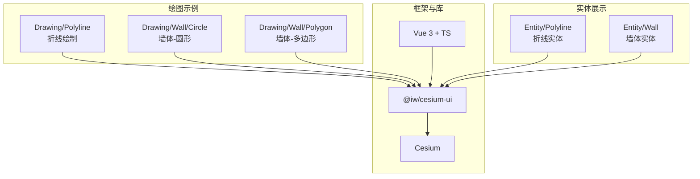
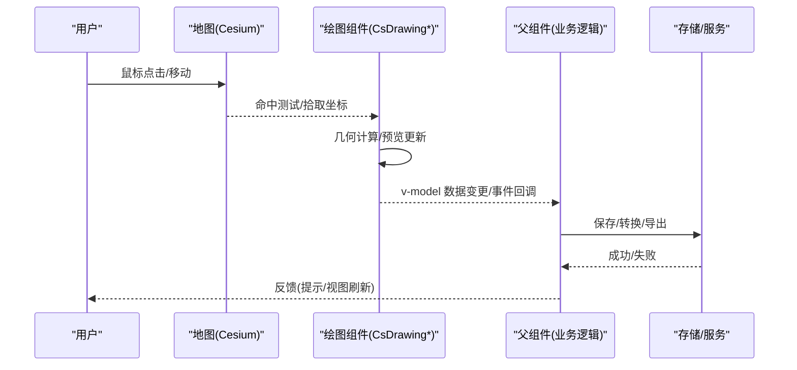
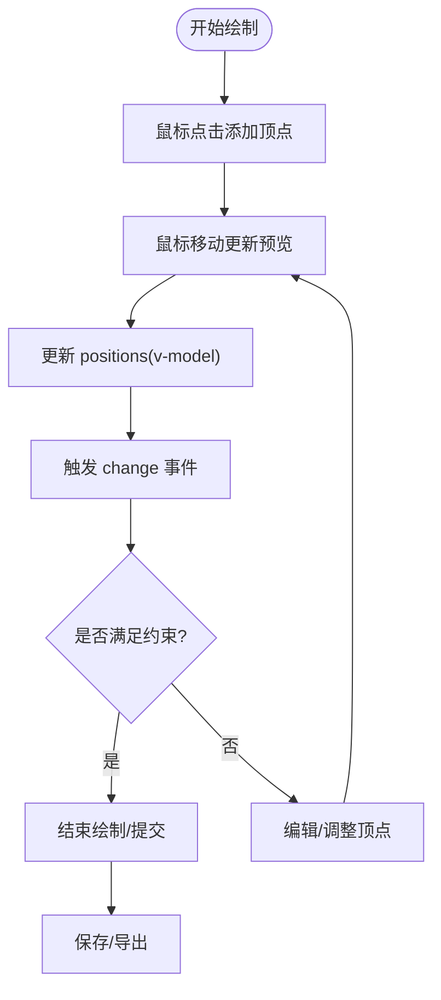
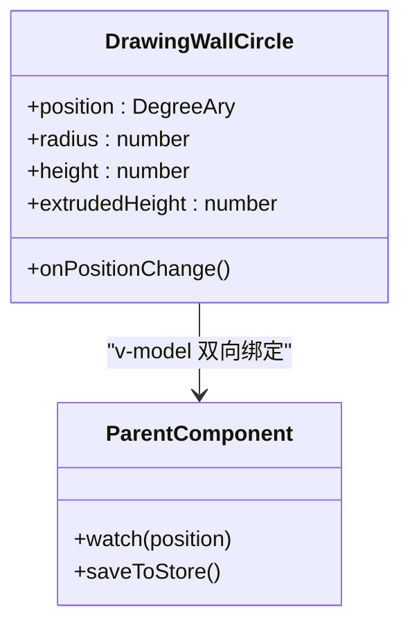
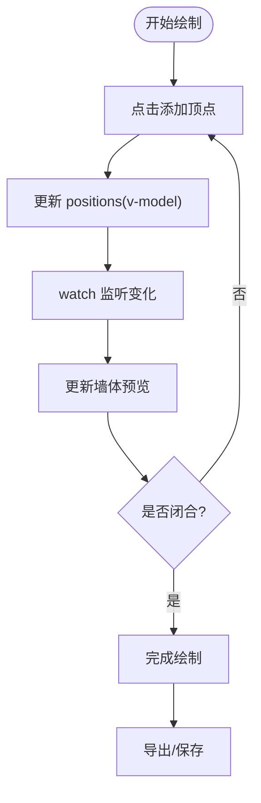
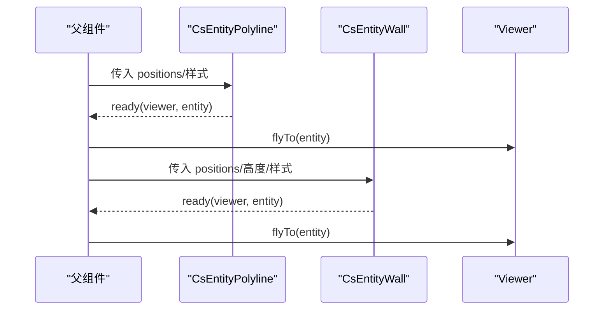
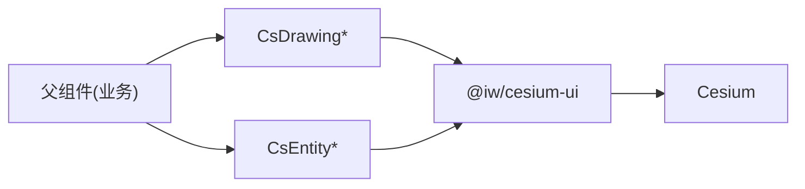

# 绘图工具

<cite>
**本文引用的文件**   
- [Demo-Drawing-Polyline.vue](file://src/components/Drawing/Demo-Drawing-Polyline.vue)
- [Demo-Drawing-WallCircle.vue](file://src/components/Drawing/Wall/Demo-Drawing-WallCircle.vue)
- [Demo-Drawing-WallPolygon.vue](file://src/components/Drawing/Wall/Demo-Drawing-WallPolygon.vue)
- [Demo-Polyline.vue](file://src/components/Entity/Demo-Polyline.vue)
- [Demo-Wall.vue](file://src/components/Entity/Demo-Wall.vue)
</cite>

## 目录
1. [简介](#简介)
2. [项目结构](#项目结构)
3. [核心组件](#核心组件)
4. [架构总览](#架构总览)
5. [详细组件分析](#详细组件分析)
6. [依赖关系分析](#依赖关系分析)
7. [性能与交互优化建议](#性能与交互优化建议)
8. [故障排查指南](#故障排查指南)
9. [结论](#结论)
10. [附录：数据模型与API参考](#附录数据模型与api参考)

## 简介
本技术文档围绕“绘图工具”的折线绘制与墙体绘制（圆形、多边形）展开，聚焦以下方面：
- 鼠标事件处理与实时预览机制
- 编辑能力与撤销重做策略
- 几何计算、坐标变换与边界检测思路
- 用户交互流程与状态管理最佳实践
- 绘图数据的保存、加载与编辑工作流

本项目基于 Vue 3 + TypeScript + Vite，使用 @iw/cesium-ui 提供的绘图与实体组件在 Cesium 场景中完成交互与渲染。示例组件展示了如何绑定 v-model 数据、监听变化事件以及将绘制的结果转换为可持久化的数据结构。

## 项目结构
绘图相关示例位于 src/components/Drawing 及其子目录 Wall；与之对应的静态实体展示位于 src/components/Entity。整体组织方式以功能域划分，便于扩展新的绘图类型或实体类型。

图表来源
- [Demo-Drawing-Polyline.vue:1-48](file://src/components/Drawing/Demo-Drawing-Polyline.vue#L1-L48)
- [Demo-Drawing-WallCircle.vue:1-55](file://src/components/Drawing/Wall/Demo-Drawing-WallCircle.vue#L1-L55)
- [Demo-Drawing-WallPolygon.vue:1-53](file://src/components/Drawing/Wall/Demo-Drawing-WallPolygon.vue#L1-L53)
- [Demo-Polyline.vue:1-68](file://src/components/Entity/Demo-Polyline.vue#L1-L68)
- [Demo-Wall.vue:1-73](file://src/components/Entity/Demo-Wall.vue#L1-L73)

章节来源
- [Demo-Drawing-Polyline.vue:1-48](file://src/components/Drawing/Demo-Drawing-Polyline.vue#L1-L48)
- [Demo-Drawing-WallCircle.vue:1-55](file://src/components/Drawing/Wall/Demo-Drawing-WallCircle.vue#L1-L55)
- [Demo-Drawing-WallPolygon.vue:1-53](file://src/components/Drawing/Wall/Demo-Drawing-WallPolygon.vue#L1-L53)
- [Demo-Polyline.vue:1-68](file://src/components/Entity/Demo-Polyline.vue#L1-L68)
- [Demo-Wall.vue:1-73](file://src/components/Entity/Demo-Wall.vue#L1-L73)

## 核心组件
- CsDrawingPolyline：折线绘制组件，通过 v-model:positions 双向绑定经纬度点数组，支持 change 事件回调以捕获绘制过程中的坐标更新。
- CsDrawingWallCircle：墙体-圆形绘制组件，提供 position、radius、height、extrudedHeight 等属性，用于定义圆心、半径、底高与拉伸高度。
- CsDrawingWallPolygon：墙体-多边形绘制组件，提供 positions、height、extrudedHeight 等属性，用于定义多边形轮廓、底高与拉伸高度。
- CsEntityPolyline / CsEntityWall：用于展示已生成的折线与墙体实体，常用于将绘制结果转为最终可视化对象。

章节来源
- [Demo-Drawing-Polyline.vue:6-33](file://src/components/Drawing/Demo-Drawing-Polyline.vue#L6-L33)
- [Demo-Drawing-WallCircle.vue:6-39](file://src/components/Drawing/Wall/Demo-Drawing-WallCircle.vue#L6-L39)
- [Demo-Drawing-WallPolygon.vue:6-37](file://src/components/Drawing/Wall/Demo-Drawing-WallPolygon.vue#L6-L37)
- [Demo-Polyline.vue:6-49](file://src/components/Entity/Demo-Polyline.vue#L6-L49)
- [Demo-Wall.vue:6-54](file://src/components/Entity/Demo-Wall.vue#L6-L54)

## 架构总览
下图展示了从用户交互到数据落地的端到端流程：用户在地图上触发鼠标事件，绘图组件实时更新预览并同步 v-model 数据；父组件监听变更，可将数据序列化保存或转换为实体进行展示。

图表来源
- [Demo-Drawing-Polyline.vue:22-33](file://src/components/Drawing/Demo-Drawing-Polyline.vue#L22-L33)
- [Demo-Drawing-WallCircle.vue:23-39](file://src/components/Drawing/Wall/Demo-Drawing-WallCircle.vue#L23-L39)
- [Demo-Drawing-WallPolygon.vue:22-37](file://src/components/Drawing/Wall/Demo-Drawing-WallPolygon.vue#L22-L37)

## 详细组件分析

### 折线绘制（CsDrawingPolyline）
- 交互机制
  - 通过 v-model:positions 双向绑定经纬度点数组，实现绘制过程中点的增删改与实时预览。
  - 提供 change 事件，便于父组件在每次坐标变化时执行自定义逻辑（如统计长度、校验拓扑）。
- 数据模型
  - positions：DegreeAry[]，每个元素为 [经度, 纬度, 可选高度]。
- 预览与编辑
  - 组件内部维护临时预览几何体，随鼠标移动即时更新。
  - 支持编辑模式下的节点拖拽、插入、删除（由组件封装，父组件无需关心细节）。
- 撤销重做
  - 建议在父组件维护一个操作栈，记录每次 positions 快照；对撤销/重做按钮调用 push/pop 即可回滚状态。
- 几何计算与边界检测
  - 折线长度、最近点投影、线段相交等可在父组件中基于 positions 计算。
  - 边界检测可通过 Cesium 的屏幕/世界坐标转换与拾取接口实现。

图表来源
- [Demo-Drawing-Polyline.vue:8-33](file://src/components/Drawing/Demo-Drawing-Polyline.vue#L8-L33)

章节来源
- [Demo-Drawing-Polyline.vue:8-33](file://src/components/Drawing/Demo-Drawing-Polyline.vue#L8-L33)

### 墙体-圆形绘制（CsDrawingWallCircle）
- 交互机制
  - 通过 v-model:position、v-model:radius、v-model:height、v-model:extrudedHeight 控制圆心、半径、底高与拉伸高度。
  - 由于该版本未提供 change 事件，示例中使用 watch 监听 position 的变化以获取实时坐标。
- 数据模型
  - position：DegreeAry，圆心坐标。
  - radius：number，单位通常为米。
  - height/extrudedHeight：number，定义墙体的底部与顶部高度。
- 预览与编辑
  - 拖动圆心或改变半径时，墙体预览随之更新。
  - 高度参数可用于控制墙体厚度或贴地效果。
- 几何计算与边界检测
  - 圆上采样点生成、点到圆距离判断、圆与多边形相交等可在父组件中实现。
  - 结合 Cesium 的 EllipseGraphics 或 Polygon 近似表示进行碰撞检测。

图表来源
- [Demo-Drawing-WallCircle.vue:8-39](file://src/components/Drawing/Wall/Demo-Drawing-WallCircle.vue#L8-L39)

章节来源
- [Demo-Drawing-WallCircle.vue:8-39](file://src/components/Drawing/Wall/Demo-Drawing-WallCircle.vue#L8-L39)

### 墙体-多边形绘制（CsDrawingWallPolygon）
- 交互机制
  - 通过 v-model:positions、v-model:height、v-model:extrudedHeight 控制多边形轮廓与墙体高度。
  - 同样未提供 change 事件，示例中使用 watch 监听 positions 变化。
- 数据模型
  - positions：DegreeAry[]，多边形顶点序列。
  - height/extrudedHeight：number，定义墙体底部与顶部高度。
- 预览与编辑
  - 动态增加/删除顶点，实时更新墙体预览。
  - 支持闭合/非闭合多边形的切换（由组件内部逻辑决定）。
- 几何计算与边界检测
  - 多边形面积、周长、点是否在多边形内、多边形自相交检测等可在父组件中实现。
  - 可使用 Cesium 的 PolygonGeometry 或 Polyline 辅助计算。

图表来源
- [Demo-Drawing-WallPolygon.vue:8-37](file://src/components/Drawing/Wall/Demo-Drawing-WallPolygon.vue#L8-L37)

章节来源
- [Demo-Drawing-WallPolygon.vue:8-37](file://src/components/Drawing/Wall/Demo-Drawing-WallPolygon.vue#L8-L37)

### 实体展示（折线与墙体）
- 折线实体（CsEntityPolyline）
  - 接收 positions 与样式属性（宽度、材质），并在 ready 回调中返回 Entity 实例，便于进一步操作（如 flyTo）。
- 墙体实体（CsEntityWall）
  - 接收 positions、minimum-heights、maximum-heights 与样式属性，用于构建墙体几何体。

图表来源
- [Demo-Polyline.vue:23-49](file://src/components/Entity/Demo-Polyline.vue#L23-L49)
- [Demo-Wall.vue:23-54](file://src/components/Entity/Demo-Wall.vue#L23-L54)

章节来源
- [Demo-Polyline.vue:23-49](file://src/components/Entity/Demo-Polyline.vue#L23-L49)
- [Demo-Wall.vue:23-54](file://src/components/Entity/Demo-Wall.vue#L23-L54)

## 依赖关系分析
- 外部依赖
  - Cesium：三维地球与图形引擎，负责场景渲染与坐标系统。
  - @iw/cesium-ui：封装了 CsDrawing* 与 CsEntity* 组件，简化绘图与实体创建流程。
- 组件耦合
  - 绘图组件与父组件通过 v-model 与事件解耦，便于替换实现或扩展功能。
  - 实体组件与 Viewer 通过 ready 回调解耦，便于统一的生命周期管理。

图表来源
- [Demo-Drawing-Polyline.vue:6-33](file://src/components/Drawing/Demo-Drawing-Polyline.vue#L6-L33)
- [Demo-Drawing-WallCircle.vue:6-39](file://src/components/Drawing/Wall/Demo-Drawing-WallCircle.vue#L6-L39)
- [Demo-Drawing-WallPolygon.vue:6-37](file://src/components/Drawing/Wall/Demo-Drawing-WallPolygon.vue#L6-L37)
- [Demo-Polyline.vue:6-49](file://src/components/Entity/Demo-Polyline.vue#L6-L49)
- [Demo-Wall.vue:6-54](file://src/components/Entity/Demo-Wall.vue#L6-L54)

章节来源
- [Demo-Drawing-Polyline.vue:6-33](file://src/components/Drawing/Demo-Drawing-Polyline.vue#L6-L33)
- [Demo-Drawing-WallCircle.vue:6-39](file://src/components/Drawing/Wall/Demo-Drawing-WallCircle.vue#L6-L39)
- [Demo-Drawing-WallPolygon.vue:6-37](file://src/components/Drawing/Wall/Demo-Drawing-WallPolygon.vue#L6-L37)
- [Demo-Polyline.vue:6-49](file://src/components/Entity/Demo-Polyline.vue#L6-L49)
- [Demo-Wall.vue:6-54](file://src/components/Entity/Demo-Wall.vue#L6-L54)

## 性能与交互优化建议
- 减少频繁重绘
  - 对高频鼠标移动事件进行节流/防抖，避免每帧都更新预览几何体。
- 批量更新
  - 合并多次 positions 变更，使用 requestAnimationFrame 或 Cesium 的增量更新机制。
- 几何计算优化
  - 对大量点进行抽稀（如 Douglas-Peucker）以减少渲染压力。
  - 使用空间索引（如 R-tree）加速点面包含与相交检测。
- 内存管理
  - 及时销毁不再使用的 Entity 与 Graphics，避免内存泄漏。
- 用户体验
  - 提供明确的绘制状态提示（如“绘制中/已完成”）。
  - 支持键盘快捷键（如 ESC 取消、Enter 完成）提升效率。

[本节为通用建议，不直接分析具体文件]

## 故障排查指南
- 现象：绘制完成后显示二维图形而非墙体
  - 说明：示例中存在 TODO 注释指出该问题，需检查 extrudedHeight 与 height 的设置是否正确，以及组件版本差异。
  - 处理：确认墙体高度参数有效；必要时升级组件版本或改用实体组件展示。
- 现象：无法监听到 change 事件
  - 说明：部分组件（如 CsDrawingWallCircle、CsDrawingWallPolygon）在当前版本未提供 change 事件。
  - 处理：使用 watch 监听 v-model 数据变化，或在父组件中自行派发事件。
- 现象：坐标数据异常
  - 说明：经纬度顺序或高度单位不一致可能导致显示异常。
  - 处理：统一使用 [经度, 纬度, 高度] 格式，并确保高度单位为米。

章节来源
- [Demo-Drawing-WallCircle.vue:21-26](file://src/components/Drawing/Wall/Demo-Drawing-WallCircle.vue#L21-L26)
- [Demo-Drawing-WallPolygon.vue:12-25](file://src/components/Drawing/Wall/Demo-Drawing-WallPolygon.vue#L12-L25)

## 结论
本项目通过 @iw/cesium-ui 的绘图与实体组件，快速实现了折线与墙体（圆形、多边形）的交互式绘制。父组件借助 v-model 与事件机制，能够轻松集成撤销重做、数据持久化与实体展示等功能。在实际工程中，建议结合性能优化与健壮的错误处理，进一步提升用户体验与系统稳定性。

[本节为总结性内容，不直接分析具体文件]

## 附录：数据模型与API参考
- 数据类型
  - DegreeAry：[经度, 纬度, 可选高度]
  - positions：DegreeAry[]，折线或多边形顶点序列
  - position：DegreeAry，圆心坐标
  - radius：number，圆的半径（米）
  - height/extrudedHeight：number，墙体底部与顶部高度（米）
- 常用 API（组件属性/事件）
  - CsDrawingPolyline
    - v-model:positions
    - @change(positions)
  - CsDrawingWallCircle
    - v-model:position
    - v-model:radius
    - v-model:height
    - v-model:extrudedHeight
  - CsDrawingWallPolygon
    - v-model:positions
    - v-model:height
    - v-model:extrudedHeight
  - CsEntityPolyline
    - :positions
    - :width
    - :material
    - @ready(viewer, entity)
  - CsEntityWall
    - :positions
    - :minimum-heights
    - :maximum-heights
    - :width
    - :material
    - :outline
    - :outline-color
    - :outline-width
    - @ready(viewer, entity)

章节来源
- [Demo-Drawing-Polyline.vue:8-33](file://src/components/Drawing/Demo-Drawing-Polyline.vue#L8-L33)
- [Demo-Drawing-WallCircle.vue:8-39](file://src/components/Drawing/Wall/Demo-Drawing-WallCircle.vue#L8-L39)
- [Demo-Drawing-WallPolygon.vue:8-37](file://src/components/Drawing/Wall/Demo-Drawing-WallPolygon.vue#L8-L37)
- [Demo-Polyline.vue:39-49](file://src/components/Entity/Demo-Polyline.vue#L39-L49)
- [Demo-Wall.vue:39-54](file://src/components/Entity/Demo-Wall.vue#L39-L54)