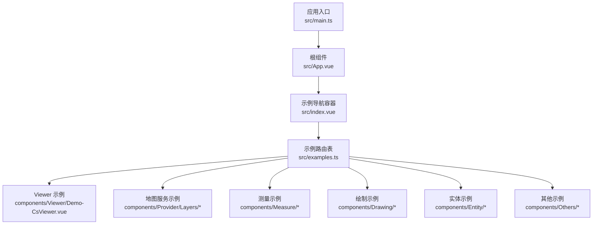
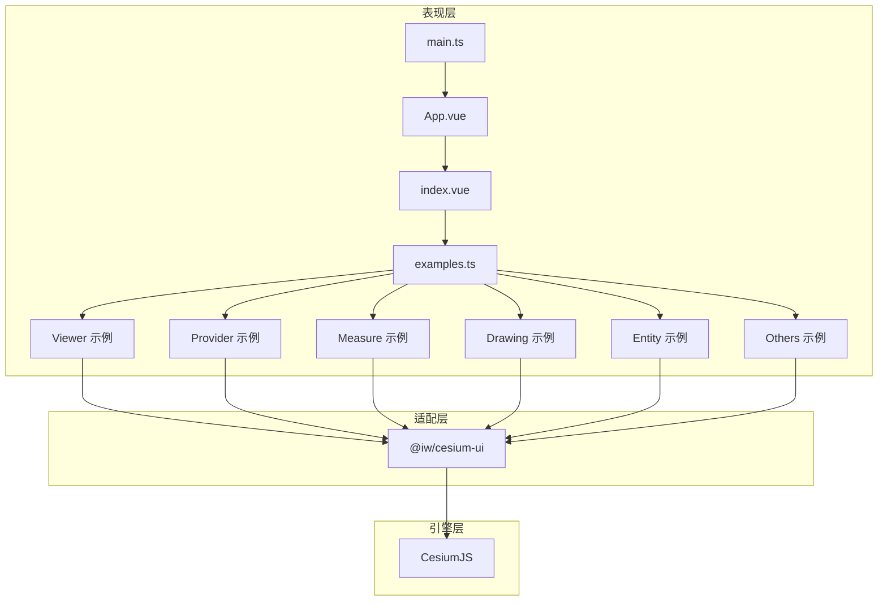
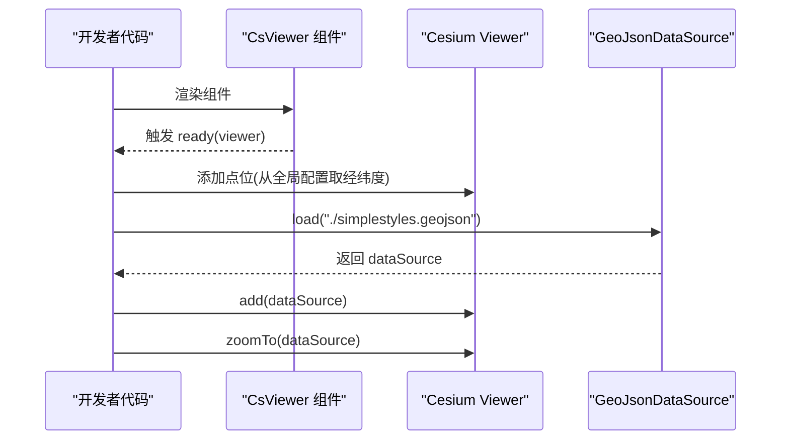
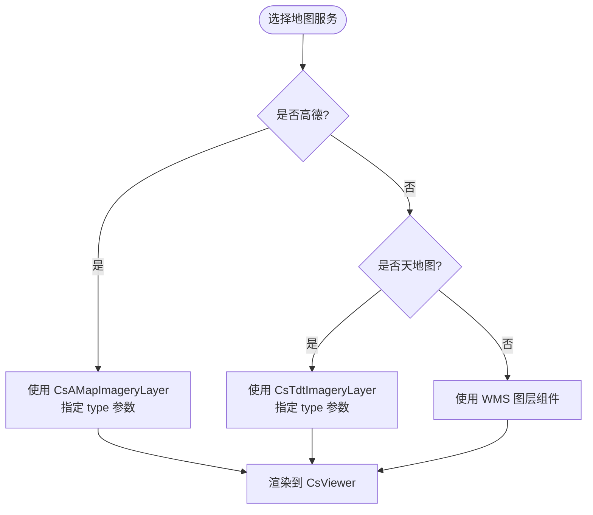
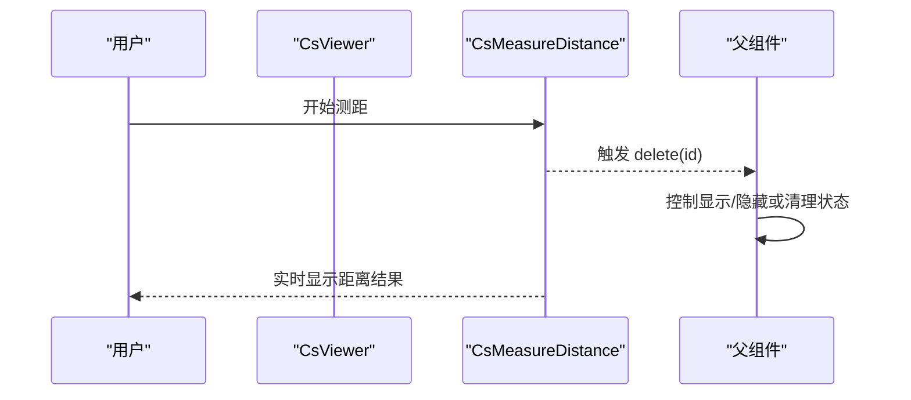
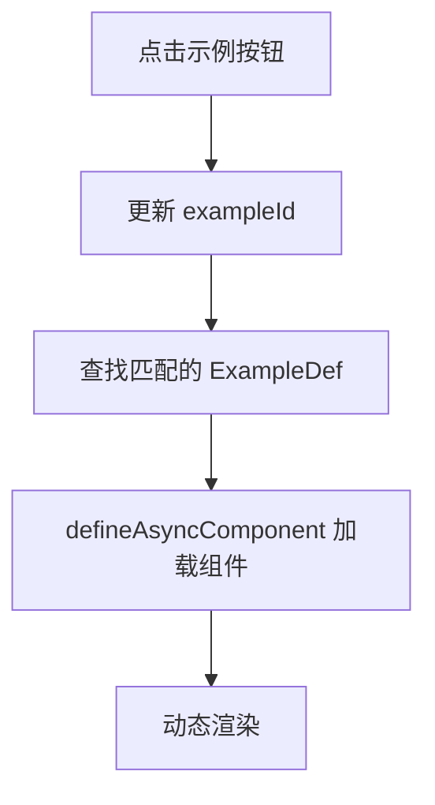
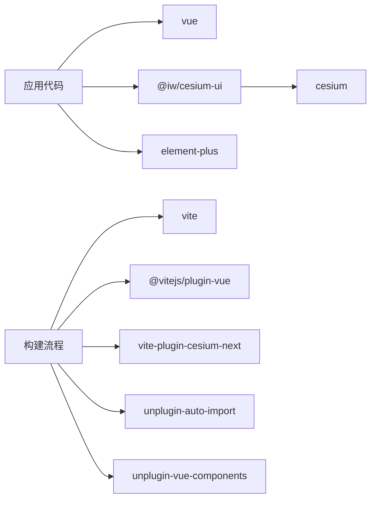

# 项目概述

<cite>
**本文引用的文件**   
- [README.md](file://README.md)
- [package.json](file://package.json)
- [vite.config.ts](file://vite.config.ts)
- [src/main.ts](file://src/main.ts)
- [src/App.vue](file://src/App.vue)
- [src/index.vue](file://src/index.vue)
- [src/examples.ts](file://src/examples.ts)
- [src/components/Viewer/Demo-CsViewer.vue](file://src/components/Viewer/Demo-CsViewer.vue)
- [src/components/Provider/Layers/Demo-AMap.vue](file://src/components/Provider/Layers/Demo-AMap.vue)
- [src/components/Provider/Layers/Demo-TDTMap.vue](file://src/components/Provider/Layers/Demo-TDTMap.vue)
- [src/components/Measure/Demo-Measure-Distance.vue](file://src/components/Measure/Demo-Measure-Distance.vue)
</cite>

## 目录
1. [简介](#简介)
2. [项目结构](#项目结构)
3. [核心组件](#核心组件)
4. [架构总览](#架构总览)
5. [详细组件分析](#详细组件分析)
6. [依赖关系分析](#依赖关系分析)
7. [性能与构建特性](#性能与构建特性)
8. [故障排查指南](#故障排查指南)
9. [结论](#结论)

## 简介
本项目是一个基于 Vue 3 + TypeScript + Vite 的三维地球可视化演示仓库，核心能力围绕 CesiumJS 展开，提供：
- 三维地球展示与交互（通过 CsViewer）
- 多种地图服务集成（高德、天地图、WMS）
- 测量工具（距离、面积、坐标拾取）
- 绘制工具（线、墙等）
- 实体标注（点、线、面、标签、广告牌等）
- 地形加载与 GeoSot 网格示例
- 丰富的 UI 辅助组件（异步加载、错误提示、信息窗体、工具提示等）

技术栈选择原因：
- Vue 3 + script setup：现代、简洁、类型友好，利于组件化组织。
- TypeScript：提升开发体验与可维护性。
- Vite：快速热更新与轻量构建。
- CesiumJS：成熟的三维地球引擎，支持海量地理数据与多源图层。
- @iw/cesium-ui：封装 Cesium 常用能力为 Vue 组件，降低使用门槛。
- Element Plus：统一的 UI 控件，用于示例导航与交互。

本仓库以“示例驱动”的方式组织功能，便于初学者快速上手，同时为有经验的开发者提供清晰的扩展入口。

**章节来源**
- [README.md:1-6](file://README.md#L1-L6)

## 项目结构
仓库采用按功能域划分的目录组织方式，核心目录说明如下：
- public：静态资源（如 GeoJSON 示例数据）。
- src：源码目录
  - assets：静态资源（如图标字体）。
  - components：按功能域组织的示例组件
    - Viewer：Viewer 初始化与配置示例
    - Provider：地图服务与地形示例
    - Measure：测量相关示例
    - Drawing：绘制相关示例
    - Entity：实体标注示例
    - Others：其他辅助交互示例
    - Ui：通用 UI 辅助组件
  - main.ts：应用入口，注册插件与全局配置
  - App.vue：根组件
  - index.vue：示例导航容器
  - examples.ts：示例路由表与懒加载定义

**图表来源**
- [src/main.ts:1-26](file://src/main.ts#L1-L26)
- [src/App.vue:1-9](file://src/App.vue#L1-L9)
- [src/index.vue:1-55](file://src/index.vue#L1-L55)
- [src/examples.ts:1-59](file://src/examples.ts#L1-L59)

**章节来源**
- [src/main.ts:1-26](file://src/main.ts#L1-L26)
- [src/App.vue:1-9](file://src/App.vue#L1-L9)
- [src/index.vue:1-55](file://src/index.vue#L1-L55)
- [src/examples.ts:1-59](file://src/examples.ts#L1-L59)

## 核心组件
- 应用入口与全局配置
  - 在入口中初始化 Vue 应用，注册 Element Plus 与 CesiumUI 插件，并设置 Cesium Ion Token、初始经纬度与高度、以及天地图 Token。
- 示例导航容器
  - 根据示例列表动态渲染当前示例组件，并提供按钮切换。
- 示例路由表
  - 集中管理所有示例的 id、label 与懒加载组件映射，统一处理异步加载与错误状态。

关键职责划分：
- main.ts：负责应用启动、插件注册与全局配置注入。
- index.vue：负责示例切换与动态组件渲染。
- examples.ts：负责示例元数据与懒加载策略。

**章节来源**
- [src/main.ts:11-24](file://src/main.ts#L11-L24)
- [src/index.vue:1-33](file://src/index.vue#L1-L33)
- [src/examples.ts:1-21](file://src/examples.ts#L1-L21)

## 架构总览
整体架构分为三层：
- 表现层（Vue 组件）：示例组件与 UI 组件，负责用户交互与视图渲染。
- 适配层（@iw/cesium-ui）：将 Cesium 能力封装为 Vue 组件，提供 CsViewer、图层、测量等能力。
- 引擎层（CesiumJS）：三维地球渲染、坐标系、数据源、事件系统等底层能力。

**图表来源**
- [src/main.ts:1-26](file://src/main.ts#L1-L26)
- [src/App.vue:1-9](file://src/App.vue#L1-L9)
- [src/index.vue:1-55](file://src/index.vue#L1-L55)
- [src/examples.ts:1-59](file://src/examples.ts#L1-L59)
- [src/components/Viewer/Demo-CsViewer.vue:1-67](file://src/components/Viewer/Demo-CsViewer.vue#L1-L67)
- [src/components/Provider/Layers/Demo-AMap.vue:1-67](file://src/components/Provider/Layers/Demo-AMap.vue#L1-L67)
- [src/components/Provider/Layers/Demo-TDTMap.vue:1-59](file://src/components/Provider/Layers/Demo-TDTMap.vue#L1-L59)
- [src/components/Measure/Demo-Measure-Distance.vue:1-51](file://src/components/Measure/Demo-Measure-Distance.vue#L1-L51)

## 详细组件分析

### Viewer 初始化与数据加载
- 功能要点
  - 通过 CsViewer 挂载 Cesium 三维场景。
  - 监听 ready 事件，获取 Viewer 实例后添加点位与 GeoJSON 数据源。
  - 使用 useCsGlobalConfig 读取全局配置中的经纬度。
- 关键点
  - 在 ready 回调中操作 Viewer，确保场景已初始化完成。
  - 通过 GeoJsonDataSource.load 加载外部 GeoJSON 并缩放至数据范围。

**图表来源**
- [src/components/Viewer/Demo-CsViewer.vue:10-36](file://src/components/Viewer/Demo-CsViewer.vue#L10-L36)

**章节来源**
- [src/components/Viewer/Demo-CsViewer.vue:1-67](file://src/components/Viewer/Demo-CsViewer.vue#L1-L67)

### 地图服务集成（高德、天地图、WMS）
- 高德地图
  - 通过 CsAMapImageryLayer 接入不同样式的高德底图。
  - 可在同一页面渲染多个 CsViewer，分别绑定不同图层。
- 天地图
  - 通过 CsTdtImageryLayer 接入影像与矢量等不同类型天地图服务。
- WMS
  - 通过 WMS 图层组件接入标准 OGC WMS 服务。

**图表来源**
- [src/components/Provider/Layers/Demo-AMap.vue:11-49](file://src/components/Provider/Layers/Demo-AMap.vue#L11-L49)
- [src/components/Provider/Layers/Demo-TDTMap.vue:11-41](file://src/components/Provider/Layers/Demo-TDTMap.vue#L11-L41)

**章节来源**
- [src/components/Provider/Layers/Demo-AMap.vue:1-67](file://src/components/Provider/Layers/Demo-AMap.vue#L1-L67)
- [src/components/Provider/Layers/Demo-TDTMap.vue:1-59](file://src/components/Provider/Layers/Demo-TDTMap.vue#L1-L59)

### 测量工具（距离、面积、坐标拾取）
- 距离测量
  - 通过 CsMeasureDistance 启用测距工具，支持删除与销毁回调。
- 面积测量
  - 圆形与多边形面积测量示例位于 Measure/Area 目录下。
- 坐标拾取
  - 通过相应示例组件实现点击拾取坐标。

**图表来源**
- [src/components/Measure/Demo-Measure-Distance.vue:13-35](file://src/components/Measure/Demo-Measure-Distance.vue#L13-L35)

**章节来源**
- [src/components/Measure/Demo-Measure-Distance.vue:1-51](file://src/components/Measure/Demo-Measure-Distance.vue#L1-L51)

### 示例导航与懒加载
- 示例导航
  - index.vue 根据 examples 数组渲染按钮，点击切换 exampleId，动态渲染对应组件。
- 懒加载策略
  - examples.ts 使用 defineAsyncComponent 包裹每个示例组件，提供 loading 与 error 组件，并设置重试与超时策略。

**图表来源**
- [src/index.vue:1-33](file://src/index.vue#L1-L33)
- [src/examples.ts:1-21](file://src/examples.ts#L1-L21)

**章节来源**
- [src/index.vue:1-55](file://src/index.vue#L1-L55)
- [src/examples.ts:1-59](file://src/examples.ts#L1-L59)

## 依赖关系分析
- 运行时依赖
  - vue：前端框架。
  - cesium：三维地球引擎。
  - @iw/cesium-ui：Cesium 的 Vue 组件封装。
  - element-plus：UI 组件库。
  - color：颜色处理。
- 开发依赖
  - vite：构建工具。
  - @vitejs/plugin-vue：Vue 支持。
  - vite-plugin-cesium-next：Vite 下 Cesium 支持。
  - unplugin-auto-import / unplugin-vue-components：自动导入与按需注册。
  - typescript / vue-tsc：类型检查与编译。

**图表来源**
- [package.json:12-28](file://package.json#L12-L28)
- [vite.config.ts:1-24](file://vite.config.ts#L1-L24)

**章节来源**
- [package.json:1-31](file://package.json#L1-L31)
- [vite.config.ts:1-24](file://vite.config.ts#L1-L24)

## 性能与构建特性
- 构建优化
  - 使用 Vite 与 Vue 插件获得快速热更新与按需打包。
  - 通过 vite-plugin-cesium-next 解决 Cesium 在 Vite 下的兼容性问题。
  - 自动导入与组件按需注册减少样板代码。
- 运行期优化
  - 示例组件采用懒加载，避免首屏一次性加载全部示例。
  - 通过 AsyncLoading 与 AsyncError 组件提升用户体验与容错能力。
- 建议
  - 对大型 GeoJSON 或模型数据，考虑分片加载与 LOD 策略。
  - 合理使用 viewer.entities 与 DataSource，避免频繁增删造成重绘开销。
  - 地图服务与地形按需开启，减少网络与渲染压力。

[本节为通用指导，不直接分析具体文件]

## 故障排查指南
- Cesium Ion Token 未配置或无效
  - 现象：无法访问需要授权的 Cesium Ion 资源。
  - 排查：确认入口文件中已设置 Ion.defaultAccessToken。
- 天地图 Token 缺失
  - 现象：天地图图层无法加载。
  - 排查：确认 CesiumUI 初始化时传入 tdtToken。
- 示例组件加载失败
  - 现象：示例按钮点击无响应或显示错误。
  - 排查：检查 examples.ts 中懒加载路径是否正确；查看 AsyncError 组件的错误信息。
- 地图服务不可用
  - 现象：高德/天地图/WMS 图层空白。
  - 排查：检查网络连通性与服务地址；确认图层 type 参数与服务匹配。

**章节来源**
- [src/main.ts:11-24](file://src/main.ts#L11-L24)
- [src/examples.ts:6-19](file://src/examples.ts#L6-L19)

## 结论
本项目以 Vue 3 + TypeScript + Vite 为基础，结合 CesiumJS 与 @iw/cesium-ui，提供了完整的三维地球可视化示例集合。通过示例驱动的组织方式，既适合初学者快速理解 Cesium 在 Vue 环境中的用法，也为有经验开发者提供了可扩展的组件化实践参考。建议在真实项目中：
- 将示例组件抽象为业务组件，复用 CsViewer、图层与测量能力。
- 结合业务数据源（如 GeoJSON、WMS、服务接口）进行数据驱动渲染。
- 关注性能优化与错误处理，提升用户体验与系统稳定性。

[本节为总结性内容，不直接分析具体文件]